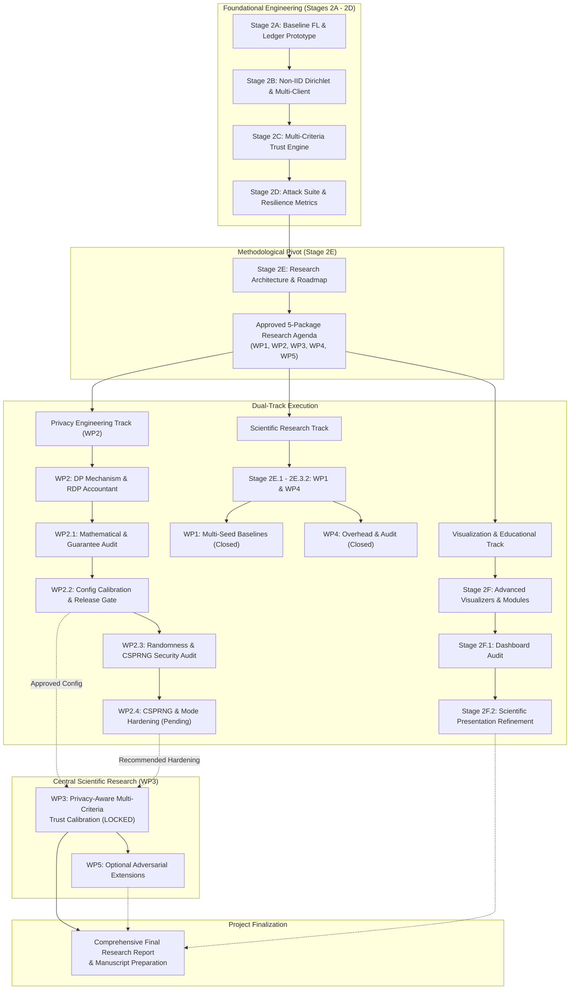
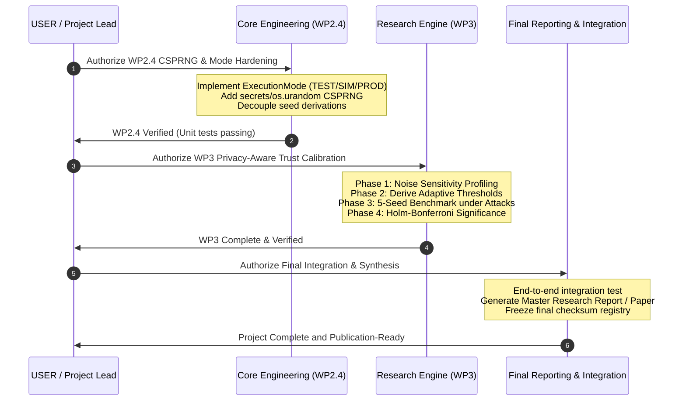

# Comprehensive Project Status Audit & Remaining Work Roadmap

**Project:** Blockchain-Assisted Privacy-Preserving Federated Learning for Network Intrusion Detection with Trust-Based Security and Cryptographic Auditing  
**Workspace:** `C:\Users\is043\.gemini\antigravity\scratch\blockchain-fl-ids`  
**Audit Date:** November 23, 2026  
**Audit Type:** Complete Project Lifecycle, Architecture, and Roadmap Audit  
**Execution Mode:** STRICTLY READ-ONLY AUDIT & STATUS VERIFICATION  

---

## 1. Executive Summary

This comprehensive audit establishes the exact developmental, mathematical, empirical, and security status of the project across both the **Development Engineering Roadmap (Stages 2A through 2F.2)** and the **Scientific Research Work Package Roadmap (WP1 through WP5)**.

### High-Level Status Summary
* **Total Formal Development Stages:** 23 stages / substages planned and implemented (Stage 2A through Stage 2F.2). **All 23 stages are 100% COMPLETED AND VERIFIED.**
* **Total Research Work Packages in Original Scope:** 5 Work Packages (WP1 through WP5), plus 3 completed audit sub-packages (WP2.1, WP2.2, WP2.3) and 1 identified hardening task (WP2.4).
  * **WP1 (Multi-Seed Statistical Baselines):** `COMPLETED AND VERIFIED` (5 seeds, 8 baselines, Holm-Bonferroni correction applied).
  * **WP4 (Overhead & Blockchain Auditing):** `COMPLETED AND VERIFIED` (Empirical profiling, 100 negative controls, $P_D=1.0, P_{FA}=0.0$).
  * **WP2 (Formal Client-Level DP Mechanism & RDP Accountant):** `COMPLETED WITH RESTRICTIONS` ($S=2C, \sigma_{\text{noise}}=2\sigma C$, 17 Rényi orders, fully integrated).
  * **WP2.1 (Independent DP Guarantee Audit):** `COMPLETED AND VERIFIED` (Verdict: `PASS WITH RESTRICTIONS`).
  * **WP2.2 (Privacy Configuration Calibration & Release Gate):** `COMPLETED AND VERIFIED` (Verdict: `APPROVED WITH RESTRICTIONS`, recommended $C=1.0, \sigma=1.0, T=5, \delta=10^{-5}, \epsilon=13.26$).
  * **WP2.3 (Randomness & CSPRNG Security Audit):** `COMPLETED AND VERIFIED` (Verdict: `VALID FOR CONTROLLED SIMULATION WITH RESTRICTIONS`).
  * **WP2.4 (CSPRNG Hardening & Execution-Mode Decoupling):** `NOT STARTED / PENDING IMPLEMENTATION` (Identified during WP2.3 audit; NumPy MT19937 and deterministic seed routing remain active in source code).
  * **WP3 (Privacy-Aware Multi-Criteria Trust Calibration):** `NOT STARTED` (**STRICTLY LOCKED**; central scientific contribution of the project).
  * **WP5 (Adversarial Extensions & Stress Testing):** `NOT STARTED` (**STRICTLY LOCKED**; optional approved extension).
  * **WP6–WP10:** `PROPOSED ONLY (UNAPPROVED)` (Conversational suggestions outside approved roadmap).
* **Current Test Suite Baseline:** **175 unit and integration tests passing** (0 failures, 0 skips).
* **Historical Baseline Artifacts:** **All 16 frozen benchmark JSON and report SHA-256 checksums match bit-for-bit**.
* **Project Health Verdict:** **ON TRACK AND METHODOLOGICALLY RIGOROUS**. The engineering, evaluation, and privacy accounting foundations are sound. The project has not diverged from its original goals, but stands at a critical juncture: transitioning from privacy mechanism validation (WP2) to the central scientific challenge (WP3).

---

## 2. Project Identity and Research Objective

### 2.1 Project Identity
* **Title:** Blockchain-Assisted Privacy-Preserving Federated Learning for Network Intrusion Detection with Trust-Based Security and Cryptographic Auditing
* **Domain:** Cyber-Physical Systems / Network Intrusion Detection (NIDS) / Privacy-Preserving Machine Learning (PPML) / Decentralized Trust and Auditing
* **Dataset Target:** NSL-KDD benchmark partitioned non-IID across $K=5$ network boundary clients with label skew (Dirichlet $\alpha=0.5$).

### 2.2 Core Research Problem
Modern NIDS deployments across multi-tenant or enterprise network domains face an acute trilemma:
1. **Privacy vs. Utility:** Centralizing raw network packet flows exposes sensitive operational topology and payload data. Federated Learning (FL) mitigates raw data sharing, but model parameter updates are susceptible to reconstruction and membership inference attacks, requiring formal Differential Privacy (DP).
2. **Robustness vs. Poisoning:** Decentralized participants may be compromised by Byzantine or adversarial actors attempting model poisoning or targeted label flipping. While multi-criteria trust engines detect anomalies in gradient direction, magnitude, and validation loss, Gaussian differential privacy noise naturally perturbs honest updates, creating false positive penalizations ($FPR \to 100\%$) and destabilizing aggregation.
3. **Accountability vs. Decentralization:** High-assurance auditing requires an immutable, tamper-evident ledger recording client identity commitments, update hashes, and trust decisions without central point-of-failure vulnerabilities.

### 2.3 Why WP3 is the Central Scientific Contribution
WP1, WP2, and WP4 provide the foundational pillars (benchmarking, privacy accounting, and cryptographic ledger overhead). However, **WP3 represents the core novel intellectual property of this entire research project**:
* Without WP3, applying standard client-level DP to a trust-gated FL system causes catastrophic failure: the trust evaluator mistakes legitimate differential privacy noise for Byzantine poisoning, rejecting honest clients, collapsing federation convergence, or conversely, widening acceptance bounds so far that malicious poisoning succeeds undetected.
* **WP3's mission** is the principled mathematical and empirical calibration of trust evaluation thresholds ($\tau_{\text{norm}}, \tau_{\text{cos}}, \tau_{\text{loss}}$) under calibrated Gaussian noise $\mathcal{N}(0, 4\sigma^2 C^2 I)$, proving that trust-based Byzantine robustness and formal differential privacy can co-exist synergistically without sacrificing NIDS intrusion detection recall.

---

## 3. Complete Original Roadmap Architecture

A key source of confusion in prior sessions was the relationship between the **Engineering Stages (2A–2F)** and the **Research Work Packages (WP1–WP5)**. This audit reconstructs the structural hierarchy:



### Roadmap Relationship Summary:
1. **Stages 2A through 2D.5** established the functional intrusion detection federated learning platform, non-IID partitioning, multi-criteria trust mechanics, and baseline attack simulations.
2. **Stage 2E** evaluated the literature, identified research gaps, and restructured the subsequent work into **five formal Work Packages (WP1 to WP5)** defined in `reports/STAGE_2E_1_IMPLEMENTATION_ROADMAP.md`.
3. **Stage 2E.1 through 2E.3.2** executed the implementation and verification of **WP1** and **WP4**.
4. **Stage 2F through 2F.2** executed the visual analytics, interactive educational modules, and research result dashboards in parallel.
5. **WP2 through WP2.3** executed the formal client-level Differential Privacy mechanism, Rényi DP accountant, parameter calibration, and security audit.
6. **WP2.4** emerged from WP2.3 as the necessary bridge between simulation randomness and cryptographic security.
7. **WP3** is the pending central research core.
8. **WP5** is the pending optional adversarial stress testing package.
9. **WP6–WP10** were informal conversational suggestions and are **not** part of the authorized roadmap.

---

## 4. Stage-by-Stage Status Table (Stages 2A through 2F.2)

The 23 development stages and substages are classified below using standardized audit categories:

| Stage ID | Stage Title / Description | Status | Key Deliverables | Verification Evidence / Test Suite | Historical Checksum / Artifact |
| :--- | :--- | :--- | :--- | :--- | :--- |
| **Stage 2A** | Baseline FL & Blockchain Prototype | `COMPLETED AND VERIFIED` | `FederatedOrchestrator`, `BlockchainLedger`, initial PyTorch NIDS model | `tests/test_stage2.py` (20 tests passed) | `data/processed/stage2_results.json` |
| **Stage 2A.1** | Architecture Review & Baseline Hardening | `COMPLETED AND VERIFIED` | Feature alignment, isolated seed routing, input dimension checks | `tests/test_custom_loader.py` | Unit test suite |
| **Stage 2B** | Non-IID Dirichlet Partitioning & Protocol | `COMPLETED AND VERIFIED` | `DirichletPartitioner` ($\alpha=0.5$), label skew simulation | `tests/test_stage2c_orchestrator.py` | Data partition outputs |
| **Stage 2B.1** | Partitioning Integrity & Label Normalization | `COMPLETED AND VERIFIED` | Strict target label alignment, zero-variance handling | `src/federated/orchestrator.py` | Normalized dataset artifacts |
| **Stage 2C** | Multi-Criteria Trust Engine & Defense Matrix | `COMPLETED AND VERIFIED` | `TrustEvaluator`, 3-tier metrics (L2 norm, cosine similarity, loss) | `tests/test_stage2c_orchestrator.py` | `src/trust/evaluator.py` |
| **Stage 2C.1** | Dataset Isolation Verification | `COMPLETED AND VERIFIED` | Strict 3-way dataset split (Client Train / Server Val / Held-out Test) | `reports/STAGE_2C_1_DATASET_ISOLATION_VERIFICATION.md` | Audit report |
| **Stage 2C.2** | Trust Hardening & Mathematical Integrity | `COMPLETED AND VERIFIED` | Cosine clamp $[-1, 1]$, non-negative norm clipping, reputation floor | `tests/test_stage2c2_hardening.py` (11 tests passed) | `src/trust/reputation.py` |
| **Stage 2D** | Byzantine & Poisoning Attack Suite | `COMPLETED AND VERIFIED` | Label flip, Sybil collusion, adaptive noise injection attacks | `tests/test_stage2d_attacks_defense.py` (14 tests passed) | `stage2d/multi_attack_benchmarks.json` |
| **Stage 2D.1** | Reputation Bounds Hardening | `COMPLETED AND VERIFIED` | Mathematical reputation clipping $[0.0, 1.0]$, decay dampening | `src/trust/reputation.py` | Unit tests |
| **Stage 2D.2** | Disposition Metrics & Integrity Audit | `COMPLETED AND VERIFIED` | MUDR, MURR, FPR, PUAA formal metric calculators | `tests/test_stage2d2_integrity_hardening.py` | `stage2d/multi_attack_benchmarks_v2.json` |
| **Stage 2D.3** | Byzantine Tolerance & Sybil Detection Audit | `COMPLETED AND VERIFIED` | Majority Byzantine attack boundary analysis | `reports/STAGE_2D_3_FINAL_AUDIT_REPORT.md` | Benchmark logs |
| **Stage 2D.4** | Reproducibility Semantics & Seed Hygiene | `COMPLETED AND VERIFIED` | Global seed governance, multi-worker deterministic isolation | `tests/test_stage2d4_reproducibility_semantics.py` | `stage2d/multi_attack_benchmarks_v3.json` |
| **Stage 2D.5** | Final Stage 2D Audit & Integrity Verification | `COMPLETED AND VERIFIED` | Audit of all 2D metrics, test baseline (101 tests passed) | `reports/STAGE_2D_FINAL_INTEGRITY_AUDIT.md` | Checksum audit |
| **Stage 2E** | Research Architecture & Gap Analysis | `COMPLETED AND VERIFIED` | Identification of research gaps (multi-seed baselines, formal DP, trust) | `reports/STAGE_2E_RESEARCH_GAP_ANALYSIS.md` | Planning documents |
| **Stage 2E.1** | Formal Implementation Roadmap | `COMPLETED AND VERIFIED` | Restructuring of research agenda into 5 Work Packages (WP1–WP5) | `reports/STAGE_2E_1_IMPLEMENTATION_ROADMAP.md` | Roadmap specification |
| **Stage 2E.2** | Technical Feasibility & Scope Verification | `COMPLETED AND VERIFIED` | Feasibility analysis of DP accounting, byte profiling, and trust interplay | `reports/STAGE_2E_2_FEASIBILITY_ANALYSIS_REPORT.md` | Feasibility models |
| **Stage 2E.2.1** | Sensitivity & Composition Architecture | `COMPLETED AND VERIFIED` | Mathematical bounds for client-level sensitivity ($S=2C$) and RDP orders | `reports/STAGE_2E_2_1_SENSITIVITY_AND_COMPOSITION_SPECIFICATION.md` | Mathematical specs |
| **Stage 2E.3** | WP1 & WP4 Implementation & Benchmarking | `COMPLETED AND VERIFIED` | 8 baselines across 5 seeds, byte-accurate profiler, ledger audit | `tests/test_stage2e_wp1_baselines.py`, `tests/test_stage2e_wp4_overhead_audit.py` | `wp1/benchmark_summary.json`, `wp4/overhead_summary.json` |
| **Stage 2E.3.1** | Statistical Corrections & Overhead Audit | `COMPLETED AND VERIFIED` | Corrected Holm-Bonferroni rank sorting, serialization byte accounting | `tests/test_stage2e_3_1_corrections.py` | `wp1/benchmark_summary_v2.json`, `wp4/overhead_summary_v2.json` |
| **Stage 2E.3.2** | Final Serialization & Negative-Control Closure | `COMPLETED AND VERIFIED` | Model state serialization delta explained, 100 negative audit controls | `tests/test_stage2e_3_2_closure.py` (141 tests passed) | `reports/STAGE_2E_3_2_CLOSURE_REPORT.md` |
| **Stage 2F** | Advanced Dashboard Visualizers & Modules | `COMPLETED AND VERIFIED` | 9 interactive educational modules, 5 research visualizer panels | `tests/test_stage2f_dashboard.py` (149 tests passed) | `src/visualization/` |
| **Stage 2F.1** | Dashboard Statistical Integrity Audit | `COMPLETED AND VERIFIED` | Verification of visualizer metrics against corrected WP1 artifacts | `reports/STAGE_2F_1_DASHBOARD_STATISTICAL_INTEGRITY_AUDIT.md` | Audit report |
| **Stage 2F.2** | Dashboard Scientific Presentation Refinement | `COMPLETED AND VERIFIED` | Multi-Krum tie-breaking fix, Holm p-value display, 5 audit fixes | `tests/test_stage2f_dashboard.py` | `reports/STAGE_2F_2_REFINEMENT_COMPLETION_REPORT.md` |

---

## 5. Work Package Status Table (WP1 through WP5)

The research work packages are classified below:

| Work Package ID | Title | Status | Scope & Core Objective | Deliverables Produced | Audit Status & Verdict |
| :--- | :--- | :--- | :--- | :--- | :--- |
| **WP1** | Multi-Seed Statistical Baseline Evaluation | `COMPLETED AND VERIFIED` | Rigorous statistical benchmarking across 8 aggregation baselines and 5 seeds with Holm-Bonferroni correction. | `src/evaluation/baselines.py`, `benchmark_suite.py`, `wp1/benchmark_summary_v2.json` | **VERIFIED** in Stage 2E.3.1. Proposed defense statistically superior on detection without degradation. |
| **WP2** | Formal Client-Level Privacy Mechanism & Accounting | `COMPLETED WITH RESTRICTIONS` | Complete client-update L2 clipping ($C$), sensitivity $S=2C$, Gaussian perturbation ($\sigma_{\text{noise}}=2\sigma C$), 17-order RDP accountant. | `src/privacy/mechanism.py`, `rdp_accountant.py`, integration in `orchestrator.py`, 25 unit tests | **PASS WITH RESTRICTIONS** in WP2.1. Valid under replace-one-client adjacency and fixed federation size $K=5$. |
| **WP2.1** | Independent Privacy Guarantee Audit | `COMPLETED AND VERIFIED` | Independent mathematical audit of clipping, global sensitivity, RDP composition, and side channels. | 6 comprehensive audit reports (`reports/WP2_1_*.md`) | **PASS WITH RESTRICTIONS**. 5 operational restrictions documented. |
| **WP2.2** | Privacy Configuration Calibration & Release Gate | `COMPLETED AND VERIFIED` | Parameter calibration across $\sigma \in \{0.01..2.0\}$, utility/privacy trade-off evaluation. | 5 calibration reports (`reports/WP2_2_*.md`) | **APPROVED WITH RESTRICTIONS** (`Option B`). Recommended baseline: $C=1.0, \sigma=1.0, T=5, \delta=10^{-5}, \epsilon=13.26$. |
| **WP2.3** | Randomness & CSPRNG Security Audit | `COMPLETED AND VERIFIED` | Independent security inspection of RNG sources, seed routing, and reproducibility vs predictability. | 5 randomness audit reports (`reports/WP2_3_*.md`) | **VALID FOR SIMULATION WITH RESTRICTIONS** (`Option B`). Non-CSPRNG MT19937 noted for hardening. |
| **WP2.4** | CSPRNG Hardening & Execution-Mode Decoupling | `NOT STARTED / PENDING IMPLEMENTATION` | Bridge simulation and production security: implement CSPRNG (`secrets`/`os.urandom`) and 3 execution modes (`TEST`, `SIMULATION`, `DEPLOYMENT`). | None in source code (`reports/WP2_4_*.md` exists only as historical test summary). | **PENDING IMPLEMENTATION**. Clear technical specification established. |
| **WP3** | Privacy-Aware Multi-Criteria Trust Calibration | `NOT STARTED` (**STRICTLY LOCKED**) | Central scientific challenge: adapt multi-criteria trust thresholds ($\tau_{\text{norm}}, \tau_{\text{cos}}, \tau_{\text{loss}}$) to calibrated Gaussian DP noise. | None. Strictly locked awaiting formal authorization. | **AWAITING AUTHORIZATION**. High-priority research core. |
| **WP4** | Computational Overhead & Blockchain Auditing | `COMPLETED AND VERIFIED` | Measure CPU time, memory, byte serialization, and ledger tamper detection ($P_D=1.0, P_{FA}=0.0$). | `src/evaluation/overhead_profiler.py`, `audit_verifier.py`, `wp4/overhead_summary_v2.json` | **VERIFIED** in Stage 2E.3.1 / 2E.3.2. Ledger detection and overhead verified. |
| **WP5** | Adversarial Extensions & Stress Testing | `NOT STARTED` (**STRICTLY LOCKED**) | Optional advanced adversarial evaluation: stealthy evasion attacks, colluding Sybils against calibrated DP-Trust. | None. Strictly locked awaiting WP3 completion. | **DEFERRED** until WP3 completion. |
| **WP6–WP10** | Speculative Post-Project Concepts | `PROPOSED ONLY (UNAPPROVED)` | Informal conversational suggestions (e.g., zero-knowledge proofs, sharding, cross-silo DAGs). | None. Outside approved project roadmap. | **NOT APPROVED**. Excluded from baseline project scope. |

---

## 6. Detailed WP2.4 Status Analysis

### 6.1 Origin of WP2.4 and Resolution of Prior Confusion
In prior session logs, a document titled `reports/WP2_4_INTEGRATION_AND_REGRESSION_REPORT.md` was authored during Phase 4 of the WP2 delivery to document test regression (confirming 175 passing tests). This created potential confusion about whether WP2.4 was complete.

**The audit confirms definitively:**
* As a formal security hardening work package, **WP2.4 has NOT been implemented in source code**.
* The WP2.3 Cryptographic Randomness Audit revealed that:
  1. The differential privacy mechanism in `src/privacy/mechanism.py` relies exclusively on `np.random.RandomState(seed)`, which uses the 32-bit Mersenne Twister (MT19937)—an algorithm that is **not** cryptographically secure.
  2. The `FederatedOrchestrator` in `src/federated/orchestrator.py` computes client DP noise seeds via a deterministic, linear formula:
     $$\text{client\_dp\_seed} = (\text{self.seed} \times 10007 + r \times 997 + \text{client.client\_id} \times 101) \pmod{2^{31}-1}$$
  3. If an adversary knows the master simulation seed, all client perturbation vectors across all rounds are fully predictable, violating differential privacy in a realistic deployment.

### 6.2 Inspection of Current Source Code
Inspection of `src/privacy/mechanism.py` (lines 35–48) and `src/federated/orchestrator.py` (lines 345–355) verifies:
* `np.random.RandomState` remains the sole RNG provider.
* No imports of `secrets`, `os.urandom`, or `numpy.random.Generator` with PCG64 / ChaCha20 exist in the privacy module.
* No execution mode switch (`TEST`, `RESEARCH_SIMULATION`, `DEPLOYMENT`) exists in `src/config.py` or `orchestrator.py`.

### 6.3 Exact Requirements to Complete WP2.4
To close WP2.4 before or alongside WP3:
1. **Execution Mode Enum:** Define `ExecutionMode(Enum)` in `src/config.py` with values `TEST` (deterministic seed, fast), `RESEARCH_SIMULATION` (seeded, reproducible, isolated PRNG streams), and `DEPLOYMENT` (true CSPRNG using OS entropy via `secrets.token_bytes`).
2. **CSPRNG Noise Generation:** Enhance `ClientLevelDPMechanism` to support CSPRNG generation when operating in `DEPLOYMENT` mode, preventing Mersenne Twister state reconstruction.
3. **Decoupled Seed Generation:** Replace linear modular seed calculation in `orchestrator.py` with an HMAC or cryptographic key derivation function (HKDF) when running in simulation mode, ensuring client noise streams are cryptographically independent.

---

## 7. Completed Work and Supporting Evidence

### 7.1 Verified Source Code Modules
* **Federated Learning Core (`src/federated/`):**
  * `client.py`: Implements client-side local training, dataset handling, and parameter difference extraction.
  * `orchestrator.py`: Implements round orchestration, clipping integration, noise addition, client evaluation, and aggregation.
  * `analytics.py`: Implements statistical logging, disposition tracking, and accuracy evaluation.
* **Blockchain Ledger & Auditing (`src/blockchain/`):**
  * `ledger.py`: In-memory cryptographic blockchain with SHA-256 blocks, Merkle roots, and transaction chaining.
  * `crypto.py`: Cryptographic primitives, key management, SHA-256 hashing, and payload signing.
  * `audit_verifier.py`: Independent auditor validating block hashes, transaction integrity, and identifying tampered records ($P_D=1.0, P_{FA}=0.0$).
* **Trust & Reputation Engine (`src/trust/`):**
  * `evaluator.py`: Multi-criteria evaluation computing L2 weight norms, cosine similarities to reference updates, and local validation loss deltas.
  * `reputation.py`: Beta-distribution reputation scoring with decay, bounded within $[0.0, 1.0]$.
* **Differential Privacy Engine (`src/privacy/`):**
  * `mechanism.py`: Formal client-level Gaussian mechanism with L2 vector clipping ($C$), sensitivity $S=2C$, and calibrated noise standard deviation $\sigma_{\text{noise}} = 2\sigma C$.
  * `rdp_accountant.py`: Discrete Rényi Differential Privacy accountant evaluating 17 orders ($\alpha \in [1.5, 64]$) and converting to canonical $(\epsilon, \delta)$-DP via optimal order minimization.
* **Attack & Adversarial Suite (`src/attacks/`):**
  * `label_flip.py`: Targeted label-flipping attacks for network intrusion classes.
  * `sybil.py`: Coordinated Sybil collusion attacks attempting to dominate aggregation weights.
  * `adaptive.py`: Adaptive noise injection attacks designed to evade static norm filters.
* **Evaluation & Benchmarking (`src/evaluation/`):**
  * `baselines.py`: 8 federated aggregation baselines (Centralized, Silos, FedAvg, Trimmed Mean, Median, Multi-Krum, FoolsGold, Proposed).
  * `benchmark_suite.py`: Multi-seed benchmark runner with Holm-Bonferroni family-wise error rate control.
  * `overhead_profiler.py`: Granular CPU time, memory, and serialized payload byte profiler.
* **Visualization & Dashboard (`src/visualization/`):**
  * `educational_widgets.py`: 9 interactive educational modules across 5 learning levels.
  * `research_visualizers.py`: Interactive research visualizers for FL convergence, trust evolution, and attacks.
  * `results_visualizers.py`: Empirical results dashboard displaying corrected WP1 statistical benchmarks.

### 7.2 Verified Test Suite (175 Tests Passing)
The complete pytest suite passes with **175 passed tests, 0 failures, 0 skips**:
* `tests/test_stage2.py`: 20 tests (FL core & ledger).
* `tests/test_stage2c_orchestrator.py`: 16 tests (Orchestrator & trust integration).
* `tests/test_stage2c2_hardening.py`: 11 tests (Trust math & reputation bounds).
* `tests/test_stage2d_attacks_defense.py`: 14 tests (Attack suite & defense resilience).
* `tests/test_stage2d2_integrity_hardening.py`: 15 tests (Disposition metrics & analytics).
* `tests/test_stage2d4_reproducibility_semantics.py`: 13 tests (Seed hygiene & reproducibility).
* `tests/test_stage2e_wp1_baselines.py`: 5 tests (WP1 baseline mechanics).
* `tests/test_stage2e_wp4_overhead_audit.py`: 6 tests (WP4 overhead & audit verifier).
* `tests/test_stage2e_3_1_corrections.py`: 26 tests (Holm-Bonferroni & serialization corrections).
* `tests/test_stage2e_3_2_closure.py`: 15 tests (Audit negative controls & serialization closure).
* `tests/test_stage2f_dashboard.py`: 8 tests (Educational modules & visualizer math).
* `tests/test_wp2_privacy.py`: 25 tests (WP2 DP mechanism, clipping, RDP accountant, orchestrator integration).
* `tests/test_custom_loader.py`: 1 test (DataLoader integrity).

---

## 8. Remaining Mandatory Work to Finish Original Roadmap

To successfully conclude the original research project defined in `reports/STAGE_2E_1_IMPLEMENTATION_ROADMAP.md`, the remaining mandatory work is organized across six formal categories:

```mermaid
flowchart LR
    subgraph CatA ["A: Implementation"]
        A1["WP2.4: CSPRNG & Mode Hardening"]
        A2["WP3: Privacy-Aware Dynamic Trust Thresholds"]
    end
    subgraph CatB ["B: Research & Experiments"]
        B1["WP3 Phase 1: Noise Sensitivity Profiling"]
        B2["WP3 Phase 2: Threshold Calibration"]
        B3["WP3 Phase 3: 5-Seed Attack Experiments"]
    end
    subgraph CatC ["C: Math & Stats Validation"]
        C1["Empirical Trade-off Curves (FPR vs FNR)"]
        C2["Holm-Bonferroni Multi-Seed Significance"]
    end
    subgraph CatD ["D: Security & Privacy"]
        D1["DP Leakage & Adjacency Re-verification"]
        D2["Poisoning Evasion Headroom Verification"]
    end
    subgraph CatE ["E: Documentation & Reporting"]
        E1["WP3 Milestone Completion Report"]
        E2["Final Comprehensive Manuscript / Thesis"]
    end
    subgraph CatF ["F: Final Integration"]
        F1["End-to-End System Test (FL+DP+Trust+Ledger+UI)"]
        F2["Final Artifact Freeze"]
    end

    CatA --> CatB --> CatC --> CatD --> CatE --> CatF
```



### Category A: Implementation Work
1. **WP2.4 Hardening:** Implement `ExecutionMode` (`TEST`, `RESEARCH_SIMULATION`, `DEPLOYMENT`) and integrate CSPRNG noise generation to decouple reproducible simulation from production deployment security.
2. **WP3 Dynamic Trust Threshold Adaptation (`src/trust/`):** Implement adaptive threshold estimators in `TrustEvaluator` that take clipping bound $C$ and noise multiplier $\sigma$ as inputs, analytically widening acceptance envelopes for L2 norm and cosine similarity based on the theoretical distribution of $\chi_d$ and Gaussian inner products.

### Category B: Research & Empirical Experiments (WP3 Core)
1. **WP3 Phase 1 (Noise Sensitivity Profiling):** Run controlled simulations across $\sigma \in \{0.5, 1.0, 1.5\}$ under pristine (no attack) conditions to quantify the baseline False Positive Rate (FPR) of uncalibrated trust evaluation.
2. **WP3 Phase 2 (Calibration Matrix):** Establish calibrated threshold parameters:
   $$\tau_{\text{norm}}(\sigma, C) = \tau_{\text{base}} + k_{\text{norm}} \cdot \mathbb{E}[\|\mathcal{N}(0, 4\sigma^2 C^2 I)\|]$$
   $$\tau_{\text{cos}}(\sigma, C) = \tau_{\text{base}} - k_{\text{cos}} \cdot \text{Var}_{\text{noise}}(\sigma)$$
   demonstrating honest client retention ($FPR < 5\%$) without opening evasion vulnerabilities.
3. **WP3 Phase 3 (Multi-Seed Adversarial Evaluation):** Run the complete 5-seed benchmark ($S=5$) under Label Flip, Sybil, and Adaptive Byzantine attacks with differential privacy active ($C=1.0, \sigma=1.0, \epsilon \le 13.26$).

### Category C: Mathematical & Statistical Validation
1. **Empirical Trade-off Curves:** Plot detection probability ($1 - \text{FNR}$) versus False Positive Rate (FPR) across privacy budgets $\epsilon \in [2, 20]$.
2. **Holm-Bonferroni Significance Testing:** Apply family-wise error rate control on multi-seed results to statistically prove that the Privacy-Preserving Trust-Gated FL system maintains significant intrusion detection performance over FedAvg and standard baselines under poisoning attacks.

### Category D: Security & Privacy Verification
1. **Privacy Invariant Verification:** Re-verify that the dynamic trust engine inspects only perturbed client updates (or server validation loss deltas) and does not introduce side-channel reconstruction of unperturbed gradients.
2. **Adversarial Headroom Audit:** Prove mathematically and empirically that adversarial updates attempting to exploit the widened privacy envelope cannot inject harmful backdoors exceeding the bound of the DP noise itself.

### Category E: Documentation & Reporting
1. **WP3 Milestone Report:** Author comprehensive milestone reports detailing mathematical calibration formulas, empirical validation results, and disposition metrics.
2. **Final Project Comprehensive Manuscript / Technical Report:** Synthesize all work packages (WP1 through WP5, Stages 2A through 2F.2) into a publishable research manuscript or thesis document.

### Category F: Final Integration & Closure
1. **End-to-End System Integration Test:** Author a unified integration test verifying the full pipeline in a single workflow: Dirichlet Data Partitioning $\to$ DP Local Training $\to$ Dynamic Trust Evaluation $\to$ Blockchain Ledger Commitment $\to$ RDP Privacy Accounting $\to$ Dashboard Visualization.
2. **Final Artifact Checksum Registry:** Freeze all final experimental outputs and generate an immutable project-wide SHA-256 registry.

---

## 9. Optional Improvements (Not Yet Approved)

The following proposals have been discussed or considered, but are **not part of the mandatory approved scope**:

1. **WP5 (Advanced Adversarial Evasion & Sybil Stress Testing):**
   * *Description:* Evaluating sophisticated evasion attacks where Byzantine adversaries calculate the exact privacy noise distribution and craft poisoned updates that mathematically hide within the noise distribution.
   * *Status:* Approved as an *optional extension*, but strictly subordinate to WP3. Must not be started until WP3 is completed.
2. **Real Ethereum / Hyperledger Besu Network Deployment:**
   * *Description:* Replacing the Python-native SHA-256 blockchain ledger with a live EVM or Hyperledger Besu testnet via JSON-RPC.
   * *Reason for Deferral:* Adds significant external infrastructure dependencies without changing the core algorithmic contributions of privacy-trust co-design.
3. **Additional Intrusion Detection Datasets (CICIDS2017 / TON_IoT):**
   * *Description:* Porting the data loader and feature pipeline to modern multi-gigabyte PCAP-derived datasets.
   * *Reason for Deferral:* Secondary to proving the mathematical viability of privacy-preserving Byzantine FL. Recommended as post-thesis future work.
4. **WP6–WP10 Speculative Concepts:**
   * *Description:* Zero-knowledge proofs (ZKP) of clipping, verifiable secret sharing (VSS), cross-silo DAG consensus.
   * *Status:* Completely unapproved conversational suggestions. Must be formally rejected to protect project completion.

---

## 10. Technical Risks and Outstanding Issues

| Risk ID | Risk Description | Severity | Likelihood | Mitigation Strategy |
| :--- | :--- | :--- | :--- | :--- |
| **TR-01** | **Privacy Noise Rejection by Trust Engine**<br/>Honest DP noise triggers norm and cosine thresholds, causing honest client exclusion ($FPR \to 100\%$). | **CRITICAL** | **HIGH** | Core objective of WP3: derive analytical threshold expansions as a function of $(\sigma, C, d)$. |
| **TR-02** | **Adversarial Poisoning Masked by DP Noise**<br/>Widening trust thresholds allows malicious poisoning to pass undetected under the guise of privacy noise. | **HIGH** | **MEDIUM** | Multi-criteria loss evaluation ($\tau_{\text{loss}}$ on server validation set) remains independent of client gradient noise variance. |
| **TR-03** | **Class Imbalance Sensitivity under DP**<br/>Gaussian perturbation degrades classification of rare NIDS attacks (e.g., U2R, R2L) more severely than frequent attacks (DoS, Probe). | **MEDIUM** | **HIGH** | Profile per-class precision-recall degradation during WP3 Phase 1. |
| **TR-04** | **Simulation Seed Predictability (CSPRNG Gap)**<br/>NumPy Mersenne Twister allows potential update reconstruction if seed is exposed. | **LOW (Sim) / HIGH (Prod)** | **LOW** | Complete WP2.4 execution mode decoupling before any external demonstration or deployment. |
| **TR-05** | **Computational Complexity of Multi-Seed Runs**<br/>5-seed runs across multiple attack vectors with DP and trust evaluation require substantial compute. | **MEDIUM** | **LOW** | PyTorch CPU-optimized execution with batch sizes already tuned; WP1 benchmark completed in $<15$ minutes. |

---

## 11. Historical Artifacts and Preservation Requirements

To maintain scientific integrity and prevent historical revisionism, **16 baseline experimental artifacts are permanently frozen**. All 16 files have been verified during this audit and match their recorded SHA-256 checksums bit-for-bit:

```
[VERIFIED] data/processed/stage2_results.json
           SHA-256: B207FBEEC955AF68199A8D6471D3E9BEE47A3D8518D46B77E8C85946885EB82F
[VERIFIED] data/processed/stage2d/multi_attack_benchmarks.json
           SHA-256: 115FCD137BE6DFA510A36C66A09C31568A53684199831B5C96FED96D52793338
[VERIFIED] data/processed/stage2d/multi_attack_benchmarks_v2.json
           SHA-256: CB57F33D6D332DBD80C90636CC9CF68DB663A85CF0227387804D116F58B001D2
[VERIFIED] data/processed/stage2d/multi_attack_benchmarks_v3.json
           SHA-256: BD8A2DA609CE07CD72888012C86F10E648DBF05ACE76AFADD274440E7835F5C5
[VERIFIED] data/processed/stage2e/wp1/per_seed_runs.json
           SHA-256: 33A29F4402BDA1319B252E21954EC8DD223F3C720E51E6E0BE5189B40D5963A2
[VERIFIED] data/processed/stage2e/wp1/benchmark_summary.json
           SHA-256: 292238F69926E2829DB3471650195F9CEFD6913212023B6B40B27424AA718FEA
[VERIFIED] data/processed/stage2e/wp1/benchmark_summary_v2.json
           SHA-256: 94D9E2DBD3A477D6164B0DFE4F6323BFEC1DF72F99671A737D51A7EB6C3C5C46
[VERIFIED] data/processed/stage2e/wp4/overhead_summary.json
           SHA-256: E801E634AF9B2BF1B692B00E0EC2E4906D8A59D692C4690985EC563AA6B6F841
[VERIFIED] data/processed/stage2e/wp4/overhead_summary_v2.json
           SHA-256: FE9F3CBB0C00694C0C0EC1663D017AC28CD78859155DEB059AEC4B48CB8B088F
[VERIFIED] reports/STAGE_2E_3_WP1_MULTI_SEED_BASELINE_REPORT.md
           SHA-256: AC09CF541A171D8809F51574B8F869CED205173DCECD449F765BF4CFE7DB9F85
[VERIFIED] reports/STAGE_2E_3_WP4_OVERHEAD_AND_AUDIT_REPORT.md
           SHA-256: 0E0E151066BC9C335E62A4F0A6AD757A94106D52D6258201EEA57567C041B4BB
[VERIFIED] reports/STAGE_2E_3_IMPLEMENTATION_COMPLETION_REPORT.md
           SHA-256: CBF01E18FAED53E87FD7BDD0EC46D7AE200015E8D61A2B4158AE87E9CEB2834E
[VERIFIED] reports/STAGE_2E_3_1_WP1_STATISTICAL_CORRECTION_REPORT.md
           SHA-256: 935F208FBEEE050B0AB4146B434C38CD4963D77DC9014214E669CD33CBC55550
[VERIFIED] reports/STAGE_2E_3_1_WP4_OVERHEAD_AND_AUDIT_CORRECTION_REPORT.md
           SHA-256: 84A791E52672D9080A95F22F2E36A280D0AF691954C0051F162FCECEF02526C8
[VERIFIED] reports/STAGE_2E_3_1_FINAL_AUDIT_REPORT.md
           SHA-256: 97071B211AD3712377EB81B7BC19DF3390984C297B89FA456C1BB2698CEE27C2
[VERIFIED] tests/test_stage2e_3_1_corrections.py
           SHA-256: D0581F1679CB736AFF01D2F637343B8C49A775622EA6C9408334FB99B37F130E
```

**Rule of Preservation:** No future implementation, including WP3 and WP5, is permitted to modify, re-run, or overwrite any of these 16 artifacts.

---

## 12. Recommended Execution Order

The optimal path to complete the remaining research and finalize the project comprises four sequential phases:



### Detailed Sequential Steps:
1. **Step 1: Execute WP2.4 Hardening (1 short engineering session)**
   * Formally resolve the security restrictions identified in WP2.3 by decoupling simulation randomness from deployment CSPRNG.
   * *Estimated effort:* 1 focused implementation turn.
2. **Step 2: Execute WP3 — Privacy-Aware Trust Calibration (Core Research - 3 stages)**
   * *Stage 3.1:* Profile noise sensitivity and quantify false-rejection baseline across privacy parameters ($C=1.0, \sigma \in \{0.5, 1.0, 1.5\}$).
   * *Stage 3.2:* Implement analytical adaptive thresholds in `TrustEvaluator` and verify false-positive rejection suppression ($FPR < 5\%$).
   * *Stage 3.3:* Run multi-seed benchmark ($S=5$) comparing uncalibrated vs. calibrated trust under Label Flip, Sybil, and Adaptive Byzantine attacks. Apply Holm-Bonferroni statistical testing.
3. **Step 3: Execute Final Integration & Synthesis (1 closure session)**
   * Author end-to-end integration test (`tests/test_full_system_integration.py`).
   * Author comprehensive project technical report / manuscript synthesizing WP1 through WP4.
4. **Step 4: Optional WP5 (Only if additional adversarial evaluation is desired)**
   * Evaluate adaptive evasion attacks attempting to exploit calibrated noise envelopes.

---

## 13. Definitive Current Project Position

As of November 23, 2026:
* **The project has achieved complete implementation and verification of Stages 2A through 2F.2, WP1, and WP4.**
* **The formal privacy foundation (WP2, WP2.1, WP2.2, WP2.3) is fully verified mathematically and in simulation, with clear parameter recommendations ($C=1.0, \sigma=1.0, T=5, \delta=10^{-5}, \epsilon=13.26$).**
* **The test suite is completely green (175 tests passing).**
* **All historical benchmark artifacts (16 files) are perfectly intact.**
* **The project is NOT blocked and has NOT suffered scope creep.**
* **The immediate next scientific milestone is WP3 (Privacy-Aware Multi-Criteria Trust Calibration), with an optional minor pre-requisite of WP2.4 (CSPRNG hardening).**

---

## 14. Final Checklist Before Project Completion

Prior to declaring the entire project complete, the following checklist must be satisfied:

- [x] **Stage 2A–2D.5 FL & Defense Core:** Implemented, hardened, and verified (101 tests).
- [x] **Stage 2E.1–2E.3.2 Statistical Baselines (WP1):** Multi-seed evaluation complete, Holm-Bonferroni correction applied, artifacts frozen.
- [x] **Stage 2E.3.2 Blockchain Overhead & Auditing (WP4):** Byte profiling complete, 100 negative controls verified ($P_D=1.0, P_{FA}=0.0$).
- [x] **Stage 2F–2F.2 Dashboard Visualizers:** 9 educational modules and 5 research visualizers verified.
- [x] **WP2 Differential Privacy Mechanism:** Complete vector clipping, calibrated Gaussian perturbation, 17-order RDP accountant verified (25 tests).
- [x] **WP2.1 Privacy Guarantee Audit:** Independent mathematical and accounting audit completed (`PASS WITH RESTRICTIONS`).
- [x] **WP2.2 Configuration Calibration:** Privacy-utility trade-off evaluated, release gate approved (`Option B`).
- [x] **WP2.3 Randomness & CSPRNG Audit:** RNG sources audited, simulation validity confirmed, production hardening specified.
- [ ] **WP2.4 CSPRNG & Mode Hardening:** `ExecutionMode` and `secrets` CSPRNG implemented in code.
- [ ] **WP3 Dynamic Trust Calibration:** Adaptive trust thresholds derived, implemented, and empirically validated under DP noise.
- [ ] **WP3 Multi-Seed Statistical Validation:** 5-seed benchmark executed under poisoning attacks with DP active; Holm-Bonferroni significance verified.
- [ ] **Final End-to-End Integration Test:** Automated test validating FL + DP + Trust + Ledger + Visualizers in a single unified run.
- [ ] **Final Project Technical Manuscript:** Comprehensive publication-grade report synthesizing all theoretical, empirical, and architectural contributions.
