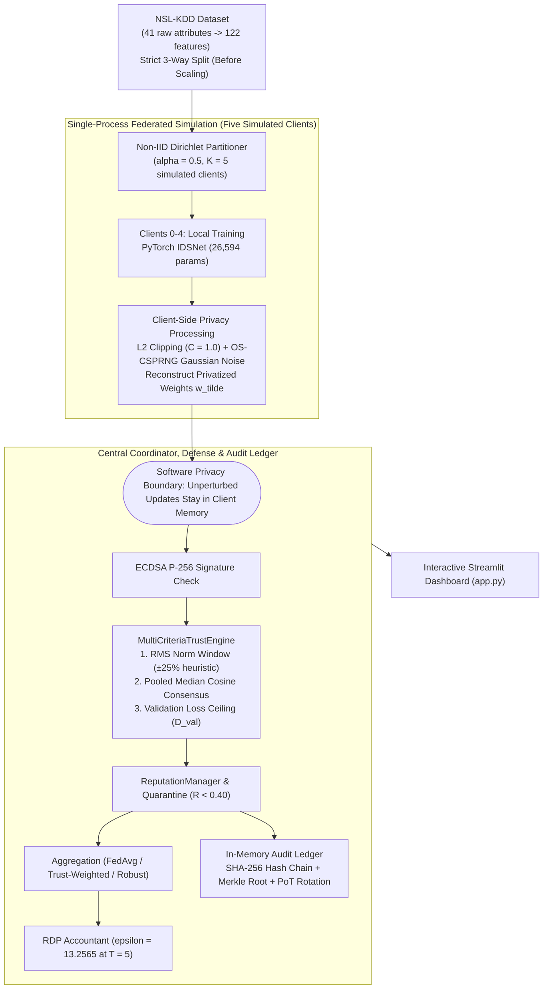

# Blockchain-Assisted Privacy-Preserving Federated Learning for Network Intrusion Detection

[](https://www.python.org/)
[](https://pytorch.org/)
[](https://streamlit.io/)
[](docs/privacy_and_rdp.md)
[](#how-to-run-tests)
[](reports/FINAL_RESEARCH_ARTIFACT_CHECKSUM_REGISTRY.md)

---

## Project Overview

This project is a Python-based research simulation that combines **Federated Learning**, **Differential Privacy**, **trust-based security**, and **cryptographic auditing** for **Network Intrusion Detection**.

It uses the **NSL-KDD** dataset (`41` raw attributes encoded into `122` input features) and **five simulated clients** inside a centralized coordinator to study how collaborative model training can be performed while applying privacy protection, evaluating suspicious updates, and maintaining a tamper-evident audit record.

> **Simulation Scope Note:** All five participants and the cryptographic audit ledger execute in-memory within a single coordinated Python session (`FederatedOrchestrator`). No distributed multi-machine networking, production Ethereum/Hyperledger blockchain deployment, or physical device key isolation is implemented.

---

## Problem Being Addressed

Training collaborative Network Intrusion Detection Systems (NIDS) across separate network domains faces three competing pressures:

1. **Data Exposure vs. Collaboration:** Centralizing raw traffic logs violates operational confidentiality and privacy mandates, while sharing unperturbed federated model updates can still leak training information without Differential Privacy.
2. **The Differential Privacy vs. Trust Conflict:** Client-level Gaussian noise protects individual participant datasets, yet in high dimensions (`26,594` parameters) that noise inflates model weight norms and scatters update angles—causing uncalibrated anomaly filters to falsely reject `100%` of honest participants.
3. **Need for Verifiable Auditability:** Standard federated averaging keeps no tamper-evident history of which client updates were signed, accepted, rejected, or quarantined across rounds.

---

## Main Features

- **Federated Learning with Five Simulated Clients:** Sequential in-process simulation training a shared global model across `K = 5` client partitions.
- **Non-IID Dirichlet Data Partitioning:** Models realistic class and traffic skew ($\alpha = 0.5$) alongside strict 3-way train / validation / held-out test isolation.
- **PyTorch Intrusion Detection Model (`IDSNet`):** 4-layer MLP (`122 -> 128 -> 64 -> 32 -> 2`, `26,594` trainable parameters) with Batch Normalization and Dropout, plus Track B support for general tabular datasets.
- **Client-Level Differential Privacy:** Complete update-vector L2 clipping ($C = 1.0$) and Gaussian perturbation under replace-one-client-dataset adjacency.
- **Rényi Differential Privacy (RDP) Accounting:** Tracks cumulative $(\epsilon, \delta)$-DP across rounds ($\epsilon = 13.2565$ at discrete order $\alpha = 3.0$, $T = 5$, $\sigma = 1.0$, $\delta = 10^{-5}$).
- **OS-Backed Secure Randomness:** Enforces `os.urandom` Box-Muller Gaussian sampling (`OS_CSPRNG`) in `RESEARCH_SIMULATION` and `DEPLOYMENT` execution modes while isolating `TEST` PRNG seeding.
- **Multi-Criteria Trust Evaluation:** Calibrated Root-Mean-Square (RMS) norm bounds (`±25%` heuristic window), pooled peer-median cosine consensus, and validation-loss checks on privatized client model weights.
- **Asymmetric Client Reputation & Quarantine:** Rewards valid rounds (`+0.05`), slashes rejected rounds (`-0.35`), quarantines clients below `0.40`, and supports 3-round shadow probation.
- **Byzantine & Data-Poisoning Simulations:** Built-in Gaussian noise, model scaling, sign-flipping, targeted label-flipping, Sybil coalition, and parameterized geometric stealth perturbations.
- **Multiple Aggregation Algorithms:** `FedAvg`, `Trust-Weighted FedAvg`, `Trimmed Mean`, `Coordinate Median`, plus `Multi-Krum` and `FoolsGold` baselines.
- **SHA-256 & ECDSA Verification:** NIST P-256 (`SECP256R1`) update authentication and pre-trust cryptographic payload gating.
- **Merkle-Tree & Hash-Chain Auditing:** Locally simulated in-memory ledger with Proof-of-Trust validator rotation and synthetic tamper detection suite.
- **Streamlit Dashboard & Learning Centre:** Interactive 6-section web platform with XAI packet attributions, live simulation controls, research visualizers, and 9 progressive educational modules.

---

## System Architecture

All client simulations, privacy transformations, trust checks, and ledger commitments execute within one centralized Python coordinator (`FederatedOrchestrator`), enforcing an explicit **software privacy boundary** between client memory and orchestrator evaluation in secure execution modes:



---

## How the System Works

1. **Data Isolation & Partitioning:** NSL-KDD is split first into a `124,973`-sample client training pool, a `1,000`-sample orchestrator validation slice (`D_val`), and the `22,544`-sample `KDDTest+` held-out test set before fitting `MinMaxScaler`. The training pool is split across 5 simulated clients via Dirichlet skew ($\alpha = 0.5$).
2. **Local Training & Privatization:** Non-quarantined clients train locally on their data slice. When client-level DP is enabled in secure modes, `ClientLevelDPMechanism` clips the update $\Delta w_k$ to norm $C$, injects OS-CSPRNG noise $n_k \sim \mathcal{N}(0, 4\sigma^2 C^2 I_d)$, and reconstructs privatized model weights $\tilde{w}_k$ before leaving the client method.
3. **Cryptographic Signing & Verification:** Weight digests are signed via ECDSA P-256 (keys managed centrally by the orchestrator in the current simulation). Invalid or altered payloads are rejected before entering trust scoring.
4. **Privacy-Aware Trust & Reputation:** `MultiCriteriaTrustEngine` inspects privatized candidate weights against calibrated RMS norm bounds, pooled peer-median direction, and `D_val` validation loss. Rejected clients are slashed (`-0.35`) and quarantined below `0.40`.
5. **Audit Commitment, Aggregation & Accounting:** All round dispositions, SHA-256 weight hashes, and Merkle roots are recorded to an in-memory block; accepted updates are aggregated into $w_{t+1}$; and `RDPAccountant` updates cumulative privacy loss.

Detailed design notes live in [`docs/architecture.md`](docs/architecture.md), [`docs/privacy_and_rdp.md`](docs/privacy_and_rdp.md), [`docs/trust_and_attacks.md`](docs/trust_and_attacks.md), and [`docs/blockchain_auditing.md`](docs/blockchain_auditing.md).

---

## Technology Stack

| Layer | Technologies |
|---|---|
| **Runtime** | Python `3.10` – `3.13` (verified on `3.13.7`) |
| **Deep Learning** | PyTorch (`torch >= 2.0.0`) |
| **Data & Statistics** | NumPy, Pandas, SciPy, Scikit-Learn |
| **Cryptography** | `cryptography` (ECDSA `SECP256R1`), Python `hashlib` (SHA-256), `os.urandom` |
| **Web UI & Visualizers** | Streamlit (`>= 1.28.0`), Plotly (`>= 5.17.0`), Matplotlib |
| **Testing & Config** | Pytest, PyYAML |

---

## Dashboard Preview

Running `streamlit run app.py` launches the 6-section interactive cyber-defense workspace:

1. **System Overview:** Node roster health cards, Dirichlet skew charts, and FL architecture visualizers.
2. **FL & Defense Studio:** Configurable live training runs across Track A (NSL-KDD) and Track B (tabular presets / CSV upload) with attack injectors, defense toggles, and 5-step recovery storyboard.
3. **Trust & Governance:** Asymmetric reputation trajectories, quarantine tracking, and trust equations.
4. **Blockchain Audit:** Block/transaction explorer and interactive synthetic tamper tester.
5. **Research Intelligence:** Frozen WP1/WP4 benchmark charts, headline metrics, and gradient-based XAI flow explanations.
6. **Learn & Explore:** Nine self-guided modules across five progressive skill levels.

### Screenshot Checklist (Insertion Pending)
Genuine rendered application screenshots are not currently committed to the repository. Capture real UI screenshots from a live `streamlit run app.py` browser session and place them under `docs/assets/screenshots/` before linking them here:

- [ ] `docs/assets/screenshots/01_system_overview.png` — System Overview & Node Health Cards
- [ ] `docs/assets/screenshots/02_fl_defense_studio.png` — Live FL & Defense Storyboard
- [ ] `docs/assets/screenshots/03_trust_governance.png` — Reputation Trajectory & Trust Governance
- [ ] `docs/assets/screenshots/04_blockchain_audit.png` — Block Inspector & Tamper Verifier
- [ ] `docs/assets/screenshots/05_research_xai.png` — Research Benchmarks & XAI Attribution View
- [ ] `docs/assets/screenshots/06_learning_centre.png` — Interactive Cyber-Defense Learning Centre

---

## Important Experimental Findings

All experimental summaries below reflect frozen artifacts verified against [`reports/FINAL_RESEARCH_ARTIFACT_CHECKSUM_REGISTRY.md`](reports/FINAL_RESEARCH_ARTIFACT_CHECKSUM_REGISTRY.md) and audited in Work Package 3.1:

- **Calibrated Trust Resolves DP False Rejections (50 Multi-Seed Runs, $C=1, \sigma=1, T=5, \epsilon=13.2565$):**
  Under client-level DP, the uncalibrated trust engine falsely rejected `100.0%` of honest updates and froze training. Calibrated RMS-norm and directional thresholds reduced **pooled** honest false-positive rates (FPR) across the 5 pilot seeds to **`1.0%–4.0%`** across all 5 tested scenarios (Holm-Bonferroni adjusted $p \le 6.47 \times 10^{-6}$), while individual seed FPRs ranged up to **`16.0%`** (`4/25` rejections on Seed 777 under `clean_dp`).
- **Attack Detection Under DP Depends on Attack Type:**
  Calibrated trust detected **`100.0%`** of tested Byzantine model poisoning submissions (`gaussian_noise`, `model_scaling`, `sign_flip`), whereas stealthy **`label_flip` data poisoning** achieved **`12.0%` (`3/25`)** detection because clipped update deltas ($\le 1.0$) are masked beneath Gaussian noise ($\|n\|_2 \approx 326.15$).
- **Accuracy Changes Are Not Statistically Significant ($N = 5$ Seeds):**
  Across the 5 pilot seeds (`df = 4`), test accuracy differences after Holm-Bonferroni correction are not statistically significant at $\alpha = 0.05$ (`p_adj = 1.0000` in WP3 DP runs; `p_adj >= 0.1839` across 7 clean WP1 baseline comparisons vs. FedAvg). Observed accuracy recovery in DP scenarios (`47.91% -> 57.64%` mean on `label_flip`) results from unblocking honest FedAvg aggregation rather than filtering the data poisoner.
- **Cryptographic Overhead & Synthetic Tamper Audit (WP4):**
  ECDSA P-256 signing/verification took `< 0.20 ms` per operation on CPU; serialized float32 model payloads measured `106,537 bytes` (`104.04 KiB`). Across a finite in-memory suite of `500` positive tampering trials (5 categories) and `100` pristine checks on a 4-block template ledger, all `500/500` synthetic faults were detected with `0/100` false alarms.

Full tables and statistical metrics are documented in [`docs/experiments_and_results.md`](docs/experiments_and_results.md).

---

## Installation and Setup

### 1. Clone the Repository
```bash
git clone https://github.com/RanvyGHBs/blockchain-fl-ids.git
cd blockchain-fl-ids
```

### 2. Create a Virtual Environment & Install Dependencies
```bash
python -m venv .venv
# Linux / macOS:
source .venv/bin/activate
# Windows PowerShell:
# .\.venv\Scripts\Activate.ps1

pip install --upgrade pip
pip install -r requirements.txt
# Development, testing, and linting tools (pytest, ruff):
pip install -r requirements-dev.txt
```

### 3. Verify Dataset Setup (NSL-KDD)
Canonical raw files (`KDDTrain+.txt`, `KDDTest+.txt`) are stored in `data/raw/`. If missing, `NSLKDDLoader` downloads them automatically on first run (or uses a synthetic fallback offline). Verify isolated preprocessing:

```bash
python -c "from src.data.nsl_kdd import NSLKDDLoader; loader = NSLKDDLoader(); X_tr, y_tr, X_val, y_val, X_te, y_te = loader.preprocess_isolated(); print(f'Pool: {X_tr.shape}, Val: {X_val.shape}, Test: {X_te.shape}')"
```
Expected output on canonical NSL-KDD:
```text
Pool: (124973, 122), Val: (1000, 122), Test: (22544, 122)
```

---

## How to Launch the Application

### Interactive Streamlit Dashboard
```bash
streamlit run app.py
```
Open **`http://localhost:8501`** in your browser once Streamlit starts.

### Terminal Live Simulation Demo
Execute a lightweight CPU-only synthetic smoke demo (no dataset download) or the full 2-round NSL-KDD live simulation (`OS-CSPRNG` DP, `model_scaling` attack on Client 3, calibrated trust defense, and ledger forging):
```bash
# Lightweight CPU-only smoke demo (deterministic synthetic data, ~5s):
python scripts/run_live_demo.py --smoke

# Full NSL-KDD terminal demonstration:
python scripts/run_live_demo.py
```

---

## How to Run Tests & Quality Checks

### Offline Unit & Synthetic Test Suite (CPU, No NSL-KDD Download)
```bash
python -m pytest tests/ -m "not integration" -q
```

### Full Automated Test Suite (Includes Local NSL-KDD Integration Tests)
```bash
python -m pytest tests/ -q
```

### Configuration Validation, Smoke Demo & End-to-End Integration Checks
```bash
# Fast validation & smoke-demo checks (CPU, synthetic data)
python -m pytest tests/test_config_validation.py tests/test_smoke_demo.py -v

# Canonical NSL-KDD end-to-end integration test (requires data/raw/ NSL-KDD)
python -m pytest tests/test_end_to_end_pipeline.py -v
```

### Linting (Ruff) & Frozen Checksum Audit
```bash
# Repo-wide correctness lint check
ruff check app.py src scripts tests

# Checksum audit of 25 frozen artifacts + full test suite
python scripts/maintenance/verify_checksums_and_tests.py
```

*(Optional experiment runners live in `scripts/experiments/` and `scripts/run_wp3_experiments.py` — see [`docs/development_guide.md`](docs/development_guide.md) before running them: `scripts/run_wp3_experiments.py`, `run_stage2.py`, `run_stage2d.py`, `run_stage2e_wp1.py`, and `run_stage2e_wp4.py` overwrite JSON files tracked in the frozen 25-artifact checksum registry, whereas `run_benchmark.py` writes `data/processed/benchmark_results.json`, which is not in the registry.)*

---

## Project Structure

```text
blockchain-fl-ids/
├── README.md
├── CITATION.cff
├── .gitignore
├── pyproject.toml                        # Pytest & Ruff configuration
├── requirements.txt                      # Core runtime & UI dependencies
├── requirements-dev.txt                  # Development/test dependencies (pytest, ruff)
├── app.py                                # 6-section Streamlit dashboard
├── config/default.yaml                   # Legacy Stage 2 YAML snapshot (unused at runtime; active defaults in src/config.py)
├── data/
│   ├── raw/                              # Raw NSL-KDD files (git-ignored, .gitkeep tracked)
│   └── processed/                        # Frozen benchmark JSONs (numpy arrays git-ignored)
├── docs/                                 # Technical documentation & release checklist
│   ├── architecture.md
│   ├── privacy_and_rdp.md
│   ├── trust_and_attacks.md
│   ├── blockchain_auditing.md
│   ├── experiments_and_results.md
│   ├── development_guide.md
│   ├── release_checklist.md
│   └── project_history/
├── reports/                              # Frozen audit reports, claim matrix & SHA-256 registry
├── scripts/
│   ├── run_live_demo.py                  # Quick CLI demonstration
│   ├── run_wp3_experiments.py            # Resumable WP3 multi-seed experiment runner
│   ├── capture_dashboard_screenshots.py  # Headless browser capture helper
│   ├── generate_report_figures.py        # Matplotlib figure generator
│   ├── experiments/                      # Historical stage benchmark runners
│   └── maintenance/                      # Checksum integrity & regression verification
├── src/                                  # Core Python modules (data, models, privacy, trust, etc.)
└── tests/                                # 23 automated unit, validation, smoke & integration test files
```

---

## Limitations

- **Single-Process Simulation:** Simulated clients, orchestrator, and key storage execute in one local Python process; network latency, packet drops, and independent host key isolation are not modeled.
- **Simulated In-Memory Audit Ledger:** The blockchain ledger is an in-memory SHA-256 chain without peer-to-peer consensus, disk immutability against host root access, Ethereum, or Hyperledger integration.
- **Heuristic Trust Bounds & Data Poisoning:** The `[0.75 * mu_RMS, 1.25 * mu_RMS]` norm window is an empirical heuristic, peer alignment uses a pooled coordinate median (`m`) rather than leave-one-out, validation loss thresholding is permissive, weight-space vs. update-space sign flips differ in visibility, and label-flipping detection under DP is only `12.0%`.
- **Statistical Power ($N = 5$ Seeds):** Honest FPR reduction is statistically significant ($p < 10^{-5}$), whereas test accuracy improvements across 5 seeds do not pass Holm-Bonferroni significance at $\alpha = 0.05$.
- **Telemetry Exposure:** Validation losses logged on ledger transactions satisfy client DP by post-processing, but could leak signal about `D_val` in an external public ledger deployment.
- **Domain & Privacy Scope:** Evaluated primarily on tabular NSL-KDD records (`122` features); approved privacy budget ($\epsilon = 13.2565$ across $T = 5$ rounds) protects client datasets under replace-one adjacency without client subsampling.
- **No Software License Granted:** No software license is granted for this repository and all rights are reserved by copyright holder Ranveer Singh Thakur; while GitHub public visibility allows viewing and forking, no permission is granted to use, modify, or redistribute the software without explicit permission.

---

## Documentation Links

- [System Architecture](docs/architecture.md)
- [Differential Privacy & RDP Accounting](docs/privacy_and_rdp.md)
- [Trust Calibration, Attacks & Weaknesses](docs/trust_and_attacks.md)
- [Blockchain Auditing & Verification](docs/blockchain_auditing.md)
- [Experiments & Frozen Benchmark Results](docs/experiments_and_results.md)
- [Development Guide](docs/development_guide.md)
- [Release & GitHub Metadata Checklist](docs/release_checklist.md)
- [Project History & Milestone Archive](docs/project_history/README.md)
- [25-Artifact SHA-256 Checksum Registry](reports/FINAL_RESEARCH_ARTIFACT_CHECKSUM_REGISTRY.md)

---

## References and Citation

### Selected Academic References
1. **Abadi et al. (2016):** *Deep Learning with Differential Privacy.* ACM CCS.
2. **McMahan et al. (2017):** *Communication-Efficient Learning of Deep Networks from Decentralized Data.* AISTATS.
3. **Mironov (2017):** *Rényi Differential Privacy.* IEEE CSF.
4. **Blanchard et al. (2017):** *Machine Learning with Adversaries: Byzantine Tolerant Gradient Descent.* NeurIPS.
5. **Yin et al. (2018):** *Byzantine-Robust Distributed Learning: Towards Optimal Statistical Rates.* ICML.
6. **Tavallaee et al. (2009):** *A Detailed Analysis of the KDD CUP 99 Data Set.* IEEE CISDA.
7. **Kim et al. (2020):** *Blockchained On-Device Federated Learning.* IEEE Communications Letters.
8. **Fung et al. (2022):** *Mitigating Sybils in Federated Learning Poisoning (FoolsGold).* IEEE TDSC.

### Citing This Software
Citation metadata is provided in [`CITATION.cff`](CITATION.cff).

### License
No software license is granted for this repository. All rights are reserved, and copyright remains with **Ranveer Singh Thakur**. Public visibility on GitHub permits viewing and forking under GitHub's Terms of Service, but does not grant any right to use, copy, modify, or distribute this software without explicit written permission from the copyright holder.
