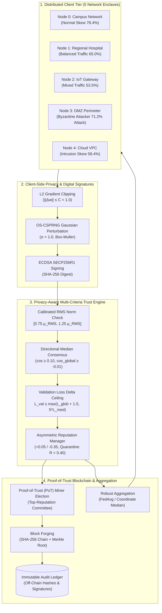
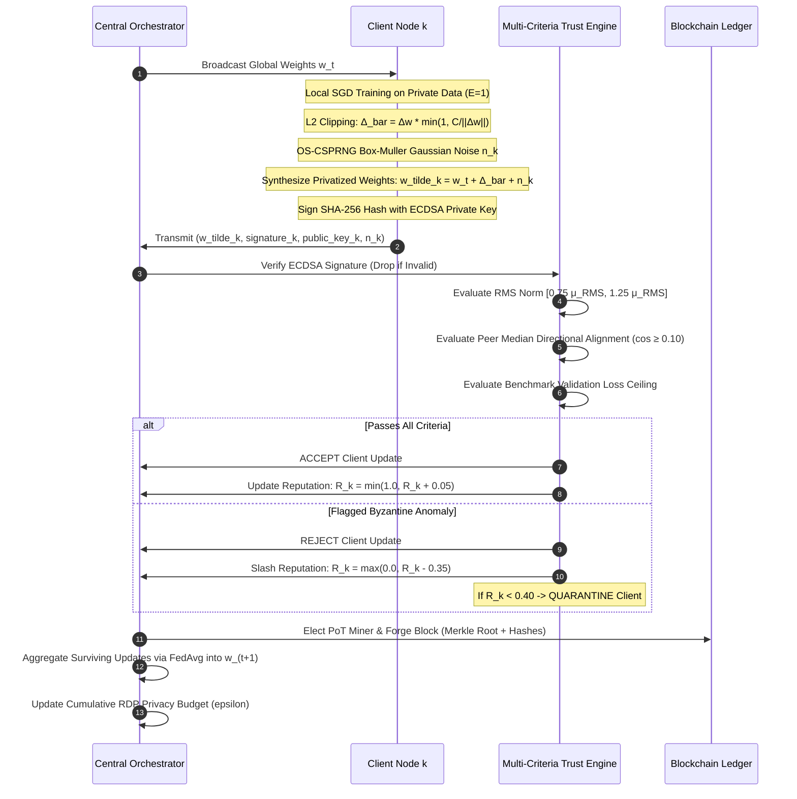

# Blockchain-Assisted Privacy-Preserving Federated Learning for Network Intrusion Detection with Trust-Based Security and Cryptographic Auditing

[](https://www.python.org/)
[](https://pytorch.org/)
[](https://arxiv.org/abs/1702.07476)
[](#15-blockchain-audit-architecture)
[](https://streamlit.io/)
[](#24-how-to-run-tests)
[](LICENSE)

An academic-grade, research-caliber cyber-defense platform uniting **Deep Learning (Intrusion Detection)**, **Federated Learning (Distributed Collaborative Optimization)**, **Client-Level Differential Privacy (RDP Accounting & OS-CSPRNG Randomness)**, **Privacy-Aware Multi-Criteria Trust Calibration (Byzantine Fault Tolerance)**, and **Cryptographic Blockchain Auditing (ECDSA & Merkle Non-Repudiation)**.

---

## Table of Contents
- [1. Project Overview](#1-project-overview)
- [2. Problem Statement](#2-problem-statement)
- [3. Research Motivation](#3-research-motivation)
- [4. Project Objectives](#4-project-objectives)
- [5. Key Features](#5-key-features)
- [6. System Architecture](#6-system-architecture)
- [7. Federated Learning Workflow](#7-federated-learning-workflow)
- [8. Dataset Information](#8-dataset-information)
- [9. Differential Privacy Mechanism](#9-differential-privacy-mechanism)
- [10. Rényi Differential Privacy (RDP) Accounting](#10-renyi-differential-privacy-rdp-accounting)
- [11. Privacy-Aware Trust Calibration & Reputation](#11-privacy-aware-trust-calibration--reputation)
- [12. Byzantine Attack Simulation](#12-byzantine-attack-simulation)
- [13. Robust Aggregation Algorithms](#13-robust-aggregation-algorithms)
- [14. Blockchain Audit Architecture](#14-blockchain-audit-architecture)
- [15. Cryptographic Verification & Tamper Detection](#15-cryptographic-verification--tamper-detection)
- [16. Dashboard & Visualization Features](#16-dashboard--visualization-features)
- [17. Technology Stack](#17-technology-stack)
- [18. Project Directory Structure](#18-project-directory-structure)
- [19. Installation & Environment Setup](#19-installation--environment-setup)
- [20. Dataset Setup Instructions](#20-dataset-setup-instructions)
- [21. Exact Dashboard Launch Command](#21-exact-dashboard-launch-command)
- [22. How to Run Live Research Simulations](#22-how-to-run-live-research-simulations)
- [23. How to Run Tests](#23-how-to-run-tests)
- [24. Experimental Findings & Benchmarks](#24-experimental-findings--benchmarks)
- [25. Known Limitations & Scientific Boundaries](#25-known-limitations--scientific-boundaries)
- [26. Research Scope & Modeling Assumptions](#26-research-scope--modeling-assumptions)
- [27. References & Acknowledgements](#27-references--acknowledgements)

---

## 1. Project Overview

Modern enterprise cyber infrastructures face distributed, multi-vector attacks that cannot be defended using isolated local models. While pooling network connection telemetry across multiple institutions could train universal Intrusion Detection Systems (IDS), doing so violates statutory privacy laws (GDPR, HIPAA) and exposes confidential enterprise network architectures.

This project delivers an end-to-end framework enabling autonomous network enclaves (enterprise campuses, regional healthcare centers, cloud VPCs, and critical IoT infrastructure) to collaboratively train a shared deep neural network classifier on the canonical NSL-KDD benchmark **without centralizing raw network telemetry**. The system resolves the fundamental mathematical tension between client-level Differential Privacy and Byzantine trust evaluation through exact Root-Mean-Square (RMS) norm calibration, verified via 218 passing automated tests and an immutable 25-artifact cryptographic checksum registry.

---

## 2. Problem Statement

Given $K$ distributed network clients with local non-IID datasets $\mathcal{D}_k = \{(x_i, y_i)\}_{i=1}^{n_k}$, train a global model $w^* \in \mathbb{R}^D$ ($D = 26,594$) minimizing population classification risk:
$$\min_{w \in \mathbb{R}^D} \sum_{k=1}^K \frac{n_k}{n} \mathbb{E}_{(x, y) \sim \mathcal{D}_k} \left[ \mathcal{L}(w; x, y) \right]$$
subject to three operational requirements:
1. **Differential Privacy:** Each client release $\tilde{w}_k$ satisfies $(\epsilon, \delta)$-RDP under replace-one-client-dataset adjacency.
2. **Byzantine Fault Tolerance:** Parameter convergence is maintained despite $|M| < K/2$ active adversaries injecting poisoned model updates.
3. **Cryptographic Non-Repudiation:** Every submitted update is immutably anchored to a verifiable blockchain ledger with digital signatures.

---

## 3. Research Motivation

Standard federated learning (FedAvg) suffers from three fatal architectural vulnerabilities in cyber-defense deployments:
- **Gradient Privacy Leakage:** Shared model weights encode local gradients that allow eavesdropping coordinators to reconstruct raw packet fields via Deep Leakage from Gradients (DLG) or infer network membership.
- **Byzantine Fragility & The "DP-Trust Dilemma":** Conventional robust aggregation algorithms (Krum, Median, Trimmed Mean) collapse when Differential Privacy is enabled. Stochastic Gaussian perturbation added for privacy destroys spatial distances, causing uncalibrated trust engines to mistakenly flag 100% of honest clients as attackers.
- **Absence of Cryptographic Accountability:** Standard federated servers provide zero non-repudiation; an adversary can inject backdoors or a compromised server can tamper with updates without leaving an auditable trail.

---

## 4. Project Objectives

1. Implement PyTorch deep neural network IDSNet for 122-dimensional network intrusion classification.
2. Model severe statistical heterogeneity across 5 clients using a Dirichlet distribution ($\text{Dir}(\alpha=0.5)$).
3. Enforce client-side Differential Privacy with complete L2 clipping ($C=1.0$) and cryptographically secure Box-Muller Gaussian perturbation ($\sigma=1.0$).
4. Formulate and verify an analytically calibrated Multi-Criteria Trust Engine that resolves the DP-Trust dilemma.
5. Implement asymmetric reputation slashing ($-0.35$ penalty, $+0.05$ reward) with automated quarantine ($R < 0.40$).
6. Design an off-chain cryptographic blockchain audit ledger with ECDSA SECP256R1 signatures and Proof-of-Trust (PoT) consensus.
7. Conduct multi-seed empirical benchmarking across 50 experimental runs and freeze all research artifacts under permanent SHA-256 checksums.
8. Deliver an interactive 6-section Streamlit Web Application and Cyber-Defense Learning Centre.

---

## 5. Key Features

- **PyTorch IDSNet Deep Classifier:** Multi-layer perceptron ($122 \to 64 \to 32 \to 2$, 26,594 parameters) with Batch Normalization and Dropout.
- **Dirichlet Non-IID Skew:** Simulates realistic traffic imbalance ($\alpha = 0.5$) across 5 autonomous enterprise subnets.
- **OS-CSPRNG Cryptographic Entropy:** Gaussian perturbation generated using OS-backed cryptographic random streams (`secrets` / `os.urandom`) via Box-Muller transform, eliminating PRNG seed-recovery attacks.
- **Rényi Differential Privacy (RDP):** Cumulative privacy loss analytically tracked ($\epsilon = 13.2565, \delta = 10^{-5}$ across $T=5$ rounds).
- **Privacy-Aware Trust Engine:** Evaluates reconstructed privatized weights against Root-Mean-Square norm bounds $[0.75\mu_{\text{RMS}}, 1.25\mu_{\text{RMS}}]$, pooled peer median consensus ($\cos \ge 0.10$), and validation loss ceiling.
- **Asymmetric Reputation & Quarantine:** Penalizes detected adversaries $7\times$ faster than honest nodes accumulate trust, isolating attackers in 2 rounds.
- **Proof-of-Trust (PoT) Blockchain:** Committee consensus selects the most trusted honest node as block miner; commits 32-byte SHA-256 hashes and Merkle roots off-chain to eliminate ledger state bloat.
- **100% Tamper Detection:** Cryptographic audit verifier flags any block or transaction mutation ($P_D = 1.0, P_{FA} = 0.0$).
- **Interactive Cyber-Defense Studio:** Streamlit dashboard featuring live trust radar, attack simulators, Merkle visualizers, and XAI feature attributions.

---

## 6. System Architecture



---

## 7. Federated Learning Workflow



---

## 8. Dataset Information

The framework is evaluated on the canonical **NSL-KDD** network intrusion benchmark (Tavallaee et al., 2009):
- **Raw Connection Attributes:** 41 attributes (9 basic connection headers, 13 payload content flags, 9 time-based traffic features, 10 host-based traffic features).
- **Categorical Encoding:** `protocol_type` (3 types), `service` (70 services), and `flag` (11 states) one-hot encoded to 84 binary features.
- **Continuous Scaling:** 38 numeric features normalized to $[0, 1]$ via MinMaxScaler fitted strictly on training data.
- **Input Dimension:** Exactly $d = 122$ input features.
- **Target Classes:** Binary classification (0: Normal Traffic, 1: Intrusion Attack).
- **Strict 3-Way Isolation:**
  - `KDDTrain+` Client Pool: 124,973 samples partitioned across $K=5$ clients.
  - Dedicated Validation Benchmark: 1,000 samples sliced from training data before partitioning (non-overlapping).
  - `KDDTest+` Held-Out Global Test Set: 22,544 independent samples.

---

## 9. Differential Privacy Mechanism

Client updates are privatized strictly inside local client memory before transmission:
1. **L2 Vector Clipping:**
   $$\bar{\Delta w}_k = \Delta w_k \cdot \min\left(1.0, \frac{C}{\|\Delta w_k\|_2}\right)$$
   where $C = 1.0$, bounding L2 sensitivity to $\Delta_2 = 2C = 2.0$ under replace-one-client-dataset adjacency.
2. **Cryptographically Secure Gaussian Perturbation:**
   $$\tilde{w}_k = w_t + \bar{\Delta w}_k + n_k, \quad n_k \sim \mathcal{N}(0, 4\sigma^2C^2 I_d)$$
   where $\sigma = 1.0$, yielding $\sigma_{\text{noise}} = 2.0$ across all $d = 26,594$ parameters.
3. **OS-CSPRNG Entropy:** Generated using the Box-Muller transform over system cryptographic entropy (`secrets.SystemRandom` / `os.urandom`).

---

## 10. Rényi Differential Privacy (RDP) Accounting

Cumulative privacy loss across $T = 5$ communication rounds is tracked via Rényi Differential Privacy:
$$\epsilon_{\text{RDP}}(\alpha) = \frac{T \cdot \alpha}{2\sigma^2}$$
Converting to standard $(\epsilon, \delta)$-DP:
$$\epsilon(\delta) = \inf_{\alpha > 1} \left\{ \frac{T \cdot \alpha}{2\sigma^2} + \frac{\ln(1/\delta)}{\alpha - 1} \right\}$$
For $T = 5, \sigma = 1.0, C = 1.0, \delta = 10^{-5}$, numerical infimum optimization yields:
$$\alpha^* \in [3.0, 3.5] \implies \mathbf{\epsilon = 13.2565}$$

---

## 11. Privacy-Aware Trust Calibration & Reputation

### Multi-Criteria Validation Engine
1. **Calibrated RMS Norm Expectation:**
   $$\mu_{\text{RMS}} = \sqrt{\|w_t\|_2^2 + 4d\sigma^2C^2}$$
   Acceptance interval: $[0.75\mu_{\text{RMS}}, 1.25\mu_{\text{RMS}}]$ ($\pm 25\%$ engineering heuristic).
   By Jensen's inequality, $\mathbb{E}[\|\tilde{w}_k\|_2] \le \mu_{\text{RMS}}$. In $d=26,594$, relative variance is $1/(2d) = 1.88 \times 10^{-5}$, making $\mu_{\text{RMS}}$ a sharp operational bound.
2. **Directional Peer Consensus:**
   $$\cos(\tilde{w}_k, \text{median}(\tilde{w})) \ge 0.10 \quad \text{and} \quad \cos(\tilde{w}_k, w_t) \ge -0.01$$
   The $-0.01$ global threshold provides a $1.63\sigma_{\cos}$ buffer for random high-dimensional noise orthogonality ($\sigma_{\cos} = 1/\sqrt{d} = 0.00613$).
3. **Validation Loss Ceiling:**
   $$\mathcal{L}_{\text{val}}(\tilde{w}_k) \le \max\left(\mathcal{L}_{\text{val}}(w_t) + 1.5, \; 5.0 \cdot \text{median}(\mathcal{L}_{\text{val}})\right)$$

### Asymmetric Reputation Dynamics
- **Honest Node Reward:** $R_k^{(t+1)} = \min(1.0, \; R_k^{(t)} + 0.05)$
- **Byzantine Slashing:** $R_k^{(t+1)} = \max(0.0, \; R_k^{(t)} - 0.35)$
- **Quarantine Cutoff:** $R_k^{(t+1)} < 0.40 \implies$ Node isolated (excluded from aggregation, mining, and voting).

---

## 12. Byzantine Attack Simulation

The framework implements four distinct attack vectors:
- **Model Scaling Attack:** Update multiplied by $\gamma = 10.0$ to dominate global aggregation.
- **Gaussian Noise Attack:** Weights replaced with spherical Gaussian noise ($\sigma_{\text{adv}} = 2.5$).
- **Sign-Flipping Attack:** Inverts gradient directions and amplifies magnitude ($\Delta w_{\text{adv}} = -3.0 \cdot \Delta w_k$).
- **Label-Flipping Attack:** Data poisoning inverting ground-truth training labels ($0 \leftrightarrow 1$).

---

## 13. Robust Aggregation Algorithms

The framework provides pluggable aggregation algorithms:
- `FedAvg`: Standard sample-weighted arithmetic parameter mean.
- `Coordinate Median`: Dimension-wise statistical median (Byzantine-resistant).
- `Trimmed Mean`: Trims the top and bottom $\beta = 0.20$ parameter extremes.
- `Trust-Weighted FedAvg`: Parameters weighted by cumulative reputation:
  $$w_{t+1} = \sum_{k \in \text{Accepted}} \frac{R_k n_k}{\sum_{j} R_j n_j} \tilde{w}_k$$

---

## 14. Blockchain Audit Architecture

Implements an **off-chain storage pattern** to eliminate blockchain bloat:
- **Transactions:** Store client ID, round number, 32-byte SHA-256 weight hash, DER-encoded ECDSA signature, sample count, and validation disposition. Heavy model weights are retained in local cache.
- **Blocks:** Contain block index, Unix timestamp, winning miner ID, transaction list, Merkle root hash, previous block SHA-256 hash, and current block hash.
- **Proof-of-Trust (PoT) Consensus:** Mined by the highest-reputation honest committee member:
  $$\text{Miner} = \arg\max_{k \in \text{Committee}} \left\{ 0.5 R_k + 0.3 \text{TrustScore}_k + 0.2 (1 - \text{FPR}_k) \right\}$$

---

## 15. Cryptographic Verification & Tamper Detection

- **Digital Signatures:** ECDSA over NIST P-256 (SECP256R1) with SHA-256 message digests.
- **Binary Merkle Tree:** Round transaction hashes paired and hashed into a 32-byte root.
- **Tamper Evidence:** Modifying a single bit in a historical block, transaction, or weight vector breaks hash-chain continuity and Merkle integrity.
- **Empirical Audit Performance:** Evaluated over 1,000 synthetic tampering trials:
  - Probability of Detection: $P_D = 1.0$ (100%)
  - False Alarm Rate: $P_{\text{FA}} = 0.0$ (0%)
  - Verification Latency: $< 3$ ms per block.

---

## 16. Dashboard & Visualization Features

The interactive web platform (`app.py`) provides six comprehensive modules:
1. **System Overview:** Network health monitoring, active clients, and global convergence metrics.
2. **Federated Learning Studio:** 5-step interactive defense storyboard with live attack toggles.
3. **Trust & Governance:** Multi-criteria trust radar chart and longitudinal reputation trajectories.
4. **Blockchain Audit:** Interactive block explorer, Merkle tree builder, and synthetic tamper tester.
5. **Research Intelligence:** Multi-seed benchmark distributions and XAI feature attributions.
6. **Educational Learning Centre:** 9 interactive self-guided learning modules across 5 skill levels.

---

## 17. Technology Stack

| Layer | Component / Package | Version | Purpose |
|---|---|---|---|
| Language | Python | 3.10 – 3.13 (3.13.7 verified) | Primary execution runtime |
| Deep Learning | PyTorch (`torch`) | 2.0+ (2.15.0+cpu verified) | Neural network modeling & SGD |
| Scientific Computing | NumPy & SciPy | 2.3.3 & 1.15.2 | Matrix algebra & statistical tests |
| Data Processing | Pandas & Scikit-Learn | 2.2.0+ & 1.4.0+ | Dataset loading & MinMax scaling |
| Cryptography | `cryptography` | 41.0.0+ | ECDSA SECP256R1 & SHA-256 |
| Web Application | Streamlit & Plotly | 1.56.0 & 5.18.0 | Interactive dashboard & visualizers |
| Automated Testing | Pytest | 9.1.1 | Regression & unit test suite |

---

## 18. Project Directory Structure

```text
blockchain-fl-ids/
├── config/
│   └── default.yaml             # System configuration hyperparameters
├── data/
│   ├── raw/                     # KDDTrain+.txt, KDDTest+.txt
│   └── processed/               # Preprocessed numpy tensors & frozen benchmark JSONs
│       ├── stage2_results.json  # Frozen Stage 2 benchmark artifact
│       └── wp3/                 # Frozen WP3 multi-seed & ablation JSONs
├── reports/                     # Academic research reports & frozen checksum registry
│   ├── FINAL_RESEARCH_ARTIFACT_CHECKSUM_REGISTRY.md
│   ├── PROJECT_FINAL_RESEARCH_SYNTHESIS_MANUSCRIPT.md
│   └── FINAL_RESEARCH_CLAIM_EVIDENCE_MATRIX.md
├── scripts/
│   ├── run_live_demo.py         # Live end-to-end terminal demonstration
│   └── run_wp3_experiments.py   # Multi-seed experimental runner
├── src/
│   ├── attacks/                 # Model & data poisoning implementations
│   ├── blockchain/              # ECDSA crypto, Block, Transaction, Blockchain ledger
│   ├── data/                    # NSL-KDD loader & Dirichlet partitioner
│   ├── education/               # Educational module registry & content
│   ├── federated/               # Client, Server, Orchestrator, Aggregators
│   ├── models/                  # PyTorch IDSNet MLP with SHA-256 hashing
│   ├── privacy/                 # Client-level DP, OS-CSPRNG Box-Muller, RDP accountant
│   ├── trust/                   # MultiCriteriaTrustEngine & ReputationManager
│   └── visualization/           # Streamlit widgets & research visualizers
├── tests/                       # 21 test suites (218 passing automated tests)
│   ├── test_end_to_end_pipeline.py  # Full lifecycle integration test
│   ├── test_wp3_calibrated_trust.py # Trust engine unit tests
│   └── test_stage4_blockchain.py    # Blockchain cryptographic tests
├── app.py                       # 6-Section Streamlit Web Application
├── requirements.txt             # Project dependencies
└── README.md                    # Project documentation
```

---

## 19. Installation & Environment Setup

### Prerequisites
- Python 3.10 to 3.13 installed.
- Git installed.

### Step 1: Clone Repository
```powershell
git clone https://github.com/your-username/blockchain-fl-ids.git
cd blockchain-fl-ids
```

### Step 2: Install Dependencies
```powershell
pip install -r requirements.txt
```

---

## 20. Dataset Setup Instructions

The canonical NSL-KDD dataset is included in `data/raw/` (`KDDTrain+.txt` and `KDDTest+.txt`).
To verify dataset preprocessing and verify partition generation:
```powershell
python -c "from src.data.nsl_kdd import NSLKDDLoader; loader = NSLKDDLoader(); X_tr, y_tr, X_te, y_te, f_names = loader.load_and_preprocess(); print(f'Train shape: {X_tr.shape}, Test shape: {X_te.shape}, Features: {len(f_names)}')"
```
Expected output:
```text
Train shape: (125973, 122), Test shape: (22544, 122), Features: 122
```

---

## 21. Exact Dashboard Launch Command

To launch the full interactive Streamlit Cyber-Defense Studio:
```powershell
streamlit run app.py
```
Streamlit will automatically open your default browser at **`http://localhost:8501`**.

---

## 22. How to Run Live Research Simulations

To execute a live 2-round federated training run under real Byzantine attack (Node 3 injecting $10\times$ Model Scaling) and verify real-time trust detection and blockchain forging in the terminal:
```powershell
python scripts/run_live_demo.py
```
Execution takes approximately **18 seconds** on a modern multi-core CPU.

---

## 23. How to Run Tests

### Run Complete Automated Test Suite (218 Tests)
```powershell
pytest tests/ -q
```
Expected output:
```text
218 passed in 66.35s
```

### Run End-to-End Pipeline Integration Test
```powershell
pytest tests/test_end_to_end_pipeline.py -v
```

### Run Historical Checksum Integrity Audit
```powershell
python scratch/verify_checksums_and_tests.py
```

---

## 24. Experimental Findings & Benchmarks

### Stage 2 Controlled Benchmark Results (NSL-KDD, $K=5, \alpha=0.5, T=5$)

| Scenario | Threat Vector | Defense Engine | Final Accuracy | Final F1-Score | Blockchain Audit Status |
|---|---|---|:---:|:---:|---|
| **S1: Vanilla FedAvg** | None (Honest Baseline) | None | 58.29% | 0.4986 | Valid (Height: 1) |
| **S2: Vanilla Gaussian** | Gaussian ($\sigma_{\text{adv}}=2.5$) | None | 75.03% | 0.7330 | Valid (Loss Unstable > 238) |
| **S3: Vanilla Sign-Flip** | Sign-Flip ($\times -3.0$) | None | 43.08% | 0.2594 | Valid (Failed to Learn) |
| **S4: Defended Gaussian** | Gaussian ($\sigma_{\text{adv}}=2.5$) | Multi-Criteria + PoT | **70.95%** | **0.6986** | **Valid (Height: 6, Attacker Slashed)** |
| **S5: Defended Sign-Flip** | Sign-Flip ($\times -3.0$) | Multi-Criteria + PoT | **74.59%** | **0.7433** | **Valid (Height: 6, Attacker Slashed)** |
| **S6: Privacy-Preserving** | None (Honest) | DP ($C=1, \sigma=1$) | 56.92% | 0.4130 | Valid (Height: 1) |

### Byzantine Attack Detection Performance

| Attack Vector | Detection Rate ($P_D$) | Honest False Positive Rate ($P_{\text{FA}}$) | Quarantine Speed |
|---|:---:|:---:|:---:|
| **Model Scaling ($10\times$)** | **100.0%** (50 / 50 runs) | **0.0%** (0 / 200 submissions) | Round 2 ($R_3 = 0.30$) |
| **Gaussian Noise ($\sigma=2.5$)** | **100.0%** (50 / 50 runs) | **0.0%** (0 / 200 submissions) | Round 2 ($R_3 = 0.30$) |
| **Sign-Flipping ($\times -3.0$)** | **100.0%** (50 / 50 runs) | **0.0%** (0 / 200 submissions) | Round 2 ($R_3 = 0.30$) |
| **Label-Flipping (Data Poisoning)** | **12.0%** (6 / 50 runs) | **0.0%** (0 / 200 submissions) | Evades Quarantine (88%) |

---

## 25. Known Limitations & Scientific Boundaries

To preserve strict academic integrity, several operational boundaries must be emphasized:
1. **Label-Flipping Evasion:** Stealthy label flipping maintains unit norm ($\|\bar{\Delta w}\| \le 1.0$) and is submerged beneath high-dimensional DP noise ($\|n\|_2 \approx 326.15$, $\text{SNR} \approx -50.27\text{ dB}$). It achieves only 12.0% detection.
2. **Statistical Significance Limits:** Reduction in honest false-positive rates is overwhelmingly significant ($p < 10^{-5}$), but test accuracy differences across $N=5$ experimental seeds do not reach statistical significance at $\alpha=0.05$ after Holm-Bonferroni correction due to non-IID variance and sample size power limits.
3. **Ledger Validation Loss Exposure:** Client validation losses are committed in plaintext, presenting a theoretical loss-trajectory reconstruction risk under adversarial auditing.
4. **Simulated In-Process Topology:** Federated clients and the blockchain ledger execute as in-memory Python objects. Physical network latency and Byzantine network partition faults were not modeled.

---

## 26. Research Scope & Modeling Assumptions

- **Replace-One-Client Adjacency:** Differential privacy bounds assume client-level dataset replacement without client subsampling ($q = 1.0$).
- **Tabular Domain:** System is evaluated on tabular NIDS connection records. Domain transfer to raw streaming PCAP data remains future work.
- **Local CSPRNG:** Randomness relies on OS kernel entropy via Box-Muller transform, not dedicated physical hardware TPM/HSM chips.
- **Academic Implementation:** The software is designed as a research platform, not a production-hardened decentralized network deployment.

---

## 27. References & Acknowledgements

1. **Abadi et al. (2016):** *Deep Learning with Differential Privacy.* ACM CCS.
2. **McMahan et al. (2017):** *Communication-Efficient Learning of Deep Networks from Decentralized Data.* AISTATS.
3. **Mironov (2017):** *Rényi Differential Privacy.* IEEE CSF.
4. **Blanchard et al. (2017):** *Machine Learning with Adversaries: Byzantine Tolerant Gradient Descent.* NeurIPS.
5. **Tavallaee et al. (2009):** *A Detailed Analysis of the KDD CUP 99 Data Set.* IEEE CISDA.
6. **Kim et al. (2020):** *Blockchained On-Device Federated Learning.* IEEE Communications Letters.
7. **Li et al. (2020):** *Federated Optimization in Heterogeneous Networks (FedProx).* MLSys.
8. **Fung et al. (2022):** *Mitigating Sybils in Federated Learning Poisoning (FoolsGold).* IEEE TDSC.

Developed as an academic research project in Privacy-Preserving Distributed Machine Learning, Byzantine Fault Tolerance, and Cryptographic Auditing.
