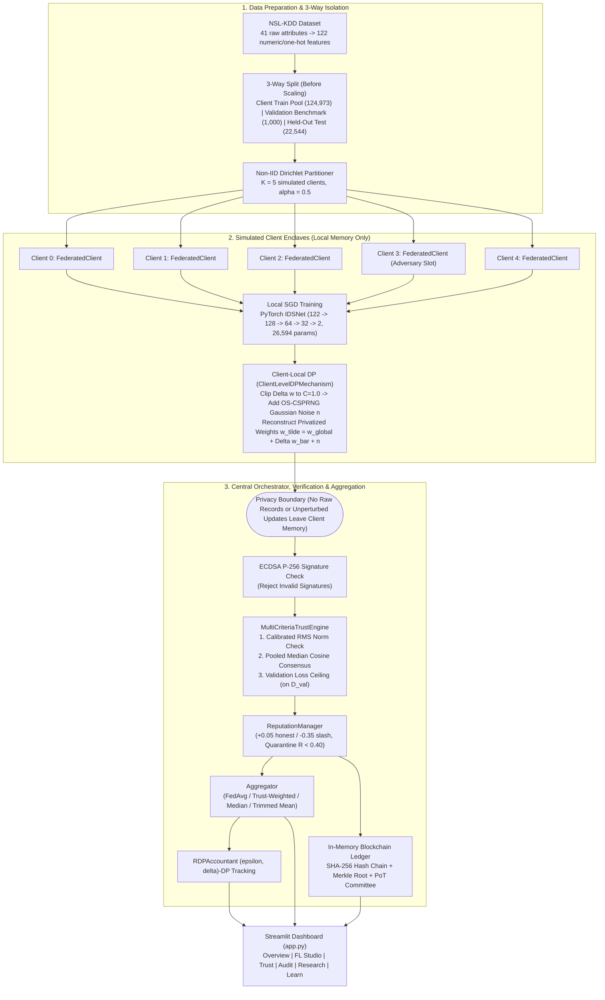

# System Architecture

This document describes the software architecture, simulation topology, data pipeline, privacy boundary, and interactive dashboard structure of the **Blockchain-Assisted Privacy-Preserving Federated Learning for Network Intrusion Detection** research platform.

---

## 1. Execution Scope and Simulation Topology

This project is a **single-process Python research testbed** built with PyTorch, NumPy, `cryptography`, Plotly, and Streamlit.

- **Five Simulated Clients:** The five network participants (`Network-Node-0` through `Network-Node-4`) execute sequentially inside a single centralized coordinator (`FederatedOrchestrator` in [src/federated/orchestrator.py](../src/federated/orchestrator.py)).
- **Not Physically Distributed:** The system does **not** run across five physically independent host machines, and does not implement peer-to-peer socket RPC, physical WAN latency, or Byzantine network partitions.
- **Purpose of Simulation:** Modeling autonomous data silos within one reproducible Python orchestration loop allows controlled scientific evaluation of Non-IID convergence, Differential Privacy (DP) calibration, Byzantine attack resilience, and cryptographic tamper auditing.

---

## 2. End-to-End Architecture and Privacy Boundary

---

## 3. Data Pipeline and 3-Way Isolation

Implemented in [src/data/nsl_kdd.py](../src/data/nsl_kdd.py), [src/data/custom_loader.py](../src/data/custom_loader.py), and [src/data/partitioner.py](../src/data/partitioner.py):

1. **Raw Features (NSL-KDD):** 41 network connection attributes (38 numeric + 3 categorical: `protocol_type`, `service`, `flag`), plus target label and difficulty metadata in raw files.
2. **Feature Engineering:** One-hot encoding of the 3 categorical attributes produces 84 binary features, which combined with the 38 continuous features yields **122 processed input features** (`d_in = 122`).
3. **Strict 3-Way Isolation (`preprocess_isolated()`):**
   - `KDDTrain+` (125,973 rows) is split *first* into the **Client Training Pool** (124,973 samples) and a stratified **Trust Validation Benchmark** (`D_val`, 1,000 samples).
   - `MinMaxScaler` is fitted **exclusively** on the 124,973 client-training records, then applied to transform `D_val` and `KDDTest+` (22,544 held-out test samples).
   - Neither `D_val` nor `KDDTest+` enters client training or scaler fitting.
4. **Non-IID Partitioning:** `FederatedPartitioner` distributes the training pool across $K = 5$ simulated clients using a Dirichlet distribution over class labels ($\text{Dir}(\alpha = 0.5)$).
5. **Track B Adaptability:** `CustomDatasetLoader` supports Breast Cancer Wisconsin, Iris, Wine, and custom CSV uploads under the same 3-way isolation protocol.

---

## 4. Neural Network Architecture (`IDSNet`)

Implemented in [src/models/ids_net.py](../src/models/ids_net.py), `IDSNet` is a Multi-Layer Perceptron (MLP) designed for tabular flow vectors:

| Layer Group | Transformation | Regularization / Activation | Trainable Parameters |
|---|---|---|---:|
| Hidden Block 1 | `Linear(122, 128)` + `BatchNorm1d(128)` | ReLU + Dropout (0.2) | 15,744 + 256 = 16,000 |
| Hidden Block 2 | `Linear(128, 64)` + `BatchNorm1d(64)` | ReLU + Dropout (0.2) | 8,256 + 128 = 8,384 |
| Hidden Block 3 | `Linear(64, 32)` + `BatchNorm1d(32)` | ReLU + Dropout (0.2) | 2,080 + 64 = 2,144 |
| Output Classifier | `Linear(32, 2)` (or `num_classes`) | Raw Logits | 66 |
| **Total (Binary NSL-KDD)** | **14 trainable tensors (`self.parameters()`)** | **Excludes 451 BatchNorm running-stat buffers** | **26,594 (`106,376 bytes` float32)** |

Model serialization for federated communication (`get_weights_vector()`) flattens the 26,594 trainable float32 parameters into a 1D NumPy array (`106,537 bytes` when Pickle-serialized, including a 161-byte Python Pickle container header), excluding the 9 non-trainable `BatchNorm1d` state buffers (`running_mean`, `running_var`, `num_batches_tracked`).

---

## 5. Privacy Boundary and Round Lifecycle

In secure execution modes (`ExecutionMode.RESEARCH_SIMULATION` and `ExecutionMode.DEPLOYMENT`), the round executes in four phases inside `FederatedOrchestrator._run_round()`:

1. **Local Training & Local Privatization (Client Boundary):**
   - Active (non-quarantined) clients synchronize with global weights $w_t$ and execute local Adam optimization (with optional FedProx proximal penalty).
   - Before leaving `FederatedClient`, `client.privatize_local_weights(w_t)` computes the update $\Delta w_k = w_k - w_t$, clips it to L2 norm $C$, perturbs it with OS-CSPRNG Gaussian noise $n_k$, and reconstructs the privatized model weights $\tilde{w}_k = w_t + \bar{\Delta w}_k + n_k$.
   - Without DP, model updates can leak sensitive training distribution properties (e.g., membership inference or gradient inversion). Raw training records never leave local client partitions, and in DP mode unperturbed model updates never cross the client boundary.
2. **Cryptographic Signing & Gate:**
   - Each weight vector's SHA-256 hex digest is signed with ECDSA P-256 (`SECP256R1`). Note that in the current single-process simulation, client keypairs (`self.client_keys`) are generated and stored centrally inside `FederatedOrchestrator`.
   - `CryptoManager.verify_signature()` rejects altered payloads or forged signatures before trust evaluation.
3. **Multi-Criteria Trust & Reputation Update:**
   - Verified candidate weights $\tilde{w}_k$ are evaluated by `MultiCriteriaTrustEngine` (Norm check, Cosine check, and Validation Loss check on `D_val`).
   - `ReputationManager` applies asymmetric updates (`+0.05` reward, `-0.35` slash, quarantine below `0.40`, with 3-round shadow probation).
   - Accepted and rejected records (hashes, signatures, validation metrics, reputation deltas) are forged into an in-memory block via Proof-of-Trust validator selection (`Blockchain`).
4. **Aggregation & Privacy Accounting:**
   - Surviving updates are aggregated (`FedAvg`, `Trust-Weighted`, `Trimmed Mean`, or `Coordinate Median`) into $w_{t+1}$.
   - `RDPAccountant.step()` accumulates cumulative privacy loss across rounds.

---

## 6. Software Modules Overview

| Directory / Module | Responsibility | Key Classes / Functions |
|---|---|---|
| [src/config.py](../src/config.py) | Execution modes, baseline constants, startup validation | `ExecutionMode`, `PrivacyRandomnessMode`, `validate_config()`, `get_approved_research_config()` |
| [src/data/](../src/data/) | Dataset loading, 3-way isolation, Dirichlet skew | `NSLKDDLoader`, `CustomDatasetLoader`, `FederatedPartitioner` |
| [src/models/ids_net.py](../src/models/ids_net.py) | PyTorch neural classifier & vector serialization | `IDSNet` |
| [src/federated/](../src/federated/) | Simulated FL loop, orchestration, aggregators, metrics | `FederatedClient`, `FederatedServer`, `FederatedOrchestrator`, `aggregate_*`, `compute_research_headline_metrics()` |
| [src/privacy/](../src/privacy/) | Formal client-level DP, OS-CSPRNG Box-Muller, RDP | `ClientLevelDPMechanism`, `generate_csprng_gaussian()`, `RDPAccountant`, legacy `LocalDifferentialPrivacy` |
| [src/trust/](../src/trust/) | Calibrated/uncalibrated trust filters & reputation | `MultiCriteriaTrustEngine`, `PrivacyAwareTrustEngine`, `ReputationManager` |
| [src/attacks/](../src/attacks/) | Poisoning and Byzantine attack implementations | `apply_gaussian_noise_attack`, `apply_sign_flipping_attack`, `apply_model_scaling_attack`, `apply_targeted_label_flipping_attack`, `generate_sybil_coalition_updates`, `generate_adaptive_byzantine_update` |
| [src/blockchain/](../src/blockchain/) | In-memory audit chain, ECDSA signatures, tamper testing | `Blockchain`, `Block`, `Transaction`, `CryptoManager`, `AuditVerifier`, `SyntheticTamperSuite` |
| [src/evaluation/](../src/evaluation/) | Multi-seed benchmarks and CPU/payload profiler | `CentralizedBaseline`, `LocalSiloBaseline`, `MultiSeedBenchmarkSuite`, `OverheadProfiler` |
| [src/xai/explainer.py](../src/xai/explainer.py) | Gradient-based Input × Sensitivity attributions | `FastFeatureExplainer` |
| [src/education/](../src/education/) & [src/visualization/](../src/visualization/) | Streamlit visualizers and 9 educational modules | `EDUCATIONAL_MODULES`, `render_*_visualizer`, `render_*_widget` |

---

## 7. Dashboard Architecture (`app.py`)

The Streamlit application ([app.py](../app.py)) acts as an interactive frontend over the simulation modules and frozen research artifacts, organized into six sections:

1. **System Overview:** Displays simulated node cards, Dirichlet partition charts, reputation status, and interactive FL lifecycle/heterogeneity visualizers.
2. **FL & Defense Studio:** Lets users run live scenarios across Track A (NSL-KDD) or Track B (Breast Cancer, Iris, Wine, custom CSV) with configurable attacks, aggregators, and defense tiers, displaying cumulative Stage 2D metrics and a 5-step defense storyboard.
3. **Trust & Governance:** Displays reputation trajectories, quarantine thresholds, and multi-criteria inspection equations.
4. **Blockchain Audit:** Lets users inspect blocks and transactions in the session's in-memory ledger and run interactive synthetic tampering checks.
5. **Research Intelligence:** Loads frozen empirical artifacts (`stage2_results.json`, `benchmark_summary_v2.json`, `overhead_summary_v2.json`) and provides real-time packet flow XAI explanations via `FastFeatureExplainer`.
6. **Learn & Explore:** Hosts 9 educational cyber-defense modules, each structured into 5 progressive tabs (Understand, Visualize, Math, Technical Deep-Dive, Knowledge Check Quiz).
