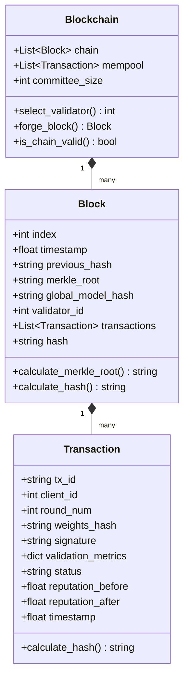

# Blockchain Auditing and Cryptographic Verification

This document explains the cryptographic signature scheme, block and transaction structure, validator selection, and tamper-evidence verifier implemented in [src/blockchain/](../src/blockchain/).

> **Architectural Scope Disclosure:**
> The ledger in this repository is a **locally simulated, in-memory, tamper-evident audit ledger** running inside the central Python coordinator (`FederatedOrchestrator`).
> **No production Ethereum, Hyperledger Besu/Fabric, peer-to-peer gossip protocol, or distributed consensus network is implemented.**

---

## 1. Ledger Data Structures

### Off-Chain Model Weight Pattern ([src/blockchain/block.py](../src/blockchain/block.py))
- Heavy float32 parameter vectors (`106,537 bytes` serialized) are **not** stored inside ledger blocks.
- Each `Transaction` records: `client_id`, `round_num`, SHA-256 hex digest of the submitted weights (`weights_hash`), base64-encoded ECDSA signature (`signature`), trust validation report dict (`validation_metrics`), disposition (`ACCEPTED` or `REJECTED`), `reputation_before`, `reputation_after`, `timestamp`, and a deterministic SHA-256 `tx_id` computed over sorted JSON (`client_id`, `round_num`, `weights_hash`, `signature`, `status`, `timestamp`).
- Each `Block` stores its sequential `index`, `timestamp`, `previous_hash`, binary `merkle_root` over transaction `tx_id`s (duplicating the last hash when the count is odd, or `sha256("empty_block")` when empty), `global_model_hash`, `validator_id`, and `hash` (SHA-256 of sorted JSON block header).

---

## 2. Cryptographic Primitives & Key Management ([src/blockchain/crypto.py](../src/blockchain/crypto.py))

- **Hashing:** Standard SHA-256 via Python `hashlib.sha256`. In `FederatedOrchestrator`, client weights are hashed via `CryptoManager.sha256_hash(weights.tobytes().hex())`.
- **Digital Signatures:** **ECDSA over NIST P-256 (`ec.SECP256R1`)** with SHA-256 digest (`cryptography` library). Keys are serialized as PKCS8 private PEM and SubjectPublicKeyInfo public PEM; signatures are base64-encoded DER bytes (`96` string characters).

### Important Key-Management Clarification
- In the current simulation ([src/federated/orchestrator.py](../src/federated/orchestrator.py), lines 474–475), ECDSA keypairs for all simulated clients are generated and held **centrally in memory** by `FederatedOrchestrator` in `self.client_keys[cid] = (priv_k, pub_k)`.
- Consequently, this implementation demonstrates **cryptographic payload verification and attribution interfaces**, **not** hardware-enforced private-key isolation across independent physical client devices.

### What ECDSA Proves vs. Does Not Prove
- **What it verifies:** Message integrity and signature authenticity under the assumed key-management model—if a bit in the weight vector or signature is altered (`test_03_cryptographic_gate_tampered_payload_rejected`), `CryptoManager.verify_signature()` rejects the payload before it enters `MultiCriteriaTrustEngine`.
- **What it does NOT verify:** Signature verification **does not indicate that an update is benign**. A malicious participant signs its poisoned weights with its valid private key; authentication simply ensures non-repudiation of who submitted that payload once trust evaluation slashes the update.

---

## 3. Simulated Proof-of-Trust Validator Selection ([src/blockchain/chain.py](../src/blockchain/chain.py))

When forging a round block (`select_validator()`):
1. Clients are sorted in descending order of current `ReputationManager` scores.
2. The top `committee_size` (default `3`) highest-reputation participants form the eligible validator committee.
3. The block proposer is rotated deterministically by block height: `top_candidates[len(chain) % len(top_candidates)]`.

*(Note: This is a lightweight simulated committee rotation over the central coordinator's ledger object—not a Byzantine-fault-tolerant distributed networking consensus protocol like PBFT or Tendermint.)*

---

## 4. Audit Verification and Synthetic Tamper Testing ([src/blockchain/audit_verifier.py](../src/blockchain/audit_verifier.py))

`AuditVerifier.verify_chain()` inspects:
1. Non-empty chain and Genesis integrity (`index == 0`, `previous_hash == "0"*64`, valid Genesis header hash).
2. Sequential indexing (`curr.index == prev.index + 1`) and expected chain height.
3. Hash-chain continuity (`curr.previous_hash == prev.hash`).
4. Header SHA-256 checksum recomputation (`curr.hash == curr.calculate_hash()`).
5. Binary Merkle root recomputation (`curr.merkle_root == curr.calculate_merkle_root()`).
6. Optional per-transaction ECDSA signature audit (`verify_signatures=True`, noting `AuditVerifier` checks signature over `tx.weights_hash`).

### WP4 Finite Tamper Suite Observations
From the Stage 2E.3 WP4 benchmark ([run_stage2e_wp4.py](../scripts/experiments/run_stage2e_wp4.py), which emits [overhead_summary.json](../data/processed/stage2e/wp4/overhead_summary.json)) and its Stage 2E.3.1 audited revision ([overhead_summary_v2.json](../data/processed/stage2e/wp4/overhead_summary_v2.json), documented in [STAGE_2E_3_1_WP4_OVERHEAD_AND_AUDIT_CORRECTION_REPORT.md](../reports/STAGE_2E_3_1_WP4_OVERHEAD_AND_AUDIT_CORRECTION_REPORT.md)):
- **500 synthetic positive tamper trials** (100 trials each across `payload_modification`, `block_deletion`, `block_reordering`, `hash_chain_modification`, `merkle_root_inconsistency`): **500 / 500 detected** ($100.0\%$ observed detection, mean latency $0.07\text{–}0.19\text{ ms}$ per audit).
- **100 negative control trials** (deep copies of the 4-block, 15-transaction pristine ledger template): **0 / 100 false alarms** ($0.0\%$ observed FPR, mean latency $0.1719\text{ ms}$).

---

## 5. Audit Ledger Limitations

1. **In-Memory Volatile State:** Blocks reside in Python RAM objects for the duration of an experiment/session; they are not persisted to distributed storage and do not protect against host OS memory/filesystem tampering.
2. **Validation Metric Telemetry Side-Channel:** Each `Transaction` stores `validation_metrics` (including `cand_loss` computed against the validator's `D_val`). While client training privacy satisfies $(\epsilon, \delta)$-DP by post-processing, publishing loss values on a shared ledger would leak indirect signal about the validator's reference slice `D_val`.
3. **Finite Negative-Control Topology:** The 100 negative controls test repeated verification idempotency on a fixed 4-block ledger template rather than diverse dynamic block lengths or client-count churn.
