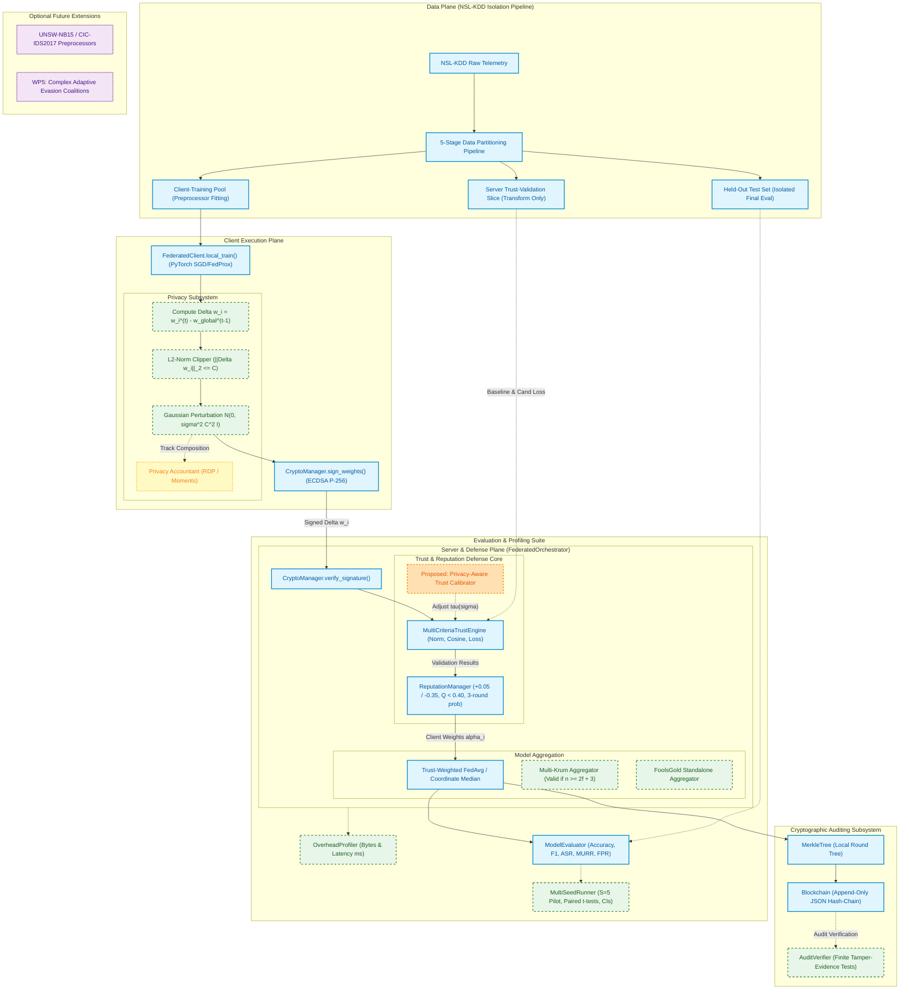
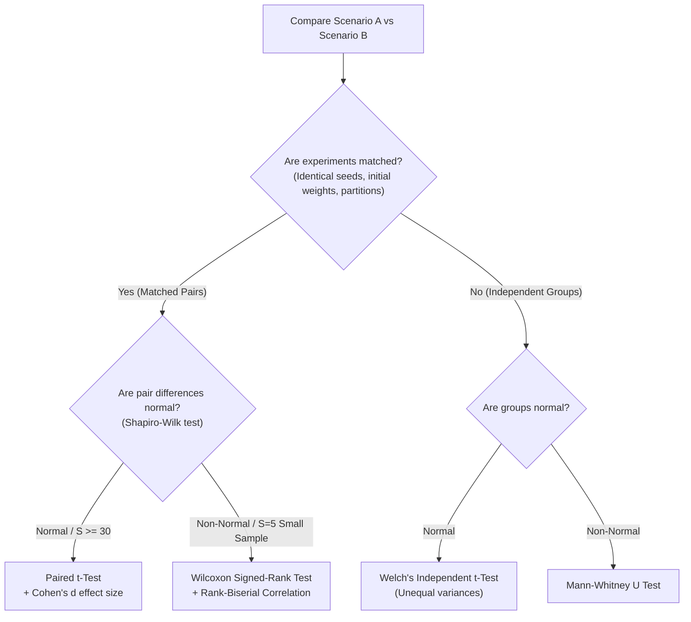
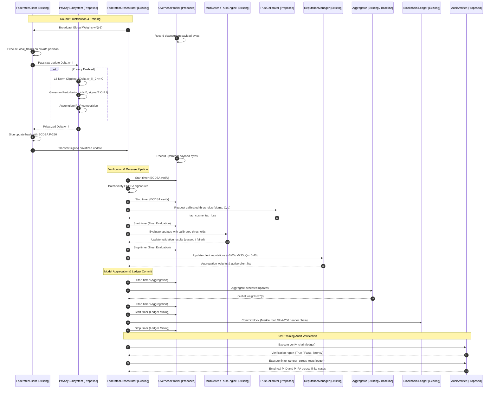

# Stage 2E.1 — Proposed System Architecture Specification
## Privacy-Aware Trust Calibration for Blockchain-Audited Federated Network Intrusion Detection

**Project:** Blockchain-Assisted Privacy-Preserving Federated Learning for Network Intrusion Detection with Trust-Based Security and Cryptographic Auditing  
**Workspace:** `C:\Users\is043\.gemini\antigravity\scratch\blockchain-fl-ids`  
**Milestone:** Stage 2E.1 (Methodological Corrections & Planning Package Revision)  
**Status:** REVISED ARCHITECTURAL SPECIFICATION (Planning Only — Zero Code Modifications)  
**Date:** November 2026  

---

## 1. Architectural Reconciliation & Design Principles

The Stage 2E.1 architecture reconciles the research design with the verified Stage 2D codebase, establishing clear component boundaries and explicit status classifications.

### 1.1 Status Classification Taxonomy
Every architectural component, data structure, and module in this specification is explicitly classified under one of five status designations:
- `[Existing and Implemented]`: Verified production code in the existing repository.
- `[Proposed for Stage 2E]`: New module or integration planned for implementation upon authorization.
- `[Optional Future Extension]`: Non-blocking capability deferred to subsequent development stages.
- `[Requires Theoretical Validation]`: Design where mathematical proofs or sensitivity bounds must be established before implementation.
- `[Requires Experimental Validation]`: Design where hypotheses must be confirmed through empirical testing.

### 1.2 Reconciled Architectural Decisions
1. **Preservation of Stage 2D Trust & Reputation Core `[Existing and Implemented]`:**  
   The fictitious "Beta Distribution & Two-Strike Quarantine" model proposed in early planning is **completely retracted**. The architecture strictly preserves the implemented `MultiCriteriaTrustEngine` (L2 norm, cosine similarity to peer median, validation loss verification) and `ReputationManager` (asymmetric $+0.05 / -0.35$ scoring, quarantine threshold $R < 0.40$, 3-round shadow probation).
2. **Privacy Calibration as a Trust Extension `[Requires Experimental Validation]`:**  
   Privacy-aware calibration is introduced as a dynamic adjustment layer to the existing trust thresholds ($\tau_{\text{cosine}}, \tau_{\text{loss}}$), investigated empirically under clean and poisoned conditions.
3. **Formal Privacy Accounting Formulation `[Requires Theoretical Validation]`:**  
   Update clipping is applied to weight deltas $\Delta \mathbf{w}_i^{(t)}$, and privacy claims are restricted to *"clipping-based Gaussian update perturbation (without formal privacy accounting)"* until a mathematically sound accountant is formally derived and unit-tested.
4. **Audit Ledger Framing `[Existing and Implemented]`:**  
   The blockchain subsystem is characterized strictly as a *"tamper-evident and cryptographically verifiable local audit ledger"*, avoiding unfounded claims of P2P consensus or absolute immutability.

---

## 2. Reconciled Global Architecture Diagram

The diagram below reflects the reconciled architecture, mapping existing Stage 2D implementations and proposed Stage 2E extensions.



---

## 3. Module Specifications & Interfaces

### 3.1 Formal Privacy Module (`src/privacy/accountant.py`) `[Requires Theoretical Validation]`

#### 3.1.1 Architectural Purpose
Upgrades the heuristic `LocalDifferentialPrivacy` implementation to operate on local update deltas $\Delta \mathbf{w}_i^{(t)}$ rather than absolute model weights, applying $L_2$-norm clipping, Gaussian perturbation, and formal privacy accounting across communication rounds.

#### 3.1.2 Mathematical Specifications
1. **Adjacency Unit:** Evaluated under **Example-Level Adjacency** (protecting individual connection flow records within local training batches).
2. **Clipping:**
   $$\Delta \mathbf{w}_{i, \text{clipped}} = \Delta \mathbf{w}_i \cdot \min\left(1, \frac{C}{\|\Delta \mathbf{w}_i\|_2}\right)$$
3. **Gaussian Perturbation:**
   $$\Delta \mathbf{w}_{i, \text{private}} = \Delta \mathbf{w}_{i, \text{clipped}} + \mathcal{N}\left(0, \sigma^2 C^2 \mathbf{I}_d\right)$$
4. **Composition & Accounting:**
   Rényi Differential Privacy (RDP) order $\alpha > 1$ accumulated over $T$ active rounds:
   $$\epsilon_{\text{total}}(\alpha) = \sum_{t=1}^T \frac{\alpha}{2 \sigma_t^2}$$
   Converted to standard $(\epsilon, \delta)$-DP:
   $$\epsilon^*(\delta) = \min_{\alpha > 1} \left\{ \epsilon_{\text{total}}(\alpha) + \frac{\ln(1/\delta)}{\alpha - 1} \right\}$$
   *Theoretical Constraint:* Must formally verify that subsampling assumptions match the actual client selection protocol before asserting formal $(\epsilon, \delta)$ guarantees.

#### 3.1.3 Interface Design
```python
class PrivacyAccountant:
    """[Requires Theoretical Validation]
    Tracks cumulative privacy expenditure across federated rounds.
    """
    def __init__(self, target_delta: float = 1e-5):
        self.target_delta = target_delta
        self.orders = [1.5, 2.0, 3.0, 5.0, 8.0, 14.0, 32.0, 64.0]
        self.total_rdp = {alpha: 0.0 for alpha in self.orders}

    def record_round(self, noise_multiplier: float, sample_rate: float = 1.0) -> None:
        """Accumulates RDP expenditure for a communication round."""
        ...

    def get_privacy_spent(self) -> Tuple[float, float]:
        """Converts accumulated RDP to canonical (epsilon, delta)-DP."""
        ...
```

---

### 3.2 Privacy-Aware Trust Calibrator (`src/trust/calibrator.py`) `[Requires Experimental Validation]`

#### 3.2.1 Architectural Purpose
Investigates the relationship between privacy noise scale $\sigma$, update geometry, and validation loss to formulate and test calibrated trust thresholds.

#### 3.2.2 Threshold Adjustment Models to Investigate
The module provides three distinct calibration models for empirical evaluation:
1. **Uncalibrated Baseline:** Static Stage 2D thresholds ($\tau_{\text{cosine}} = 0.15, \tau_{\text{loss}} = 1.5$).
2. **Empirically Estimated Threshold:** Quantile-based threshold derived from clean baseline runs under noise $\sigma$:
   $$\tau_{\text{cosine}}^{\text{emp}}(\sigma) = Q_{0.01}(\cos(\Delta \mathbf{w}_{\text{honest}}, \Delta \mathbf{w}_{\text{median}}))$$
   $$\tau_{\text{loss}}^{\text{emp}}(\sigma) = Q_{0.99}\left(\frac{\mathcal{L}_{\text{cand}} - \mathcal{L}_{\text{base}}}{\max(0.01, \mathcal{L}_{\text{base}})}\right)$$
3. **Theoretically Derived Linear Bound `[Requires Theoretical Validation]`:**
   $$\tau_{\text{cosine}}^{\text{theo}}(\sigma) = \tau_0 - \kappa_1 \cdot \sigma \cdot \frac{C}{\sqrt{d}}$$
   $$\tau_{\text{loss}}^{\text{theo}}(\sigma) = \tau_{\text{loss}, 0} + \kappa_2 \cdot \sigma^2$$

#### 3.2.3 Interface Design
```python
class PrivacyTrustCalibrator:
    """[Requires Experimental Validation]
    Provides calibrated thresholds for MultiCriteriaTrustEngine based on noise parameter sigma.
    """
    def __init__(self, mode: str = "empirical", base_cosine: float = 0.15, base_loss: float = 1.5):
        self.mode = mode
        self.base_cosine = base_cosine
        self.base_loss = base_loss

    def get_calibrated_thresholds(
        self,
        noise_multiplier: float,
        clip_norm: float,
        model_dim: int,
        empirical_stats: Optional[Dict[str, Any]] = None
    ) -> Tuple[float, float]:
        """Returns (calibrated_cosine_threshold, calibrated_loss_threshold)."""
        ...
```

---

### 3.3 Baseline Aggregation Module (`src/evaluation/baselines.py`) `[Proposed for Stage 2E]`

#### 3.3.1 Architectural Purpose
Houses standard comparative baselines to evaluate performance bounds and relative Byzantine resilience under identical data splits.

#### 3.3.2 Baseline Specifications
1. **Centralized-IDS (`CentralizedBaseline`):** Model trained on the unified training dataset without client partitioning (empirical upper bound).
2. **Local Silos (`LocalSiloBaseline`):** Individual clients train models strictly on isolated local partitions without collaboration (uncooperative lower bound).
3. **Multi-Krum (`MultiKrumAggregator`):** Implements Blanchard et al. (NeurIPS 2017).
   - *Byzantine Constraint:* Requires $n \ge 2f + 3$. Valid for $n=5$ with $f=1$; requires $n \ge 7$ if evaluated with $f=2$.
4. **FoolsGold (`FoolsGoldAggregator`):** Implements Fung et al. (IEEE TIFS 2020).
   - Evaluated as a standalone aggregator baseline to prevent redundant scoring conflicts with `MultiCriteriaTrustEngine`.

---

### 3.4 Multi-Seed Statistical Benchmark Suite (`src/evaluation/benchmark_suite.py`) `[Proposed for Stage 2E]`

#### 3.4.1 Architectural Purpose
Automates scenario execution across the initial 5-seed pilot ensemble ($S=\{42, 101, 2024, 777, 999\}$), aggregating results into publication-grade statistical summaries and conducting appropriate hypothesis tests.

#### 3.4.2 Statistical Testing Selection Logic


---

### 3.5 Overhead Profiler (`src/evaluation/overhead_profiler.py`) `[Proposed for Stage 2E]`

#### 3.5.1 Architectural Purpose
Instruments the orchestration loop to empirically measure computational latency and network byte transmission without interfering with model execution.

#### 3.5.2 Measured Metrics
- `upstream_client_bytes`: Serialized local update tensor + ECDSA signature + client metadata.
- `downstream_server_bytes`: Serialized global model + reputation vector + quarantine list.
- `latency_ecdsa_sign_ms`: Client-side ECDSA P-256 signature generation.
- `latency_ecdsa_verify_batch_ms`: Server-side ECDSA signature verification for all participating clients.
- `latency_trust_eval_ms`: MultiCriteriaTrustEngine execution (L2 norm, cosine similarity, validation loss).
- `latency_aggregation_ms`: Aggregation algorithm computation time.
- `latency_ledger_commit_ms`: SHA-256 block header calculation, Merkle tree construction, and disk write.
- `latency_audit_verify_ms`: Post-training full-chain cryptographic audit verification.

---

### 3.6 Cryptographic Ledger Audit Verifier (`src/blockchain/audit_verifier.py`) `[Proposed for Stage 2E]`

#### 3.6.1 Architectural Purpose
Provides automated verification of chain integrity and evaluates tamper detection performance across a finite suite of synthetic tampering scenarios.

#### 3.6.2 Finite Tamper Test Cases
1. `tamper_payload`: Corrupt transaction data or model hash in Block $t \in [1, T-1]$.
2. `delete_block`: Remove Block $t$ from the chain.
3. `reorder_blocks`: Transpose Block $t$ and Block $t+1$.
4. `corrupt_hash_chain`: Alter `prev_hash` of Block $t+1$.
5. `corrupt_merkle_root`: Alter the Merkle root recorded in Block $t$ header.

*Reporting Standard:* Reports Tamper Detection Probability $P_D$ and False Alarm Rate $P_{\text{FA}}$ evaluated strictly across $N=100$ trials per test case. Universal detection claims across all arbitrary attack distributions are explicitly avoided.

---

## 4. End-to-End Orchestration Sequence Flow

The sequence diagram below illustrates the round lifecycle under Stage 2E.1, showing the clean integration of proposed extensions with existing Stage 2D components.



---

## 5. Non-Breaking Backward Compatibility Guarantee

1. **Default Off Discipline:** All Stage 2E extensions (`enable_dp_accounting`, `enable_trust_calibration`, `enable_overhead_profiler`, `enable_audit_verifier`) default to `False`.
2. **Zero Modification to Existing Public Signatures:** Existing classes (`MultiCriteriaTrustEngine`, `ReputationManager`, `FederatedClient`, `FederatedOrchestrator`, `Blockchain`) preserve their Stage 2D signatures and default execution logic.
3. **Regression Invariance:** When Stage 2E extensions are disabled, existing Stage 2D benchmark scenarios (S1–S8) execute with 100% bit-for-bit regression parity.
