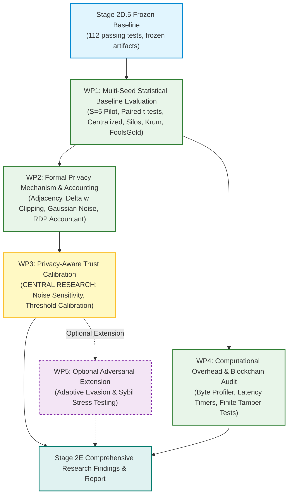
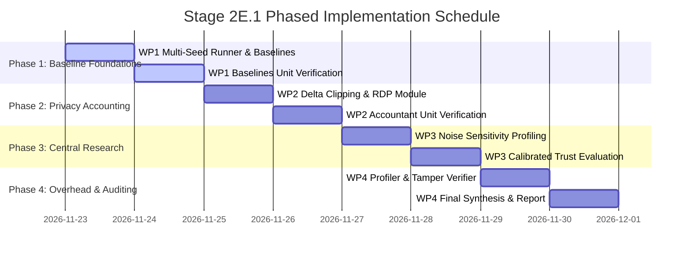

# Stage 2E.1 — Reorganized Implementation Roadmap & Work Packages
## Privacy-Aware Trust Calibration for Blockchain-Audited Federated Network Intrusion Detection

**Project:** Blockchain-Assisted Privacy-Preserving Federated Learning for Network Intrusion Detection with Trust-Based Security and Cryptographic Auditing  
**Workspace:** `C:\Users\is043\.gemini\antigravity\scratch\blockchain-fl-ids`  
**Milestone:** Stage 2E.1 (Methodological Corrections & Planning Package Revision)  
**Status:** REVISED IMPLEMENTATION ROADMAP (Planning Only — Zero Code Modifications)  
**Date:** November 2026  

---

## 1. Roadmap Architecture & Work Package Sequencing

Stage 2E.1 reorganizes the implementation roadmap into **five logically dependent Work Packages (WP1 to WP5)**. 

The sequencing ensures that statistical baseline rigor is established first, formal privacy mechanisms and accounting are derived second, the central privacy-trust calibration research is investigated third, and empirical overhead and ledger auditability are verified fourth.

---

## 2. Comprehensive Work Package Specifications

### Work Package 1 (WP1): Multi-Seed Statistical Baseline Evaluation

| Attribute | Specification |
|:---|:---|
| **Work Package ID** | **WP1** |
| **Title** | Multi-Seed Statistical Baseline Evaluation |
| **Priority** | **HIGH (Essential Foundation for Empirical Validity)** |
| **Complexity / Effort** | **Medium (3 Story Points / ~6 Hours)** |
| **Technical Risk** | **LOW** (Modular evaluation runners; zero core state mutation) |
| **Primary Objective** | Establish reproducible baseline performance across an initial 5-seed pilot ensemble ($S=\{42, 101, 2024, 777, 999\}$) on NSL-KDD, implementing four standard comparative baselines: Centralized-IDS (ceiling), Local Silos (floor), Multi-Krum (Blanchard et al., NeurIPS 2017), and FoolsGold (Fung et al., IEEE TIFS 2020). |
| **Scientific Justification** | Single-seed benchmarks (`seed=42`) cannot establish statistical significance or rule out lucky initialization. Comparing against performance bounds (Centralized, Silos) and established Byzantine defenses (Multi-Krum, FoolsGold) is mandatory for scholarly peer review. |
| **Existing Code Affected** | Interfacing with `src/federated/orchestrator.py`, `src/federated/client.py`, and `src/models/ids_net.py` in read-only mode. |
| **Proposed New Modules** | `src/evaluation/baselines.py` (CentralizedIDS, LocalSiloIDS, MultiKrumAggregator, FoolsGoldAggregator), `src/evaluation/benchmark_suite.py` (MultiSeedRunner, Paired $t$-test, Wilcoxon signed-rank test), `tests/test_baselines.py`, `tests/test_benchmark_suite.py`. |
| **Mathematical Basis** | - Sample mean $\bar{M}$, standard deviation $s_M$, 95% Student's $t$ confidence interval $\bar{M} \pm t_{4, 0.975} \frac{s_M}{\sqrt{5}}$. - Matched Paired $t$-test with Cohen's $d_z$ effect size; Wilcoxon signed-rank test for small-sample verification. - Multi-Krum: $\arg\min_{i} \sum_{j \in \mathcal{N}_i} \|\mathbf{w}_i - \mathbf{w}_j\|_2^2$ subject to $n \ge 2f + 3$. - FoolsGold: update trajectory cosine matrix $s_{ij}$, historical aggregation weight scaling. |
| **Experimental Design** | Execute Group 1 scenarios (B1–B6) across all 5 seeds on NSL-KDD under Non-IID Dirichlet $\alpha = 0.5$. |
| **Expected Evidence** | Tabulated $\mu \pm \sigma$ and 95% CIs demonstrating: (1) Centralized > Proposed > Silos; (2) Proposed defense achieves competitive clean accuracy with standard FedAvg while providing provable Byzantine rejection under $n \ge 2f + 3$. |
| **Dependencies** | Stage 2D.5 accepted codebase and deterministic seeding discipline. |
| **Acceptance Criteria** | 1. All 4 baselines execute deterministically across identical seed sets. 2. Multi-Krum client count constraint $n \ge 2f + 3$ is mathematically validated before execution. 3. Hypothesis testing module correctly reports $t$-stats, $p$-values, degrees of freedom, and Cohen's $d_z$. 4. All unit tests pass with 100% test success. |

---

### Work Package 2 (WP2): Formal Privacy Mechanism and Accounting

| Attribute | Specification |
|:---|:---|
| **Work Package ID** | **WP2** |
| **Title** | Formal Privacy Mechanism and Accounting |
| **Priority** | **HIGH (Essential Theoretical & Methodological Requirement)** |
| **Complexity / Effort** | **Medium-High (4 Story Points / ~8 Hours)** |
| **Technical Risk** | **MEDIUM** (Formal accountant derivation and unit verification required) |
| **Primary Objective** | Define and implement a mathematically sound clipping-based Gaussian perturbation mechanism operating on local update deltas $\Delta \mathbf{w}_i^{(t)}$, establish an explicit example-level adjacency relation, and implement a validated Rényi Differential Privacy (RDP) accountant. |
| **Scientific Justification** | The existing Stage 2D implementation applies heuristic clipping and noise to absolute weight vectors without formal accounting. To claim differential privacy, update sensitivity must be bounded via $L_2$ clipping on update deltas $\Delta \mathbf{w}_i$, and composition across communication rounds must be mathematically tracked. |
| **Existing Code Affected** | `src/federated/client.py` (add delta extraction and clipping), `src/privacy/differential.py` (retained for backward compatibility; new accountant introduced). |
| **Proposed New Modules** | `src/privacy/accountant.py` (PrivacyAccountant, RDP accumulation, RDP-to-DP conversion), `tests/test_privacy_accountant.py`. |
| **Mathematical Basis** | - Example-level adjacency: $|D \oplus D'| = 1$. - $L_2$ update clipping: $\Delta \mathbf{w}_{\text{clipped}} = \Delta \mathbf{w} \cdot \min(1, C / \|\Delta \mathbf{w}\|_2)$. - Gaussian mechanism: $\Delta \mathbf{w}_{\text{private}} = \Delta \mathbf{w}_{\text{clipped}} + \mathcal{N}(0, \sigma^2 C^2 \mathbf{I})$. - RDP composition: $\epsilon_{\text{total}}(\alpha) = \sum_{t=1}^T \frac{\alpha}{2 \sigma_t^2}$. - Canonical conversion: $\epsilon^*(\delta) = \min_{\alpha > 1} \{ \epsilon_{\text{total}}(\alpha) + \frac{\ln(1/\delta)}{\alpha - 1} \}$. |
| **Experimental Design** | Validate accountant against known analytical test cases (e.g., single-step Gaussian, sequential composition over $T=5$ rounds with $\sigma \in \{0.05, 0.1, 0.2, 0.5\}$ and $\delta = 10^{-5}$). |
| **Expected Evidence** | Unit test verification demonstrating that computed $(\epsilon, \delta)$ values match theoretical analytical bounds to within $10^{-6}$ precision. |
| **Dependencies** | WP1 deterministic runner. |
| **Acceptance Criteria** | 1. Clipping operates strictly on update deltas $\Delta \mathbf{w}_i$, not absolute model weights. 2. Accountant explicitly reports whether client sampling is deterministic or subsampled. 3. Terminology restricted to *"clipping-based Gaussian update perturbation (without formal privacy accounting)"* until all tests pass. 4. Zero regression on existing Stage 2D tests. |

---

### Work Package 3 (WP3): Privacy-Aware Trust Calibration (Central Research Contribution)

| Attribute | Specification |
|:---|:---|
| **Work Package ID** | **WP3** |
| **Title** | Privacy-Aware Trust Calibration |
| **Priority** | **HIGH (Central Proposed Research Contribution)** |
| **Complexity / Effort** | **High (5 Story Points / ~10 Hours)** |
| **Technical Risk** | **MEDIUM** (Requires balancing false-positive reduction against poisoning vulnerability) |
| **Primary Objective** | Empirically investigate how privacy-preserving Gaussian perturbation impacts honest-client update geometry ($L_2$ norms, cosine similarities) and validation losses, and evaluate whether dynamic calibration of trust thresholds can eliminate false-positive rejections of honest clients without weakening detection of malicious poisoning attacks. |
| **Scientific Justification** | This constitutes the primary novel scientific question of the study. Standard trust engines misclassify privacy-perturbed honest updates as malicious. Naively relaxing thresholds creates evasion loopholes for adversaries. A calibrated trust mechanism is essential for practical privacy-preserving FL-IDS. |
| **Existing Code Affected** | `src/trust/evaluator.py` (`MultiCriteriaTrustEngine` accepting dynamic thresholds), `src/federated/orchestrator.py`. |
| **Proposed New Modules** | `src/trust/calibrator.py` (`PrivacyTrustCalibrator`, empirical quantile estimator, theoretical bound evaluator), `tests/test_trust_calibrator.py`. |
| **Mathematical Basis** | - Empirical quantile thresholding: $\tau_{\text{cos}}^{\text{emp}}(\sigma) = Q_{0.01}(\cos)$, $\tau_{\text{loss}}^{\text{emp}}(\sigma) = Q_{0.99}(\Delta \mathcal{L})$. - Theoretical adjustment model: $\tau_{\text{cos}}^{\text{theo}}(\sigma) = 0.15 - \kappa_1 \sigma \frac{C}{\sqrt{d}}$, $\tau_{\text{loss}}^{\text{theo}}(\sigma) = 1.5 + \kappa_2 \sigma^2$. - False-positive rate evaluation: $\text{FPR} = \frac{|\mathcal{U}_{\text{rejected}}^{\text{honest}}|}{|\mathcal{U}_{\text{submitted}}^{\text{honest}}|}$. - Poisoning detection preservation: $\text{MURR} = \frac{|\mathcal{U}_{\text{rejected}}^{\text{mal}}|}{|\mathcal{U}_{\text{submitted}}^{\text{mal}}|}$, $\text{ASR} \le 5.0\%$. |
| **Experimental Design** | 1. Profile honest clients under clean conditions across noise multipliers $\sigma \in \{0.0, 0.05, 0.1, 0.2, 0.5\}$ (Group 2 scenarios C1–C7). 2. Test poisoning detection under calibrated vs uncalibrated trust against targeted label-flip, untargeted noise, and sign-flip attacks (Group 3 scenarios R1–R5). |
| **Expected Evidence** | 1. Quantitative proof of the noise level $\sigma_{\text{crit}}$ at which uncalibrated trust causes false-positive honest rejections ($\text{FPR} > 0$). 2. Comparative evaluation demonstrating that calibrated trust reduces FPR while maintaining high MURR ($>95\%$) and low ASR ($<5\%$). |
| **Dependencies** | WP1 (baselines) and WP2 (privacy mechanism). |
| **Acceptance Criteria** | 1. Honest-client noise sensitivity curves documented for both IID and Non-IID partitions. 2. Calibrated trust engine demonstrates measurable reduction in honest client FPR under $\sigma = 0.20$. 3. Poisoning detection is proven preserved under adversarial attacks. 4. Uncalibrated vs calibrated comparisons are executed under strictly matched seeds. |

---

### Work Package 4 (WP4): Computational Overhead and Blockchain Audit Evaluation

| Attribute | Specification |
|:---|:---|
| **Work Package ID** | **WP4** |
| **Title** | Computational Overhead and Blockchain Audit Evaluation |
| **Priority** | **MEDIUM-HIGH (Essential for Systems Review & Feasibility Claims)** |
| **Complexity / Effort** | **Low-Medium (2 Story Points / ~4 Hours)** |
| **Technical Risk** | **LOW** (Passive telemetry instrumentation; cloned chain manipulation) |
| **Primary Objective** | Implement a high-precision computational and communication overhead profiler, and establish an automated cryptographic audit verifier (`AuditVerifier`) to evaluate tamper detection performance over a finite suite of synthetic tampering scenarios. |
| **Scientific Justification** | Reviewers require empirical quantification of overhead to assess real-world deployability. Furthermore, characterizing the blockchain as a *"tamper-evident, cryptographically verifiable local audit ledger"* requires empirical proof that unauthorized ledger tampering is deterministically detected. |
| **Existing Code Affected** | Read-only context manager instrumentation in `src/federated/orchestrator.py` and `src/blockchain/`. |
| **Proposed New Modules** | `src/evaluation/overhead_profiler.py` (OverheadProfiler, timing context managers, byte counters), `src/blockchain/audit_verifier.py` (AuditVerifier, finite tamper test generator), `tests/test_overhead_profiler.py`, `tests/test_audit_verifier.py`. |
| **Mathematical Basis** | - Network payload bytes: $B_{\text{round}} = N \cdot B_{\text{down}} + \sum B_{\text{up}}^{(i)}$. - Wall-clock latency: $\Delta t = (t_{\text{end}} - t_{\text{start}}) \times 10^{-6}$ ms via `time.perf_counter_ns()`. - SHA-256 header hash chaining: $H_t = \text{SHA256}(\text{Index} \parallel H_{t-1} \parallel \text{Root} \parallel \text{Nonce})$. - Merkle root integrity: $\text{Root} = \text{Merkle}(\{H(\text{tx}_1), \dots, H(\text{tx}_k)\})$. - Finite detection probability: $P_D = \frac{N_{\text{detected}}}{N_{\text{tampered}}}$ over $N=500$ finite test trials. |
| **Experimental Design** | 1. Profile 5 rounds of training across baselines and defenses (Scenarios O1, O2). 2. Execute 100 trials each for 5 finite tampering cases: payload alteration, block deletion, block reordering, hash-chain inconsistency, and Merkle root corruption (Scenarios T1, T2). |
| **Expected Evidence** | 1. Complete empirical telemetry table showing signing, verification, trust evaluation, aggregation, and ledger mining latencies. 2. Empirical proof of $P_D = 1.000$ and $P_{\text{FA}} = 0.000$ strictly over the defined finite test set. |
| **Dependencies** | Stage 2D.5 blockchain modules and WP1 baseline suite. |
| **Acceptance Criteria** | 1. Profiler introduces $< 1\%$ overhead to local training. 2. Byte counters reflect actual serialized object sizes. 3. All 5 finite tamper cases are deterministically detected with explicit error reporting. 4. All unit tests pass with 100% success. |

---

### Work Package 5 (WP5): Optional Adversarial Extension

| Attribute | Specification |
|:---|:---|
| **Work Package ID** | **WP5** |
| **Title** | Optional Adversarial Extension (Adaptive Evasion & Sybil Stress Testing) |
| **Priority** | **OPTIONAL (Non-Blocking Extension Post-Core)** |
| **Complexity / Effort** | **Medium (3 Story Points / ~6 Hours)** |
| **Technical Risk** | **LOW-MEDIUM** (More complex multi-client adversarial configurations) |
| **Primary Objective** | Explore advanced adversarial evasion strategies (e.g., adaptive Byzantine stealth updates that attempt to remain within calibrated trust thresholds, and coordinated Sybil coalitions) as an optional post-core research extension. |
| **Scientific Justification** | Evaluating whether an adaptive adversary with partial knowledge of the calibration threshold can craft stealthy poisoning updates provides valuable supplementary insights for subsequent journal submissions. |
| **Existing Code Affected** | `src/attacks/adaptive_byzantine.py`, `src/attacks/sybil_coalition.py`. |
| **Proposed New Modules** | `src/evaluation/adaptive_study.py`, `tests/test_adaptive_study.py`. |
| **Dependencies** | WP1, WP2, and WP3 completion. |
| **Acceptance Criteria** | Optional package; may be deferred without impacting core Stage 2E completion. |

---

## 3. Phased Implementation Timeline

---

## 4. Methodological Invariance & Risk Mitigation

1. **Deterministic Execution Discipline:** Every scenario in WP1–WP4 must initialize random number generators independently per scenario and per round using standardized seeds.
2. **Computational Feasibility:** NSL-KDD benchmark scenarios require ~1.5–2.0 minutes per scenario on CPU. A 5-seed pilot across core scenarios requires ~35–45 minutes total computation time.
3. **No Retroactive Regressions:** All existing Stage 2D benchmark JSON artifacts (`stage2_results.json`, `multi_attack_benchmarks.json`, `multi_attack_benchmarks_v2.json`, `multi_attack_benchmarks_v3.json`) remain permanently immutable.
