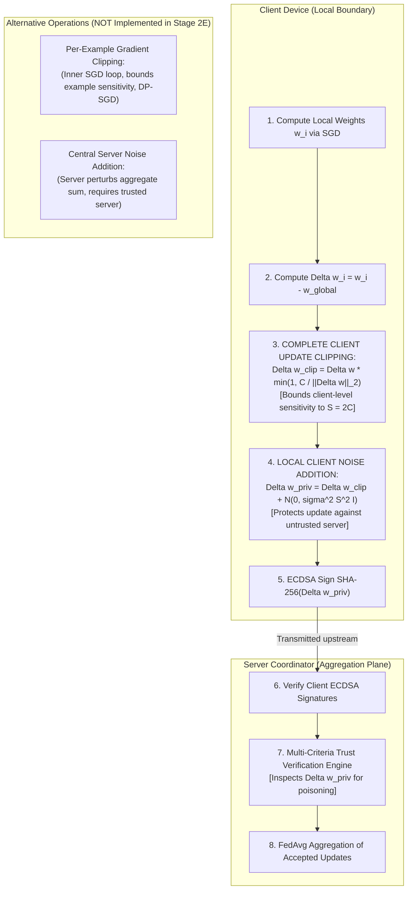

# Stage 2E.2.1 — Final Work Package 2 (WP2) Privacy Specification & Blueprint
## Methodological Blueprint for Privacy Perturbation and Accounting Implementation

**Project:** Blockchain-Assisted Privacy-Preserving Federated Learning for Network Intrusion Detection with Trust-Based Security and Cryptographic Auditing  
**Workspace:** `C:\Users\is043\.gemini\antigravity\scratch\blockchain-fl-ids`  
**Milestone:** Stage 2E.2.1 (Client-Level Sensitivity & Privacy Composition Verification)  
**Status:** SPECIFICATION BLUEPRINT (Planning Only — Zero Code Modifications)  
**Date:** November 2026  

---

## 1. Specification Overview & Status Categorization

This document establishes the definitive Work Package 2 (WP2) Privacy Specification. It synthesizes the mathematical derivations from `STAGE_2E_2_1_CLIENT_ADJACENCY_AND_SENSITIVITY.md` and `STAGE_2E_2_1_RDP_COMPOSITION_VERIFICATION.md` into an actionable, mathematically consistent implementation blueprint.

### 1.1 Status Classification Taxonomy
Every design choice, formula, and operational assumption in this blueprint is explicitly classified under one of five status designations:
- `[Mathematically Established under Stated Assumptions]`: Rigorously proven from differential privacy theory under the stated model.
- `[Recommended Design Decision]`: Architectural choice selected to fit the research goals and system design.
- `[Requires Implementation Verification]`: Code module that must be verified against unit tests upon implementation.
- `[Requires Experimental Validation]`: Empirical trade-off that must be validated through experimental execution.
- `[Unresolved Researcher Decision]`: Parameter or policy requiring researcher authorization before final execution.

---

## 2. Comprehensive WP2 Attribute Specification Table

| Attribute | Specification & Mathematical Formulation | Status Classification |
|:---|:---|:---:|
| **Privacy Unit** | The entire local training partition $D_i$ of client $i$ during round $t$ (Client-Level Privacy). | `[Recommended Design Decision]` |
| **Adjacency Relation** | **Replace-One-Client-Dataset Adjacency:** $\mathcal{D} \sim \mathcal{D}' \iff \exists ! k \text{ s.t. } D_k \neq D_k'$ while for all $j \neq k, D_j = D_j'$. The total cohort size $N = 5$ remains constant. | `[Recommended Design Decision]` |
| **Model Update Definition** | Parameter update delta: $\Delta \mathbf{w}_i^{(t)} \triangleq \mathbf{w}_i^{(t)} - \mathbf{w}_{\text{global}}^{(t-1)} \in \mathbb{R}^d$, where $\mathbf{w}_i^{(t)}$ is obtained after local SGD on $D_i$. | `[Mathematically Established]` |
| **Clipping Location** | Applied client-side immediately upon completion of local training, before noise addition, before ECDSA signing: $\bar{\Delta \mathbf{w}}_i^{(t)} = \mathcal{C}_C(\Delta \mathbf{w}_i^{(t)}) = \Delta \mathbf{w}_i^{(t)} \cdot \min\left(1, \frac{C}{\|\Delta \mathbf{w}_i^{(t)}\|_2}\right)$. | `[Recommended Design Decision]` |
| **Global Sensitivity ($S$)** | **$S = 2C$** (Euclidean diameter of the $L_2$ ball $\mathcal{B}_2(C)$ under replacement adjacency: $\|\mathcal{C}_C(\Delta \mathbf{w}_k) - \mathcal{C}_C(\Delta \mathbf{w}_k')\|_2 \le 2C$). | `[Mathematically Established]` |
| **Noise Distribution** | Spherical Gaussian noise: $\mathbf{n}_i^{(t)} \sim \mathcal{N}\left(\mathbf{0}, \sigma^2 S^2 \mathbf{I}_d\right) = \mathcal{N}\left(\mathbf{0}, 4 \sigma^2 C^2 \mathbf{I}_d\right)$. | `[Mathematically Established]` |
| **Noise Placement** | **Local Client-Side Perturbation:** Noise is generated and added by client $i$ inside its local execution environment prior to transmission: $\tilde{\Delta \mathbf{w}}_i^{(t)} = \bar{\Delta \mathbf{w}}_i^{(t)} + \mathbf{n}_i^{(t)}$. | `[Recommended Design Decision]` |
| **Participation Assumptions** | Full participation of all active (non-quarantined) clients in every communication round ($q = 1.0$). Subsampling amplification does not apply. | `[Mathematically Established]` |
| **RDP Composition Strategy** | Linear summation of per-round Rényi divergence orders: $\epsilon_{\text{RDP}}^{(T)}(\alpha) = \sum_{t=1}^T \frac{\alpha S^2}{2 \sigma^2 S^2} = \frac{T \alpha}{2 \sigma^2}$ for stationary $\sigma$. | `[Mathematically Established]` |
| **Approximate-DP Conversion** | Closed-form optimal order conversion: $\epsilon^*(\delta) = \frac{T}{2 \sigma^2} + \sqrt{\frac{2 T \ln(1/\delta)}{\sigma^2}}$ for specified failure probability $\delta = 10^{-5}$. | `[Mathematically Established]` |
| **Accounting Structure** | **Dual-Level Accounting:** (1) Per-client RDP accumulator tracking rounds client $i$ was active; (2) System upper bound $\epsilon_{\text{system}} = \max_i \epsilon_i$. | `[Requires Implementation Verification]` |
| **Noise Multiplier Sweep** | Evaluation sweep across $\sigma \in \{0.0, 0.05, 0.1, 0.2, 0.5\}$ (with $\sigma = 0.20$ as standard default baseline). | `[Requires Experimental Validation]` |
| **Mandatory Terminology** | **"Clipping-based Gaussian update perturbation (without formal privacy accounting)"** must be retained in all reporting until unit tests verify numerical RDP conversion. | `[Recommended Design Decision]` |

---

## 3. Explicit Differentiation of Privacy Operations

To eliminate any potential confusion during implementation review, the following four distinct operations are explicitly distinguished:



### Key Clarifications:
1. **Complete Client Update Clipping vs. Per-Example Clipping:**  
   Our framework clips the complete post-training parameter vector $\Delta \mathbf{w}_i^{(t)}$, which bounds the client-level sensitivity. We do **not** clip per-example gradients in the inner SGD loop (DP-SGD).
2. **Local Client Noise Addition vs. Central Server Noise Addition:**  
   Noise is added locally by each client before transmission. The central server does **not** add noise to the aggregated model; it aggregates already-privatized client updates.

---

## 4. Threat Model, Security Guarantees & Stated Limitations

### 4.1 What the Proposed Mechanism Protects
- **Protection Against Parameter Reconstruction:** An honest-but-curious server or curious peer validator observing the transmitted update vector $\tilde{\Delta \mathbf{w}}_i^{(t)}$ cannot determine whether client $i$'s local telemetry was $D_i$ versus an adjacent dataset $D_i'$ beyond the mathematical bound $(\epsilon, \delta)$ provided by the Gaussian noise.
- **Protection Against Gradient Inversion:** By projecting updates onto an $L_2$ ball of radius $C$ and injecting Gaussian noise with standard deviation $2\sigma C$, extreme gradient outliers that leak specific flow features are perturbed.

### 4.2 Explicit Stated Limitations (What is NOT Protected)
1. **Network & Identity Metadata:**  
   The mechanism does **not** provide cryptographic anonymity. The server and on-chain auditors know exactly which client submitted which update, the client's public key, IP address, and message transmission timestamp.
2. **Side-Channel & Packet Size Leakage:**  
   Because all weight updates are fixed-length arrays of dimension $d = 122 \times H_1 + H_1 \times H_2 + \dots$, vector size is constant. However, transmission timing variations during local training are not obfuscated.
3. **Cryptographic Signatures Do NOT Validate Benignity:**  
   Client updates are digitally signed with ECDSA P-256 keys. This guarantees **authenticity and transit integrity** (the update was generated by the specified client and not modified in transit), but does **not** guarantee that the update is benign. A malicious client generates poisoning attacks and signs them with its own valid private key.
4. **Blockchain Transparency:**  
   The `AuditLedger` stores transaction records containing block headers, Merkle roots, client IDs, and update hashes. Any participant with ledger read access can inspect historical update hashes, reputation histories, and quarantine events.

---

## 5. Architectural Blueprint for WP2 Implementation

Upon researcher authorization, Work Package 2 will be implemented according to the following file-level architecture:

```
src/
└── privacy/
    ├── __init__.py
    ├── accountant.py        <-- [NEW MODULE] Implements PrivacyAccountant
    └── differential.py      <-- [EXISTING] Preserved for backward compatibility
src/
└── federated/
    └── client.py            <-- [MODIFIED HOOK] Extract Delta w_i and apply clipping/noise
tests/
└── test_privacy_accountant.py <-- [NEW TEST SUITE] Validates RDP conversion & sensitivity
```

### 5.1 Proposed Interface for `PrivacyAccountant` (`src/privacy/accountant.py`)
```python
class PrivacyAccountant:
    """
    Rényi Differential Privacy (RDP) Accountant for Local Gaussian Mechanism
    under Replace-One-Client Adjacency with Full Participation (q = 1.0).
    """
    def __init__(self, target_delta: float = 1e-5, orders: Optional[List[float]] = None):
        self.target_delta = target_delta
        # Discrete Rényi orders alpha > 1
        self.orders = orders or [1.5, 2.0, 3.0, 5.0, 8.0, 14.0, 20.0, 32.0, 64.0]
        # Per-client RDP accumulators: client_id -> {alpha: cumulative_rdp}
        self.client_rdp: Dict[int, Dict[float, float]] = defaultdict(
            lambda: {alpha: 0.0 for alpha in self.orders}
        )
        self.client_rounds: Dict[int, int] = defaultdict(int)

    def record_client_step(self, client_id: int, noise_multiplier: float, sensitivity_multiplier: float = 2.0) -> None:
        """
        Records RDP expenditure for client_id in a communication round.
        RDP for Gaussian mechanism: R_alpha = alpha / (2 * sigma^2).
        Sensitivity is normalized: noise std = sigma * S.
        """
        if noise_multiplier <= 0.0:
            return  # sigma = 0 provides no privacy tracking

        per_round_rdp = {alpha: alpha / (2.0 * (noise_multiplier ** 2)) for alpha in self.orders}
        for alpha in self.orders:
            self.client_rdp[client_id][alpha] += per_round_rdp[alpha]
        self.client_rounds[client_id] += 1

    def get_client_privacy(self, client_id: int) -> Tuple[float, float]:
        """
        Converts accumulated RDP to canonical (epsilon, delta)-DP via closed-form infimum:
        eps*(delta) = T / (2 * sigma^2) + sqrt(2 * T * ln(1/delta) / sigma^2)
        """
        T = self.client_rounds[client_id]
        if T == 0:
            return 0.0, self.target_delta

        # Find numerical infimum across discrete orders for exact verification
        min_eps = float('inf')
        for alpha in self.orders:
            eps_alpha = self.client_rdp[client_id][alpha] + math.log(1.0 / self.target_delta) / (alpha - 1.0)
            if eps_alpha < min_eps:
                min_eps = eps_alpha

        return min_eps, self.target_delta

    def get_system_privacy_summary(self) -> Dict[str, Any]:
        """Returns max epsilon across all participating clients and round counts."""
        ...
```

---

## 6. Strict Acceptance Criteria for WP2

To ensure absolute verification before moving to WP3, WP2 must satisfy the following criteria:
1. **Numerical Accountant Validation:** The numerical infimum computed across discrete Rényi orders in `PrivacyAccountant` must match the closed-form analytical equation $\epsilon^*(\delta) = \frac{T}{2 \sigma^2} + \sqrt{\frac{2 T \ln(1/\delta)}{\sigma^2}}$ to within $10^{-4}$ relative tolerance.
2. **Clipping Boundary Guarantee:** In unit tests, 100 randomly generated synthetic update vectors with norms $\|\mathbf{v}\|_2 \in [0.1, 100.0]$ must satisfy $\|\mathcal{C}_C(\mathbf{v})\|_2 \le C$ to machine precision.
3. **Noise Variance Verification:** The empirical sample variance of $10,000$ drawn noise elements must match $\sigma^2 S^2 = 4 \sigma^2 C^2$ within a 99% chi-square confidence interval.
4. **Zero Impact When Disabled:** When `enable_dp=False`, `FederatedOrchestrator` must execute identical Stage 2D benchmark outputs with zero metric regression.
