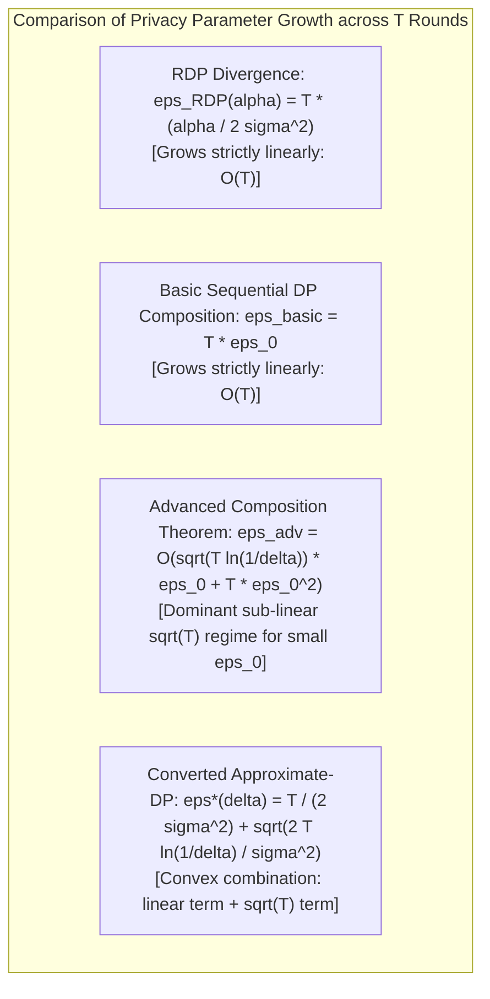

# Stage 2E.2.1 — Repeated-Round Privacy Composition, RDP Analysis, and Parameter Semantics
## Mathematical Verification of Composition, Conversion, and Noise Multiplier Dynamics

**Project:** Blockchain-Assisted Privacy-Preserving Federated Learning for Network Intrusion Detection with Trust-Based Security and Cryptographic Auditing  
**Workspace:** `C:\Users\is043\.gemini\antigravity\scratch\blockchain-fl-ids`  
**Milestone:** Stage 2E.2.1 (Client-Level Sensitivity & Privacy Composition Verification)  
**Status:** MATHEMATICAL VERIFICATION (Planning Only — Zero Code Modifications)  
**Date:** November 2026  

---

## 1. Executive Summary & Purpose

This document provides the formal mathematical verification of repeated-round privacy composition under full client participation ($q=1.0$), establishes the exact Rényi Differential Privacy (RDP) formulation and closed-form $(\epsilon, \delta)$ conversion, and analyzes the operational semantics of the noise multiplier $\sigma$.

It eliminates premature assumptions regarding subsampling amplification, clarifies the non-linear growth dynamics of converted approximate-DP bounds, and establishes a joint empirical measurement methodology to evaluate the privacy–trust trade-off in Work Package 2 (WP2) and Work Package 3 (WP3).

---

## 2. Full Client Participation and the Absence of Subsampling Amplification

In large-scale cross-device federated learning (e.g., McMahan et al., 2018), differential privacy relies heavily on **privacy amplification by subsampling**:
- A cohort of $K$ clients is chosen uniformly at random (or via Poisson sampling) from a vast population of $N$ clients ($N \ge 10,000$).
- The sampling ratio $q \triangleq \frac{K}{N} \ll 0.01$ dampens privacy expenditure, scaling Rényi divergence by $\mathcal{O}(q^2)$:
  $$R_\alpha(\mathcal{M}_{\text{subsampled}}) \approx q^2 \cdot \frac{\alpha}{2 \sigma^2}$$

### Mathematical Reality of the 5-Client Cross-Silo Setting:
1. In our federated network intrusion detection simulation, the client pool consists of a fixed cohort of $N = 5$ edge nodes (e.g., branch networks, regional datacenters).
2. In every communication round $t \in \{1, \dots, T\}$, all active (non-quarantined) clients participate deterministically:
   $$q = \frac{N_{\text{active}}}{N} = \frac{5}{5} = 1.0$$
3. There is **zero stochastic randomness** in client selection.
4. **Formal Consequence:** Subsampled Gaussian mechanism accountants (e.g., Wang et al., AISTATS 2019; Mironov et al., 2019) **cannot be applied**. Privacy accounting must be performed under the standard Gaussian mechanism with full participation ($q = 1.0$), where privacy loss accumulates without subsampling attenuation.

---

## 3. Rényi Differential Privacy (RDP) Formulation and Composition

### 3.1 Single-Round RDP for the Local Gaussian Mechanism
Let $\mathcal{M}: \mathcal{D}_i \to \mathbb{R}^d$ denote client $i$'s local update mechanism:
$$\mathcal{M}(D_i) = \mathcal{C}_C\left(\Delta \mathbf{w}_i\right) + \mathbf{n}_i, \quad \mathbf{n}_i \sim \mathcal{N}\left(\mathbf{0}, \sigma^2 S^2 \mathbf{I}_d\right)$$
where $S$ is the $L_2$ global sensitivity of the clipping function $\mathcal{C}_C(\cdot)$.

By Mironov (CSF 2017, Corollary 1), for any two adjacent local datasets $D_i \sim D_i'$, the Rényi divergence of order $\alpha > 1$ between the output probability distributions $P = \mathcal{M}(D_i)$ and $Q = \mathcal{M}(D_i')$ is given by:
$$D_\alpha(P \parallel Q) = \frac{\alpha \|\mathcal{C}_C(\Delta \mathbf{w}_i) - \mathcal{C}_C(\Delta \mathbf{w}_i')\|_2^2}{2 \sigma^2 S^2}$$
Taking the supremum over all adjacent datasets where $\|\mathcal{C}_C(\Delta \mathbf{w}_i) - \mathcal{C}_C(\Delta \mathbf{w}_i')\|_2 \le S$:
$$D_\alpha(P \parallel Q) \le \frac{\alpha S^2}{2 \sigma^2 S^2} = \frac{\alpha}{2 \sigma^2}$$

#### Fundamental Invariance Property:
Notice that the sensitivity term $S^2$ in the numerator **cancels exactly** with the $S^2$ scaling in the Gaussian noise variance denominator!  
As long as the injected Gaussian noise standard deviation is scaled proportionally to the true $L_2$ sensitivity ($\sigma_{\text{noise}} = \sigma \cdot S$), the single-round RDP expenditure is **strictly independent of the numerical sensitivity bound $S$**:
$$\epsilon_{\text{RDP}}^{(t)}(\alpha) = \frac{\alpha}{2 \sigma^2}$$

---

### 3.2 Repeated-Round Sequential Composition
Under adaptive sequential composition of differentially private mechanisms (Mironov, 2017, Theorem 1), Rényi divergences add linearly.  
For client $i$ participating in $T$ communication rounds with noise multipliers $\{\sigma_1, \sigma_2, \dots, \sigma_T\}$:
$$\epsilon_{\text{RDP}}^{(T)}(\alpha) = \sum_{t=1}^T \epsilon_{\text{RDP}}^{(t)}(\alpha) = \sum_{t=1}^T \frac{\alpha}{2 \sigma_t^2}$$
For a stationary noise multiplier $\sigma_t = \sigma$ across all $T$ rounds:
$$\epsilon_{\text{RDP}}^{(T)}(\alpha) = T \cdot \frac{\alpha}{2 \sigma^2} = \frac{T \alpha}{2 \sigma^2}$$

*Applicability Condition:* This linear addition holds strictly because each round's noise vector $\mathbf{n}_i^{(t)}$ is drawn independently from $\mathcal{N}(\mathbf{0}, \sigma^2 S^2 \mathbf{I}_d)$.

---

## 4. Conversion from Accumulated RDP to Canonical $(\epsilon, \delta)$-DP

### 4.1 Conversion Formulation
By Mironov (CSF 2017, Proposition 3), a mechanism that satisfies $(\alpha, \epsilon_{\text{RDP}}(\alpha))$-RDP satisfies canonical $(\epsilon(\delta), \delta)$-differential privacy for any specified $\delta \in (0, 1)$ via:
$$\epsilon(\delta) = \inf_{\alpha > 1} \left\{ \epsilon_{\text{RDP}}^{(T)}(\alpha) + \frac{\ln(1/\delta)}{\alpha - 1} \right\}$$
Substituting the accumulated RDP expression $\epsilon_{\text{RDP}}^{(T)}(\alpha) = \frac{T \alpha}{2 \sigma^2}$:
$$\epsilon(\delta) = \inf_{\alpha > 1} \left\{ \frac{T \alpha}{2 \sigma^2} + \frac{\ln(1/\delta)}{\alpha - 1} \right\}$$

---

### 4.2 Analytical Closed-Form Minimization
Define the objective function $g: (1, \infty) \to \mathbb{R}$:
$$g(\alpha) \triangleq \frac{T \alpha}{2 \sigma^2} + \frac{\ln(1/\delta)}{\alpha - 1}$$
To find the infimum, evaluate the first derivative with respect to $\alpha$:
$$\frac{dg}{d\alpha} = \frac{T}{2 \sigma^2} - \frac{\ln(1/\delta)}{(\alpha - 1)^2}$$
Setting $\frac{dg}{d\alpha} = 0$:
$$\frac{T}{2 \sigma^2} = \frac{\ln(1/\delta)}{(\alpha - 1)^2} \implies (\alpha - 1)^2 = \frac{2 \sigma^2 \ln(1/\delta)}{T}$$
Because $\alpha > 1$, taking the positive square root yields the optimal Rényi order $\alpha^*$:
$$\alpha^* = 1 + \sqrt{\frac{2 \sigma^2 \ln(1/\delta)}{T}}$$
Evaluate the second derivative to confirm a global minimum:
$$\frac{d^2 g}{d\alpha^2} = \frac{2 \ln(1/\delta)}{(\alpha - 1)^3} > 0 \quad (\text{for all } \alpha > 1, \delta \in (0, 1))$$
Substituting $\alpha^*$ back into $g(\alpha)$:
$$\epsilon^*(\delta) = \frac{T}{2 \sigma^2} \left( 1 + \sqrt{\frac{2 \sigma^2 \ln(1/\delta)}{T}} \right) + \frac{\ln(1/\delta)}{\sqrt{\frac{2 \sigma^2 \ln(1/\delta)}{T}}}$$
Distributing terms:
$$\epsilon^*(\delta) = \frac{T}{2 \sigma^2} + \frac{T}{2 \sigma^2} \sqrt{\frac{2 \sigma^2 \ln(1/\delta)}{T}} + \frac{\ln(1/\delta)}{\sqrt{\frac{2 \sigma^2 \ln(1/\delta)}{T}}}$$
Simplifying the square root terms:
$$\frac{T}{2 \sigma^2} \sqrt{\frac{2 \sigma^2 \ln(1/\delta)}{T}} = \sqrt{\frac{T^2 \cdot 2 \sigma^2 \ln(1/\delta)}{4 \sigma^4 T}} = \sqrt{\frac{T \ln(1/\delta)}{2 \sigma^2}}$$
$$\frac{\ln(1/\delta)}{\sqrt{\frac{2 \sigma^2 \ln(1/\delta)}{T}}} = \sqrt{\frac{(\ln(1/\delta))^2 \cdot T}{2 \sigma^2 \ln(1/\delta)}} = \sqrt{\frac{T \ln(1/\delta)}{2 \sigma^2}}$$
Summing the two identical square root terms:
$$\sqrt{\frac{T \ln(1/\delta)}{2 \sigma^2}} + \sqrt{\frac{T \ln(1/\delta)}{2 \sigma^2}} = 2 \sqrt{\frac{T \ln(1/\delta)}{2 \sigma^2}} = \sqrt{\frac{4 T \ln(1/\delta)}{2 \sigma^2}} = \sqrt{\frac{2 T \ln(1/\delta)}{\sigma^2}}$$
This yields the exact closed-form bound:
$$\epsilon^*(\delta) = \frac{T}{2 \sigma^2} + \sqrt{\frac{2 T \ln(1/\delta)}{\sigma^2}}$$

---

### 4.3 Rigorous Analysis of Growth Dynamics with Communication Rounds ($T$)

A frequent point of confusion in privacy literature is conflating different composition bounds. We explicitly contrast the mathematical growth rates:



#### Crucial Mathematical Distinctions:
1. **RDP Parameter Growth is Linear:** The accumulated Rényi divergence parameter $\epsilon_{\text{RDP}}^{(T)}(\alpha) = \frac{T \alpha}{2 \sigma^2}$ grows **strictly linearly** in $T$.
2. **Converted Approximate-DP $\epsilon^*(\delta)$ is NOT Purely Linear:**  
   $$\epsilon^*(\delta) = \underbrace{\frac{T}{2 \sigma^2}}_{\text{Linear in } T} + \underbrace{\sqrt{\frac{2 \ln(1/\delta)}{\sigma^2}} \cdot \sqrt{T}}_{\text{Square-root in } T}$$
   - For small $T$ and small $\sigma$, the $\sqrt{T}$ term contributes significantly to the bound.
   - For large $T$, the linear term $\frac{T}{2 \sigma^2}$ eventually dominates.
   - Therefore, claiming that the converted $(\epsilon, \delta)$ guarantee grows *purely linearly* or *purely as $\sqrt{T}$* is mathematically inaccurate. It follows the exact two-term convex closed form derived above.

---

## 5. Client Participation and Dual-Level Accounting Architecture

In our federated learning framework with dynamic reputation and two-strike quarantine:
- Quarantined clients do **not** submit updates during quarantine rounds.
- Honest, active clients submit updates in every round.

Therefore, the privacy accountant must maintain a **dual-level accounting structure**:

### 5.1 Per-Client Privacy Tracking
Each client $i \in \{1, \dots, N\}$ maintains an independent accumulated RDP vector:
$$\mathcal{E}_i(\alpha) = \sum_{t=1}^T \mathbb{I}(\text{Client } i \text{ submitted in round } t) \cdot \frac{\alpha}{2 \sigma_t^2}$$
- If client $i$ was quarantined in round $t$, its privacy expenditure for that round is **zero**.
- The accountant computes each client's specific privacy loss:
  $$\epsilon_i^*(\delta) = \frac{T_i}{2 \sigma^2} + \sqrt{\frac{2 T_i \ln(1/\delta)}{\sigma^2}}$$
  where $T_i \le T$ is the exact number of rounds client $i$ actually submitted updates.

### 5.2 System-Level Privacy Upper Bound
The orchestrator reports the system-level privacy consumption as the supremum across all clients:
$$\epsilon_{\text{system}}^*(\delta) \triangleq \max_{i \in \{1, \dots, N\}} \epsilon_i^*(\delta)$$

---

## 6. Examination of the Noise Multiplier $\sigma$

### 6.1 What Does $\sigma = 0$ Mean?
Setting $\sigma = 0$ corresponds to pure deterministic clipping without noise addition:
- The clipping operator $\mathcal{C}_C(\cdot)$ bounds update norm to $C$, but provides **zero differential privacy protection**.
- Adjacent datasets $D_i \neq D_i'$ produce distinct deterministic vectors $\bar{\Delta \mathbf{w}}_i \neq \bar{\Delta \mathbf{w}}_i'$.
- The privacy loss random variable is unbounded; Rényi divergence $D_\alpha(P \parallel Q) = \infty$, yielding $\epsilon = \infty$.

### 6.2 A Noise Multiplier is NOT an $(\epsilon, \delta)$ Guarantee
A noise multiplier $\sigma$ is an **operational variance scaling factor**, not an intrinsic privacy guarantee:
- Setting $\sigma = 0.20$ does not imply $\epsilon = 0.20$.
- The resulting privacy bound depends on:
  1. The $L_2$ sensitivity $S$ ($S = 2C$ under replacement vs $S = C$ under add/remove).
  2. The number of participation rounds $T$.
  3. The participation rate $q$ (here, $q = 1.0$).
  4. The specified failure probability $\delta$ (typically $\delta = 10^{-5}$).

### 6.3 Why Model Dimension $d$ Does Not Enter the DP Bound
By definition, Differential Privacy is **dimension-independent** for Gaussian mechanisms:
- The ratio of probability densities along the one-dimensional line segment connecting adjacent clipped outputs is governed strictly by the 1D Gaussian variance along that direction ($\sigma^2 S^2$).
- The mathematical privacy guarantee $\epsilon^*(\delta)$ derived in Section 4.2 contains **no dimension term $d$**.

### 6.4 How Model Dimension $d$ Directly Impacts Utility and Trust Analytics
While $d$ does not affect theoretical privacy, it has a **massive impact on empirical geometry**:
- The expected Euclidean norm of the $d$-dimensional Gaussian noise vector $\mathbf{n}_i \sim \mathcal{N}(\mathbf{0}, \sigma^2 S^2 \mathbf{I}_d)$ is:
  $$\mathbb{E}[\|\mathbf{n}_i\|_2] \approx \sigma S \sqrt{d}$$
- For our IDSNet architecture with $d \approx 10,000$ parameters, $\sqrt{d} \approx 100$.
- Even for modest $\sigma = 0.05$ and $S = 2.0$:
  $$\mathbb{E}[\|\mathbf{n}_i\|_2] \approx 0.05 \times 2.0 \times 100 = 10.0$$
- This noise norm ($10.0$) is an order of magnitude larger than the clipping threshold $C = 1.0$!
- **Consequence for Trust Verification:**  
  The noise vector $\mathbf{n}_i$ rotates the privatized update vector $\tilde{\Delta \mathbf{w}}_i$ into an almost orthogonal orientation relative to the peer consensus median ($\cos \approx 0$), directly triggering the Multi-Criteria Trust Engine's cosine threshold ($\tau_{\text{cosine}} = 0.15$) and causing false-positive quarantine of honest clients!
- This mathematical reality provides the exact justification for our central research topic: **Privacy-Aware Trust Calibration**.

### 6.5 Why $\sigma \ge 1.5$ Cannot Be Universally Claimed "Utility-Destroying" Without Evidence
In deep learning, neural networks often possess significant overparameterization and flat minima. In some classification domains, stochastic perturbation acts as weight decay or Langevin regularization. Therefore, asserting that $\sigma \ge 1.5$ "universally destroys utility" without empirical evidence is an unverified assumption. We treat all noise multipliers $\sigma \in \{0.0, 0.05, 0.1, 0.2, 0.5, 1.0, 1.5\}$ strictly as **empirical experimental configurations**.

---

## 7. Joint Empirical Measurement Methodology

In WP2 and WP3, the effect of privacy perturbation must be evaluated through a structured, multi-metric measurement protocol across all pilot seeds:

```
For each noise multiplier sigma in {0.0, 0.05, 0.1, 0.2, 0.5}:
    1. Model Utility:
       - Held-out Test Accuracy (%)
       - Held-out Test Macro-F1 Score
    2. Update Geometry:
       - Mean L2 norm of client updates: E[||Delta w_priv||_2]
       - Mean Cosine Similarity to Peer Consensus Median: E[cos(Delta w_priv, Delta w_median)]
       - Relative Validation Loss Delta: E[(L_cand - L_base) / max(0.01, L_base)]
    3. Trust & Defense Analytics:
       - Honest Client False Positive Rate (FPR)
       - Malicious Client Detection Rate (MURR)
       - Mean Client Reputation Trajectory
       - Quarantine Occurrence Count (PURQ)
    4. Theoretical Accounting:
       - Cumulative RDP Vector {alpha: eps_RDP(alpha)}
       - Converted Canonical Bound (eps*(delta), delta = 1e-5)
```

This joint methodology ensures that privacy expenditure, geometric distortion, trust behavior, and intrusion detection accuracy are measured concurrently under controlled experimental conditions.
