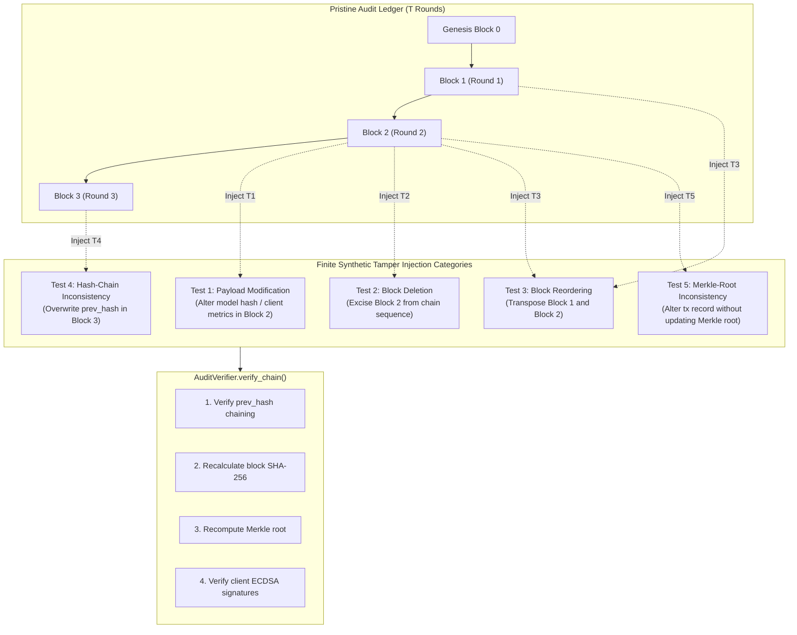
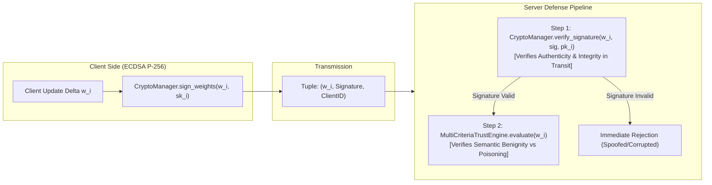

# Stage 2E.2 — Blockchain Tamper-Evidence Metrics & Correct Interpretation
## Evaluation Protocol for Tamper-Evident and Cryptographically Verifiable Audit Ledgers

**Project:** Blockchain-Assisted Privacy-Preserving Federated Learning for Network Intrusion Detection with Trust-Based Security and Cryptographic Auditing  
**Workspace:** `C:\Users\is043\.gemini\antigravity\scratch\blockchain-fl-ids`  
**Milestone:** Stage 2E.2 (Privacy Mechanism Feasibility & Statistical Protocol Clarification)  
**Status:** METHODOLOGICAL AUDIT PROTOCOL (Planning Only — Zero Code Modifications)  
**Date:** November 2026  

---

## 1. Systems Framing & Architectural Demarcation

To ensure scholarly credibility and avoid misleading claims regarding blockchain capabilities, this document establishes the correct technical characterization of the blockchain subsystem implemented in `src/blockchain/`.

### 1.1 Accurate Systems Characterization
The blockchain implementation is strictly characterized as a:
> **Tamper-evident and cryptographically verifiable local audit ledger**

It is an append-only, hash-chained transaction log designed to provide auditable non-repudiation, parameter integrity verification, and historical provenance tracking for federated intrusion detection rounds.

### 1.2 Explicitly Disclaimed Claims
In compliance with research integrity standards, the following descriptions are **prohibited**:
- **Not a Production-Grade Decentralized Blockchain:** The current implementation does not feature a distributed peer-to-peer (P2P) gossip network, Byzantine fault tolerant state machine replication across independent physical machines, or network-level validator node discovery.
- **Not a Decentralized Consensus Protocol:** Consensus is orchestrated locally; there is no live Proof-of-Work mining difficulty competition, Proof-of-Stake validator staking mechanism, or Raft/PBFT consensus message exchange over sockets.
- **Not "Absolutely Immutable":** Immutability is not an inherent magical property; it is an emergent property of distributed consensus with majority honest stake/hashpower. In a local ledger simulation, an entity with local filesystem write access can modify files; however, any such modification is **deterministically detectable** via cryptographic hash mismatch.

---

## 2. Finite Synthetic Tampering Test Suite

Tamper-evidence must be evaluated empirically over an explicitly defined **finite test suite** comprising five distinct attack categories.

### 2.1 Explicit Definitions of the Five Tamper Categories

1. **Category 1: Block Payload Modification (`tamper_payload`)**
   - *Injection Action:* Mutate a single field within the block body (e.g., alter the serialized global model weights hash, client reputation score, or client ID in Block $t \in [1, T-1]$).
   - *Detection Mechanism:* Recalculating the block's SHA-256 header hash fails to match the recorded `block.hash`, and subsequent blocks exhibit broken `prev_hash` pointer chains.
2. **Category 2: Block Deletion (`delete_block`)**
   - *Injection Action:* Excise an intermediate block $t$ from the chain, connecting Block $t-1$ directly to Block $t+1$.
   - *Detection Mechanism:* Block $t+1$ possesses `prev_hash == Hash(Block t)`, which fails to match `Hash(Block t-1)`. Furthermore, block index sequence exhibits a discontinuity ($t-1 \to t+1$).
3. **Category 3: Block Reordering (`reorder_blocks`)**
   - *Injection Action:* Transpose two consecutive intermediate blocks (Block $t$ and Block $t+1$).
   - *Detection Mechanism:* Both `prev_hash` pointers and index ordering break at the transposed positions.
4. **Category 4: Hash-Chain Pointer Inconsistency (`corrupt_hash_chain`)**
   - *Injection Action:* Overwrite the `prev_hash` attribute of Block $t+1$ with an arbitrary random 32-byte hex string.
   - *Detection Mechanism:* Direct pointer comparison `block[t+1].prev_hash == block[t].hash` evaluates to `False`.
5. **Category 5: Merkle Root Inconsistency (`corrupt_merkle_root`)**
   - *Injection Action:* Modify a transaction record inside Block $t$ while forging the block header's `merkle_root` field.
   - *Detection Mechanism:* The recomputed Merkle root from the transaction list fails to match the header `merkle_root`.

---

## 3. Experimental Metrics & Strict Reporting Discipline

### 3.1 Experimental Trial Definitions
For every trial in the verification benchmark:
- **Ground Truth Tampering State ($y_{\text{tamper}} \in \{0, 1\}$):**
  - $y_{\text{tamper}} = 1$: Synthetic tampering was deliberately injected into the ledger.
  - $y_{\text{tamper}} = 0$: The ledger is an untampered, pristine production chain.
- **Auditor Detection Outcome ($\hat{y}_{\text{tamper}} \in \{0, 1\}$):**
  - $\hat{y}_{\text{tamper}} = 1$: `AuditVerifier.verify_chain()` returned `False` and generated an integrity violation alert.
  - $\hat{y}_{\text{tamper}} = 0$: `AuditVerifier.verify_chain()` returned `True` (chain deemed valid).
- **Diagnostics Reported:** Exact corrupted block index $t_{\text{corrupt}}$, failure category, and verification latency in milliseconds ($T_{\text{audit}}$).

### 3.2 Formal Metric Formulations

#### 3.2.1 Observed Detection Rate (Positive Test Suite)
Evaluated across $K = 5$ tampering categories, with $N_{\text{trial}} = 100$ independent trials per category ($500$ total positive trials):
$$\text{Observed Detection Rate} \triangleq \frac{\sum_{i=1}^{500} \mathbb{I}(\hat{y}_i = 1 \mid y_i = 1)}{500}$$

#### 3.2.2 Observed False Alarm Rate (Negative Test Suite)
Evaluated across $M_{\text{trial}} = 100$ independently generated, unperturbed, pristine ledger instances:
$$\text{Observed False Alarm Rate} \triangleq \frac{\sum_{j=1}^{100} \mathbb{I}(\hat{y}_j = 1 \mid y_j = 0)}{100}$$

### 3.3 Strict Reporting Language Discipline

| Forbidden Claim (Overclaim) | Required Scholarly Reporting Format |
|:---|:---|
| *"The blockchain achieves universal $P_D = 1.0$ across all attacks."* | **"Observed Detection Rate: 500/500 (100.0% on the specified finite synthetic tampering test suite)."** |
| *"The system is mathematically proven to have zero false alarms ($P_{\text{FA}} = 0$)."* | **"Observed False Alarm Rate: 0/100 (0.0% across 100 unperturbed pristine audit ledger instances)."** |
| *"The blockchain guarantees immutability of training updates."* | **"The hash-chained audit ledger guarantees tamper-evidence: any retrospective alteration of recorded update hashes or metadata is deterministically detected upon verification."** |

---

## 4. The Functional Role of ECDSA Digital Signatures

A critical conceptual clarification must be maintained regarding the division of responsibility between cryptographic signatures and trust validation:

### 4.1 What ECDSA Digital Signatures Prove
1. **Signer Authenticity (Non-Repudiation):** Proves that the update was generated by the specific entity possessing the private key $\text{sk}_i$ registered to public key $\text{pk}_i$.
2. **Transmission Integrity:** Proves that the parameter vector was not modified in transit between the client and the orchestrator.

### 4.2 What ECDSA Digital Signatures CANNOT Prove
- **Signatures Do NOT Prove Semantic Benignity:**  
  A compromised or malicious client will compute a poisoned update (e.g., label-flipping or sign-flipping) and **sign it with its own legitimate private key**. The cryptographic signature will verify with 100% mathematical validity.
- **The Role of Trust Validation:**  
  Detecting that a cryptographically authentic update contains adversarial poison is strictly and exclusively the responsibility of the **Multi-Criteria Trust Engine** and the **Reputation Manager**.

*Summary Rule:* Cryptography enforces **identity and transport integrity**; trust analytics enforces **behavioral security**.
