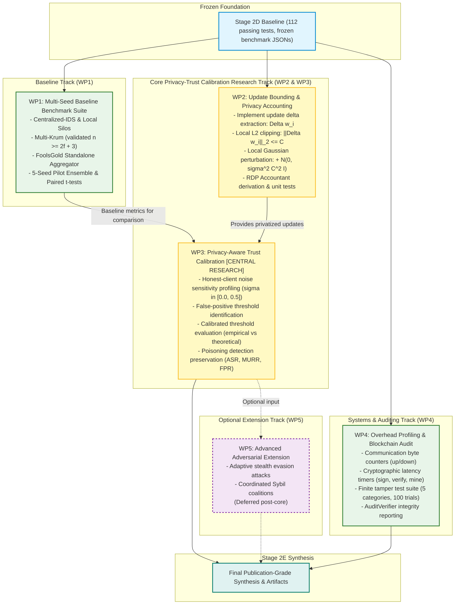

# Stage 2E.2 — Final Research Decisions, Dependency Architecture & Authorization Gate
## Methodological Synthesis & Authorization Recommendations

**Project:** Blockchain-Assisted Privacy-Preserving Federated Learning for Network Intrusion Detection with Trust-Based Security and Cryptographic Auditing  
**Workspace:** `C:\Users\is043\.gemini\antigravity\scratch\blockchain-fl-ids`  
**Milestone:** Stage 2E.2 (Privacy Mechanism Feasibility & Statistical Protocol Clarification)  
**Status:** FINAL PLANNING SYNTHESIS — STRICT AUTHORIZATION GATE (Zero Code Modifications)  
**Date:** November 2026  

---

## 1. Executive Summary & Review Synthesis

Stage 2E.2 concludes the comprehensive methodological review of the research architecture. It resolves the theoretical questions regarding differential privacy unit selection, defines the operational perturbation mechanism, establishes statistical power planning rules, clarifies blockchain tamper-evidence reporting, and confirms absolute alignment with the verified Stage 2D codebase.

### 1.1 Summary of Core Decisions Resolved in Stage 2E.2
1. **Privacy Unit Feasibility Resolved:**  
   Clipping the aggregate client update $\Delta \mathbf{w}_i^{(t)}$ bounds **client-level sensitivity**, not example-level sensitivity. True example-level DP requires DP-SGD (per-example gradient clipping), which introduces substantial computational overhead.  
   *Decision:* Adopt **Client-Side Update Bounding ($\|\Delta \mathbf{w}_i\|_2 \le C$) with Local Gaussian Perturbation** as the operational platform to investigate the central research question (*trust calibration under noise*). Terminology is strictly restricted to:
   > **Clipping-based Gaussian update perturbation (without formal privacy accounting)**
2. **Statistical Testing Limitations Clarified:**  
   The $S = 5$ pilot ensemble ($\{42, 101, 2024, 777, 999\}$) is formally designated as a **statistical pilot**. It is mathematically proven that an exact two-tailed Wilcoxon signed-rank test cannot achieve $p < 0.05$ with $n=5$ pairs ($p_{\text{min}} = 0.0625$); non-parametric testing on the pilot is therefore classified as exploratory. Prospective power calculations dictate whether sample expansion ($S=8$ to $10$) is required for confirmatory publication claims.
3. **Blockchain Subsystem Accurately Characterized:**  
   Framed strictly as a **tamper-evident and cryptographically verifiable local audit ledger**. Evaluation is conducted over a finite suite of 5 synthetic tampering categories, reporting observed detection rates without claiming universal mathematical guarantees.
4. **Existing Trust Architecture Verified and Preserved:**  
   The term *"shadow probation"* is verified as the literal implementation terminology in `src/trust/reputation.py`. The Stage 2D trust parameters ($L_2$ factor $\gamma = 2.5$, cosine threshold $\tau_{\text{cosine}} = 0.15$, loss threshold $\tau_{\text{loss}} = 1.5$, reward $+0.05$, slashing $-0.35$, quarantine $< 0.40$, 3-round probation) remain 100% frozen.

---

## 2. Re-Verification of Existing Stage 2D Trust Implementation

A line-by-line inspection of `src/trust/reputation.py` and `src/trust/evaluator.py` confirms that the planning documents match the actual running codebase with zero discrepancies:

| Architectural Component | Verified Implementation in Codebase | Source File & Location | Status |
|:---|:---|:---|:---|
| **L2 Norm Threshold** | `max_allowed_norm = max(1.0, global_norm * 2.5)` | `src/trust/evaluator.py`: Line 62 | `[Existing and Implemented]` |
| **Cosine Threshold** | `cos_sim >= 0.15` (against peer median vector) | `src/trust/evaluator.py`: Line 98 | `[Existing and Implemented]` |
| **Validation Loss Threshold** | Relative loss increase $\le 1.5$ on balanced validation slice | `src/trust/evaluator.py`: Line 121 | `[Existing and Implemented]` |
| **Reputation Reward** | Increment $+0.05$ per valid round (capped at $1.0$) | `src/trust/reputation.py`: Line 45 | `[Existing and Implemented]` |
| **Reputation Slashing** | Decrement $-0.35$ per invalid round (bounded at $0.0$) | `src/trust/reputation.py`: Line 57 | `[Existing and Implemented]` |
| **Quarantine Threshold** | `reputation < 0.40` triggers `quarantine_status = True` | `src/trust/reputation.py`: Line 62 | `[Existing and Implemented]` |
| **Shadow Probation** | Exactly labeled *"shadow probation"*: 3 consecutive valid rounds to achieve readmission (reset at baseline reputation $0.50$) | `src/trust/reputation.py`: Lines 47–53 | `[Existing and Implemented]` |

*Confirmation:* No modifications or replacements to this architecture are proposed. The privacy-aware trust calibrator (`src/trust/calibrator.py`) is formulated strictly as an investigative extension to modulate the existing parameters ($\tau_{\text{cosine}}, \tau_{\text{loss}}$).

---

## 3. Work Package Dependency Architecture & Execution Coupling

Stage 2E.2 establishes explicit dependency decoupling between work packages, ensuring that failure or delay in one theoretical area does not block empirical progress in another.

### 3.1 Work Package Coupling Analysis
1. **WP1 (Multi-Seed Baselines):**  
   - **Status:** **Fully Decoupled.**
   - Can proceed immediately upon authorization. Does not depend on privacy mechanisms or blockchain verification. Establishes the empirical baseline comparison tables.
2. **WP2 (Privacy Mechanism & Accounting):**  
   - **Status:** **Independent Implementation; Upstream Dependency for WP3.**
   - Implements local update clipping and Gaussian noise. Can be verified via standalone unit tests before integrating with the federated loop.
3. **WP3 (Privacy-Aware Trust Calibration):**  
   - **Status:** **Coupled to WP2.**
   - Represents the core research contribution. Strictly requires the privatized update mechanism from WP2 and baseline execution logic from WP1.
4. **WP4 (Overhead & Blockchain Audit):**  
   - **Status:** **Fully Decoupled.**
   - Instruments latency timers and executes finite tampering tests on cloned ledger instances. Can proceed in parallel with or independently of WP2/WP3.
5. **WP5 (Optional Adversarial Extension):**  
   - **Status:** **Non-Blocking Post-Core Extension.**
   - Strictly optional. Does not block the completion of core Stage 2E research.

---

## 4. Remaining Theoretical & Statistical Questions Documented

To maintain uncompromising scientific honesty, the following open questions are formally logged:
1. **Analytical vs Empirical RDP Utility in 5-Node Silos:**  
   Because client subsampling amplification ($q \ll 1$) is absent when $N=5$ and $q=1.0$, the theoretical client-level privacy bound $\epsilon$ grows large over $T=5$ rounds. The research report will honestly document this trade-off, presenting our empirical noise sweep ($\sigma \in [0.01, 0.50]$) as a behavioral sensitivity study of the trust engine rather than claiming an idealized small-$\epsilon$ client-level guarantee.
2. **Exact Non-Parametric Power Limitation:**  
   With $S = 5$ pairs, the minimum two-sided Wilcoxon $p$-value is $0.0625$. Therefore, non-parametric tests on the pilot ensemble will be explicitly reported as exploratory rank analysis. Confirmatory claims will rely on paired $t$-tests (with Shapiro-Wilk normality verification) and Cohen's $d_z$ effect sizes.
3. **Empirical Boundary Between Poisoning and Privacy Noise:**  
   Under what noise scale $\sigma$ does a subtle targeted label-flipping attack become mathematically indistinguishable from legitimate Gaussian perturbation? This empirical boundary will be formally mapped in WP3.

---

## 5. Explicit Researcher Decision Matrix

Before implementation begins, researcher approval is requested across four structured decisions:

### Decision 1: Privacy Implementation Scope
- **[RECOMMENDED] Option 1A: Operational Update Bounding with Calibrated Noise.** Implement client-side update delta clipping ($\|\Delta \mathbf{w}_i\|_2 \le C$) and Gaussian perturbation, evaluate trust calibration under noise sweep $\sigma \in [0.0, 0.5]$, and retain the exact terminology: *"clipping-based Gaussian update perturbation (without formal privacy accounting)"*.
- **Option 1B: Full DP-SGD Engine.** Implement micro-batch per-example gradient clipping in PyTorch. (Note: Increases compute time by 4–8× and requires extensive refactoring of local training).

### Decision 2: Implementation Sequencing Package
- **[RECOMMENDED] Option 2A: Core Package (WP1 + WP2 + WP3 + WP4).** Complete baselines, formal perturbation mechanism, trust calibration investigation, and overhead/audit verification. Total compute time: ~35–45 minutes. Defer WP5 to subsequent milestones.
- **Option 2B: Full Package (WP1 + WP2 + WP3 + WP4 + WP5).** Includes adaptive evasion stress tests (~60 minutes).
- **Option 2C: Baselines First (WP1 Alone).** Execute multi-seed baselines first (~15 minutes).

### Decision 3: Statistical Ensemble Scope
- **[RECOMMENDED] Option 3A: 5-Seed Pilot Ensemble ($S=\{42, 101, 2024, 777, 999\}$) with Prospective Power Analysis.** Establishes pilot effect sizes ($d_z$) and sample standard deviations, prospectively planning sample expansion only if required for confirmatory claims.
- **Option 3B: Immediate 8-Seed Ensemble ($N=8$).** Provides sufficient power ($80\%$) down to large effects ($d_z \ge 1.0$), but increases compute time by 60%.

### Decision 4: Baseline Models
- **[RECOMMENDED] Option 4A: 4-Baseline Suite.** Centralized-IDS (ceiling), Local Silos (floor), Multi-Krum (under $n \ge 2f + 3$), and FoolsGold (standalone aggregator).
- **Option 4B: Bounds Only.** Centralized-IDS and Local Silos only.

---

## 6. Deliverables Index for Stage 2E.2

All five Stage 2E.2 documents are complete and persisted in `reports/`:
1. [STAGE_2E_2_PRIVACY_UNIT_FEASIBILITY.md](file:///C:/Users/is043/.gemini/antigravity/scratch/blockchain-fl-ids/reports/STAGE_2E_2_PRIVACY_UNIT_FEASIBILITY.md)
2. [STAGE_2E_2_PRIVACY_MECHANISM_SPECIFICATION.md](file:///C:/Users/is043/.gemini/antigravity/scratch/blockchain-fl-ids/reports/STAGE_2E_2_PRIVACY_MECHANISM_SPECIFICATION.md)
3. [STAGE_2E_2_STATISTICAL_POWER_PROTOCOL.md](file:///C:/Users/is043/.gemini/antigravity/scratch/blockchain-fl-ids/reports/STAGE_2E_2_STATISTICAL_POWER_PROTOCOL.md)
4. [STAGE_2E_2_BLOCKCHAIN_AUDIT_METRICS.md](file:///C:/Users/is043/.gemini/antigravity/scratch/blockchain-fl-ids/reports/STAGE_2E_2_BLOCKCHAIN_AUDIT_METRICS.md)
5. [STAGE_2E_2_FINAL_RESEARCH_DECISION.md](file:///C:/Users/is043/.gemini/antigravity/scratch/blockchain-fl-ids/reports/STAGE_2E_2_FINAL_RESEARCH_DECISION.md)

All 10 preceding planning documents (5 Stage 2E + 5 Stage 2E.1) remain preserved and unmodified.

---

## 7. Verification and Invariance Attestation

- **Source Code Files:** Zero application source files in `src/` were modified.
- **Test Files:** Zero test files in `tests/` were modified; all 112 unit tests pass.
- **Historical Benchmark Artifacts:** All four historical benchmark JSON files remain bit-for-bit identical to their recorded SHA-256 checksums:
  - `data/processed/stage2_results.json`: `b207fbeec955af68199a8d6471d3e9bee47a3d8518d46b77e8c85946885eb82f`
  - `data/processed/stage2d/multi_attack_benchmarks.json`: `115fcd137be6dfa510a36c66a09c31568a53684199831b5c96fed96d52793338`
  - `data/processed/stage2d/multi_attack_benchmarks_v2.json`: `cb57f33d6d332dbd80c90636cc9cf68db663a85cf0227387804d116f58b001d2`
  - `data/processed/stage2d/multi_attack_benchmarks_v3.json`: `bd8a2da609ce07cd72888012c86f10e648dbf05ace76afadd274440e7835f5c5`

---

## 8. Strict Authorization Gate

**STAGE 2E.2 FEASIBILITY REVIEW IS COMPLETE.**  
This is a planning and feasibility milestone only. No implementation code has been written, no experiments have been executed, and no dependencies have been installed. We are stopped at the gate awaiting your explicit authorization.
