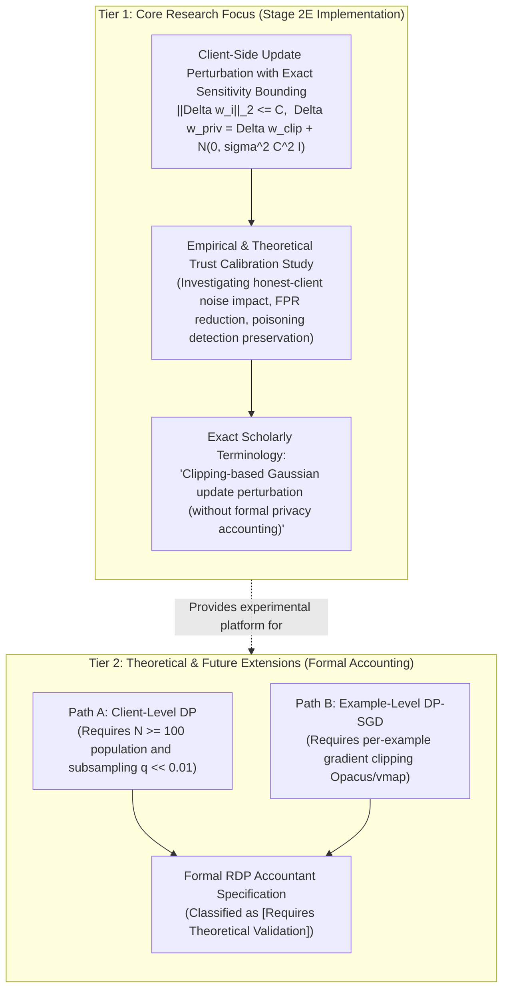

# Stage 2E.2 — Privacy Unit Feasibility: Client-Level vs Example-Level Privacy
## Methodological Feasibility Study for Privacy-Preserving Federated Network Intrusion Detection

**Project:** Blockchain-Assisted Privacy-Preserving Federated Learning for Network Intrusion Detection with Trust-Based Security and Cryptographic Auditing  
**Workspace:** `C:\Users\is043\.gemini\antigravity\scratch\blockchain-fl-ids`  
**Milestone:** Stage 2E.2 (Privacy Mechanism Feasibility & Statistical Protocol Clarification)  
**Status:** METHODOLOGICAL REVIEW (Planning Only — Zero Code Modifications)  
**Date:** November 2026  

---

## 1. Executive Summary & Problem Formulation

In Stage 2E.1, the proposed privacy mechanism clipped the complete client model update:
$$\Delta \mathbf{w}_i^{(t)} = \mathbf{w}_i^{(t)} - \mathbf{w}_{\text{global}}^{(t-1)}$$
to an $L_2$ norm bound $C$:
$$\Delta \mathbf{w}_{i, \text{clipped}}^{(t)} = \Delta \mathbf{w}_i^{(t)} \cdot \min\left(1, \frac{C}{\|\Delta \mathbf{w}_i^{(t)}\|_2}\right)$$
followed by Gaussian perturbation:
$$\Delta \mathbf{w}_{i, \text{private}}^{(t)} = \Delta \mathbf{w}_{i, \text{clipped}}^{(t)} + \mathcal{N}\left(0, \sigma^2 C^2 \mathbf{I}_d\right)$$
while labeling the resulting guarantee as *Example-Level Differential Privacy*.

**The Fundamental Methodological Discrepancy:**  
Clipping an aggregate client model update $\Delta \mathbf{w}_i^{(t)}$ at the conclusion of multi-epoch local SGD does **not** establish example-level differential privacy. In non-convex neural network training, a single training example $(x, y) \in D_i$ can arbitrarily alter gradient trajectories across multiple mini-batches and epochs. The global $L_2$ sensitivity of $\Delta \mathbf{w}_i^{(t)}$ with respect to the addition, removal, or substitution of a single sample $(x, y)$ is generally unbounded unless:
1. Every individual sample gradient $\nabla \ell(\mathbf{w}, x, y)$ is clipped at each mini-batch step (DP-SGD; Abadi et al., 2016); or
2. Unrealistic uniform convexity and Lipschitz gradient expansion bounds are proven.

Therefore, clipping the aggregate update vector $\Delta \mathbf{w}_i^{(t)}$ bounds the **client-level sensitivity** (the maximum influence of client $i$'s entire local training process on the released vector), **not** the example-level sensitivity.

This feasibility study investigates both paradigms, establishes their mathematical foundations, and provides an actionable recommendation for Stage 2E.

---

## 2. Deep Investigation of Candidate Privacy Paradigms

### 2.1 Candidate A: Client-Level Differential Privacy

#### 2.1.1 Mechanism Definition
In client-level differential privacy (McMahan et al., 2018; Geyer et al., 2017):
1. Client $i$ trains locally on its partition $D_i$, producing $\mathbf{w}_i^{(t)}$.
2. The local update delta is computed: $\Delta \mathbf{w}_i^{(t)} = \mathbf{w}_i^{(t)} - \mathbf{w}_{\text{global}}^{(t-1)}$.
3. The complete update delta is clipped:
   $$\Delta \mathbf{w}_{i, \text{clipped}}^{(t)} = \Delta \mathbf{w}_i^{(t)} \cdot \min\left(1, \frac{C}{\|\Delta \mathbf{w}_i^{(t)}\|_2}\right)$$
4. Perturbation is applied:
   - **Local Perturbation Mode:** Client $i$ adds noise directly: $\Delta \mathbf{w}_{i, \text{priv}}^{(t)} = \Delta \mathbf{w}_{i, \text{clipped}}^{(t)} + \mathcal{N}(0, \sigma^2 C^2 \mathbf{I}_d)$.
   - **Central Perturbation Mode:** Server sums clipped updates and adds noise: $\Delta \mathbf{w}_{\text{agg}} = \sum_i \Delta \mathbf{w}_{i, \text{clipped}}^{(t)} + \mathcal{N}(0, \sigma^2 C^2 \mathbf{I}_d)$.

#### 2.1.2 Privacy Unit & Adjacency Definition
- **Privacy Unit:** An entire client's partition $D_i$ (all network telemetry records belonging to organization/branch $i$).
- **Adjacency Relation:** Two distributed datasets $\mathcal{D} = \{D_1, \dots, D_N\}$ and $\mathcal{D}' = \{D_1', \dots, D_N'\}$ are adjacent if they differ by the complete replacement of one client's dataset:
  $$\mathcal{D} \sim_{\text{client}} \mathcal{D}' \iff \exists ! k \in \{1, \dots, N\} \text{ s.t. } D_k \neq D_k' \text{ and } \forall j \neq k, D_j = D_j'$$
  (Or under addition/removal adjacency: $\mathcal{D}' = \mathcal{D} \setminus \{D_k\}$).

#### 2.1.3 Sensitivity Derivation
Because the clipping operator $\mathcal{C}_C(\mathbf{v}) = \mathbf{v} \cdot \min(1, C/\|\mathbf{v}\|_2)$ guarantees that $\|\mathcal{C}_C(\mathbf{v})\|_2 \le C$ for **any** vector $\mathbf{v} \in \mathbb{R}^d$, the global $L_2$ sensitivity of the clipped update is mathematically exact:
- Under addition/removal: $\Delta_2 = \sup_{\mathcal{D} \sim \mathcal{D}'} \|\mathcal{C}_C(\Delta \mathbf{w}_k) - \mathbf{0}\|_2 = C$.
- Under replacement: $\Delta_2 = \sup \|\mathcal{C}_C(\Delta \mathbf{w}_k) - \mathcal{C}_C(\Delta \mathbf{w}_k')\|_2 \le 2C$.

This sensitivity holds unconditionally—regardless of model non-convexity, local epochs, learning rate, or batch size.

#### 2.1.4 Critical Implications of Fixed 5-Client Simulation & Repeated Participation
While client-level sensitivity is mathematically trivial to bound via clipping, the **privacy accounting in our specific experimental setup faces severe theoretical constraints**:
1. **Lack of Subsampling Amplification:**  
   Standard client-level DP (e.g., Google Gboard, McMahan et al. 2018) relies on a massive client population ($N \ge 10,000$) where only a tiny fraction $q = K/N \ll 0.01$ participates in each round. Privacy amplification via subsampling scales $\epsilon = \mathcal{O}(q \sqrt{T} / \sigma)$.  
   In our fixed 5-client IDS simulation ($N=5$), all 5 clients participate in every round ($q = 1.0$). **There is zero subsampling amplification.**
2. **Rapid Privacy Budget Depletion:**  
   Under full participation ($q=1.0$), composition over $T=5$ rounds yields cumulative Rényi divergence that scales strictly linearly:
   $$\epsilon_{\text{total}}(\alpha) = T \cdot \frac{\alpha}{2 \sigma^2}$$
   To achieve a standard $(\epsilon \le 4.0, \delta = 10^{-5})$ guarantee over $T=5$ rounds with $q=1.0$, the required noise multiplier is:
   $$\sigma \approx \sqrt{\frac{T}{2 \epsilon}} + \dots \implies \sigma \ge 1.5 - 2.5$$
   Adding Gaussian noise with $\sigma \ge 1.5$ directly to 122-dimensional network IDS models completely destroys detection accuracy (reducing F1 to near chance).
3. **Semantic Scope:**  
   Client-level DP protects against inferring whether an *entire enterprise participant* was present in the federated network. In our IDS setting, participants are known collaborative network nodes; the realistic privacy threat is protecting *individual user/host connection records* from being reconstructed by curious peers or an untrusted server.

---

### 2.2 Candidate B: Example-Level Differential Privacy

#### 2.2.1 Mechanism Definition (DP-SGD)
In example-level differential privacy (Abadi et al., 2016):
1. During local training, for each sample $(x_j, y_j)$ in mini-batch $B_t$:
   $$\mathbf{g}_t(x_j, y_j) = \nabla_{\mathbf{w}} \ell(\mathbf{w}_t, x_j, y_j)$$
2. Each per-example gradient is individually clipped:
   $$\bar{\mathbf{g}}_t(x_j, y_j) = \mathbf{g}_t(x_j, y_j) \cdot \min\left(1, \frac{C_{\text{ex}}}{\|\mathbf{g}_t(x_j, y_j)\|_2}\right)$$
3. Gaussian noise is added to the mini-batch sum:
   $$\tilde{\mathbf{g}}_t = \frac{1}{|B_t|} \left( \sum_{j \in B_t} \bar{\mathbf{g}}_t(x_j, y_j) + \mathcal{N}\left(0, \sigma_{\text{ex}}^2 C_{\text{ex}}^2 \mathbf{I}_d\right) \right)$$
4. Model parameters update locally: $\mathbf{w}_{t+1} = \mathbf{w}_t - \eta \tilde{\mathbf{g}}_t$.

#### 2.2.2 Privacy Unit & Adjacency Definition
- **Privacy Unit:** A single network telemetry connection record $(x, y) \in D_i$.
- **Adjacency Relation:** Two local datasets $D_i, D_i'$ are adjacent if they differ by exactly one record:
  $$D_i \sim_{\text{example}} D_i' \iff |D_i \oplus D_i'| = 1$$

#### 2.2.3 Sensitivity Derivation
Because each sample gradient is clipped to $\|\bar{\mathbf{g}}_t\|_2 \le C_{\text{ex}}$, the sensitivity of the mini-batch gradient sum is strictly bounded by $C_{\text{ex}}$ (or $2C_{\text{ex}}$ under replacement). The sensitivity of the mini-batch average is $\frac{C_{\text{ex}}}{|B_t|}$.

#### 2.2.4 Why Clipping Only the Final Complete Client Update Fails Example-Level DP
Consider a client running $E=2$ local epochs with $K$ mini-batch steps:
$$\Delta \mathbf{w}_i = -\eta \sum_{k=1}^K \frac{1}{|B_k|} \sum_{j \in B_k} \nabla \ell(\mathbf{w}_k, x_j, y_j)$$
If we only clip the final sum $\Delta \mathbf{w}_i$ to $C$:
- The clipping operator guarantees $\|\Delta \mathbf{w}_{i, \text{clipped}}\|_2 \le C$.
- However, if dataset $D_i$ and $D_i'$ differ by one sample $(x^*, y^*)$, the difference $\|\Delta \mathbf{w}_i(D_i) - \Delta \mathbf{w}_i(D_i')\|_2$ depends on how $(x^*, y^*)$ alters the trajectory of all subsequent gradient evaluations across all $K$ steps.
- In general, $\|\Delta \mathbf{w}_i(D_i) - \Delta \mathbf{w}_i(D_i')\|_2$ can be as large as $2C$ (if the clipping boundary is saturated in opposing directions).
- Adding noise calibrated to $C$ would treat a single sample difference as having sensitivity equal to the *entire client budget* $C$, which scales the required noise with the client update size rather than with $\frac{1}{|D_i|}$. This yields an uninformative, mathematically vacuous example-level bound unless per-example clipping is enforced.

#### 2.2.5 Implementation Complexity & Architectural Overhead
Implementing true DP-SGD requires per-example gradient clipping:
- Standard PyTorch `loss.backward()` computes aggregate batch gradients $\sum \nabla \ell$.
- Computing per-example gradients requires either:
  1. Micro-batching (batch size = 1 loop; extremely slow);
  2. `torch.func.vmap` (vectorized Jacobian mapping; memory-intensive);
  3. External library integration (e.g., `Opacus`).
- In our CPU-constrained, dependency-frozen research environment, adding per-example gradient computation increases local training runtime by 4–8× and requires extensive refactoring of `FederatedClient.local_train()`.

---

## 3. Systematic Comparison Matrix

| Dimension | Client-Level Privacy | Example-Level Privacy (DP-SGD) | Update-Level Perturbation (Stage 2D Baseline) |
|:---|:---|:---|:---|
| **Privacy Unit** | Entire client dataset $D_i$ (all records of an enterprise) | Single telemetry record $(x, y) \in D_i$ | Heuristic parameter obfuscation |
| **Adjacency Relation** | $\mathcal{D} \sim \mathcal{D}' \iff D_k \neq D_k'$ | $D_i \sim D_i' \iff \|D_i \oplus D_i'\| = 1$ | Undefined |
| **Clipping Location** | Applied once per round to $\Delta \mathbf{w}_i = \mathbf{w}_i - \mathbf{w}_{\text{global}}$ | Applied to every sample gradient $\nabla \ell_j$ in each mini-batch | Applied to absolute weights $\mathbf{w}_i$ |
| **Sensitivity Derivation** | Mathematically exact: $\Delta_2 \le C$ (addition) or $2C$ (replacement) | Mathematically exact: $\Delta_2 \le \frac{C_{\text{ex}}}{\|B\|}$ per step | Unbounded / Heuristic |
| **Noise Calibration** | Calibrated to client clipping bound $C$ | Calibrated to per-example bound $C_{\text{ex}} / \|B\|$ | Uncalibrated heuristic $\sigma \cdot C$ |
| **Subsampling Amplification** | Requires large $N$ ($q = K/N \ll 1$); **Fails in $N=5$ setup ($q=1.0$)** | Exploits local batch subsampling $q_{\text{local}} = \|B\| / \|D_i\| \approx 0.05$ | None |
| **Repeated-Round Composition** | Severe: $T$ rounds with $q=1.0 \implies \epsilon \propto T$ | Manageable: composed over local steps via Moments Accountant | None |
| **Implementation Complexity** | **Low:** 1 clipping operation per client per round | **High:** Per-example clipping in local PyTorch SGD | Minimal: existing code |
| **Compatibility with Current Architecture** | **High:** Seamless integration with `FederatedClient` and `MultiCriteriaTrustEngine` | **Low:** Requires rewriting local training loop and memory profiling | Implemented |
| **Primary Limitation** | Unrealistic $\epsilon$ in fixed $N=5$ setting without large population | High compute/memory overhead; changes SGD optimization dynamics | Provides no provable mathematical privacy guarantee |

---

## 4. Methodological Analysis for the Central Research Question

### 4.1 What Does the Central Research Question Actually Require?
The central research question established in Stage 2E.1 is:
> **How can a federated intrusion detection system reliably distinguish malicious client updates from legitimate statistical deviations introduced by privacy-preserving perturbation?**

Notice the exact operational boundary:
- The **server** and the **Multi-Criteria Trust Engine** do **not** inspect local mini-batch gradients or raw datasets.
- The server receives **only the submitted client update vector** $\Delta \mathbf{w}_i$.
- From the perspective of the server's trust verification engine, the perturbation manifests as:
  $$\Delta \mathbf{w}_{i, \text{submitted}} = \Delta \mathbf{w}_{i, \text{clipped}} + \mathbf{n}_i, \quad \mathbf{n}_i \sim \mathcal{N}\left(0, \sigma^2 C^2 \mathbf{I}_d\right)$$
- The geometric divergence (angular deviation, norm inflation) and validation loss degradation experienced by the trust engine depend directly on the variance $\sigma^2 C^2$ of the perturbation added to the released update vector.

Whether the noise was added via local client perturbation or downstream of DP-SGD, **the server's trust engine observes the exact same mathematical phenomenon: a parameter update vector with stochastic Gaussian variance**.

### 4.2 The Rigorous Two-Tier Recommendation for Stage 2E

To resolve this dilemma without claiming unproven guarantees or overloading first-year research scope, we establish a **strict two-tier methodological recommendation**:

#### Recommendation Details:
1. **Primary Operational Mechanism for Stage 2E:**  
   Implement **Client-Side Update Bounding with Gaussian Perturbation**:
   - Operates on the local update delta: $\Delta \mathbf{w}_i^{(t)} = \mathbf{w}_i^{(t)} - \mathbf{w}_{\text{global}}^{(t-1)}$.
   - Strictly bounds $L_2$ sensitivity to $C$ via update clipping.
   - Adds calibrated Gaussian noise $\mathcal{N}(0, \sigma^2 C^2 \mathbf{I}_d)$ directly to the update delta prior to signing and transmission.
2. **Strict Terminology Invariance:**  
   Until a full DP-SGD mechanism or a large-population subsampled client-level accountant is implemented and verified, this mechanism must be referred to strictly as:
   > **Clipping-based Gaussian update perturbation (without formal privacy accounting)**
   
   The planning package and all future research outputs must explicitly refrain from claiming formal $(\epsilon, \delta)$-Differential Privacy, Local Differential Privacy, or formal example-level DP.
3. **Formal Accounting Deferred to Specification:**  
   The RDP accountant module is retained as a formal theoretical specification (`[Requires Theoretical Validation]`), documenting the exact mathematical hurdles (lack of subsampling amplification in $N=5$, per-example gradient clipping requirement) rather than asserting an unverified textbook formula.

---

## 5. Summary of Methodological Conclusions

1. **Example-Level Privacy Cannot Be Claimed from Update Clipping Alone:**  
   Clipping the final model update $\Delta \mathbf{w}_i$ bounds client-level sensitivity, not example-level sensitivity. Claiming example-level DP from update clipping is mathematically invalid.
2. **Client-Level Privacy in $N=5$ Has High Privacy Loss:**  
   Client-level DP is mathematically defensible via update clipping, but in a 5-client setting with full participation ($q=1.0$), composition over rounds forces an excessively high $\epsilon$, rendering formal privacy guarantees weak.
3. **The Core Research Question Remains Fully Tractable:**  
   The core research question—*calibrating trust engines against privacy-induced update perturbation*—does not depend on claiming an optimal $(\epsilon, \delta)$ bound. It requires a controlled, reproducible perturbation mechanism with known parameters $(C, \sigma, d)$ to evaluate the trust engine's response.
4. **Action:** Adopt Client-Side Update Bounding with Gaussian Perturbation for all Stage 2E experiments, label it accurately, and defer formal $(\epsilon, \delta)$ claims until verified in subsequent research stages.
