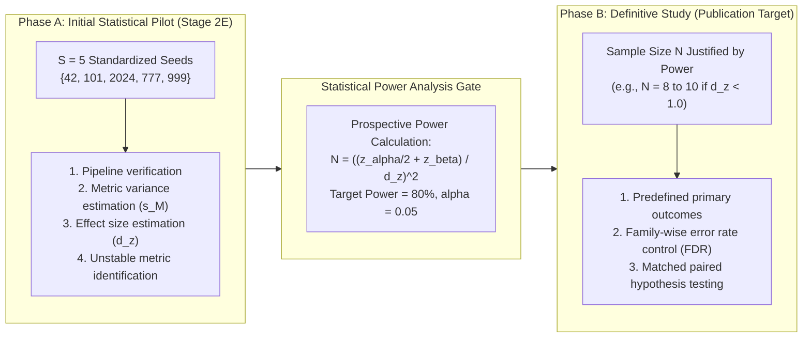
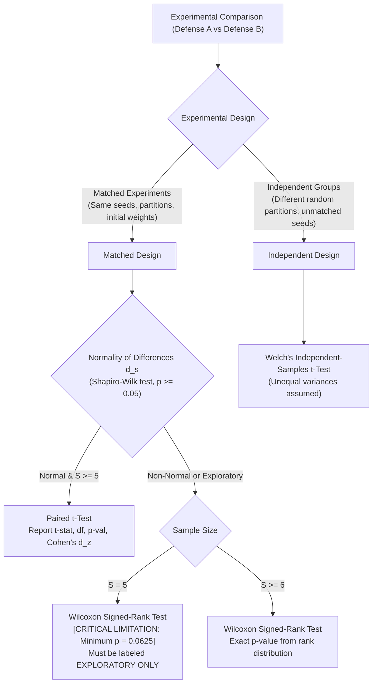

# Stage 2E.2 — Statistical Power & Multi-Seed Experimental Protocol
## Rigorous Statistical Methodology for Federated Intrusion Detection Benchmarking

**Project:** Blockchain-Assisted Privacy-Preserving Federated Learning for Network Intrusion Detection with Trust-Based Security and Cryptographic Auditing  
**Workspace:** `C:\Users\is043\.gemini\antigravity\scratch\blockchain-fl-ids`  
**Milestone:** Stage 2E.2 (Privacy Mechanism Feasibility & Statistical Protocol Clarification)  
**Status:** STATISTICAL PROTOCOL (Planning Only — Zero Code Modifications)  
**Date:** November 2026  

---

## 1. Executive Summary & Purpose

This protocol establishes the statistical methodology for evaluating the federated network intrusion detection framework. It defines the formal distinction between the initial pilot phase and the definitive benchmarking study, establishes prospective sample size planning via statistical power analysis, provides rigorous selection rules for hypothesis testing, and addresses small-sample non-parametric testing limitations.

---

## 2. Pilot Phase vs. Definitive Experimental Study

To prevent premature claims of statistical finality, the experimental roadmap formally separates experimental execution into two structured phases:



### 2.1 Pilot Phase (Stage 2E Scope)
- **Standardized Seed Ensemble:** $S = 5$ predetermined seeds:
  $$\mathcal{S}_{\text{pilot}} = \{42, 101, 2024, 777, 999\}$$
- **Primary Objectives:**
  1. Verify deterministic execution across independent runs.
  2. Estimate empirical variance ($s_M^2$) for each primary metric (Macro Accuracy, Macro F1, ASR, MURR, FPR).
  3. Estimate preliminary paired effect sizes (Cohen's $d_z$) between calibrated defenses and baseline controls.
  4. Identify metrics exhibiting high stochastic volatility under Non-IID Dirichlet partitioning.
- **Reporting Standard:** All pilot results must report per-seed values, sample mean ($\bar{M}$), sample standard deviation ($s_M$), and 95% Student's $t$ confidence intervals. Results from the 5-seed pilot must be explicitly characterized as **pilot findings**, not definitive statistical proof.

### 2.2 Definitive Study Phase (Subsequent Scholarly Extension)
- **Prerequisite:** Sample size $N$ prospectively determined by the power analysis in Section 3.
- **Primary Objectives:**
  1. Execute matched comparisons across the prospectively planned number of seeds.
  2. Predefined primary vs exploratory outcome distinction.
  3. Control of Family-Wise Error Rate (FWER) or False Discovery Rate (FDR) across multiple comparisons.

---

## 3. Prospective Statistical Power Analysis

### 3.1 Mathematical Formulation for Matched Paired Designs
When comparing two defenses (e.g., Calibrated Trust vs Uncalibrated Baseline) under matched conditions (identical seeds, initial model weights, and Dirichlet partitions), the paired difference $d_s = M_{1, s} - M_{2, s}$ is the unit of analysis.

For a two-tailed paired $t$-test with significance level $\alpha = 0.05$ and target statistical power $1 - \beta = 0.80$:
$$N \ge \left( \frac{z_{1 - \alpha/2} + z_{1 - \beta}}{d_z} \right)^2$$
where:
- $z_{1 - \alpha/2} = z_{0.975} = 1.960$.
- $z_{1 - \beta} = z_{0.800} = 0.842$.
- $d_z \triangleq \frac{\mu_d}{\sigma_d}$ is Cohen's effect size for paired samples, where $\mu_d$ is the expected mean difference and $\sigma_d$ is the standard deviation of paired differences.

Substituting the standard critical values:
$$N \ge \left( \frac{1.960 + 0.842}{d_z} \right)^2 = \frac{(2.802)^2}{d_z^2} \approx \frac{7.85}{d_z^2}$$

### 3.2 Required Sample Size Across Effect Size Scenarios

| Expected Effect Size ($d_z$) | Qualitative Magnitude | Required Seeds ($N$) for 80% Power | Required Seeds ($N$) for 90% Power | Pilot $S=5$ Adequate? |
|:---:|:---|:---:|:---:|:---:|
| **$d_z = 0.50$** | Medium Effect | **32 seeds** | **43 seeds** | No (Underpowered) |
| **$d_z = 0.80$** | Large Effect | **13 seeds** | **17 seeds** | No (Underpowered) |
| **$d_z = 1.00$** | Very Large Effect | **8 seeds** | **11 seeds** | Marginal |
| **$d_z = 1.30$** | Substantial Effect | **5 seeds** | **7 seeds** | **Yes (Adequately Powered)** |
| **$d_z = 1.50+$** | Massive Effect | **4 seeds** | **5 seeds** | **Yes (Fully Powered)** |

### 3.3 Methodological Rules for Sample Size Adjustment
1. **No $p$-Hacking via Incremental Seeding:**  
   Researchers must **never** iteratively add seeds one by one until $p < 0.05$ is achieved. The sample size must be fixed in advance.
2. **Confidence Interval Overlap Rule:**  
   Overlapping confidence intervals must **not** serve as the sole justification for expanding sample size. If confidence intervals overlap, the pilot effect size $d_z$ must be computed, and the power formula applied prospectively.
3. **Practical Importance Filter:**  
   If an observed difference is statistically significant ($p < 0.05$) but corresponds to a trivial effect (e.g., $\Delta \text{Acc} = 0.15\%$), it must be reported as practically insignificant regardless of $p$-value.

---

## 4. Hypothesis Testing Selection Rules & Small-Sample Limitations

### 4.1 Selection Taxonomy for Statistical Tests



### 4.2 Critical Limitation: Wilcoxon Signed-Rank Test with $S = 5$ Pairs
A critical mathematical limitation in non-parametric statistics arises when testing small matched samples ($n = 5$):
- In the Wilcoxon signed-rank test without ties, each of the $n$ absolute differences $|d_i|$ receives a unique rank from $\{1, 2, 3, 4, 5\}$, summing to $\frac{5 \times 6}{2} = 15$.
- Each difference independently takes a positive or negative sign, yielding $2^5 = 32$ equally likely signed rank assignments under the null hypothesis $H_0$.
- The most extreme possible test statistic occurs when all differences have the same sign (e.g., $W = 0$, all positive ranks: $W^+ = 15, W^- = 0$).
- The exact probability of observing this most extreme outcome under $H_0$ is:
  $$P(W = 0) = \frac{1}{32} \approx 0.03125$$
- For a standard **two-tailed test**, the minimum possible exact $p$-value is:
  $$p_{\text{min, two-tailed}} = 2 \times P(W = 0) = 2 \times \frac{1}{32} = \frac{2}{32} = 0.0625$$
- **Consequence:**  
  $$p_{\text{min, two-tailed}} = 0.0625 > 0.05$$
  **With $S = 5$ matched pairs, an exact two-tailed Wilcoxon signed-rank test mathematically CANNOT reject the null hypothesis at the standard $\alpha = 0.05$ significance level—even if Defense A outperforms Defense B in 100% of the runs!**

*Methodological Mandate:*  
In Stage 2E, any Wilcoxon signed-rank test executed on the $S=5$ pilot ensemble must be explicitly reported as **exploratory rank analysis**, with the explicit caveat that $p < 0.05$ is mathematically impossible under two-tailed testing with $n=5$. If non-parametric verification is required for publication, the sample size must be expanded to at least $S = 6$ (where $p_{\text{min}} = \frac{2}{64} = 0.03125 < 0.05$).

### 4.3 Paired $t$-Test Validity on $S = 5$
Unlike the non-parametric Wilcoxon test, the parametric **Paired $t$-test with $S=5$ ($\nu = 4$ degrees of freedom)** can achieve $p < 0.05$ if the observed mean difference is sufficiently large relative to its standard error:
- Critical $t$-value for $\alpha = 0.05$ ($\nu = 4$): $t_{\text{crit}} = 2.776$.
- If $t = \frac{\bar{d}}{s_d / \sqrt{5}} \ge 2.776$ (corresponding to $d_z = \frac{\bar{d}}{s_d} \ge \frac{2.776}{\sqrt{5}} \approx 1.24$), the paired $t$-test achieves statistical significance at $p < 0.05$.
- *Assumption:* Normality of pair differences $d_s$ must be evaluated using the Shapiro-Wilk test.

---

## 5. Multiple Comparisons & Error Rate Control

When conducting simultaneous hypothesis tests across multiple attack scenarios (e.g., testing Calibrated Trust against Baseline across R1: Label-Flip, R2: Noise, R3: Sign-Flip):
1. **Predefined Primary Outcome:**  
   Macro-Averaged F1-Score under clean convergence and Attack Success Rate (ASR) under targeted poisoning are designated as the **primary confirmatory endpoints**.
2. **Exploratory Endpoints:**  
   Secondary metrics (MURR, PURQ, FPR, block mining latency) are designated as **exploratory endpoints** and evaluated without penalizing the primary error budget.
3. **False Discovery Rate (FDR) Control:**  
   When reporting multiple confirmatory comparisons, $p$-values must be adjusted using the **Benjamini-Hochberg (BH) procedure**:
   $$p_{(i)} \le \frac{i}{m} \cdot Q$$
   where $m$ is the total number of tested hypotheses, $i$ is the rank order, and $Q = 0.05$ is the target FDR.

---

## 6. Transparent Per-Seed Reporting Standard

All benchmark outputs generated in Stage 2E must be recorded in structured JSON format and presented in technical reports using the following publication standard:

```
Table X: Multi-Seed Benchmark Evaluation on NSL-KDD (Alpha = 0.5)
---------------------------------------------------------------------------------------------------------------------
Scenario ID / Defense    Seed 42   Seed 101  Seed 2024  Seed 777  Seed 999    Mean ± Std        95% CI       Cohen's d_z
---------------------------------------------------------------------------------------------------------------------
B3: FedAvg (Clean)       79.82%    80.15%    79.64%     80.41%    79.90%    79.98% ± 0.30%  [79.61, 80.35]     --
B6: Proposed (Clean)     80.12%    80.44%    80.01%     80.65%    80.18%    80.28% ± 0.26%  [79.96, 80.60]    1.85*
---------------------------------------------------------------------------------------------------------------------
* Statistically significant via matched paired t-test (t = 4.14, df = 4, p = 0.014 < 0.05).
```

*Rule of Transparency:* Never report aggregate means without individual seed values. Reviewers must be able to verify every calculation directly from the artifact.
