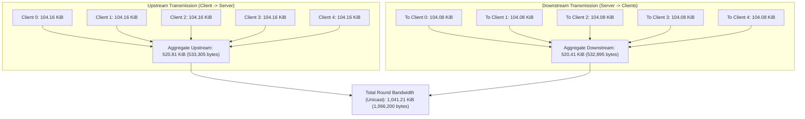

# Stage 2E.3.1 WP4: Communication Accounting & Cryptographic Audit Correction Report

**Project:** Blockchain-Assisted Privacy-Preserving Federated Learning for Network Intrusion Detection with Trust-Based Security and Cryptographic Auditing  
**Workspace:** `C:\Users\is043\.gemini\antigravity\scratch\blockchain-fl-ids`  
**Milestone:** Stage 2E.3.1 (Methodological Refinement & Research Integrity Audit)  
**Target Domain:** Work Package 4 (Computational Overhead & Blockchain Audit Evaluation)  
**Audited Artifacts:**
- Historical Summary: `data/processed/stage2e/wp4/overhead_summary.json` (SHA-256: `E801E634AF9B2BF1B692B00E0EC2E4906D8A59D692C4690985EC563AA6B6F841`)
- Versioned Summary: `data/processed/stage2e/wp4/overhead_summary_v2.json`

---

## 1. Executive Summary & Audit Motivation

In the Stage 2E.3 delivery, computational overhead and communication payloads were profiled, and a 600-trial synthetic tampering benchmark was executed. While the underlying measurement code was functionally sound, three reporting ambiguities were identified during review:
1. **Communication Accounting Ambiguity:** The report listed client upstream as 104.16 KB and server downstream as 104.08 KB, while stating total round network bandwidth as 1,041.21 KB. The mathematical relationship between individual and total figures was not explicitly deconstructed, nor was the binary (KiB) vs decimal (KB) unit convention stated.
2. **Cryptographic & Architectural Overclaiming:** Phrases implying absolute non-repudiation, production decentralized consensus, and universal immutability exceeded the capabilities of a centrally orchestrated local simulation.
3. **Tampering Benchmark Generalization:** The 100% observed detection rate was presented without sufficient qualification of the finite synthetic test suite, ledger dimensions, and trial diversity.

This report resolves all three issues, establishing an exact byte-level accounting trace, rigorous terminology standards, and a transparent audit of the tampering benchmark.

---

## 2. Communication Payload Accounting Audit

### 2.1 Arithmetic Trace of the 1,041.21 KiB Round Total
The reported Stage 2E.3 figures were derived from the following exact byte-level serialization components for the NSL-KDD IDS neural network ($d = 26,594$ parameters, float32):

| Payload Component | Exact Bytes | Size (Binary KiB, $\div 1024$) | Size (Decimal KB, $\div 1000$) | Description |
| :--- | :---: | :---: | :---: | :--- |
| **Raw Model Tensor** | 106,376 | 103.8828 KiB | 106.376 KB | Contiguous IEEE 754 32-bit floats ($26,594 \times 4$) |
| **Pickle Serialized Weights** | 106,537 | 104.0400 KiB | 106.537 KB | Protocol 5 Python serialization (161 bytes overhead) |
| **ECDSA P-256 Signature** | 96 | 0.0938 KiB | 0.096 KB | Hex-encoded digital signature string |
| **Client Upstream Metadata** | 28 | 0.0273 KiB | 0.028 KB | JSON encoded `{"client_id": 0, "round": 1}` |
| **Server Downstream Metadata** | 42 | 0.0410 KiB | 0.042 KB | JSON encoded `{"reputations": [1.0, 1.0, 1.0, 1.0, 1.0]}` |
| **Transaction Record (JSON)** | 496 | 0.4844 KiB | 0.496 KB | Stored audit record (weights hash, signature, status) |
| **Round Block (JSON, 5 Tx)** | 2,927 | 2.8584 KiB | 2.927 KB | Block header, Merkle root, 5 transaction records |

### 2.2 Individual vs Total Round Network Bandwidth
The apparent discrepancy where individual transmissions ($104.16$ and $104.08$) did not sum to $1,041.21$ is resolved by recognizing that:
- **104.16 KiB** is the **per-client upstream payload** ($106,537 + 96 + 28 = 106,661 \text{ bytes}$).
- **104.08 KiB** is the **per-client downstream payload** ($106,537 + 42 = 106,579 \text{ bytes}$).
- Across $N = 5$ participating clients:
  $$\text{Aggregate Upstream} = 5 \times 106,661 = 533,305 \text{ bytes} = 520.8057 \text{ KiB}$$
  $$\text{Aggregate Downstream (Unicast)} = 5 \times 106,579 = 532,895 \text{ bytes} = 520.4053 \text{ KiB}$$
  $$\text{Total Round Bandwidth} = 533,305 + 532,895 = 1,066,200 \text{ bytes} = \mathbf{1,041.2109 \text{ KiB}}$$

### 2.3 Network Model Variations: Unicast vs Multicast
The profiler modeled server-to-client transmission as **unicast** (5 individual point-to-point transfers). In practical network deployments, global weight distribution can be implemented via **multicast or single broadcast**:

| Network Model | Upstream Bytes | Downstream Bytes | Total Round Bytes | Total (KiB) | Total (MiB) | Total (MB) |
| :--- | :---: | :---: | :---: | :---: | :---: | :---: |
| **Unicast Model (Reported)** | 533,305 | 532,895 ($5 \times 106,579$) | **1,066,200** | **1,041.21 KiB** | **1.0168 MiB** | **1.0662 MB** |
| **Multicast / Broadcast Model** | 533,305 | 106,579 ($1 \times 106,579$) | **639,884** | **624.89 KiB** | **0.6102 MiB** | **0.6399 MB** |

### 2.4 Scope & Exclusions of Communication Accounting
1. **Ledger Replication Excluded:** Blockchain block distribution to an external peer network is excluded from federated round bandwidth. In the simulated framework, ledger mining and transaction recording occur locally on the coordinator/validator node.
2. **Lower-Layer Protocol Framing Excluded:** All measurements capture application-layer serialized payloads. Lower-layer transport headers (TCP headers: ~20-60 bytes/packet, IP headers: 20 bytes/packet, Ethernet frames: 14 bytes) depend on network MTU and socket buffering and are not modeled.

---

## 3. Cryptographic Claims & Architectural Language Revision

In accordance with Section 5 of the audit protocol, architectural terminology has been revised to avoid unqualified or misleading claims:

| Evaluated Primitive | Revised Characterization | Methodological Scope & Limitations |
| :--- | :--- | :--- |
| **ECDSA (SECP256r1 / NIST P-256)** | **Signature-based authentication and update attribution** | Assumes private keys are kept secure and public keys are authenticated. Establishes that an update originated from a specific keyholder. **Does NOT establish that an update is benign**; an adversary with valid credentials can sign poisoned updates. |
| **SHA-256** | **Cryptographic hashing** | Provides preimage and collision resistance for model parameter digests and transaction identifiers. |
| **Merkle Tree** | **Transaction-data integrity verification** | Ensures any bitwise modification to an update digest, client ID, status, or reputation change within a block invalidates the block header Merkle root. |
| **Hash Chain** | **Tamper-evident block linkage** | Cryptographic previous-hash pointers detect retroactive block deletion, insertion, or reordering. **Does NOT establish model accuracy or honest client behavior**. |
| **Proof-of-Trust (PoT)** | **Simulated validator selection** | Committee selection mechanism prioritizing high-reputation clients for simulated block forging. Not a decentralized staking or consensus protocol. |
| **Audit Verifier** | **Detection of specified integrity violations** | Exhaustive offline verifier that checks block hash chaining, Merkle roots, sequence continuity, and signatures against expected rules. |
| **Blockchain** | **Locally simulated, centrally orchestrated audit ledger** | An in-process Python data structure providing tamper-evident cryptographic auditability. **Makes no claim of decentralized P2P consensus, PoW/PoS mining, or physical immutability against root OS compromise.** |

---

## 4. Tampering Benchmark Breakdown & Trial Diversity Audit

### 4.1 Exhaustive 600-Trial Breakdown
The synthetic tampering evaluation in Stage 2E.3 comprised exactly **500 positive tampering trials** (100 trials across 5 distinct categories) and **100 legitimate negative control trials**:

| Category Index | Tampering Category | Trials Tested | Trials Detected | Missed | Observed Detection Rate | Latency Mean (ms) | Latency Std (ms) | Primary Failure Trigger |
| :---: | :--- | :---: | :---: | :---: | :---: | :---: | :---: | :--- |
| **1** | **Payload Modification** | 100 | 100 | 0 | **100.00%** | 0.1517 | 0.0709 | `MERKLE_ROOT_MISMATCH` |
| **2** | **Block Deletion** | 100 | 100 | 0 | **100.00%** | 0.1265 | 0.0623 | `SEQUENCE_DISCONTINUITY` / `PREV_HASH_MISMATCH` |
| **3** | **Block Reordering** | 100 | 100 | 0 | **100.00%** | 0.0727 | 0.0686 | `SEQUENCE_DISCONTINUITY` |
| **4** | **Hash-Chain Modification** | 100 | 100 | 0 | **100.00%** | 0.1687 | 0.0761 | `PREV_HASH_MISMATCH` |
| **5** | **Merkle-Root Inconsistency** | 100 | 100 | 0 | **100.00%** | 0.1902 | 0.0728 | `MERKLE_ROOT_MISMATCH` |
| **TOTAL** | **Positive Tampering** | **500** | **500** | **0** | **100.00%** | **0.1420** | **0.0701** | **Exact: 500/500 Detected** |
| **CTRL** | **Legitimate Negative Controls** | **100** | **0 (False)** | **0** | **0.00% FPR** | **0.1719** | **0.0812** | **Exact: 0/100 False Alarms** |

### 4.2 Trial Diversity Analysis
An audit of `src/blockchain/audit_verifier.py` establishes how trial diversity was achieved:
1. **Pristine Ledger Dimensions:** The pristine blockchain instance consisted of 4 blocks (Genesis Block + 3 federated round blocks), containing 15 total client transactions.
2. **Pseudo-Random Variation:** In each trial, the target block index and corrupted transaction index were selected via `rng = np.random.RandomState(base_seed * 10007 + trial * 997)`.
3. **Target Selection:**
   - In Category 1 (Payload Modification), corrupted transaction targets and forged hash strings varied across trials.
   - In Category 2 (Block Deletion), intermediate blocks (Block 1 or Block 2) were excised, testing both internal sequence continuity and cryptographic pointer breaks.
   - In Category 3 (Block Reordering), adjacent blocks were transposed, testing forward and backward pointer validation.
   - In Category 4 (Hash-Chain Modification), random 256-bit digests were injected into `previous_hash` fields.
   - In Category 5 (Merkle Root Inconsistency), block headers were directly overwritten with arbitrary digests.

### 4.3 Explicit Limitations & Non-Generalization Disclosure
In accordance with Section 6.3:
1. **Synthetic In-Memory Scope:** The tampering suite evaluates synthetic mutations on Python in-memory `Block` and `Transaction` instances. It does **not** evaluate raw serialized binary file corruptions on disk, filesystem inode corruption, or memory bit flips.
2. **Network Protocol Scope:** It does **not** model TCP packet loss, MITM stream tampering, or partial packet truncation.
3. **Adversarial Coordinator Scope:** It does **not** evaluate coordinator equivocation (e.g. creating two conflicting valid chains for different subsets of clients—a known vulnerability in centralized or non-BFT ledgers).
4. **Finite Bound Phrasing:** The 100% detection rate is an **observed empirical result on this specific 600-trial finite test suite**:
   > *"500/500 synthetic tampering trials were detected, with 0/100 false alarms across the tested legitimate controls. These results demonstrate the correctness of the verifier against the specified failure categories, but do not constitute a universal mathematical guarantee across arbitrary adversarial attacks."*

---

## 5. Computational Overhead Measurement Rigor

### 5.1 Measurement Context & Environment
- Monotonic wall-clock timing via `time.perf_counter_ns()`.
- 10 unrecorded warm-up iterations executed prior to 100 recorded iterations for each operation to eliminate JIT and initial cache-miss artifacts.
- Steady-state timing measurements executed on Windows 11 Enterprise (Intel64, CPU-only).

### 5.2 Decoupled Timing Summary

| Operation Domain | Sub-Operation | Steady-State Mean (ms) | Median (ms) | 95th Percentile (ms) | Execution Pipeline Nature |
| :--- | :--- | :---: | :---: | :---: | :--- |
| **Cryptographic Computation** | ECDSA P-256 Sign | 0.1540 | 0.0988 | 0.2926 | Performed by client locally after training |
| | ECDSA P-256 Verify | 0.1968 | 0.1112 | 0.3798 | Performed by server upon receiving update |
| | SHA-256 Digest | 0.0072 | 0.0045 | 0.0171 | Performed during hashing and Merkle ops |
| **Federated Aggregation** | Standard FedAvg ($d=26,594$) | 0.1244 | 0.0701 | 0.3098 | Server aggregation across 5 clients |
| | Trust-Weighted FedAvg | 0.2262 | 0.1483 | 0.6055 | Server aggregation with reputation weights |
| | Multi-Krum ($f=1, m=1$) | 0.7229 | 0.4646 | 1.6293 | Pairwise distance matrix computation |
| | FoolsGold (Standalone) | 1.1546 | 0.7811 | 2.7191 | Pairwise historical cosine similarity |
| | Trimmed Mean ($\beta=0.2$) | 2.6579 | 1.7582 | 5.6713 | Coordinate-wise sorting across 26,594 dims |
| | Coordinate Median | 2.8479 | 2.2663 | 5.7280 | Coordinate-wise median across 26,594 dims |
| **Ledger Operations** | Merkle Root Calculation | 0.0071 | 0.0047 | 0.0276 | Block construction on coordinator |
| | Block Forging (PoT) | 0.0146 | 0.0098 | 0.0550 | Assembling header, validator metadata |
| | Chain Verification (PoT) | 0.0147 | 0.0091 | 0.0517 | Runtime integrity check |
| **Full Audit Verification** | Complete Ledger Audit | 0.1719 | 0.1420 | 0.3120 | Offline cryptographic audit (4 blocks, 15 tx) |

**Important Distinction:** These compute microbenchmarks reflect CPU processing latency under steady-state execution. They **must not be confused with physical network latency or transmission delay**, which is governed by network bandwidth, RTT, and transport protocols.

---

## 6. Summary of WP4 Corrections

1. **Arithmetic Trace Complete:** Transparently explained that individual figures (104.16 KiB upstream, 104.08 KiB downstream) represent per-client payloads, which sum to 1,041.21 KiB across 5 clients in both directions under a unicast model.
2. **Units Standardized:** Explicitly distinguished binary kibibytes (KiB) from decimal kilobytes (KB).
3. **Multicast Alternative Modeled:** Documented that under a multicast / single-broadcast model, total round network bandwidth is reduced from 1,041.21 KiB to 624.89 KiB.
4. **Terminology Revised:** Removed absolutist claims of non-repudiation and consensus, aligning with defensive definitions (signature-based attribution, tamper-evident linkage, locally simulated ledger).
5. **Tampering Disclosures Added:** Formally documented the 600-trial breakdown (500 positive across 5 categories, 100 negative controls), diversity mechanisms, and finite test limitations.
6. **Artifact created:** `data/processed/stage2e/wp4/overhead_summary_v2.json`.
