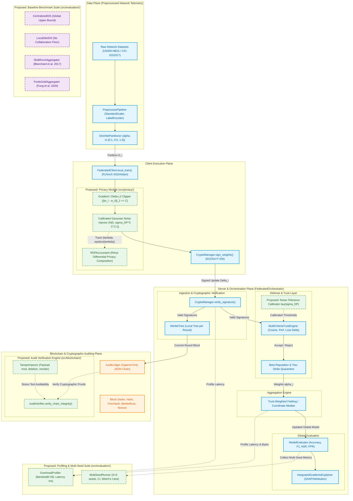
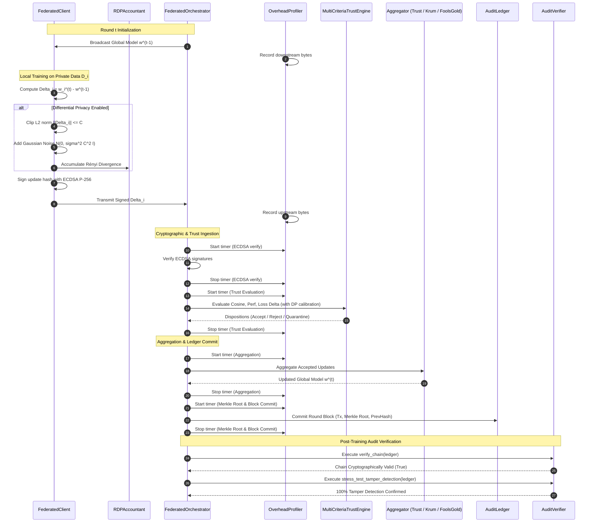

# Stage 2E — Proposed System Architecture Specification
## Privacy-Preserving, Blockchain-Audited Federated Learning for Network Intrusion Detection

**Project:** Blockchain-Assisted Privacy-Preserving Federated Learning for Network Intrusion Detection with Trust-Based Security and Cryptographic Auditing  
**Workspace:** `C:\Users\is043\.gemini\antigravity\scratch\blockchain-fl-ids`  
**Milestone:** Stage 2E (Research Gap Analysis, Architecture Proposal & Experimental Roadmap)  
**Status:** PROPOSED ARCHITECTURAL SPECIFICATION (Planning Only — Zero Code Modifications)  
**Date:** November 2026  

---

## 1. Executive Architectural Overview

Stage 2D established a deterministic, multi-attack federated learning framework featuring a Multi-Criteria Trust Engine (cosine similarity, historical performance, loss delta), dynamic reputation scoring with Beta distributions, a two-strike quarantine mechanism, and a local append-only cryptographic ledger (`AuditLedger`, Merkle trees, ECDSA/SHA-256 signatures).

The proposed **Stage 2E Architecture** addresses the six critical research gaps identified in `STAGE_2E_RESEARCH_GAP_ANALYSIS.md`:
1. **Formal Privacy Accounting:** Transitioning from uncalibrated Gaussian perturbation to mathematically rigorous $(\epsilon, \delta)$-Differential Privacy via Rényi Differential Privacy (RDP).
2. **Statistical Multi-Seed Evaluation:** Transitioning from single-seed runs (`seed=42`) to a multi-seed orchestration engine computing statistical significance ($\mu \pm \sigma$, 95% Confidence Intervals, Welch's $t$-tests).
3. **Empirical Overhead Profiling:** Instrumentation to measure exact network payload sizes (bytes/round) and execution latency (milliseconds) for cryptographic, trust, and aggregation pipelines.
4. **Standard Baseline Comparison Suite:** Native modular baseline implementations of Centralized-IDS, Local-only data silos, Multi-Krum (Blanchard et al., NeurIPS 2017), and FoolsGold (Fung et al., IEEE TIFS 2020).
5. **Ledger Tamper-Evidence Verification:** Automated cryptographic stress testing verifying detection of block payload alteration, block deletion, and block reordering.

### 1.1 Non-Breaking Backward Compatibility Constraint

A fundamental architectural requirement of Stage 2E is **strict non-breaking backward compatibility**:
- The existing core classes (`FederatedOrchestrator`, `FederatedClient`, `MultiCriteriaTrustEngine`, `AuditLedger`, `Block`, `CryptoManager`, `ModelEvaluator`) must retain their current public APIs and default behaviors.
- Stage 2E functionality will be introduced via **modular composition, inheritance, or sidecar wrappers**, allowing existing Stage 2D scenarios (S1–S8) to execute with 100% bit-for-bit regression parity when Stage 2E features are disabled.
- All historical benchmark artifacts (`stage2_results.json`, `multi_attack_benchmarks.json`, `multi_attack_benchmarks_v2.json`, `multi_attack_benchmarks_v3.json`) remain strictly immutable.

---

## 2. Global System Architecture Diagram

The diagram below details the complete federated learning architecture, explicitly demarcating existing Stage 2D operational components from proposed Stage 2E extensions.



---

## 3. Detailed Component Specifications

### 3.1 Formal Privacy Accounting Module (`src/privacy/accountant.py`)

#### 3.1.1 Architectural Rationale
Stage 2D incorporated heuristic Gaussian perturbation without formal privacy accounting. In privacy-critical intrusion detection, uncalibrated noise provides no mathematical guarantee of differential privacy and risks severe utility loss. Stage 2E introduces Rényi Differential Privacy (RDP) accounting based on Mironov (CSF 2017), tracking cumulative privacy expenditure across federated rounds.

#### 3.1.2 Class Design: `RDPAccountant`
```python
class RDPAccountant:
    """
    Rényi Differential Privacy (RDP) accountant for subsampled Gaussian mechanisms.
    Calculates cumulative (epsilon, delta)-DP privacy expenditure.
    """
    def __init__(self, target_delta: float = 1e-5, orders: Optional[List[float]] = None):
        self.target_delta = target_delta
        # Discrete Rényi orders lambda in [1.5, 128.0]
        self.orders = orders or [1.5, 2.0, 3.0, 4.0, 6.0, 8.0, 16.0, 32.0, 64.0, 128.0]
        self.rdp_history: Dict[float, float] = {alpha: 0.0 for alpha in self.orders}
        self.round_history: List[Dict[str, Any]] = []

    def step(self, noise_multiplier: float, sample_rate: float, num_steps: int = 1) -> None:
        """
        Record composition of Gaussian mechanism over num_steps rounds.
        RDP for Gaussian mechanism: R_alpha = alpha / (2 * sigma^2)
        Subsampled RDP applies Wang et al. (AISTATS 2019) or standard composition.
        """
        ...

    def get_privacy_spent(self) -> Tuple[float, float]:
        """
        Convert RDP guarantees to standard (epsilon, delta)-DP:
        epsilon(delta) = min_{alpha > 1} { RDP(alpha) + ln(1/delta) / (alpha - 1) }
        Returns: (epsilon, delta)
        """
        ...

    def reset(self) -> None:
        """Reset privacy accumulator for new seed runs."""
        ...
```

#### 3.1.3 Integration with `FederatedClient`
In `src/federated/client.py`, when `enable_dp=True`:
1. Client computes model parameter difference: $\Delta w_i = w_i^{(t)} - w^{(t-1)}$.
2. $L_2$-norm clipping: $\Delta \tilde{w}_i = \Delta w_i / \max\left(1, \frac{\|\Delta w_i\|_2}{C}\right)$.
3. Calibrated Gaussian noise addition: $\Delta \hat{w}_i = \Delta \tilde{w}_i + \mathcal{N}\left(0, \sigma_{\text{DP}}^2 C^2 \mathbf{I}\right)$.
4. The orchestrator records each round's step in `RDPAccountant` with sample rate $q = \frac{K_{\text{active}}}{N_{\text{total}}}$.

#### 3.1.4 Analytical Noise-Tolerance Calibrator (`src/federated/trust_calibrator.py`)
To resolve the **Privacy-Trust Interference Conflict**, the trust engine must dynamically adapt its cosine similarity and loss degradation rejection thresholds based on the injected noise scale $\sigma_{\text{DP}}$:
$$\tau_{\text{cosine}}(\sigma_{\text{DP}}) = \tau_0 - \kappa_1 \cdot \sigma_{\text{DP}} \cdot \frac{C}{\sqrt{d}}$$
$$\tau_{\text{loss}}(\sigma_{\text{DP}}) = \tau_{\text{loss}, 0} + \kappa_2 \cdot \sigma_{\text{DP}}^2$$
where $d$ is parameter dimensionality and $\kappa_1, \kappa_2$ are empirically bounded calibration constants.

---

### 3.2 Statistical Multi-Seed Evaluation Runner (`src/evaluation/benchmark_suite.py`)

#### 3.2.1 Architectural Rationale
Single-seed evaluation risks overfitting to a fortunate initial parameter or partition state. Stage 2E introduces an automated orchestration runner that executes scenarios across an ensemble of 5 standardized seeds ($S = \{42, 101, 2024, 777, 999\}$), aggregating metrics into sample means ($\mu$), sample standard deviations ($\sigma$), 95% Student's $t$ confidence intervals, and hypothesis tests.

#### 3.2.2 Class Design: `MultiSeedRunner`
```python
class MultiSeedRunner:
    """
    Executes federated scenarios across multiple deterministic seeds,
    aggregating results into publication-grade statistical summaries.
    """
    def __init__(
        self,
        seeds: List[int] = [42, 101, 2024, 777, 999],
        output_dir: str = "data/processed/stage2e/"
    ):
        self.seeds = seeds
        self.output_dir = output_dir

    def run_scenario_ensemble(
        self,
        scenario_id: str,
        config_template: Dict[str, Any]
    ) -> Dict[str, Any]:
        """
        Executes scenario across all configured seeds.
        Returns:
            {
                "scenario_id": scenario_id,
                "seeds": self.seeds,
                "runs": [ {round_results, final_metrics}... ],
                "summary": {
                    "accuracy": {"mean": float, "std": float, "ci_95": [float, float]},
                    "f1_score": {"mean": float, "std": float, "ci_95": [float, float]},
                    "asr": {"mean": float, "std": float, "ci_95": [float, float]},
                    "murr": {"mean": float, "std": float, "ci_95": [float, float]},
                    "fpr": {"mean": float, "std": float, "ci_95": [float, float]},
                }
            }
        """
        ...

    def compute_hypothesis_tests(
        self,
        scenario_a_runs: List[Dict[str, Any]],
        scenario_b_runs: List[Dict[str, Any]],
        metric_key: str = "accuracy"
    ) -> Dict[str, Any]:
        """
        Computes paired Welch's t-test and Wilcoxon signed-rank test.
        Returns: t_stat, p_value, w_stat, significance_flag (p < 0.05).
        """
        ...
```

---

### 3.3 Empirical Overhead Profiler (`src/evaluation/overhead_profiler.py`)

#### 3.3.1 Architectural Rationale
Reviewers require empirical quantification of the computational and communication overhead imposed by security, trust evaluation, and blockchain ledger operations. Stage 2E establishes a high-precision, low-overhead profiler.

#### 3.3.2 Class Design: `OverheadProfiler`
```python
class OverheadProfiler:
    """
    Instruments federated rounds to measure communication payloads (bytes)
    and execution latency (milliseconds) for cryptographic and aggregation tasks.
    """
    def __init__(self):
        self.metrics: Dict[str, List[float]] = defaultdict(list)
        self.byte_counters: Dict[str, int] = defaultdict(int)

    @contextmanager
    def measure_latency(self, component_name: str):
        """Context manager for timing wall-clock latency in milliseconds."""
        t0 = time.perf_counter_ns()
        try:
            yield
        finally:
            elapsed_ms = (time.perf_counter_ns() - t0) / 1e6
            self.metrics[component_name].append(elapsed_ms)

    def record_bytes(self, channel_name: str, payload_bytes: int):
        """Record upstream or downstream data transmission in bytes."""
        self.byte_counters[channel_name] += payload_bytes

    def get_summary(self) -> Dict[str, Any]:
        """
        Computes per-round mean and cumulative communication/computation overhead.
        """
        ...
```

#### 3.3.3 Profiling Tap Points
- `upstream_client_bytes`: Model update tensor serialization + ECDSA signature + metadata.
- `downstream_server_bytes`: Global model broadcast + reputation scores + quarantine notices.
- `latency_ecdsa_sign_ms`: Client-side signature generation.
- `latency_ecdsa_verify_ms`: Server-side signature batch verification.
- `latency_merkle_gen_ms`: SHA-256 Merkle tree calculation per round.
- `latency_trust_eval_ms`: Multi-criteria cosine similarity and loss evaluation.
- `latency_aggregation_ms`: Trust-weighted FedAvg model aggregation.

---

### 3.4 Non-Federated & Alternative Defense Baselines (`src/evaluation/baselines.py`)

#### 3.4.1 Architectural Rationale
Evaluating an intrusion detection framework without comparing against centralized upper bounds and established Byzantine defenses weakens scholarly claims. Stage 2E incorporates four modular baselines adhering to identical dataset splits and evaluation routines:

1. **Centralized-IDS (`CentralizedBaseline`):** Model trained on the unified training dataset without client partitioning, representing the empirical performance upper bound.
2. **Local-Only Silos (`LocalSiloBaseline`):** Individual clients train models strictly on their isolated local partitions without sharing updates or collaborating, representing the uncooperative lower bound.
3. **Multi-Krum Defense (`MultiKrumAggregator`):** Implements Blanchard et al. (NeurIPS 2017). Calculates pairwise Euclidean distances among client updates and selects the updates minimizing local neighborhood distance sums.
4. **FoolsGold Defense (`FoolsGoldAggregator`):** Implements Fung et al. (IEEE TIFS 2020). Computes historical pairwise cosine similarity between client update trajectories to detect and penalize Sybil clusters.

#### 3.4.2 Interface Specification: `BaseAggregator`
```python
class BaseByzantineAggregator(ABC):
    @abstractmethod
    def aggregate(
        self,
        updates: List[Dict[str, torch.Tensor]],
        client_weights: Optional[List[float]] = None,
        **kwargs
    ) -> Dict[str, torch.Tensor]:
        """Aggregates local model updates into global model parameters."""
        pass
```

Both `MultiKrumAggregator` and `FoolsGoldAggregator` inherit from `BaseByzantineAggregator`, allowing drop-in substitution into `FederatedOrchestrator` without modifying server execution loops.

---

### 3.5 Cryptographic Ledger Tamper-Evidence Verifier (`src/blockchain/audit_verifier.py`)

#### 3.5.1 Architectural Rationale
The Stage 2D `AuditLedger` records hashes, Merkle roots, and signatures. However, its security value remains theoretical without an automated audit mechanism that actively tests whether the chain successfully catches tampering, deletions, or replay attacks.

#### 3.5.2 Class Design: `AuditVerifier`
```python
class AuditVerifier:
    """
    Validates complete cryptographic integrity of an AuditLedger chain.
    Detects block payload tampering, header alteration, deletion, and reordering.
    """
    def __init__(self, crypto_manager: CryptoManager):
        self.crypto = crypto_manager

    def verify_chain(self, ledger: AuditLedger) -> Tuple[bool, List[str]]:
        """
        Performs exhaustive cryptographic audit:
        1. Validates Genesis block hash.
        2. Validates block hash chaining (block.prev_hash == previous.hash).
        3. Recalculates block SHA-256 hash from header fields.
        4. Verifies Merkle tree root matches transaction hashes.
        5. Validates client ECDSA signatures recorded in transaction records.
        Returns: (is_valid, list_of_violations)
        """
        ...

    def stress_test_tamper_detection(
        self,
        ledger: AuditLedger,
        scenario: str
    ) -> Dict[str, Any]:
        """
        Injects controlled synthetic tampering on a cloned ledger:
        - 'modify_payload': Alter model hash or metrics in an intermediate block.
        - 'delete_block': Remove an intermediate round block.
        - 'reorder_blocks': Transpose round t and round t+1.
        Returns: {
            "scenario": scenario,
            "detected": bool,
            "error_detected_at_block": int,
            "verification_latency_ms": float
        }
        """
        ...
```

---

## 4. Component Interaction and Data Flow

The sequence diagram below illustrates the end-to-end round execution lifecycle under the proposed Stage 2E architecture, showing how all proposed components interface with the existing execution flow.



---

## 5. Architectural Directory Layout

The proposed Stage 2E codebase cleanly separates new evaluation, baseline, privacy, and verification modules from existing core logic:

```
blockchain-fl-ids/
├── src/
│   ├── blockchain/
│   │   ├── audit_verifier.py      <-- [PROPOSED 2E] Tamper detection & chain audit
│   │   ├── crypto.py              <-- [EXISTING 2D] ECDSA & hashing
│   │   ├── ledger.py              <-- [EXISTING 2D] AuditLedger & Block
│   │   └── merkle.py              <-- [EXISTING 2D] MerkleTree
│   ├── evaluation/
│   │   ├── baselines.py           <-- [PROPOSED 2E] Centralized, Silo, Krum, FoolsGold
│   │   ├── benchmark_suite.py     <-- [PROPOSED 2E] Multi-seed runner (S=5, t-tests)
│   │   ├── evaluator.py           <-- [EXISTING 2D] ModelEvaluator
│   │   ├── overhead_profiler.py   <-- [PROPOSED 2E] Bandwidth & latency profiling
│   │   └── xai.py                 <-- [EXISTING 2D] IntegratedGradients
│   ├── federated/
│   │   ├── client.py              <-- [EXISTING 2D] Extensible with DP clipping/noise
│   │   ├── orchestrator.py        <-- [EXISTING 2D] Extensible hooks for profiler
│   │   └── trust_calibrator.py    <-- [PROPOSED 2E] DP noise-tolerance bounds tau(sigma)
│   ├── privacy/                   <-- [PROPOSED 2E]
│   │   ├── __init__.py
│   │   └── accountant.py          <-- [PROPOSED 2E] Rényi DP / Moments Accountant
│   ├── security/
│   │   ├── attacks.py             <-- [EXISTING 2D] Attack generator
│   │   └── trust_engine.py        <-- [EXISTING 2D] MultiCriteriaTrustEngine
├── tests/
│   ├── test_baselines.py          <-- [PROPOSED 2E] Baseline execution tests
│   ├── test_benchmark_suite.py    <-- [PROPOSED 2E] Multi-seed statistical tests
│   ├── test_overhead_profiler.py  <-- [PROPOSED 2E] Profiling precision tests
│   ├── test_privacy_accountant.py <-- [PROPOSED 2E] RDP composition & conversion tests
│   └── test_tamper_verifier.py    <-- [PROPOSED 2E] Tamper detection verification tests
└── reports/
    ├── STAGE_2E_RESEARCH_GAP_ANALYSIS.md    <-- Completed
    ├── STAGE_2E_ARCHITECTURE_PROPOSAL.md    <-- Completed
    ├── STAGE_2E_EXPERIMENTAL_PROTOCOL.md    <-- Next
    ├── STAGE_2E_IMPLEMENTATION_ROADMAP.md   <-- Next
    └── STAGE_2E_DECISION_SUMMARY.md         <-- Next
```

---

## 6. Summary of Architectural Guarantees

1. **Isolation:** No existing file in `src/` or `tests/` is altered during the planning phase.
2. **Determinism:** All new modules respect the multi-seed deterministic RNG initialization established in Stage 2D.4.
3. **Traceability:** Profiling and privacy accounting outputs map directly to immutable round logs, enabling mathematical verification by independent reviewers.
