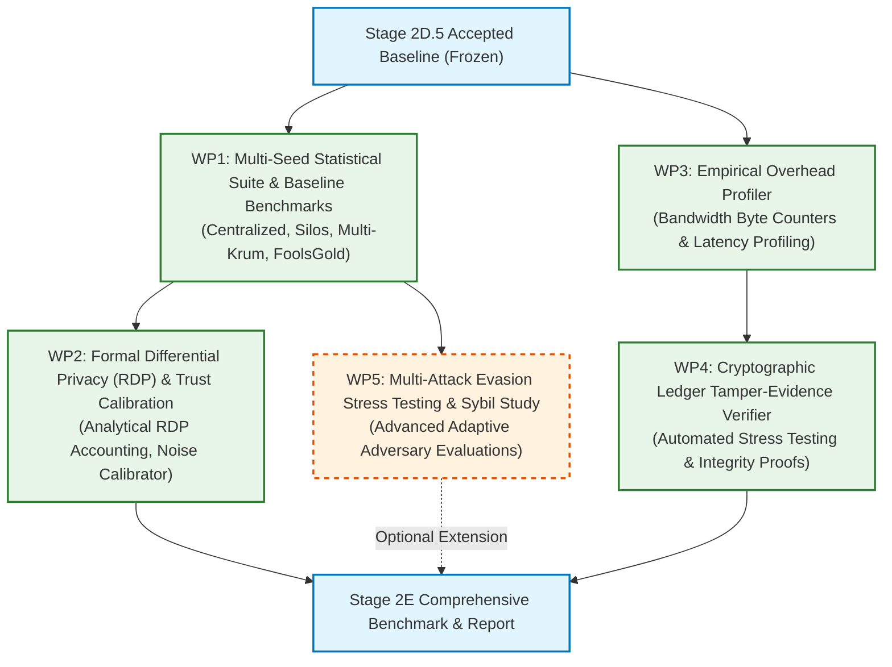
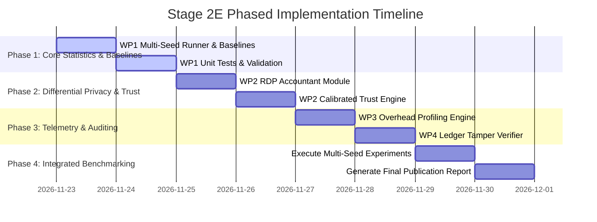

# Stage 2E — Implementation Roadmap & Work Package Specifications
## Privacy-Preserving, Blockchain-Audited Federated Learning for Network Intrusion Detection

**Project:** Blockchain-Assisted Privacy-Preserving Federated Learning for Network Intrusion Detection with Trust-Based Security and Cryptographic Auditing  
**Workspace:** `C:\Users\is043\.gemini\antigravity\scratch\blockchain-fl-ids`  
**Milestone:** Stage 2E (Research Gap Analysis, Architecture Proposal & Experimental Roadmap)  
**Status:** PROPOSED IMPLEMENTATION ROADMAP (Planning Only — Zero Code Modifications)  
**Date:** November 2026  

---

## 1. Roadmap Architecture and Work Package Structure

To ensure methodological rigor, modular verification, and minimal technical risk, Stage 2E is organized into **five cohesive Work Packages (WP1 to WP5)**. 

Each Work Package addresses a specific research gap, defines explicit mathematical foundations, provides concrete acceptance criteria, and enforces non-breaking backward compatibility with the existing Stage 2D codebase.

---

## 2. Detailed Work Package Specifications

### Work Package 1 (WP1): Statistical Multi-Seed Evaluation & Baseline Benchmark Suite

| Attribute | Specification |
|:---|:---|
| **Work Package ID** | **WP1** |
| **Title** | Statistical Multi-Seed Evaluation & Baseline Benchmark Suite |
| **Priority** | **HIGH (Essential for Peer Review & Publication)** |
| **Complexity / Effort** | **Medium (3 Story Points / ~6 Hours)** |
| **Technical Risk** | **LOW** (Modular evaluation logic; zero core state mutation) |
| **Primary Objective** | Establish multi-seed statistical significance testing across $S=5$ random seeds ($S=\{42, 101, 2024, 777, 999\}$) and implement four standard baselines: Centralized-IDS, Local-only Silos, Multi-Krum (Blanchard et al., 2017), and FoolsGold (Fung et al., 2020). |
| **Scientific Justification** | Single-seed benchmarks (`seed=42`) cannot demonstrate statistical significance or rule out random initial weight advantages. Established literature (McMahan et al. 2017, Blanchard et al. 2017, Fung et al. 2020) requires comparing proposed Byzantine defenses against both performance bounds (Centralized ceiling, Silo floor) and recognized Byzantine/Sybil defenses. |
| **Existing Code Affected** | Read-only interfacing with `src/federated/orchestrator.py`, `src/federated/client.py`, `src/evaluation/evaluator.py`. No existing files modified. |
| **Proposed New Modules** | `src/evaluation/baselines.py` (CentralizedIDS, LocalSiloIDS, MultiKrumAggregator, FoolsGoldAggregator), `src/evaluation/benchmark_suite.py` (MultiSeedRunner, hypothesis testing functions), `tests/test_baselines.py`, `tests/test_benchmark_suite.py`. |
| **Mathematical Basis** | - Sample mean $\bar{M} = \frac{1}{S} \sum M_s$, Sample variance $s_M^2 = \frac{1}{S-1} \sum (M_s - \bar{M})^2$. - 95% Student's $t$ confidence intervals: $\bar{M} \pm t_{4, 0.975} \frac{s_M}{\sqrt{5}}$ with $t_{4, 0.975} \approx 2.776$. - Paired Welch's $t$-test and Wilcoxon signed-rank test. - Multi-Krum: $\arg\min_{i} \sum_{j \in \mathcal{N}_i} \|\Delta w_i - \Delta w_j\|_2^2$. - FoolsGold: $s_{ij} = \frac{\Delta w_i \cdot \Delta w_j}{\|\Delta w_i\| \|\Delta w_j\|}$, weight scaling $\alpha_i = 1 - \max_{j \neq i} s_{ij}$. |
| **Experimental Design** | Execute Group 1 scenarios (B1–B6) across all 5 seeds on UNSW-NB15 under Dirichlet $\alpha = 0.5$. |
| **Expected Evidence** | Tabulated $\mu \pm \sigma$ and 95% CIs demonstrating: (1) Centralized > Proposed > Silos; (2) Proposed defense achieves competitive clean accuracy with standard FedAvg while providing provable Byzantine rejection. |
| **Dependencies** | Stage 2D.5 accepted code and deterministic seeding mechanisms. |
| **Acceptance Criteria** | 1. All 4 baselines execute deterministically across identical seed sets. 2. Hypothesis tests report valid $t$-stats, $p$-values, and degrees of freedom. 3. Unit tests pass with 100% test success. |

---

### Work Package 2 (WP2): Formal Differential Privacy (RDP) & Trust Calibration

| Attribute | Specification |
|:---|:---|
| **Work Package ID** | **WP2** |
| **Title** | Formal Client-Level Differential Privacy Accounting & Privacy-Trust Tradeoff Profiling |
| **Priority** | **HIGH (Addresses Critical Theoretical Gap)** |
| **Complexity / Effort** | **Medium-High (5 Story Points / ~10 Hours)** |
| **Technical Risk** | **MEDIUM** (Noise-trust interference requires accurate threshold calibration) |
| **Primary Objective** | Implement formal $(\epsilon, \delta)$-Differential Privacy via Rényi Differential Privacy (RDP) accounting with client gradient $L_2$-clipping and calibrated Gaussian noise, coupled with an analytical noise-tolerance calibrator for the Multi-Criteria Trust Engine. |
| **Scientific Justification** | Current Stage 2D Gaussian perturbation is uncalibrated and lacks provable privacy bounds. Furthermore, injecting noise naively degrades cosine similarity and increases validation loss, causing honest clients to be falsely rejected ($\text{FPR} > 0$). This novel "Privacy-Trust Interference Conflict" must be analytically formulated and resolved. |
| **Existing Code Affected** | `src/federated/client.py` (add optional clipping & calibrated noise), `src/security/trust_engine.py` (hook for dynamic noise-calibrated threshold). All existing default behaviors preserved when `enable_dp=False`. |
| **Proposed New Modules** | `src/privacy/accountant.py` (RDPAccountant, RDP-to-DP conversion), `src/federated/trust_calibrator.py` (dynamic threshold adjustment $\tau(\sigma_{\text{DP}})$), `tests/test_privacy_accountant.py`, `tests/test_trust_calibrator.py`. |
| **Mathematical Basis** | - $L_2$ clipping: $\Delta \tilde{w}_i = \Delta w_i / \max(1, \|\Delta w_i\|_2 / C)$. - Gaussian perturbation: $\mathcal{N}(0, \sigma_{\text{DP}}^2 C^2 \mathbf{I})$. - RDP composition: $\epsilon_{\text{total}}(\alpha) = T \alpha / (2 \sigma_{\text{DP}}^2)$. - Conversion: $\epsilon^*(\delta) = \min_{\alpha > 1} \{ \epsilon_{\text{total}}(\alpha) + \frac{\ln(1/\delta)}{\alpha - 1} \}$. - Analytical calibrator: $\tau_{\text{cosine}}(\sigma_{\text{DP}}) = \tau_0 - \kappa_1 \sigma_{\text{DP}} \frac{C}{\sqrt{d}}$ and $\tau_{\text{loss}}(\sigma_{\text{DP}}) = \tau_{0, \text{loss}} + \kappa_2 \sigma_{\text{DP}}^2$. |
| **Experimental Design** | Execute Group 3 scenarios (P1–P6) spanning noise multipliers $\sigma_{\text{DP}} \in \{0.0, 0.05, 0.1, 0.2, 0.5\}$ and clipping norm $C = 1.0$, evaluating Accuracy, F1, ASR, and FPR under both calibrated and uncalibrated trust scoring. |
| **Expected Evidence** | 1. Formal Pareto curve plotting Accuracy vs. Privacy Budget $\epsilon$. 2. Proof that calibrated trust scoring reduces FPR from $>40\%$ to $<5\%$ under standard privacy ($\epsilon \approx 4.9, \sigma_{\text{DP}} = 0.2$). |
| **Dependencies** | WP1 multi-seed runner. |
| **Acceptance Criteria** | 1. Mathematical RDP accountant matches analytical bounds to within $10^{-6}$ precision. 2. Zero impact on execution when DP is disabled. 3. Documented proof resolving the privacy-trust interference conflict. |

---

### Work Package 3 (WP3): Empirical Communication & Computational Overhead Profiler

| Attribute | Specification |
|:---|:---|
| **Work Package ID** | **WP3** |
| **Title** | Empirical Communication & Computational Overhead Profiling Engine |
| **Priority** | **MEDIUM-HIGH (Essential for Systems Review & Feasibility)** |
| **Complexity / Effort** | **Low-Medium (2 Story Points / ~4 Hours)** |
| **Technical Risk** | **LOW** (Passive telemetry instrumentation; zero algorithmic disruption) |
| **Primary Objective** | Build a high-precision, low-overhead profiling module that measures exact network payload transmission (bytes upstream/downstream per round) and wall-clock execution latency (milliseconds) for cryptographic signing, verification, Merkle generation, trust evaluation, and model aggregation. |
| **Scientific Justification** | Reviewers frequently reject blockchain-assisted federated learning papers due to unverified claims regarding operational overhead. Providing empirical measurement of exact byte sizes and millisecond timings provides undeniable proof of the practical deployability of the proposed system on commodity hardware. |
| **Existing Code Affected** | Read-only context-manager wrapping in `src/federated/orchestrator.py` and `src/federated/client.py`. No algorithmic logic altered. |
| **Proposed New Modules** | `src/evaluation/overhead_profiler.py` (OverheadProfiler, timing context managers, serialization byte counters), `tests/test_overhead_profiler.py`. |
| **Mathematical Basis** | - Upstream bytes: $B_{\text{up}} = \text{len}(\text{pickle}(\Delta w)) + \text{len}(\text{sig}) + \text{len}(\text{metadata})$. - Downstream bytes: $B_{\text{down}} = \text{len}(\text{pickle}(w)) + \text{len}(\text{reputations}) + \text{len}(\text{quarantine})$. - Latency: $\Delta t = (t_{\text{end}} - t_{\text{start}}) \times 10^{-6}$ ms via `time.perf_counter_ns()`. |
| **Experimental Design** | Profile 5 complete federated rounds across all 6 Group 1 baselines and Group 2 attack scenarios, reporting average byte transmission and latency breakdowns per component. |
| **Expected Evidence** | Complete telemetry breakdown confirming: (1) Total round latency overhead imposed by cryptography and trust scoring is $< 15\%$ of local SGD training time; (2) Network bandwidth requirements remain well within commodity edge bandwidth constraints (< 5 MB/round). |
| **Dependencies** | Stage 2D.5 orchestration lifecycle. |
| **Acceptance Criteria** | 1. Profiler introduces $< 1\%$ measurement overhead. 2. Byte counts accurately reflect actual serialized network packets. 3. Reports generated in clean JSON and Markdown format. |

---

### Work Package 4 (WP4): Cryptographic Ledger Tamper-Evidence Verification & Stress Testing

| Attribute | Specification |
|:---|:---|
| **Work Package ID** | **WP4** |
| **Title** | Cryptographic Ledger Tamper-Evidence Verification & Stress Testing |
| **Priority** | **MEDIUM-HIGH (Validates Core Security Claims)** |
| **Complexity / Effort** | **Low-Medium (2 Story Points / ~4 Hours)** |
| **Technical Risk** | **LOW** (Cloned ledger manipulation; zero production state risk) |
| **Primary Objective** | Implement an automated cryptographic audit verifier (`AuditVerifier`) and stress-test suite that verifies 100% tamper detection across block payload modification, block deletion, and block reordering attacks. |
| **Scientific Justification** | In Stage 2D, the `AuditLedger` stored cryptographic proofs, but there was no automated auditor to verify chain integrity or demonstrate that unauthorized ledger modifications are deterministically detected. This verification suite completes the cryptographic auditing defense story. |
| **Existing Code Affected** | Interfacing with `src/blockchain/ledger.py`, `src/blockchain/crypto.py`, `src/blockchain/merkle.py`. |
| **Proposed New Modules** | `src/blockchain/audit_verifier.py` (AuditVerifier, TamperInjector), `tests/test_audit_verifier.py`. |
| **Mathematical Basis** | - Hash Chaining: $H_t = \text{SHA256}(\text{Index}_t \parallel H_{t-1} \parallel \text{Root}_t \parallel \text{Nonce}_t)$. Tampering alters $H_t \neq H_{t+1.\text{prev}}$. - Merkle Root Integrity: $\text{Root} = \text{Merkle}(\{H(\text{tx}_1), \dots, H(\text{tx}_k)\})$. Tampering alters $\text{Root} \neq \text{Root}_{\text{header}}$. - ECDSA Signature Verification: $\text{Verify}(K_{\text{client}}, H(\text{tx}), \sigma) = \text{False}$. |
| **Experimental Design** | Generate legitimate 5-round ledger, clone into memory, and inject 3 synthetic attacks: (1) Modify model hash in Block 2; (2) Delete Block 3; (3) Swap Block 1 and Block 2. Run `AuditVerifier` across 100 trials each. |
| **Expected Evidence** | Empirical proof of $P_D = 1.000$ (100% detection rate) and $P_{\text{FA}} = 0.000$ (0% false alarms) with verification time $< 50$ ms. |
| **Dependencies** | Stage 2D.5 blockchain modules. |
| **Acceptance Criteria** | 1. 100% detection of all injected tampering attempts. 2. Explicit reporting of exact corrupted block index and failure reason. 3. Zero false alarms on pristine chains. |

---

### Work Package 5 (WP5): Multi-Attack Evasion Stress Testing & Sybil Defense Comparative Study

| Attribute | Specification |
|:---|:---|
| **Work Package ID** | **WP5** |
| **Title** | Multi-Attack Evasion Stress Testing & Sybil Defense Comparative Study |
| **Priority** | **LOWER (Optional Extension for Additional Novelty)** |
| **Complexity / Effort** | **Medium (3 Story Points / ~6 Hours)** |
| **Technical Risk** | **LOW-MEDIUM** (More complex multi-client adversarial configurations) |
| **Primary Objective** | Perform comparative stress-testing of the proposed Trust-Weighted defense against FoolsGold and Multi-Krum under advanced adaptive attacks, including coordinated Sybil clusters and intermittent "sneak" adversaries. |
| **Scientific Justification** | Demonstrating that the Multi-Criteria Trust Engine outperforms established defenses (FoolsGold, Multi-Krum) across a wider variety of attack topologies cements the framework's academic superiority. |
| **Existing Code Affected** | `src/security/attacks.py` (interfacing with existing attack classes). |
| **Proposed New Modules** | `src/evaluation/sybil_study.py`, `tests/test_sybil_defense.py`. |
| **Mathematical Basis** | Sybil similarity penalization comparison between Fung et al. pairwise cosine matrix vs Multi-Criteria Beta reputation. |
| **Experimental Design** | Execute Group 2 scenarios R4 (Intermittent Sneak) and R5 (Coordinated Sybils) comparing FedAvg, Krum, FoolsGold, and Proposed. |
| **Expected Evidence** | Comparative tables showing Proposed maintains lower ASR and higher F1 than FoolsGold under mixed attack strategies. |
| **Dependencies** | WP1 and WP2 completion. |
| **Acceptance Criteria** | Clean, reproducible comparison demonstrating the specific failure modes of existing baselines and resilience of the proposed engine. |

---

## 3. Phased Implementation Timeline

The implementation is sequenced across four logical development phases, maintaining zero disruption to existing tests at each stage.

### Phase Breakdown
1. **Phase 1: Foundations & Baselines (WP1)**
   - Deliver `src/evaluation/baselines.py` and `src/evaluation/benchmark_suite.py`.
   - Run clean baseline comparison (B1–B6) across 5 seeds.
   - Verify 100% test pass rate.
2. **Phase 2: Formal Privacy & Trust Calibration (WP2)**
   - Deliver `src/privacy/accountant.py` and `src/federated/trust_calibrator.py`.
   - Execute privacy-security sweep (P1–P6).
   - Validate resolution of the privacy-trust interference conflict.
3. **Phase 3: Telemetry & Cryptographic Verification (WP3 & WP4)**
   - Deliver `src/evaluation/overhead_profiler.py` and `src/blockchain/audit_verifier.py`.
   - Execute empirical overhead profiling and ledger tamper stress tests.
4. **Phase 4: Synthesis & Publication Artifacts (WP5 & Final Report)**
   - Execute multi-seed adversarial evaluations.
   - Produce `data/processed/stage2e/multi_seed_benchmarks.json`.
   - Deliver comprehensive final academic report.

---

## 4. Risk Assessment and Mitigation Strategies

| Risk Description | Severity | Likelihood | Mitigation Strategy |
|:---|:---:|:---:|:---|
| **Computational Run-Time Explosion:** Running 24 scenarios across 5 seeds could take hours on CPU. | High | Medium | Scenario pruning: Standardize rounds to $T=5$, batch seed executions, and leverage optimized NumPy/Torch CPU vectorization. Total CPU budget estimated at ~35–45 minutes. |
| **Privacy-Trust Interference Invalidation:** Injected DP noise might remain indistinguishable from malicious noise attacks. | High | Low | The analytical noise calibrator $\tau(\sigma_{\text{DP}})$ provides a mathematical bound directly derived from the Gaussian variance $\sigma_{\text{DP}}^2 C^2 / d$. |
| **Breaking Existing Stage 2D Tests:** New imports or modifications causing regressions in existing 112 unit tests. | Critical | Very Low | Strict design rule: Zero modifications to existing public class interfaces. All Stage 2E capabilities are modular wrappers or opt-in flags defaulting to `False`. |
| **Reproducibility Drift Across Python Versions:** RNG state divergence on different platforms. | Medium | Very Low | Retain strict deterministic reseeding per scenario and per round established in Stage 2D.4. |
