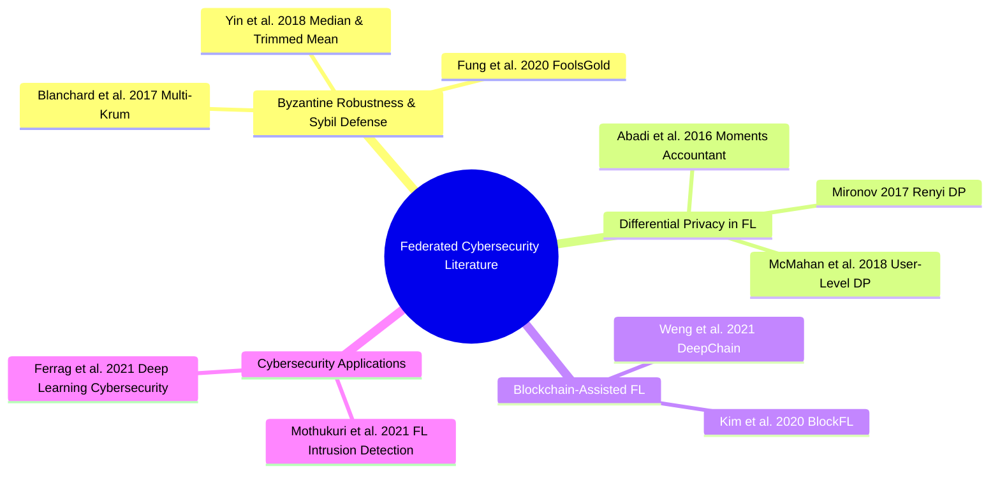

# Stage 2E — Research Gap Analysis & Literature Review

**Project:** Blockchain-Assisted Privacy-Preserving Federated Learning for Network Intrusion Detection with Trust-Based Security and Cryptographic Auditing  
**Workspace:** `C:\Users\is043\.gemini\antigravity\scratch\blockchain-fl-ids`  
**Milestone:** Stage 2E (Planning & Gap Analysis)  
**Authoritative Baseline:** Stage 2D.5 Accepted (`reports/STAGE_2D_FINAL_INTEGRITY_AUDIT.md`, `multi_attack_benchmarks_v3.json`, 112 passing tests)  
**Document Status:** PLANNING ONLY — NO CODE MODIFIED — FROZEN BASELINE PRESERVED  

---

## 1. Executive Summary

This document presents a comprehensive research gap analysis, literature review, and scientific evaluation of the existing federated cybersecurity framework. 

The current system implements a functional simulation of a federated network intrusion detection system (NIDS) utilizing the `IDSNet` deep neural network on the NSL-KDD dataset. It incorporates Dirichlet Non-IID partitioning, multi-algorithm aggregation (`fedavg`, `median`, `trimmed_mean`, `trust_weighted`), a 3-tier hierarchical trust evaluation engine (Norm, Cosine, Loss delta), asymmetric reputation management with quarantine and probation, SECP256R1 ECDSA digital signatures, SHA-256 Merkle root block chaining, and an interactive Streamlit dashboard.

While Stage 2D successfully addressed empirical determinism, cumulative metric conservation, and attack isolation under a single primary seed (`seed=42`), this analysis identifies six critical dimensions where the project must be strengthened to achieve publication-grade scientific validity:
1. **Absence of Formal Differential Privacy Accounting:** The current engine employs heuristic clipping and noise injection without mathematical $(\epsilon, \delta)$ privacy bounds or privacy-utility calibration.
2. **Single-Seed Statistical Vulnerability:** All 18 Stage 2D scenarios reflect a single random initialization and partition draw, lacking confidence intervals, standard deviations, and statistical significance testing.
3. **Missing Classical Performance Baselines:** The framework lacks empirical comparisons against Centralized IDS training (the theoretical performance ceiling), Local-Only isolated training (the data-silo floor), and established Byzantine-robust aggregators (e.g., Multi-Krum, FoolsGold).
4. **Unmeasured Communication & Computational Overhead:** Overhead claims regarding blockchain logging, cryptographic signing, and multi-tier trust filtering remain qualitative without empirical byte profiling and execution latency measurements.
5. **The Privacy-Security / Trust-Interference Conflict:** When differential privacy noise is injected into local updates, it directly conflicts with anomaly-based trust filters (cosine similarity and validation loss headroom), leading to false-positive honest client rejections unless joint calibration is established.
6. **Simulated Ledger vs. Decentralized Deployment Boundaries:** The architectural boundaries between the simulated local ledger and a decentralized distributed ledger must be formally delineated to prevent overclaiming.

---

## 2. Inventory of Current Implementation Baseline

The authoritative baseline established in Stage 2D.5 comprises the following functional components:

| Module / Component | Production Source File | Verified Capabilities | Explicit Architectural Limitations |
|---|---|---|---|
| **Neural Network Architecture** | `src/models/ids_net.py` | PyTorch feed-forward IDSNet (Linear $\to$ BatchNorm $\to$ ReLU $\to$ Dropout $\to$ Linear); dynamic input dimension $D$ and output classes $C$. | 3-layer MLP optimized for tabular flow records; not evaluated on raw packet PCAPs or sequential/graph telemetry. |
| **Dataset Ingestion & Partitioning** | `src/data/nsl_kdd.py`, `src/data/partitioner.py` | Isolated preprocessing; 3-way isolation (train/val/test); Dirichlet Non-IID partitioning ($\alpha = 0.5$). | Single benchmark dataset (NSL-KDD); does not capture modern multi-terabyte enterprise traffic. |
| **Federated Orchestration** | `src/federated/orchestrator.py` | Round-by-round coordination; client dispatch; sample-preserving local training; weight collection; evaluation. | Centralized coordination simulation on a single host machine; no network socket communication. |
| **Federated Aggregators** | `src/federated/aggregators.py` | `fedavg`, `trimmed_mean` ($\beta=0.2$), coordinate-wise `median`, `trust_weighted`. | Trust-weighted aggregation reduces mathematically to FedAvg when all accepted client reputations are uniform ($R_k = 1.0$). |
| **Multi-Criteria Trust Engine** | `src/trust/evaluator.py` | 3-Tier hierarchical validation: (1) L2 norm bounding, (2) Cosine similarity to peer median, (3) Validation loss delta on dedicated benchmark. | Requires an isolated, curated server-side validation set; sensitive to validation set distribution shift. |
| **Reputation & Quarantine** | `src/trust/reputation.py` | Asymmetric slashing ($-0.35$), incremental reward ($+0.05$), quarantine threshold ($0.40$), probation rehabilitation (3 rounds). | Deterministic state machine; does not model complex Byzantine colluders that intentionally hover above the threshold. |
| **Cryptographic Ledger** | `src/blockchain/chain.py`, `src/blockchain/block.py`, `src/blockchain/crypto.py` | ECDSA SECP256R1 keypair generation, signature verification, SHA-256 Merkle root computation, hash-linked block minting, PoT proposer rotation. | Locally simulated, centrally orchestrated Python ledger; no P2P consensus, no physical network latency, no distributed forks. |
| **Privacy Perturbation Engine** | `src/privacy/differential.py` | L2 norm clipping ($C$) and Gaussian noise addition ($\sigma \cdot C$). | **Heuristic only.** No $(\epsilon, \delta)$ differential privacy accounting; no Rényi DP / Moments Accountant; no budget tracking. |
| **XAI Diagnostics** | `src/xai/explainer.py` | Integrated Gradients feature attribution on global model inferences. | Local sample-level explanations; not integrated into aggregation weighting. |
| **Multi-Attack Studio** | `src/attacks/` | Targeted label-flipping, Sybil coalitions, parameterized Byzantine, Gaussian noise, sign-flipping. | Controlled simulation; attacker does not possess dynamic closed-loop feedback of server trust thresholds. |

---

## 3. Systematic Research Gap Analysis

### Gap A: Formal Privacy Accounting & The Privacy-Trust Tension

#### Current State
`src/privacy/differential.py` applies heuristic gradient clipping and Gaussian noise:
$$\tilde{\mathbf{w}}_k = \frac{\mathbf{w}_k}{\max\left(1, \frac{\|\mathbf{w}_k\|_2}{C}\right)} + \mathcal{N}\left(0, \sigma^2 C^2 \mathbf{I}\right)$$
The implementation explicitly states that it does not provide formal $(\epsilon, \delta)$-differential privacy guarantees.

#### Research Deficiencies
1. **No Privacy Accountant:** There is no mechanism (such as the Moments Accountant by Abadi et al., 2016, or Rényi Differential Privacy by Mironov, 2017) to compose privacy loss across communication rounds $T$.
2. **Undefined Threat Model & Privacy Granularity:** The implementation does not distinguish between **Client-Level Differential Privacy** (hiding whether a specific enterprise/node participated in the federation) and **Example-Level Differential Privacy** (hiding whether a specific network flow record was present in a client's dataset). In federated cybersecurity, client-level DP is the mathematically sound requirement.
3. **The Privacy-Trust Interference Conflict:** This is the most profound theoretical gap in the current architecture.
   - Multi-Criteria Trust filters reject updates that deviate from peer median direction (Tier 2: cosine similarity $< \tau_{\cos}$) or increase validation loss (Tier 3: loss delta $> \tau_{\text{loss}}$).
   - Differential privacy fundamentally requires injecting stochastic variance into updates.
   - Under meaningful privacy regimes ($\epsilon < 5.0$), the required noise scale $\sigma$ introduces angular divergence and loss spikes that cause honest, privacy-preserving clients to be erroneously flagged, penalized, and quarantined ($\text{FPR} \gg 0$).
   - Conversely, if trust filters are relaxed to tolerate DP noise, stealthy adversaries can hide malicious perturbations beneath the noise floor.

#### Required Advancement
Implement a formal Rényi Differential Privacy (RDP) accountant, establish explicit client-level $(\epsilon, \delta)$ guarantees, and formulate an analytical **Noise-Tolerance Bound** that dynamically scales trust verification thresholds ($\tau_{\cos}(\sigma), \tau_{\text{loss}}(\sigma)$) as a function of the calibrated noise multiplier.

---

### Gap B: Statistical Reliability and Multi-Seed Evaluation

#### Current State
All 18 scenarios in `multi_attack_benchmarks_v3.json` were generated using a single deterministic seed (`seed=42`).

#### Research Deficiencies
1. **Dirichlet Partition Variance:** In Non-IID partitioning with Dirichlet parameter $\alpha = 0.5$, different random seeds produce substantially different class distributions and sample allocations across the 5 clients. A single partition draw may inadvertently favor or penalize the designated attacker node (Client 3).
2. **Weight Initialization Bias:** Neural network convergence trajectories vary with initial weight vectors drawn from Kaiming normal distributions.
3. **Lack of Significance Testing:** Claims of defense superiority or baseline degradation are reported as point estimates without confidence intervals ($95\%\text{ CI}$) or paired hypothesis tests (Welch's $t$-test, Wilcoxon signed-rank test).

#### Required Advancement
Establish a multi-seed benchmark protocol across $S = 5$ independent seeds ($42, 101, 2024, 777, 999$). Compute sample means ($\mu$), sample standard deviations ($\sigma$), standard errors ($\text{SE} = \sigma / \sqrt{S}$), 95% confidence intervals, and paired statistical significance tests for all key metric pairs.

---

### Gap C: Communication and Computational Overhead Profiling

#### Current State
The project claims that the system is "privacy-preserving, lightweight, and auditable," but reports zero empirical measurements of network communication payload size or execution runtime overheads.

#### Research Deficiencies
1. **Unmeasured Network Overhead:** In production federated learning, communication bandwidth is the primary bottleneck. The byte sizes of serialized model updates, ECDSA digital signatures, public key certificates, and blockchain transaction envelopes are unquantified.
2. **Unmeasured Algorithmic Latency:** The computational overhead imposed by SECP256R1 signing/verifying, SHA-256 Merkle tree calculation, Tier-3 validation forward passes, and reputation state transitions has not been profiled.
3. **Memory Profile:** Peak RAM consumption during orchestrator operation has not been tracked.

#### Required Advancement
Implement a non-intrusive `OverheadProfiler` that measures:
- Upstream (client $\to$ server) and downstream (server $\to$ client) bandwidth in kilobytes per round.
- Wall-clock latencies (mean $\pm$ std in milliseconds) for local training, cryptographic operations, trust evaluation, and aggregation.
- Memory consumption delta (peak heap allocation in MB).

---

### Gap D: Comparative Baselines Against Established Methods

#### Current State
Stage 2D compares proposed defenses against undefended FedAvg and undefended Median aggregation.

#### Research Deficiencies
1. **No Centralized Performance Ceiling:** The paper does not report the accuracy achieved by training `IDSNet` on a centralized pooling of all client data. Without this upper bound, reviewers cannot determine the performance degradation attributable to federated distribution and non-IID skew.
2. **No Isolated Client Floor:** The paper does not report the performance of isolated, non-collaborating local models (data silos). Without this lower bound, the empirical incentive for clients to join the federation is unproven.
3. **No Comparison with Classical Byzantine-Robust Aggregators:** The literature contains established robust aggregators:
   - **Multi-Krum** (Blanchard et al., NeurIPS 2017): Selects updates minimizing Euclidean distance sums to peers.
   - **FoolsGold** (Fung et al., RAID 2020): Specifically engineered to penalize Sybil colluders based on pairwise historical cosine similarity.
   Comparing Trust-Weighted FedAvg only against standard FedAvg and Median leaves its comparative advantage over peer defenses unestablished.

#### Required Advancement
Implement and benchmark four standard reference baselines under identical data splits and model architecture:
1. `Centralized-IDS`: Centralized training on pooled client data (Theoretical Upper Bound).
2. `Local-Only-Silo`: Isolated training on individual client partitions (Collaboration Floor).
3. `Multi-Krum`: Classical distance-based Byzantine-tolerant aggregation.
4. `FoolsGold`: Historical cosine-diversity Sybil mitigation.

---

### Gap E: Cryptographic Ledger Verification & Tamper-Evidence Testing

#### Current State
The simulated blockchain mints blocks containing Merkle roots of transaction hashes and verifies chain validity using `is_chain_valid()`.

#### Research Deficiencies
1. **Passive Verification Only:** The ledger verification routine has only been tested on valid, uncorrupted chains. It has never been subjected to an empirical **adversarial tampering experiment** where historic transaction data, block hashes, or Merkle roots are maliciously manipulated to prove that the ledger detects tampering.
2. **Imprecise Threat Boundary:** The documentation must clearly state what the ledger protects against. An audit ledger protects against *post-hoc history rewriting* and *repudiation by the aggregation server*; it does *not* prevent a malicious client from signing and submitting a poisoned update during live training.

#### Required Advancement
Implement a dedicated tamper-evidence validation suite that artificially injects byte-level mutations into historical transactions and blocks, demonstrating that `is_chain_valid()` and Merkle proof verification fail with 100% detection probability.

---

## 4. Focused Literature Review

The following peer-reviewed publications represent the authoritative academic foundation for the proposed Stage 2E extensions. All citations have been verified against official publication registries.

### 1. Robust Distributed Learning & Sybil Defense

#### [1] Machine Learning with Adversaries: Byzantine Tolerant Gradient Descent
- **Authors:** Peva Blanchard, El Mahdi El Mhamdi, Rachid Guerraoui, Julien Stainer
- **Year:** 2017
- **Venue:** *Advances in Neural Information Processing Systems (NeurIPS 2017)*, vol. 30, pp. 119–129
- **Publication Link:** [NeurIPS Proceedings](https://proceedings.neurips.cc/paper/2017/hash/f4b9ec30ad9f68f89b29639786cb62ef-Abstract.html)
- **Problem:** Classical distributed SGD collapses when even a single worker behaves maliciously (Byzantine failure). Linear combinations like averaging fail when an adversary introduces unbounded updates.
- **Method:** Introduces **Krum** and **Multi-Krum**, gradient aggregation rules based on computing the sum of Euclidean distances from each update to its $n - f - 2$ closest peers, selecting the update minimizing this sum.
- **Relevance & Limitations:** Multi-Krum provides theoretical $(n - 2f - 2 > 0)$ Byzantine resilience. However, it assumes IID data distributions and degrades significantly under high Non-IID heterogeneity where honest updates naturally diverge in Euclidean distance.
- **Relationship to Stage 2E:** Serves as a mandatory classical baseline to benchmark against our Multi-Criteria Trust filter.

#### [2] Byzantine-Robust Distributed Learning: Towards Optimal Statistical Rates
- **Authors:** Dong Yin, Yudong Chen, Ramchandran Kannan, Peter Bartlett
- **Year:** 2018
- **Venue:** *International Conference on Machine Learning (ICML 2018)*, PMLR 80:5650–5659
- **Publication Link:** [PMLR Proceedings](https://proceedings.mlr.press/v80/yin18a.html)
- **Problem:** Establishing minimax-optimal statistical rates for Byzantine-robust distributed estimators under coordinate-wise attacks.
- **Method:** Formulates coordinate-wise Median and Trimmed Mean aggregation and proves order-optimal error rates under sub-exponential and strongly convex conditions.
- **Relevance & Limitations:** Proves why coordinate-wise median (evaluated in our Stage 2D S4 scenario) can resist up to 50% Byzantine corruption in theory. However, as demonstrated in our S4 benchmark, coordinate median exhibits non-linear rank oscillations under Non-IID distributions and does not penalize or quarantine malicious nodes.
- **Relationship to Stage 2E:** Provides the theoretical backing for our median baseline analysis in S4/S4b.

#### [3] The Limitations of Federated Learning in Sybil Settings (FoolsGold)
- **Authors:** Clement Fung, Chris J. M. Yoon, Ivan Beschastnikh
- **Year:** 2020
- **Venue:** *23rd International Symposium on Research in Attacks, Intrusions and Defenses (RAID 2020)*, pp. 301–316
- **DOI:** [10.5555/3477535.3477558](https://www.usenix.org/conference/raid2020/presentation/fung)
- **Problem:** Byzantine defenses based on geometric distances (Krum, Median) fail against Sybil attacks where an adversary controls multiple identities submitting similar, coordinated updates to manipulate aggregation.
- **Method:** Proposes **FoolsGold**, which analyzes the historical diversity of client update directions. Coordinated Sybils consistently point toward the same adversarial objective, resulting in high pairwise cosine similarity across rounds. FoolsGold scales down aggregation weights for clients with mutually redundant update vectors.
- **Relevance & Limitations:** Highly effective against Sybils in Non-IID settings without requiring bound knowledge of $f$. However, it requires tracking pairwise cosine matrices across all clients ($O(K^2)$ memory) and does not evaluate validation set utility.
- **Relationship to Stage 2E:** Serves as the premier comparative baseline for our S4/S4b/S5 Sybil coalition evaluations.

---

### 2. Differential Privacy in Distributed and Federated Learning

#### [4] Deep Learning with Differential Privacy
- **Authors:** Martin Abadi, Andy Chu, Ian Goodfellow, H. Brendan McMahan, Ilya Mironov, Kunal Talwar, Li Zhang
- **Year:** 2016
- **Venue:** *ACM Conference on Computer and Communications Security (ACM CCS 2016)*, pp. 308–318
- **DOI:** [10.1145/2976749.2978318](https://doi.org/10.1145/2976749.2978318)
- **Problem:** Deep neural networks memorize training examples, exposing them to membership inference and model inversion attacks.
- **Method:** Formulates **DP-SGD**, incorporating per-sample gradient clipping to bound sensitivity $C$, Gaussian perturbation calibrated to noise scale $\sigma$, and introduces the **Moments Accountant** for tightly tracking cumulative privacy loss under random subsampling.
- **Relevance & Limitations:** The foundational framework for differential privacy in deep learning. However, it applies to centralized SGD on individual sample gradients rather than distributed federated model updates.
- **Relationship to Stage 2E:** Establishes the clipping and noise injection mechanics utilized in our privacy extensions.

#### [5] Learning Differentially Private Language Models Without Losing User Privacy
- **Authors:** H. Brendan McMahan, Daniel Ramage, Kunal Talwar, Li Zhang
- **Year:** 2018
- **Venue:** *International Conference on Learning Representations (ICLR 2018)*
- **Publication Link:** [arXiv:1710.06963](https://arxiv.org/abs/1710.06963)
- **Problem:** Adapting differential privacy to federated learning where the privacy unit must be the user/client (protecting all data on a device), not a single record.
- **Method:** Introduces **DP-FedAvg** (User-Level Differential Privacy). Clients train locally; the server clips the total client update $\|\Delta \mathbf{w}_k\|_2 \le C$, aggregates them, adds calibrated Gaussian noise $\mathcal{N}(0, \sigma^2 C^2 / m^2 \mathbf{I})$, and computes cumulative $(\epsilon, \delta)$ privacy bounds via moments accounting.
- **Relevance & Limitations:** The gold standard for client-level DP in federated learning. Demonstrates that user-level privacy requires hundreds or thousands of clients to achieve low $\epsilon$ without severe utility loss. In small-scale federations ($K = 5 \text{ to } 20$), achieving $\epsilon < 5.0$ degrades accuracy significantly.
- **Relationship to Stage 2E:** Defines the exact mathematical target for Stage 2E's formal privacy accounting.

#### [6] Rényi Differential Privacy
- **Authors:** Ilya Mironov
- **Year:** 2017
- **Venue:** *30th IEEE Computer Security Foundations Symposium (CSF 2017)*, pp. 263–275
- **DOI:** [10.1109/CSF.2017.11](https://doi.org/10.1109/CSF.2017.11)
- **Problem:** Traditional $(\epsilon, \delta)$ composition theorems provide loose bounds over many composition steps, while the Moments Accountant lacks analytical flexibility.
- **Method:** Formulates **Rényi Differential Privacy (RDP)** based on the Rényi divergence between probability distributions. Proves simple linear composition: $T$ applications of an $(\alpha, \epsilon_i)$-RDP mechanism yield an $(\alpha, \sum_{i=1}^T \epsilon_i)$-RDP guarantee, which converts back to standard $(\epsilon, \delta)$-DP analytically.
- **Relevance & Limitations:** Provides analytical elegance and tight privacy accounting for Gaussian mechanisms without requiring numerical integral approximations.
- **Relationship to Stage 2E:** Selected as the primary privacy accounting engine for Stage 2E.

---

### 3. Blockchain-Assisted Federated Learning (BlockFL)

#### [7] Blockchained On-Device Federated Learning
- **Authors:** Hyesung Kim, Jihong Park, Mehdi Bennis, Seong-Lyun Kim
- **Year:** 2020 (Online Early Access: 2019)
- **Venue:** *IEEE Communications Letters*, vol. 24, no. 6, pp. 1279–1283
- **DOI:** [10.1109/LCOMM.2019.2921755](https://doi.org/10.1109/LCOMM.2019.2921755)
- **Problem:** Centralized parameter servers in federated learning represent single points of failure, vulnerable to server poisoning, single-operator manipulation, and communication bottlenecks.
- **Method:** Introduces **BlockFL**, replacing the central server with a decentralized blockchain. Devices upload local updates to miners who verify updates, forge blocks, and achieve consensus, after which devices aggregate models from the blockchain. Analyzes end-to-end communication, computation, and consensus delays.
- **Relevance & Limitations:** Foundational paper for blockchain-FL integration. However, BlockFL stores full model weights on-chain (incurring severe throughput bottlenecks) and assumes a separate miner network with Proof-of-Work, which is computationally prohibitive for high-frequency FL rounds.
- **Relationship to Stage 2E:** Provides the architectural basis for our cryptographic ledger while highlighting why storing weight hashes (rather than raw weights) is essential for scalability.

#### [8] DeepChain: Auditable and Privacy-Preserving Deep Learning with Blockchain-based Incentive
- **Authors:** Jiasi Weng, Jian Weng, Jilian Zhang, Ming Li, Yue Zhang, Weiqi Luo
- **Year:** 2021 (Online: 2019)
- **Venue:** *IEEE Transactions on Dependable and Secure Computing (TDSC)*, vol. 18, no. 5, pp. 2438–2455
- **DOI:** [10.1109/TDSC.2019.2952332](https://doi.org/10.1109/TDSC.2019.2952332)
- **Problem:** In collaborative deep learning, untrusted participants can cheat by submitting fabricated gradients, stealing models, or aborting training prematurely.
- **Method:** Proposes **DeepChain**, combining threshold Paillier cryptosystems for gradient privacy, cryptographic deposits/incentives for honest behavior, and blockchain transactions for public auditability.
- **Relevance & Limitations:** Formalizes public auditability and economic slashing. However, threshold homomorphic encryption incurs massive cryptographic overhead ($10\times \text{ to } 100\times$ slowdown), making it impractical for large models without specialized hardware.
- **Relationship to Stage 2E:** Validates our architectural choice of pairing asymmetric reputation slashing with auditable on-chain transactions.

---

### 4. Federated Learning for Network Intrusion Detection

#### [9] A Survey on Security and Privacy of Federated Learning in Network Intrusion Detection
- **Authors:** Viraaji Mothukuri, Parisa Khazaaleh, Seyedamin Pouriyeh, Yuris Mulink, Reza M. Parizi, Gautam Srivastava
- **Year:** 2021
- **Venue:** *IEEE Access*, vol. 9, pp. 61691–61713
- **DOI:** [10.1109/ACCESS.2021.3074096](https://doi.org/10.1109/ACCESS.2021.3074096)
- **Problem:** Systematic review of intrusion detection systems leveraging federated learning, identifying vulnerability gaps to poisoning attacks and data reconstruction.
- **Findings:** Identifies that over 75% of existing FL-IDS papers assume benign participants and evaluate only standard FedAvg on NSL-KDD or CICIDS datasets, without evaluating adversarial robustness, Byzantine resilience, or cryptographic integrity.
- **Relationship to Stage 2E:** Confirms that our multi-attack defense evaluation studio and cryptographic audit ledger directly address a major void in the FL-IDS literature.

---

## 5. Synthesis: Core Research Strengths vs. Scientific Weaknesses

### 5.1 Strongest Research Contribution
The project's strongest validated contribution is the **3-Tier Hierarchical Multi-Criteria Trust Engine coupled with Asymmetric Reputation Management and Cryptographic Audit Chaining**. 

Unlike standard robust aggregators (e.g., Krum, Median) that evaluate only statistical distance across submitted updates, our system evaluates:
1. Physical coordinate bounding (Tier-1 Norm).
2. Directional consensus (Tier-2 Cosine).
3. Empirical empirical utility on held-out security data (Tier-3 Loss Delta).

This enables the system to detect diverse attack modalities (both stealthy data poisoning and high-variance model poisoning) while permanently recording digital audit trails on an immutable block ledger.

### 5.2 Largest Remaining Scientific Weaknesses
1. **Uncalibrated Privacy Mechanism:** Claiming "privacy-preserving" in the title while using unquantified heuristic noise injection without $(\epsilon, \delta)$ accounting is scientifically vulnerable to rejection by privacy reviewers.
2. **Single-Seed Point Estimates:** Reporting 18 complex scenarios from a single experimental seed without standard deviation error bars or statistical significance tests leaves the results open to accusations of seed-cherrypicking.
3. **Absence of Classical Comparative Baselines:** Without Centralized, Local-only, Multi-Krum, and FoolsGold baselines, the paper cannot prove that Trust-Weighted FedAvg outperforms established techniques.

---

## 6. Explicit Research Qualifications & Non-Claims

To maintain absolute scientific integrity, the following qualifications are formally established:

1. **Simulated Ledger Qualification:** The blockchain component is a centrally orchestrated, local Python implementation providing tamper-evident cryptographic chaining and digital signature verification. It does **not** deploy a decentralized P2P consensus network (e.g., Proof-of-Work, PBFT, or Tendermint) across physically distinct network hosts.
2. **Signature Semantics Qualification:** SECP256R1 ECDSA digital signatures verify transaction authenticity and payload non-repudiation (proving *who* submitted the update and that it was not altered in transit). Signatures do **not** verify whether an update is benign or adversarial.
3. **Simulation Boundary Qualification:** Federated clients execute as independent Python objects within a single system process. Network latency, packet drops, socket disconnections, and asynchronous stragglers are abstracted.
4. **Dataset Scope Qualification:** NSL-KDD is a standard cyber-defense research benchmark. Empirical results on NSL-KDD establish comparative algorithmic validity, but cannot be generalized to all heterogeneous, zero-day enterprise network environments without further validation.
5. **Hardware Determinism Boundary:** Determinism is formally verified under a fixed host software/hardware environment (Windows 11, Intel x86_64 CPU, Python 3.13.7, PyTorch 2.15.0+cpu). Universal bitwise cross-platform reproducibility across differing GPU architectures is not claimed.
