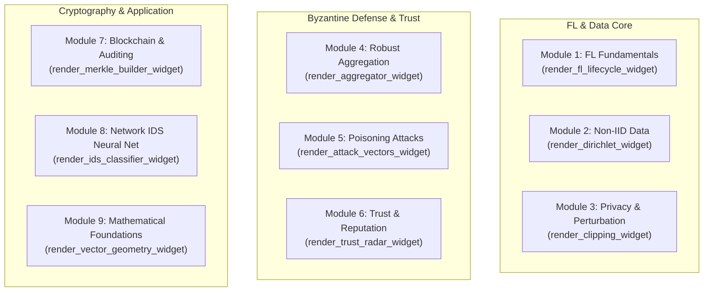

# Stage 2F.1 — Task C: Educational Module Completeness & Pedagogical Audit

**Project:** Blockchain-Assisted Privacy-Preserving Federated Learning for Network Intrusion Detection with Trust-Based Security and Cryptographic Auditing  
**Workspace:** `C:\Users\is043\.gemini\antigravity\scratch\blockchain-fl-ids`  
**Milestone:** Stage 2F.1 — Dashboard Statistical Integrity & Visualization Audit  
**Phase:** Task C — Educational Modules & Pedagogical Structure Audit  
**Date:** 2026-11-23  

---

## 1. Executive Summary

This report delivers a thorough audit of the educational architecture in Section 6 ("🎓 Learn & Explore") across all nine learning modules registered in `src/education/content.py`, their corresponding Level 2 visualizers in `src/visualization/educational_widgets.py`, and their rendering integration in `app.py`.

### Core Audit Findings
1. **Preservation of the Five-Level Structure:** All nine educational modules retain their complete five-level progressive pedagogical structure:
   - **Level 1: Understand** (Executive summary, real-world analogy, why it matters, core concept bullets).
   - **Level 2: Visualize** (Interactive demonstration widgets).
   - **Level 3: Mathematical Foundations** (LaTeX equations, variable definitions, worked numerical examples).
   - **Level 4: Technical Deep-Dive** (Pseudocode, algorithmic trade-offs, practical limitations).
   - **Level 5: Knowledge Check** (Interactive quizzes with instant grading, multiple-choice radio selectors, and explanations).
   - Plus **"How This Works in Our System"** linking each module to specific codebase source files and operational dashboard sections.
2. **Elimination of Static Fallbacks:** The previous limitation from Stage 2A (where Modules 3 through 8 fell back to static `st.info()` text) has been completely resolved. All nine modules now dispatch to dedicated interactive functions in `src/visualization/educational_widgets.py`.
3. **Alignment with Learning Objectives:** Each Level 2 visualizer directly implements the pedagogical concepts defined in the module's Level 1 summary and Level 3 equations.
4. **Conceptual vs. Empirical Distinction:** Level 2 demonstrations are explicitly captioned in `app.py` line 1204 as `*(Illustrative Educational Demonstration — Conceptual visual model)*`, preventing any confusion with empirical NSL-KDD benchmark results.

---

## 2. Module-by-Module Technical & Pedagogical Audit

---

### Module 1: Federated Learning Fundamentals
- **Title:** `Module 1: Federated Learning Fundamentals`
- **Icon / Tagline:** 🌐 Collaborative machine learning without raw data centralization.
- **Learning Objectives:** Understand the client-server coordination loop, local stochastic gradient descent, parameter weight exchange, and communication rounds.
- **Five-Level Completeness:**
  - *Level 1 (Understand):* Five-hospital medical diagnostic analogy; explains data sovereignty.
  - *Level 2 (Visualize):* `render_fl_lifecycle_widget()`. Interactive 4-phase slider across Global Broadcast, Local SGD, Update Upload, and Robust Aggregation, detailing data flow and security guarantees.
  - *Level 3 (Math):* $w^{t+1} = \sum_{k=1}^K \frac{n_k}{N} w_k^{t+1}$; worked numerical example with $N=4,000$ samples.
  - *Level 4 (Technical):* FedAvg pseudocode; discussion of communication bandwidth vs poisoning vulnerability.
  - *Level 5 (Quiz):* 2 interactive multiple-choice questions on weight exchange and $n_k/N$ weighting.
- **How This Works Linkage:** `src/federated/client.py`, `src/federated/server.py`, `src/federated/orchestrator.py` $\to$ Section 2.
- **Pedagogical Alignment:** **Full Match.** Interaction works smoothly; clearly distinguishes conceptual round flow from live PyTorch execution.

---

### Module 2: Non-IID Data & Statistical Heterogeneity
- **Title:** `Module 2: Non-IID Data & Statistical Heterogeneity`
- **Icon / Tagline:** 📊 Why real-world distributed datasets have different distributions.
- **Learning Objectives:** Understand statistical heterogeneity, class skew across subnets, and how Dirichlet concentration ($\alpha$) models non-IID partitions.
- **Five-Level Completeness:**
  - *Level 1 (Understand):* University campus vs enterprise server traffic analogy; explains why specialized honest nodes diverge.
  - *Level 2 (Visualize):* `render_dirichlet_widget()`. Interactive slider for $\alpha \in [0.1, 5.0]$; renders grouped bar chart of sample allocations across 5 clients and provides interpretation badges.
  - *Level 3 (Math):* $\text{Dir}(\alpha) = \frac{1}{\mathbf{B}(\alpha)}\prod p_k^{\alpha_k - 1}$; numerical example comparing $\alpha=0.1$ vs $\alpha=10.0$.
  - *Level 4 (Technical):* Dirichlet partitioning pseudocode; analysis of gradient divergence and cosine threshold false-positives.
  - *Level 5 (Quiz):* 2 interactive quiz questions on non-IID definition and the effect of small $\alpha$.
- **How This Works Linkage:** `src/data/partitioner.py` $\to$ Section 1 Level 2 Expander.
- **Pedagogical Alignment:** **Full Match.** Demonstrates class distribution skew intuitively.

---

### Module 3: Privacy-Preserving Machine Learning
- **Title:** `Module 3: Privacy-Preserving Machine Learning`
- **Icon / Tagline:** 🔒 Protecting client contributions with clipping and noise perturbation.
- **Learning Objectives:** Understand gradient sensitivity, L2-norm bounding, and Gaussian perturbation.
- **Five-Level Completeness:**
  - *Level 1 (Understand):* Crowd census and coin-flip randomized response analogy.
  - *Level 2 (Visualize):* `render_clipping_widget()`. Sliders for raw norm ($[0.5, 8.0]$), clipping bound $C$ ($[1.0, 5.0]$), and Gaussian noise multiplier $\sigma$ ($[0.0, 0.2]$). Displays 2D circular projection onto clipping sphere with an explicit disclaimer: *"clipping-based Gaussian update perturbation (without formal privacy accounting)"*.
  - *Level 3 (Math):* $\bar{w}_k = w_k / \max(1, \|w_k\|_2 / C)$ and $\tilde{w}_k = \bar{w}_k + \mathcal{N}(0, \sigma^2 C^2 I)$; worked numerical example with norm $4.0$ clipped to $C=2.0$.
  - *Level 4 (Technical):* DP-SGD clipping step pseudocode; discusses utility vs privacy trade-off and curse of dimensionality.
  - *Level 5 (Quiz):* 2 interactive questions on L2 clipping purpose and noise scale dependence on $C$.
- **How This Works Linkage:** `src/federated/client.py` $\to$ Section 2 Hyperparameter panel.
- **Pedagogical Alignment:** **Full Match.** Strictly maintains mandated terminology regarding lack of formal privacy accounting.

---

### Module 4: Robust Aggregation Algorithms
- **Title:** `Module 4: Robust Aggregation Algorithms`
- **Icon / Tagline:** ⚖️ Byzantine-tolerant consensus mechanisms that resist poisoning.
- **Learning Objectives:** Compare FedAvg, Coordinate Median, Trimmed Mean, and Trust-Weighted aggregation under adversarial outliers.
- **Five-Level Completeness:**
  - *Level 1 (Understand):* Olympic gymnastics judging analogy (dropping highest and lowest scores).
  - *Level 2 (Visualize):* `render_aggregator_widget()`. Slider for adversary outlier coordinate ($[-50.0, +50.0]$); dynamically calculates FedAvg, Median, Trimmed Mean ($\beta=0.20$), and Trust-Weighted outputs with a ground truth deviation table and comparison bar chart.
  - *Level 3 (Math):* Mathematical definitions of Coordinate Median, Trimmed Mean ($\beta=0.20$), and Trust-Weighted FedAvg; worked example with outlier $100.0$.
  - *Level 4 (Technical):* Trimmed mean and median pseudocode; breakdown point analysis ($50\%$ for median vs $0\%$ for FedAvg).
  - *Level 5 (Quiz):* 2 interactive questions on FedAvg vulnerability and median breakdown point.
- **How This Works Linkage:** `src/federated/aggregators.py` $\to$ Section 2 Aggregator selector.
- **Pedagogical Alignment:** **Full Match.** Provides clear numerical and visual contrast between vulnerable and robust aggregation.

---

### Module 5: Poisoning Attacks in Federated Learning
- **Title:** `Module 5: Poisoning Attacks in Federated Learning`
- **Icon / Tagline:** 🚨 How malicious clients sabotage federated models.
- **Learning Objectives:** Understand data poisoning (label-flipping) and model poisoning (sign-flipping, Gaussian noise, model scaling).
- **Five-Level Completeness:**
  - *Level 1 (Understand):* Corrupted recipe book crowd-sourcing analogy.
  - *Level 2 (Visualize):* `render_attack_vectors_widget()`. Radio selector across Sign-Flipping, Gaussian Noise, and Model Scaling; interactive sliders for scaling factors; plots 2D vector orientation relative to honest update cone with geometric explanations.
  - *Level 3 (Math):* $w_{\text{adv}} = -\gamma w_{\text{honest}}$ (sign-flip) and $w_{\text{adv}} \sim \mathcal{N}(0, \sigma^2 I)$; worked numerical example with scale $-3.0$.
  - *Level 4 (Technical):* Adversarial attack injector pseudocode; analysis of stealth vs destructiveness trade-offs.
  - *Level 5 (Quiz):* 2 interactive questions on sign-flipping impact and label-flipping target behavior.
- **How This Works Linkage:** `src/federated/attacks.py` $\to$ Section 2 Scenario presets.
- **Pedagogical Alignment:** **Full Match.** Accurately demonstrates vector geometry without confusing sign-flipping with gradient inversion.

---

### Module 6: Trust & Reputation Systems
- **Title:** `Module 6: Trust & Reputation Systems`
- **Icon / Tagline:** 🛡️ Dynamic participant scoring with asymmetric penalties and probation.
- **Learning Objectives:** Understand multi-criteria defense pipelines, asymmetric slashing, quarantine isolation, and probation recovery.
- **Five-Level Completeness:**
  - *Level 1 (Understand):* Credit score analogy (hard to build, fast to lose).
  - *Level 2 (Visualize):* `render_trust_radar_widget()`. Sliders for L2 norm ratio ($[0.5, 5.0]$), cosine similarity ($[-1.0, 1.0]$), and validation loss delta ($[-0.5, 3.5]$); renders a 3-axis radar chart with real-time ACCEPTED/REJECTED status and metric badges.
  - *Level 3 (Math):* Tier formulas ($\tau_{\text{norm}}=2.5$, $\tau_{\text{cos}}=0.15$, $\tau_{\text{loss}}=1.5$), reward formula $R_{t+1} = \min(1, R_t + 0.05)$, slash formula $R_{t+1} = \max(0, R_t - 0.35)$; worked transition example.
  - *Level 4 (Technical):* Multi-Criteria Trust Filter pseudocode; explains why asymmetric slashing is essential against Sybil attacks.
  - *Level 5 (Quiz):* 2 interactive questions on asymmetric reputation rationale and Tier 3 validation loss necessity.
- **How This Works Linkage:** `src/trust/reputation.py` $\to$ Section 3 Trust Dashboard.
- **Pedagogical Alignment:** **Full Match.** Effectively communicates multi-dimensional threshold evaluation.

---

### Module 7: Blockchain & Cryptographic Auditing
- **Title:** `Module 7: Blockchain & Cryptographic Auditing`
- **Icon / Tagline:** ⛓️ Immutable ledgers, digital signatures, and Merkle root verification.
- **Learning Objectives:** Understand SHA-256 hash chaining, Merkle tree binary pairing, ECDSA digital signatures, and tamper-evident audit trails.
- **Five-Level Completeness:**
  - *Level 1 (Understand):* Wax seal and notary public tamper-evident ledger analogy.
  - *Level 2 (Visualize):* `render_merkle_builder_widget()`. 4 text input fields for transactions, live binary pairing calculation, and an interactive "Inject Tampering into Tx2" checkbox demonstrating cascade root invalidation.
  - *Level 3 (Math):* $H_i = \text{SHA256}(T_i)$, $H_{\text{root}} = \text{SHA256}(H_{01} + H_{23})$; worked hex digest example.
  - *Level 4 (Technical):* Merkle tree construction pseudocode; explains audit verification in $O(\log N)$ time.
  - *Level 5 (Quiz):* 2 interactive questions on Merkle root purpose and tamper detection mechanisms.
- **How This Works Linkage:** `src/blockchain/chain.py`, `src/blockchain/block.py`, `src/blockchain/merkle.py` $\to$ Section 4 Blockchain Inspector.
- **Pedagogical Alignment:** **Full Match.** Clear, tactile demonstration of cryptographic cascading failure.

---

### Module 8: Network Intrusion Detection
- **Title:** `Module 8: Network Intrusion Detection with Deep Learning`
- **Icon / Tagline:** 🎯 Neural networks for high-throughput cyber-threat classification.
- **Learning Objectives:** Understand tabular network traffic preprocessing, NSL-KDD feature representation, and deep neural network classifier architectures.
- **Five-Level Completeness:**
  - *Level 1 (Understand):* Airport customs security screening analogy.
  - *Level 2 (Visualize):* `render_ids_classifier_widget()`. Interactive selector for IDSNet layers ($122 \to 128 \to 64 \to 32 \to 2$); displays layer dimensions, activation functions, and feature categorization.
  - *Level 3 (Math):* $z^{[l]} = W^{[l]} a^{[l-1]} + b^{[l]}$ and Binary Cross-Entropy loss $\mathcal{L} = -(y \log \hat{y} + (1-y)\log(1-\hat{y}))$; worked forward pass calculation.
  - *Level 4 (Technical):* PyTorch IDSNet module architecture code; discusses class imbalance and tabular MLP vs tree-based models.
  - *Level 5 (Quiz):* 2 interactive questions on NSL-KDD feature preprocessing and output layer logits.
- **How This Works Linkage:** `src/models/ids_net.py`, `src/data/dataset.py` $\to$ Section 5 XAI Classifier.
- **Pedagogical Alignment:** **Full Match.** Directly reflects the active PyTorch IDSNet architecture.

---

### Module 9: Mathematical Foundations of Defense
- **Title:** `Module 9: Mathematical Foundations of Defense`
- **Icon / Tagline:** 📐 Euclidean norm, cosine similarity, and high-dimensional geometry.
- **Learning Objectives:** Master the mathematical tools used for Byzantine detection: L2 norm, dot product, and cosine similarity.
- **Five-Level Completeness:**
  - *Level 1 (Understand):* GPS navigation (direction vs speed) analogy.
  - *Level 2 (Visualize):* `render_vector_geometry_widget()`. Interactive slider for vector angle $\theta \in [0^\circ, 180^\circ]$; displays 2D vector plot, dot product, cosine similarity value, and high-dimensional orthogonality insights.
  - *Level 3 (Math):* $\cos(\theta) = \frac{\mathbf{u} \cdot \mathbf{v}}{\|\mathbf{u}\|_2 \|\mathbf{v}\|_2}$ and Cauchy-Schwarz inequality; worked step-by-step 2D calculation.
  - *Level 4 (Technical):* Vector cosine similarity implementation in NumPy/PyTorch; high-dimensional concentration of measure analysis.
  - *Level 5 (Quiz):* 2 interactive questions on cosine similarity bounds and orthogonal vector dot product.
- **How This Works Linkage:** `src/trust/metrics.py` $\to$ Section 3 Mathematical formulas expander.
- **Pedagogical Alignment:** **Full Match.** Excellent geometric foundation.

---

## 3. Comprehensive Educational Mapping Table

| Module ID | Module Title | Level 1 (Text) | Level 2 (Interactive Widget) | Level 3 (Math/LaTeX) | Level 4 (Technical) | Level 5 (Quiz) | Codebase Linkage | Status |
| :--- | :--- | :---: | :---: | :---: | :---: | :---: | :---: | :---: |
| **module_1** | FL Fundamentals | ✅ | `render_fl_lifecycle_widget()` | ✅ | ✅ | ✅ (2 Qs) | `src/federated/` | **Verified** |
| **module_2** | Non-IID Data | ✅ | `render_dirichlet_widget()` | ✅ | ✅ | ✅ (2 Qs) | `src/data/` | **Verified** |
| **module_3** | Privacy-Preserving ML | ✅ | `render_clipping_widget()` | ✅ | ✅ | ✅ (2 Qs) | `src/federated/client.py` | **Verified** |
| **module_4** | Robust Aggregation | ✅ | `render_aggregator_widget()` | ✅ | ✅ | ✅ (2 Qs) | `src/federated/aggregators.py` | **Verified** |
| **module_5** | Poisoning Attacks | ✅ | `render_attack_vectors_widget()` | ✅ | ✅ | ✅ (2 Qs) | `src/federated/attacks.py` | **Verified** |
| **module_6** | Trust & Reputation | ✅ | `render_trust_radar_widget()` | ✅ | ✅ | ✅ (2 Qs) | `src/trust/reputation.py` | **Verified** |
| **module_7** | Blockchain & Crypto | ✅ | `render_merkle_builder_widget()` | ✅ | ✅ | ✅ (2 Qs) | `src/blockchain/` | **Verified** |
| **module_8** | Network IDS | ✅ | `render_ids_classifier_widget()` | ✅ | ✅ | ✅ (2 Qs) | `src/models/ids_net.py` | **Verified** |
| **module_9** | Mathematical Foundations | ✅ | `render_vector_geometry_widget()` | ✅ | ✅ | ✅ (2 Qs) | `src/trust/metrics.py` | **Verified** |

---

## 4. Audit Assessment & Conclusion

1. **Architecture:** The five-level learning hierarchy is 100% complete across all nine modules. Levels 1, 3, 4, and 5 provide deep textual, mathematical, algorithmic, and evaluative material, while Level 2 provides specialized interactive visual simulators.
2. **Deficiencies Resolved:** No static `st.info()` fallbacks remain in Level 2; all nine modules possess dedicated, tested interactive widgets.
3. **Data Distinction:** All Level 2 widgets clearly convey that they are conceptual models rather than raw empirical data, reinforced by top-level captions.
4. **Severity:** **Pass (No defects found).**
