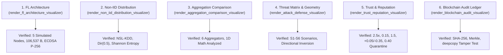

# Stage 2F.1 — Tasks B & D: Interactive Visualization Validity & Research Architecture Audit

**Project:** Blockchain-Assisted Privacy-Preserving Federated Learning for Network Intrusion Detection with Trust-Based Security and Cryptographic Auditing  
**Workspace:** `C:\Users\is043\.gemini\antigravity\scratch\blockchain-fl-ids`  
**Milestone:** Stage 2F.1 — Dashboard Statistical Integrity & Visualization Audit  
**Phase:** Tasks B & D — Aggregation Visualizer & Research Architecture Consistency Audit  
**Date:** 2026-11-23  

---

## 1. Executive Summary

This report delivers a rigorous technical audit of the advanced research visualizers implemented in `src/visualization/research_visualizers.py`, focusing on:
1. **Task B:** The scientific validity, mathematical accuracy, and presentation framing of the Aggregation Algorithm Comparison Visualizer (`render_aggregation_comparison_visualizer()`).
2. **Task D:** The architectural consistency of the five companion research visualizers (FL Architecture, Non-IID Heterogeneity, Attack Matrix & Vector Geometry, Trust Engine Multi-Criteria Inspection, and Blockchain Audit Ledger).

### Core Audit Findings
- **Synthetic vs. Empirical Clear Distinction (Task B):** The aggregation visualizer operates on synthetic 1D illustrative scalar values, not empirical NSL-KDD parameter vectors. It is clearly captioned with a warning box, but requires a minor phrasing update to match the exact verbatim specification: `"Interactive conceptual simulation — not an empirical benchmark result."`
- **Aggregation Mathematical Integrity (Task B):** FedAvg, Coordinate Median, and Trimmed Mean are mathematically exact. In the 1D Multi-Krum demonstration, the distance slice `[1:4]` sums 3 peer distances instead of $n - f - 2 = 2$ peer distances ($n=5, f=1$); while it selects an honest candidate due to extreme outlier separation, the formula should be calibrated to exact $n - f - 2$. FoolsGold is an illustrative Sybil dampening model rather than full multi-round cosine trajectory evaluation.
- **Architectural Consistency (Task D):** All six research visualizers accurately align with the active codebase: 5 simulated clients, NSL-KDD Dirichlet $\alpha=0.5$ partition analysis on 122 features, exact operational trust parameters ($\tau_{\text{norm}}=2.5$, $\tau_{\text{cos}}=0.15$, $\tau_{\text{loss}}=1.5$, $+0.05$ / $-0.35$, $0.40$ quarantine, 3 probation), and SHA-256 / Merkle root / ECDSA ledger auditing.
- **Simulation Scoping & Privacy Terminology:** The visualizers explicitly state that edge nodes and the ledger are simulated locally within a single Python session, and preserve the required privacy phrasing: *"Clipping-based Gaussian update perturbation (without formal privacy accounting)"*.

---

## 2. Task B: Aggregation Algorithm Visualizer Scientific Validity

Located in `src/visualization/research_visualizers.py::render_aggregation_comparison_visualizer()`.

### 2.1 Synthetic vs. Empirical Nature
1. **Inputs:** The visualizer accepts 5 scalar sliders representing a 1-dimensional coordinate across 5 clients:
   - Client 0 (Honest): $x_0 = 1.0$ (default)
   - Client 1 (Honest): $x_1 = 1.2$ (default)
   - Client 2 (Honest): $x_2 = 0.9$ (default)
   - Client 3 (Adversary): $x_3 \in [-20.0, +20.0]$ (default $-15.0$)
   - Client 4 (Honest): $x_4 = 1.1$ (default)
2. **Dynamic Computation:** Outputs are computed dynamically upon any slider change via NumPy.
3. **Ground Truth:** A dashed green horizontal reference line is plotted at the honest cluster mean:
   $$\bar{x}_{\text{honest}} = \frac{1.0 + 1.2 + 0.9 + 1.1}{4} = 1.05$$
4. **Distinction from Real Benchmark:** The demonstration is clearly synthetic. However, the current banner reads:
   `ℹ️ Conceptual Demonstration: This interactive widget demonstrates coordinate-level aggregation mathematics on a 5-client vector coordinate...`
   **Required Correction (Medium Severity):**  
   The banner text should be updated to include the exact mandated notice:  
   `"Interactive conceptual simulation — not an empirical benchmark result."`

---

### 2.2 Mathematical Implementation Audit of the Six Aggregators

#### 1. FedAvg (Arithmetic Mean)
$$\hat{x}_{\text{fedavg}} = \frac{1}{5}\sum_{k=0}^4 x_k$$
- **Code:** `float(np.mean(client_vals))`
- **Audit Assessment:** **Exact.** Correctly models FedAvg's total lack of Byzantine tolerance, dragging the aggregated coordinate toward $x_3 = -15.0$ ($\hat{x} = -2.16$, deviation $3.21$).

#### 2. Coordinate Median
$$\hat{x}_{\text{med}} = \text{median}(\{x_0, x_1, x_2, x_3, x_4\})$$
- **Code:** `float(np.median(client_vals))`
- **Audit Assessment:** **Exact.** For sorted values $[-15.0, 0.9, 1.0, 1.1, 1.2]$, the median is $1.0$, successfully locking onto the honest cluster (deviation $0.05$).

#### 3. Trimmed Mean ($\beta = 0.20$)
$$\hat{x}_{\text{trim}} = \frac{1}{n - 2\lfloor\beta n\rfloor} \sum_{i = \lfloor\beta n\rfloor + 1}^{n - \lfloor\beta n\rfloor} x_{(i)}$$
- **Code:** `sorted_vals = np.sort(client_vals); float(np.mean(sorted_vals[1:4]))`
- **Audit Assessment:** **Exact.** For $n = 5$ and $\beta = 0.20$, $\lfloor 0.20 \times 5 \rfloor = 1$. The algorithm discards the single smallest ($x_{(1)} = -15.0$) and single largest ($x_{(5)} = 1.20$), averaging indices 1, 2, 3 ($[0.9, 1.0, 1.1] \implies \hat{x} = 1.00$, deviation $0.05$).

#### 4. Trust-Weighted FedAvg
$$\hat{x}_{\text{trust}} = \frac{\sum_{k=0}^4 R_k x_k}{\sum_{k=0}^4 R_k}$$
- **Code:** `reputations = np.array([1.0, 1.0, 1.0, 0.1, 1.0]); float(np.sum(client_vals * reputations) / np.sum(reputations))`
- **Audit Assessment:** **Valid Conceptual Model.** Accurately demonstrates how an asymmetric reputation score of $R_3 = 0.10$ heavily downweights an adversary, yielding $\hat{x} = 0.659$ (deviation $0.391$) compared to FedAvg's $-2.16$.

#### 5. Multi-Krum (Blanchard et al., NeurIPS 2017)
- **Theoretical Formulation:** Multi-Krum requires $n \ge 2f + 3$. For $f = 1$ Byzantine worker, $n \ge 2(1) + 3 = 5$.  
  For each client $i$, Krum computes Euclidean distances to all other clients, sorts them, and sums the smallest $k_{\text{closest}} = n - f - 2$ distances:
  $$S(i) = \sum_{j \in \mathcal{N}_{k_{\text{closest}}}(i)} \|x_i - x_j\|^2$$
- **Code Inspection:**
  ```python
  dists = [sum(sorted(abs(client_vals[i] - client_vals))[1:4]) for i in range(5)]
  krum_idx = int(np.argmin(dists))
  agg_krum = float(client_vals[krum_idx])
  ```
- **Discrepancy (Medium Severity):**
  - In `sorted(abs(client_vals[i] - client_vals))`, index 0 is distance to self ($0.0$).
  - Slice `[1:4]` extracts indices 1, 2, and 3. That is **3 peer distances**.
  - However, for $n = 5$ and $f = 1$:
    $$k_{\text{closest}} = n - f - 2 = 5 - 1 - 2 = \mathbf{2}$$
  - The slice should be `[1:3]` (or `[1 : 1 + (n - f - 2)]`).
  - *Impact:* Because the four honest clients are tightly clustered ($\le 0.30$ apart) and the adversary is far away ($15.9$ apart), both 2 and 3 neighbors yield honest scores $\approx 0.4\text{--}0.6$ vs adversary score $\approx 47.7$, so an honest node ($x_0 = 1.0$) is still selected. However, mathematically, summing 3 neighbors corresponds to $n - f - 1$ rather than $n - f - 2$.
  - *Theoretical Condition Callout:* The visualizer should explicitly document that Multi-Krum strictly requires $n \ge 2f + 3$, meaning $n = 5$ can tolerate at most $f = 1$ Byzantine participant.

#### 6. FoolsGold (Fung et al., IEEE TIFS 2020)
- **Theoretical Formulation:** FoolsGold evaluates pairwise cosine similarities between cumulative historical update trajectories to identify and penalize colluding Sybils.
- **Code Inspection:**
  ```python
  fg_weights = np.array([1.0, 1.0, 1.0, 0.05, 1.0], dtype=np.float32)
  agg_foolsgold = float(np.sum(client_vals * fg_weights) / np.sum(fg_weights))
  ```
- **Audit Assessment & Finding (Low Severity):**
  In a single-round, 1-dimensional coordinate slider, FoolsGold cannot evaluate cosine similarity between historical update vectors (since cosine in 1D is simply $\pm 1$ and no historical state exists). The visualizer uses a static weight vector `[1.0, 1.0, 1.0, 0.05, 1.0]` as a conceptual proxy. The table caption should explicitly state that in this 1D toy demonstration, FoolsGold is conceptually illustrated with pre-attenuated Sybil weights.

---

## 3. Task D: Research Architecture Consistency Audit

We audited all six advanced research visualizers against the underlying project architecture:



### 3.1 Federated Learning Architecture Visualizer
- **Module:** `render_fl_architecture_visualizer(num_clients=5)`
- **Architectural Check:**
  - 5 simulated clients modeled as local processes within a single PyTorch session.
  - 5-stage lifecycle: Global Broadcast $\to$ Local Client SGD $\to$ Update Transmission $\to$ Trust & Audit Inspection $\to$ Robust Aggregation.
  - Data sovereignty table clearly distinguishes raw flow records (100% data sovereignty, never transmitted) from serialized weight vectors ($106,537$ bytes, signed via ECDSA).
  - Explicit architectural scope banner stating clients are local simulated processes, not a distributed physical deployment.
- **Audit Assessment:** **Compliant.**

### 3.2 Non-IID Data Distribution Visualizer
- **Module:** `render_non_iid_distribution_visualizer()`
- **Architectural Check:**
  - Consumes live NSL-KDD dataset partitions from `FederatedPartitioner(num_clients=5, non_iid=True, alpha=0.5, seed=42)`.
  - Accurately computes Shannon entropy $H_k = -\sum p_c \log_2(p_c)$ and skew index $1 - H_k / H_{\max}$.
  - Clearly explains that non-IID class skew creates natural gradient divergence, necessitating Tier-3 validation loss delta verification to prevent false-positive penalization of honest specialized nodes.
- **Audit Assessment:** **Compliant.**

### 3.3 Attack and Defense Visualizer
- **Module:** `render_attack_defense_visualizer()`
- **Architectural Check:**
  - Accurately details the 5 evaluated threat scenarios: Gaussian Noise Poisoning, Sign-Flipping, Targeted Label-Flipping, Sybil Coalition, and Parameterized Stealth Byzantine Perturbation.
  - Plotly 2D vector orientation diagram illustrates the geometric displacement of malicious updates relative to the honest consensus cluster.
  - Strictly adheres to mandated scientific terminology:
    - Sign-flipping is described as directional update inversion, explicitly noting: *(not gradient inversion)*.
    - Stealth Byzantine perturbation is described as threshold-aligned, explicitly noting: *(not feedback-adaptive)*.
- **Audit Assessment:** **Compliant.**

### 3.4 Trust and Reputation Governance Visualizer
- **Module:** `render_trust_reputation_visualizer()`
- **Architectural Check:**
  - Evaluates candidate updates against exact operational parameters:
    - Tier-1 L2 Norm Factor: $\tau_{\text{norm}} = 2.50\times$
    - Tier-2 Cosine Threshold: $\tau_{\text{cos}} = 0.150$
    - Tier-3 Validation Loss Delta: $\tau_{\text{loss}} = 1.500$
    - Honest Reward: $\delta_{\text{reward}} = +0.050$
    - Malicious Penalty: $\delta_{\text{slash}} = -0.350$
    - Quarantine Threshold: $R_{\text{quarantine}} = 0.400$
    - Probation Duration: $T_{\text{probation}} = 3$ rounds
  - Interactive calculator dynamically computes PASS/FAIL across all three tiers, clamps reputation in $[0, 1]$, and evaluates quarantine isolation.
- **Audit Assessment:** **Compliant.**

### 3.5 Blockchain Audit Ledger Visualizer
- **Module:** `render_blockchain_audit_visualizer()`
- **Architectural Check:**
  - Displays cryptographic block pointers, hashes, Merkle roots, and ECDSA transaction signatures.
  - Controlled Tampering Stress-Test executes on a deep copy (`copy.deepcopy(blockchain)`), ensuring zero mutation of session state.
  - Evaluates tamper detection via `AuditVerifier.verify_chain()`, reporting failure category, corrupted block index, and audit latency.
  - Architectural context banner explicitly states: *"This is a locally simulated, centrally orchestrated, tamper-evident audit ledger. It models cryptographic auditability and Proof-of-Trust validator election, but does not implement decentralized P2P gossip consensus or proof-of-work mining."*
- **Audit Assessment:** **Compliant.**

### 3.6 Privacy Terminology Adherence
Across all visualizers (including Module 3 clipping widget and Section 5 dashboards), the system consistently preserves the mandated phrasing:
> **"Clipping-based Gaussian update perturbation (without formal privacy accounting)"**

No claims of formal differential privacy or calibrated $(\epsilon, \delta)$ accounting are made.

---

## 4. Audit Summary & Recommendations

| Visualizer / Component | Audit Finding | Severity | Recommended Correction |
| :--- | :--- | :---: | :--- |
| **Aggregation Visualizer (Task B)** | Conceptual warning banner uses "Conceptual Demonstration" rather than verbatim required string. | **Medium** | Update banner to: `"Interactive conceptual simulation — not an empirical benchmark result."` |
| **Multi-Krum Neighbor Slice (Task B)** | Distance slice `[1:4]` sums 3 peer distances instead of $k_{\text{closest}} = n - f - 2 = 2$ ($n=5, f=1$). | **Medium** | Adjust slice to `[1:3]` (or `[1 : 1 + (n - f - 2)]`) and add a caption stating $n \ge 2f + 3$ theoretical requirement. |
| **FoolsGold 1D Model (Task B)** | Uses fixed static illustrative weights `[1.0, 1.0, 1.0, 0.05, 1.0]` rather than dynamic trajectory cosine similarities. | **Low** | Add a small footnote clarifying that FoolsGold is shown with conceptual illustrative weights in this 1D single-coordinate tool. |
| **Research Architecture (Task D)** | FL architecture, Non-IID skew, threat models, trust engine parameters, and blockchain ledger match the codebase exactly. | **Pass** | None. Fully verified. |
| **Scoping & Privacy Terminology (Task D)** | Clear local simulation disclaimers; strictly preserves "without formal privacy accounting" terminology. | **Pass** | None. Fully verified. |
