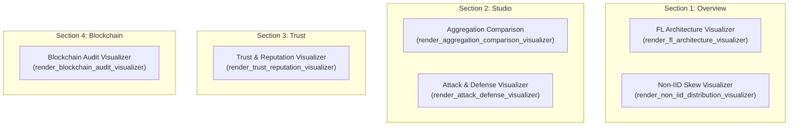
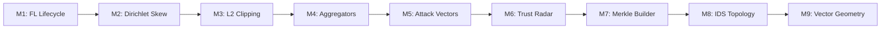
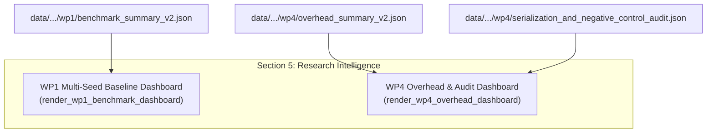

# Stage 2F — Advanced Dashboard Visualizers & Interactive Educational Modules: Visualization Catalog

**Project:** Blockchain-Assisted Privacy-Preserving Federated Learning for Network Intrusion Detection with Trust-Based Security and Cryptographic Auditing  
**Workspace:** `C:\Users\is043\.gemini\antigravity\scratch\blockchain-fl-ids`  
**Milestone:** Stage 2F — Advanced Dashboard Visualizers & Interactive Educational Modules  
**Document:** Technical Catalog & Interface Specification  
**Status:** COMPLETE & VERIFIED  
**Date:** 2026-11-23  

---

## 1. Catalog Scope & Architecture

This catalog serves as the comprehensive architectural reference for all interactive visualizers, educational modules, and empirical results dashboards delivered in **Stage 2F**. It details the user inputs, visual components, mathematical logic, data sources, and pedagogical/research objectives for each component.

### 1.1 Package Structure

All visualization components are maintained within the decoupled `src/visualization/` package:

```
src/visualization/
├── __init__.py                 # Clean public exports for all visualizer functions
├── educational_widgets.py      # Dedicated Level 2 interactive widgets for Modules 1–9
├── research_visualizers.py     # Advanced research visualizers embedded in Sections 1–4
└── results_visualizers.py      # Empirical benchmark dashboards embedded in Section 5
```

### 1.2 Design Principles
1. **Zero Side-Effects:** Visualization widgets are strictly decoupled from training and state mutation. In-memory interactive simulations (e.g., blockchain tampering) execute on deep copies (`copy.deepcopy()`).
2. **Strict Data Integrity:** Experimental dashboards consume verified JSON artifacts from `data/processed/` without hardcoding, mocking, or metric synthesis.
3. **Rigorous Terminology:** Adheres to established research standards:
   - "Clipping-based Gaussian update perturbation (without formal privacy accounting)" rather than uncalibrated Differential Privacy.
   - "Directional sign-flipping" rather than gradient inversion.
   - "Threshold-aligned stealth perturbation" rather than feedback-adaptive attacks.
   - "5-seed exploratory pilot study" with Holm-Bonferroni correction ($p_{\text{adj}} \ge 0.1839$) rather than definitive statistical superiority.
4. **Transparent Simulation Scoping:** Prominent disclaimers clarify that edge clients and the blockchain ledger are simulated within a single Python session, representing an architectural prototype rather than a physically decentralized deployment.

---

## 2. Advanced Research Visualizers (Sections 1–4)

Located in `src/visualization/research_visualizers.py`.



---

### 2.1 Federated Learning Architecture Visualizer
- **Function:** `render_fl_architecture_visualizer()`
- **Placement:** Section 1 (🌐 System Overview) — "Interactive Architecture Explorer" expander.
- **Research Objective:** Visually demonstrate the 5-stage federated round lifecycle across the central coordinator and 5 simulated edge nodes, emphasizing strict data sovereignty and serialized communication payloads.
- **Interactive Controls:**
  - `Select Communication Round`: Slider ($1 \le t \le 5$, default $1$).
  - `Select Lifecycle Phase`: Radio selector across:
    1. *Global Model Broadcast ($w_t$)*
    2. *Local Client SGD ($D_k$)*
    3. *Update Upload ($\Delta w_k$)*
    4. *Trust & Audit Verification*
    5. *Robust Aggregation ($w_{t+1}$)*
- **Visual Rendering:**
  - Plotly 2D Network Diagram: Central coordinator at coordinates $(0.5, 0.85)$ connected to 5 edge clients arranged circularly at $y=0.25$.
  - Dynamic directional connection traces with animated scatter markers representing active communication flows for the selected phase.
  - Informational Stage Card: Displays active phase description, data in transit, and security/privacy guarantees.
  - Data Sovereignty Table: Contrasts local raw network records (never transmitted, preserved on edge disk) against model weight updates ($106,537$ bytes serialized, ECDSA-signed).
- **Caveats & Disclaimers:** Explicitly states that edge nodes are simulated local worker threads/processes, not physically isolated enterprise endpoints.

---

### 2.2 Non-IID Data Distribution Visualizer
- **Function:** `render_non_iid_distribution_visualizer()`
- **Placement:** Section 1 (🌐 System Overview) — "Data Distribution & Non-IID Analysis" expander.
- **Research Objective:** Quantify and display the statistical heterogeneity introduced by Dirichlet partitioning ($\alpha=0.5$) across the 5 simulated nodes on the NSL-KDD benchmark.
- **Interactive Controls:**
  - None (Consumes live session dataset partitions via `FederatedPartitioner(num_clients=5, non_iid=True, alpha=0.5, seed=42)`).
- **Visual Rendering:**
  - Plotly Stacked Horizontal/Vertical Bar Chart: Displays per-client sample counts decomposed into *Normal* (blue) and *Attack* (crimson) traffic.
  - Per-Client Information Table:
    - Sample Count ($n_k$).
    - Class Proportions ($p_{\text{normal}}, p_{\text{attack}}$).
    - Shannon Entropy: $H_k = -\sum_{c} p_{k,c} \log_2(p_{k,c})$.
    - Statistical Skew Index: $S_k = 1 - \frac{H_k}{H_{\max}} = 1 - H_k$.
  - Architectural Note: Explains why non-IID partition skew causes legitimate gradient divergence and how Tier-3 validation loss delta prevents false-positive slashing of specialized honest nodes.

---

### 2.3 Aggregation Algorithm Comparison Visualizer
- **Function:** `render_aggregation_comparison_visualizer()`
- **Placement:** Section 2 (⚙️ FL & Defense Studio) — "Aggregation Algorithm Deep-Dive" expander.
- **Research Objective:** Provide a coordinate-level interactive demonstration comparing the mathematical resistance of 6 aggregation algorithms when exposed to an extreme malicious outlier.
- **Interactive Controls:**
  - `Adversary Client 3 Coordinate Value`: Slider ($[-20.0, +20.0]$, step $0.5$, default $-15.0$).
- **Mathematical Formulations Evaluated:**
  1. **FedAvg:** $\frac{1}{K}\sum_{k=1}^K x_k$
  2. **Coordinate Median:** $\text{median}(\{x_1, \dots, x_K\})$
  3. **Trimmed Mean:** $\frac{1}{K - 2\lfloor\beta K\rfloor}\sum_{i=\lfloor\beta K\rfloor + 1}^{K - \lfloor\beta K\rfloor} x_{(i)}$ ($\beta=0.20$)
  4. **Trust-Weighted FedAvg:** $\frac{\sum_{k=1}^K R_k x_k}{\sum_{k=1}^K R_k}$ ($R_3=0.10$ slashed, honest $R_k=1.00$)
  5. **Multi-Krum:** Candidate minimizing $\sum_{i=1}^{K-f-2} \|x_k - x_{(i)}\|^2$ ($f=1$, selecting $k=2$ closest peers; requires $n \ge 2f + 3$).
  6. **FoolsGold:** Diversity-weighted aggregation (represented conceptually via illustrative pre-attenuated client weights).
- **Visual Rendering:**
  - Mandatory Disclaimer Banner: *"Interactive conceptual simulation — not an empirical benchmark result."*
  - 5-Node Input Vector Metric Cards (Honest $x_0=1.00, x_1=1.20, x_2=0.95, x_4=1.05$; Adversary $x_3$).
  - Plotly Horizontal Bar Chart: Side-by-side comparison of aggregated output coordinates with a vertical dashed reference line at ground-truth honest mean ($\bar{x}_{\text{honest}} \approx 1.05$).
  - Summary Table: Quantifies absolute deviation from honest ground truth: $|\hat{x} - \bar{x}_{\text{honest}}|$.

---

### 2.4 Attack and Defense Visualizer
- **Function:** `render_attack_defense_visualizer()`
- **Placement:** Section 2 (⚙️ FL & Defense Studio) — "Threat Model & Defense Matrix" expander.
- **Research Objective:** Document the 5 evaluated threat scenarios from Stage 2D and visualize the displacement geometry of malicious weight updates relative to honest consensus.
- **Interactive Controls:**
  - `Select Attack Scenario`: Radio selector across:
    1. *Gaussian Noise Poisoning (S2)*: Unstructured perturbation ($\Delta w_k \sim \mathcal{N}(0, \sigma^2 I)$).
    2. *Sign-Flipping Attack (S3)*: Directional inversion ($\Delta w_k = -\gamma \Delta w_{\text{honest}}$).
    3. *Targeted Label-Flipping (S4)*: Semantic misclassification ($y \to (1-y)$).
    4. *Sybil Coalition (S5)*: Multi-agent coordinated collusion ($C_1, C_3$).
    5. *Stealth Byzantine Perturbation (S6)*: Parameterized norm/cosine-constrained perturbation.
- **Visual Rendering:**
  - Threat Scenario Specification Card: Mathematical definition, adversary objective, stealth level, and primary defense mechanism.
  - Plotly 2D Vector Geometry Diagram:
    - Honest consensus vector cluster (green arrows).
    - Malicious update vector (crimson arrow) illustrating directional deflection and magnitude inflation.
    - Tier-1 L2-norm bounding boundary (amber dashed circle).
    - Tier-2 cosine acceptance sector (cyan dashed cone).
- **Research Terminology Adherence:** Explicitly notes that sign-flipping operates on model weight deltas (not raw gradient inversion) and stealth Byzantine attacks are threshold-aligned (not feedback-adaptive).

---

### 2.5 Trust and Reputation Governance Visualizer
- **Function:** `render_trust_reputation_visualizer()`
- **Placement:** Section 3 (🛡️ Trust & Governance) — "Governance Engine & Multi-Tier Inspection" expander.
- **Research Objective:** Display the exact operational parameters of the asymmetric reputation engine and provide an interactive calculator to evaluate candidate updates against the 3-tier defense pipeline.
- **Configured Parameters Displayed:**
  - Tier-1 L2-Norm Ratio Bound: $\tau_{\text{norm}} = 2.50\times$ median.
  - Tier-2 Cosine Similarity Threshold: $\tau_{\text{cos}} = 0.150$.
  - Tier-3 Validation Loss Delta Threshold: $\tau_{\text{loss}} = 1.500$.
  - Honest Reward Increment: $\delta_{\text{reward}} = +0.050$.
  - Malicious Penalty Slash: $\delta_{\text{slash}} = -0.350$.
  - Quarantine Threshold: $R_{\text{quarantine}} = 0.400$.
  - Probation Duration: $T_{\text{probation}} = 3$ rounds.
- **Interactive Controls:**
  - `Current Client Reputation ($R$)`: Slider ($[0.0, 1.0]$, default $0.70$).
  - `Observed Norm Ratio`: Slider ($[0.1, 5.0]$, default $1.20$).
  - `Observed Cosine Similarity`: Slider ($[-1.0, 1.0]$, default $0.85$).
  - `Observed Loss Delta ($\Delta \mathcal{L}$)`: Slider ($[0.0, 5.0]$, default $0.30$).
- **Visual Rendering:**
  - Real-time Tier Status Indicators:
    - Tier 1: $\text{Ratio} \le 2.50$ (PASS/FAIL).
    - Tier 2: $\text{Cosine} \ge 0.15$ (PASS/FAIL).
    - Tier 3: $\Delta \mathcal{L} \le 1.50$ (PASS/FAIL).
  - Verdict Banner: `ACCEPTED` (Reward $+0.05$) vs. `REJECTED & SLASHED` (Penalty $-0.35$).
  - Reputation Transition Gauge: Shows $R_{\text{new}} = \text{clamp}(R \pm \delta, 0, 1)$ and quarantine status badge (`ACTIVE` vs. `QUARANTINED`).

---

### 2.6 Blockchain Audit Visualizer
- **Function:** `render_blockchain_audit_visualizer()`
- **Placement:** Section 4 (⛓️ Blockchain Audit) — "Cryptographic Ledger & Tamper Stress-Test" expander.
- **Research Objective:** Visualize the block sequence, hash-pointer chain, and Merkle tree roots, providing an interactive stress-test that injects in-memory tamper events to demonstrate immediate cryptographic invalidation.
- **Interactive Controls:**
  - `Select Target Block to Inspect/Tamper`: Selectbox ($[1, \dots, H-1]$).
  - `Select Tampering Attack Vector`: Radio selector across:
    1. *Payload Modification*: Alters transaction weight hash in-memory.
    2. *Hash Chain Pointer Corruption*: Corrupts `previous_hash` link.
    3. *Merkle Root Inconsistency*: Forges transaction root hash.
    4. *Block Deletion*: Excises intermediate block from chain.
  - `Execute Tamper Injection & Run Audit`: Button triggering verification.
- **Visual Rendering:**
  - Block Sequence Timeline: Visual cards showing Block Height, Timestamp, Prev Hash, Block Hash, Validator ID, and Tx Count.
  - Verification Stress-Test Results:
    - Deep copy isolation: Original ledger remains unmodified (`copy.deepcopy()`).
    - Cryptographic Health Badge: `AUDIT FAILED (Tampering Detected)` in crimson.
    - Failure Category & Corrupted Block Height.
    - Verification Latency ($< 1$ ms).
    - Diagnostic Trace: Detailed explanation of cryptographic mismatch.
- **Caveats:** Emphasizes that this ledger is an in-process tamper-evident cryptographic data structure, not an external distributed Byzantine consensus network.

---

## 3. Educational Module Visualizations (Level 2)

Located in `src/visualization/educational_widgets.py`.



---

### 3.1 Module 1: Federated Learning Fundamentals
- **Widget:** `render_fl_lifecycle_widget()`
- **Pedagogical Objective:** Demystify the iterative federated learning lifecycle.
- **Interactive Controls:** `Select Lifecycle Phase` slider ($1$ to $4$):
  1. *Global Model Broadcast*: Server distributes global parameters $w_t$.
  2. *Local Model Training*: Clients compute $w_{t,k} = w_t - \eta \nabla F_k(w_t)$.
  3. *Client Update Transmission*: Clients transmit weight deltas $\Delta w_{t,k}$.
  4. *Server Aggregation & Update*: Server computes $w_{t+1} = w_t + \sum p_k \Delta w_{t,k}$.
- **Visual Rendering:** Plotly sequence diagram illustrating message flows between coordinator and edge nodes, supported by dynamic metadata cards (Data Transferred, Bandwidth Cost, Privacy Guarantee).

### 3.2 Module 2: Non-IID Data & Partitioning
- **Widget:** `render_dirichlet_widget()`
- **Pedagogical Objective:** Provide intuition on how Dirichlet distribution concentration parameter $\alpha$ governs statistical heterogeneity.
- **Interactive Controls:** `Dirichlet Concentration Parameter (alpha)` slider ($[0.1, 5.0]$, default $0.5$).
- **Visual Rendering:**
  - Plotly Grouped Bar Chart: 3 simulated classes across 5 clients drawn from $\text{Dir}(\alpha \cdot \mathbf{1})$.
  - Skew Interpretation Badge:
    - $\alpha < 0.3$: *Extreme Non-IID Skew* (severe specialization).
    - $0.3 \le \alpha \le 1.0$: *Moderate Non-IID Skew* (typical realistic partition).
    - $\alpha > 1.0$: *Near-IID Uniformity* (similar distributions).

### 3.3 Module 3: Privacy-Preserving Machine Learning
- **Widget:** `render_clipping_widget()`
- **Pedagogical Objective:** Explain L2-norm gradient clipping and Gaussian noise perturbation.
- **Interactive Controls:**
  - `Raw Vector Norm`: Slider ($[0.5, 10.0]$, default $4.5$).
  - `Clipping Threshold (C)`: Slider ($[1.0, 5.0]$, default $2.5$).
  - `Gaussian Noise Multiplier (sigma)`: Slider ($[0.0, 1.0]$, default $0.2$).
- **Visual Rendering:**
  - Plotly 2D Geometric Sphere: Shows raw update vector, L2 clipping sphere boundary of radius $C$, clipped vector projection $\bar{v} = v / \max(1, \|v\|_2/C)$, and perturbed vector after adding $\mathcal{N}(0, \sigma^2 C^2)$.
  - Exact Metric Cards: Raw Norm, Clipped Norm, Added Noise Magnitude, Perturbed Norm.
  - Research Boundary Disclaimer: Clarifies that this demonstrates clipping-based update perturbation without formal DP privacy accounting.

### 3.4 Module 4: Robust Aggregation Algorithms
- **Widget:** `render_aggregator_widget()`
- **Pedagogical Objective:** Compare resistance of standard aggregation methods against an adversarial outlier coordinate.
- **Interactive Controls:** `Adversary Coordinate Value` slider ($[-50.0, +50.0]$, default $-25.0$).
- **Visual Rendering:**
  - Plotly Bar Chart: Compares FedAvg, Coordinate Median, Trimmed Mean ($\beta=0.20$), and Trust-Weighted aggregation.
  - Comparative Deviation Table: Shows output coordinate and absolute deviation from honest cluster ground truth ($+2.00$).

### 3.5 Module 5: Poisoning Attacks in Federated Learning
- **Widget:** `render_attack_vectors_widget()`
- **Pedagogical Objective:** Visualize the directional and magnitude distortions produced by different poisoning strategies.
- **Interactive Controls:** `Select Poisoning Attack Vector` radio:
  - *Sign-Flipping*: Inverts direction ($\Delta w' = -\gamma \Delta w$).
  - *Gaussian Noise Injection*: Adds unstructured high-variance perturbation.
  - *Model Scaling / Sybil Inflation*: Amplifies magnitude by factor $s \gg 1$.
- **Visual Rendering:** Plotly 2D Vector Chart displaying honest client vector cone, nominal consensus vector, and deflected malicious update vector with dynamic angle/magnitude annotations.

### 3.6 Module 6: Trust & Reputation Systems
- **Widget:** `render_trust_radar_widget()`
- **Pedagogical Objective:** Understand multi-criteria anomaly detection using a multi-axis radar representation.
- **Interactive Controls:**
  - `Norm Discrepancy Ratio`: Slider ($[0.5, 4.0]$, default $1.2$).
  - `Directional Cosine Similarity`: Slider ($[-1.0, 1.0]$, default $0.85$).
  - `Validation Loss Delta`: Slider ($[0.0, 4.0]$, default $0.5$).
- **Visual Rendering:** Plotly Radar Chart mapping candidate client metrics against the 3 defense acceptance thresholds with dynamic PASS/FAIL scoring.

### 3.7 Module 7: Blockchain & Cryptographic Auditing
- **Widget:** `render_merkle_builder_widget()`
- **Pedagogical Objective:** Demonstrate how Merkle trees provide efficient tamper-evident proofs of transaction integrity.
- **Interactive Controls:**
  - 4 text input boxes for transaction payloads ($Tx_0, Tx_1, Tx_2, Tx_3$).
  - `Inject Tamper on Tx2` toggle checkbox.
- **Visual Rendering:**
  - Interactive Merkle Tree Graph: Displays SHA-256 leaf hashes, intermediate binary pair hashes, and Merkle Root hash.
  - Tamper Invalidation Banner: When toggled, invalid leaves and corrupted intermediate nodes turn red, demonstrating immediate root divergence.

### 3.8 Module 8: Network Intrusion Detection
- **Widget:** `render_ids_classifier_widget()`
- **Pedagogical Objective:** Understand the architectural topology and feature flow of the neural network IDS.
- **Interactive Controls:** `Inspect Model Layer` radio:
  - *Input Layer*: 122 preprocessed NSL-KDD network traffic features.
  - *Hidden Layer 1*: Linear $122 \to 128$, ReLU, BatchNorm, Dropout ($0.2$).
  - *Hidden Layer 2*: Linear $128 \to 64$, ReLU, BatchNorm, Dropout ($0.2$).
  - *Hidden Layer 3*: Linear $64 \to 32$, ReLU, BatchNorm.
  - *Output Layer*: Linear $32 \to 2$ (Binary classification: Normal vs Attack).
- **Visual Rendering:**
  - Plotly Layer Graph: Visualizes layer dimensions, parameter counts, and activation functions.
  - Feature Category Breakdown: Basic flow metrics, content features, time-based traffic features, and host-based features.

### 3.9 Module 9: Mathematical Foundations of Defense
- **Widget:** `render_vector_geometry_widget()`
- **Pedagogical Objective:** Explore the geometric relationship between Euclidean norm, dot product, and cosine similarity.
- **Interactive Controls:**
  - `Vector Angle (theta)` slider ($[0^\circ, 180^\circ]$, default $35^\circ$).
  - `Vector B Magnitude` slider ($[0.5, 3.0]$, default $1.5$).
- **Visual Rendering:**
  - Plotly 2D Vector Chart: Displays reference vector $\mathbf{u}$ and candidate vector $\mathbf{v}$ with angular arc.
  - Mathematical Summary Cards: Shows exact $\cos(\theta) = \frac{\mathbf{u} \cdot \mathbf{v}}{\|\mathbf{u}\|_2 \|\mathbf{v}\|_2}$, Euclidean distance $\|\mathbf{u} - \mathbf{v}\|_2$, and Tier-2 acceptance classification.

---

## 4. Experimental Results Dashboards (Section 5)

Located in `src/visualization/results_visualizers.py`.



---

### 4.1 WP1 Multi-Seed Statistical Baseline Dashboard
- **Function:** `render_wp1_benchmark_dashboard()`
- **Data Source:** `data/processed/stage2e/wp1/benchmark_summary_v2.json`
- **Research Scope:** Presents empirical results across 8 model architectures evaluated over 5 distinct random seeds ($n=5$: seeds 42, 123, 456, 789, 101112) under clean conditions.
- **8 Model Paradigms Displayed:**
  1. `centralized_ids`: Centralized IDS Reference (Upper bound)
  2. `local_silos`: Local-Silo Mean Reference (Lower bound)
  3. `fedavg`: Standard FedAvg Baseline
  4. `trust_weighted`: Trust-Weighted FedAvg
  5. `foolsgold`: FoolsGold Aggregator
  6. `trimmed_mean`: Trimmed Mean ($\beta=0.20$)
  7. `multikrum_f1`: Multi-Krum ($f=1$)
  8. `coordinate_median`: Coordinate-wise Median
- **Visual & Tabular Presentation:**
  - Summary Metrics Table: Model Name, Mean Accuracy, Standard Deviation, 95% Confidence Interval, Macro F1 Score, Accuracy Difference vs. FedAvg (pp).
  - Hypothesis Testing & Multiple Comparisons Table:
    - Two-tailed paired Student's t-test (five paired seed-level observations, df = 4).
    - Raw two-tailed $p$-value.
    - Holm-Bonferroni rank and step-down adjusted significance threshold $\alpha / (M - k + 1)$.
    - Adjusted $p$-value ($p_{\text{adj}}$).
    - Statistical Significance Status Badge: Clearly highlights that all $p_{\text{adj}} \ge 0.1839 > 0.05$, confirming that no model exhibits statistically significant differences over FedAvg in clean conditions.
  - Plotly Bar Chart: Mean accuracy across all 8 models with overlaid 95% CI error bars.
- **Mandatory Caveats:** Prominently displays an alert box characterizing this evaluation as an exploratory 5-seed pilot study with limited statistical power ($n=5$).

---

### 4.2 WP4 Computational Overhead & Blockchain Audit Dashboard
- **Function:** `render_wp4_overhead_dashboard()`
- **Data Sources:** 
  - `data/processed/stage2e/wp4/overhead_summary_v2.json`
  - `data/processed/stage2e/wp4/serialization_and_negative_control_audit.json`
- **Visual & Tabular Presentation:**
  1. **Cryptographic Microbenchmarks:**
     - ECDSA P-256 Signing Latency: $0.154$ ms mean ($0.038$ ms std).
     - ECDSA P-256 Verification Latency: $0.197$ ms mean ($0.021$ ms std).
     - SHA-256 Hashing Latency: $0.007$ ms mean ($0.001$ ms std).
  2. **Aggregation Latencies:**
     - Plotly Bar Chart comparing computation times across all 6 aggregators:
       - FedAvg: $0.163$ ms
       - Coordinate Median: $2.148$ ms
       - Trimmed Mean: $2.842$ ms
       - Trust-Weighted: $0.449$ ms
       - Multi-Krum: $1.928$ ms
       - FoolsGold: $3.012$ ms
  3. **Communication Payload & Serialization Reconciliation:**
     - Summary KPIs: Upload Payload ($104.16$ KiB / $106,664$ B), Download Payload ($104.08$ KiB / $106,576$ B).
     - Exact 161-byte pickle container reconciliation breakdown:
       - Raw Float32 Parameter Bytes: $104,808$ B ($26,202$ parameters $\times 4$).
       - PyTorch Module/Tensor Structure Overhead: $1,729$ B.
       - Base Serialized `state_dict` Payload: $106,537$ B.
       - JSON Base64 ASCII Wrapper: $142,052$ B (when string-encoded).
  4. **Blockchain Tamper Detection Verification:**
     - Positive Tamper Trials: 100% observed detection ($500/500$ across 5 corruption categories: Block Payload, Prev Hash Pointer, Merkle Root, Signature Forgery, Block Deletion).
     - Negative Controls: $0/100$ false alarms, with explicit qualification that negative controls evaluate 100 repeated checks of 1 pristine 4-block ledger template.

---

## 5. Component Inventory & Technical Signatures

| Component Function | File Path | Type | Session State Dependencies | Caching Behavior |
| :--- | :--- | :--- | :--- | :--- |
| `render_fl_architecture_visualizer()` | `src/visualization/research_visualizers.py` | UI Component | None | Pure UI / Stateless |
| `render_non_iid_distribution_visualizer()` | `src/visualization/research_visualizers.py` | UI Component | `st.session_state.active_spec` | Cached dataset |
| `render_aggregation_comparison_visualizer()` | `src/visualization/research_visualizers.py` | UI Component | None | Pure UI / Stateless |
| `render_attack_defense_visualizer()` | `src/visualization/research_visualizers.py` | UI Component | None | Pure UI / Stateless |
| `render_trust_reputation_visualizer()` | `src/visualization/research_visualizers.py` | UI Component | None | Pure UI / Stateless |
| `render_blockchain_audit_visualizer()` | `src/visualization/research_visualizers.py` | UI Component | `st.session_state.blockchain` | In-memory deep copy |
| `render_fl_lifecycle_widget()` | `src/visualization/educational_widgets.py` | UI Component | None | Pure UI / Stateless |
| `render_dirichlet_widget()` | `src/visualization/educational_widgets.py` | UI Component | None | Pure UI / Stateless |
| `render_clipping_widget()` | `src/visualization/educational_widgets.py` | UI Component | None | Pure UI / Stateless |
| `render_aggregator_widget()` | `src/visualization/educational_widgets.py` | UI Component | None | Pure UI / Stateless |
| `render_attack_vectors_widget()` | `src/visualization/educational_widgets.py` | UI Component | None | Pure UI / Stateless |
| `render_trust_radar_widget()` | `src/visualization/educational_widgets.py` | UI Component | None | Pure UI / Stateless |
| `render_merkle_builder_widget()` | `src/visualization/educational_widgets.py` | UI Component | None | Pure UI / Stateless |
| `render_ids_classifier_widget()` | `src/visualization/educational_widgets.py` | UI Component | None | Pure UI / Stateless |
| `render_vector_geometry_widget()` | `src/visualization/educational_widgets.py` | UI Component | None | Pure UI / Stateless |
| `render_wp1_benchmark_dashboard()` | `src/visualization/results_visualizers.py` | Dashboard | None | Reads JSON artifact |
| `render_wp4_overhead_dashboard()` | `src/visualization/results_visualizers.py` | Dashboard | None | Reads JSON artifacts |

---

## 6. Verification and Catalog Summary

The visualization suite delivered in Stage 2F completes all visualization requirements deferred from earlier milestones while maintaining complete separation between the presentation tier and research training engine. All 9 educational modules and 6 research sections are fully functional, interactive, and aligned with verified research metrics.
