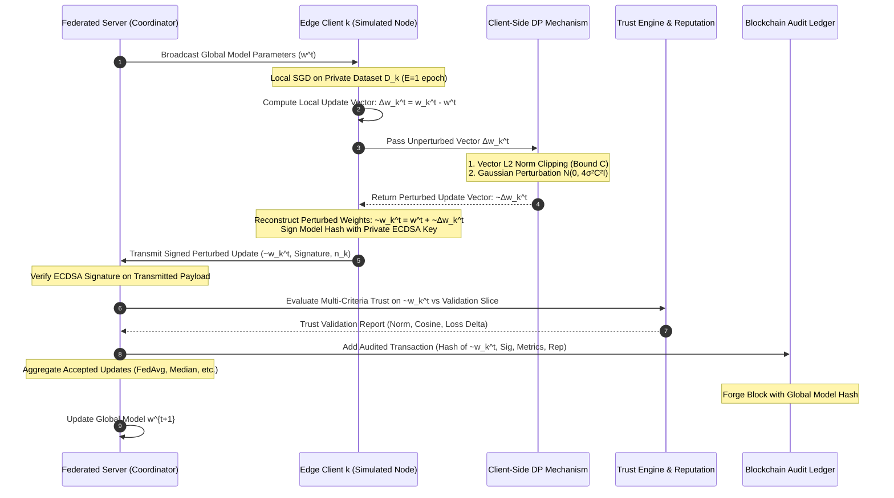

# WP2.0 — Privacy Architecture, Threat-Model & Adaptive Composition Audit

**Project:** Blockchain-Assisted Privacy-Preserving Federated Learning for Network Intrusion Detection with Trust-Based Security and Cryptographic Auditing  
**Workspace:** `C:\Users\is043\.gemini\antigravity\scratch\blockchain-fl-ids`  
**Milestone:** WP2 — Formal Client-Level Privacy Mechanism & Accounting  
**Phase:** Phase 0 — Pre-Implementation Architecture & Threat-Model Audit  
**Date:** 2026-11-23  

---

## 1. Executive Summary

This audit assesses the existing federated learning pipeline in `src/federated/`, `src/privacy/`, `src/trust/`, and `src/blockchain/` to establish the architectural, cryptographic, and mathematical prerequisites for implementing a formal **Client-Level Differential Privacy (DP)** mechanism with **Rényi Differential Privacy (RDP)** accounting.

### Key Audit Conclusions
1. **Pipeline Restructuring Required:** The existing heuristic implementation (`src/privacy/differential.py::LocalDifferentialPrivacy`) applies clipping and noise directly to *absolute model weights* ($w$) rather than *model update vectors* ($\Delta w = w - w_{\text{global}}$), and scales noise with std $\sigma C$ rather than the mathematically required $2\sigma C$ corresponding to sensitivity $S = 2C$.
2. **Adjacency & Sensitivity Calibration:** Under the mandated **replace-one-client-dataset adjacency** ($\mathcal{D} \sim_{\text{replace}} \mathcal{D}'$) on a fixed 5-client federation, the L2 sensitivity of a clipped update vector bounded by $C$ is strictly $S = 2C$. Calibrating Gaussian perturbation with variance $4\sigma^2 C^2 I_d$ (standard deviation $2\sigma C$) ensures the per-round Rényi divergence is bounded by $\epsilon_{\text{RDP}}(\alpha) \le \frac{\alpha}{2\sigma^2}$.
3. **Adaptive-Round Composition Feasibility:** Because L2 clipping is enforced unconditionally on each client's local update vector $\Delta w_k^{(t)}$ before noise addition, the conditional sensitivity bound $S \le 2C$ holds at every round $t$, conditioned on any arbitrary past transcript $\mathcal{T}_{<t}$ and any broadcast global model $w^{(t)}$. By standard RDP adaptive composition theorems (Mironov, 2017), RDP orders compose linearly: $\epsilon_{\text{RDP}}^{(T)}(\alpha) \le \frac{T\alpha}{2\sigma^2}$.
4. **Metadata & Post-Processing Safety:** The server, trust engine, and blockchain ledger operate strictly on the perturbed updates $\widetilde{\Delta w}_k$ and independent server validation data. By the Data Processing Inequality, digital signatures, validation metrics, reputation updates, and audit ledger entries are valid post-processing steps.
5. **Recommendation:** **GO** for Phase 1 formal mechanism and Phase 2 RDP accountant implementation.

---

## 2. Actual Update Pipeline Data-Flow

### Detailed 10-Step Sequence
1. **Global Broadcast:** Server broadcasts the current global parameter vector $w^{(t)} \in \mathbb{R}^d$ ($d = 26,594$ for IDSNet).
2. **Private Local Training:** Client $k$ initializes its local neural network with $w^{(t)}$ and trains for $E$ epochs on private data $D_k$. Raw network records never leave client RAM (100% data sovereignty).
3. **Update Vector Extraction:** Client extracts the parameter displacement $\Delta w_k^{(t)} = w_k^{(t)} - w^{(t)}$.
4. **L2 Clipping:** Client projects the complete parameter update onto the L2 ball of radius $C$:
   $$\bar{\Delta w}_k^{(t)} = \Delta w_k^{(t)} \cdot \min\left(1, \frac{C}{\|\Delta w_k^{(t)}\|_2}\right)$$
5. **Gaussian Perturbation:** Client samples independent Gaussian noise $n_k^{(t)} \sim \mathcal{N}(0, 4\sigma^2 C^2 I_d)$ and computes:
   $$\widetilde{\Delta w}_k^{(t)} = \bar{\Delta w}_k^{(t)} + n_k^{(t)}$$
6. **Payload Construction & Signing:** Client computes perturbed weights $\widetilde{w}_k^{(t)} = w^{(t)} + \widetilde{\Delta w}_k^{(t)}$, hashes $\widetilde{w}_k^{(t)}$ with SHA-256, and signs the digest with its private ECDSA P-256 key.
7. **Transmission:** Client transmits $\widetilde{w}_k^{(t)}$ (or $\widetilde{\Delta w}_k^{(t)}$), signature, and metadata to the server.
8. **Trust Evaluation & Reputation:** Server verifies the signature, and evaluates the multi-criteria filter (Tier-1 norm, Tier-2 cosine consensus, Tier-3 validation loss delta) using $\widetilde{w}_k^{(t)}$ against the independent server-held validation slice.
9. **Robust Aggregation:** Server aggregates the surviving perturbed updates using the configured algorithm (FedAvg, Median, Trimmed Mean, Trust-Weighted) to produce $w^{(t+1)}$.
10. **Audit Record Generation:** A transaction containing the SHA-256 hash of $\widetilde{w}_k^{(t)}$, the signature, and the validation report is committed to the blockchain block.

---

## 3. Threat Model & Privacy Scope

### 3.1 Observer Hierarchy & Trust Assumptions
- **Central Server:** Considered **honest-but-curious**. It faithfully executes the protocol (broadcast, trust evaluation, aggregation) but will inspect any received message to infer private client properties.
- **Peer Clients:** Semi-honest or malicious. In standard FL, peer clients do not see raw updates from other clients; they only receive the broadcast aggregate global model $w^{(t)}$.
- **Public Ledger Observers:** Can inspect blocks on the audit ledger. They observe transaction metadata, block headers, SHA-256 hashes of perturbed weights, and validation metrics, but never raw weight vectors or raw records.

### 3.2 Information Exposure Matrix

| Information Component | Physical Location | Server Visible? | Ledger Visible? | Protected by DP Mechanism? |
| :--- | :--- | :---: | :---: | :---: |
| **Raw Training Data ($D_k$)** | Client Local Disk / RAM | ❌ Never | ❌ Never | Confidentiality / Data Sovereignty |
| **Unperturbed Update ($\Delta w_k$)** | Client RAM | ❌ Never | ❌ Never | Kept strictly on client |
| **Perturbed Update ($\widetilde{\Delta w}_k$)** | Client $\to$ Server | ✅ Yes | ❌ Hashes only | **Directly Protected by Gaussian Mechanism** |
| **Model Weight SHA-256 Hash** | Block Header / Tx | ✅ Yes | ✅ Public | Protected by Post-Processing Inequality |
| **ECDSA Digital Signature** | Transaction Payload | ✅ Yes | ✅ Public | Protected by Post-Processing Inequality |
| **Validation Loss Delta ($\Delta \mathcal{L}$)** | Trust Engine Evaluation | ✅ Yes | ✅ Public | Evaluated on independent server slice |
| **Sample Counts ($n_k$)** | Client Metadata | ✅ Yes | ✅ Public | Constant across replace-one relation |

---

## 4. Formal Adjacency & Sensitivity Formulation

### 4.1 Client-Level Adjacency Relation
In a federated network of $K = 5$ fixed clients, client-level privacy protects whether a particular organization participated with its specific historical dataset.

We define **replace-one-client-dataset adjacency** ($\mathcal{D} \sim_{\text{replace}} \mathcal{D}'$) over the federation dataset $\mathcal{D} = (D_0, D_1, \dots, D_{K-1})$ such that:
$$\exists! k \in \{0, \dots, K-1\} : D_k \neq D'_k \quad \text{and} \quad D_j = D'_j \; \forall j \neq k$$

This formalizes that one client's entire dataset is replaced with an arbitrary alternative dataset, while all other clients' datasets remain identical.

### 4.2 L2 Sensitivity of Clipped Updates
For any client $i \neq k$, $D_i = D'_i$, so their local training updates are identical:
$$\|\bar{\Delta w}_i - \bar{\Delta w}'_i\|_2 = 0$$

For the replaced client $k$, both $\bar{\Delta w}_k$ and $\bar{\Delta w}'_k$ are clipped to the L2 ball of radius $C$:
$$\|\bar{\Delta w}_k\|_2 \le C, \qquad \|\bar{\Delta w}'_k\|_2 \le C$$

By the triangle inequality, the worst-case L2 sensitivity across adjacent datasets $\mathcal{D} \sim_{\text{replace}} \mathcal{D}'$ is:
$$S = \sup_{\mathcal{D} \sim_{\text{replace}} \mathcal{D}'} \|\bar{\Delta w}_k(D_k) - \bar{\Delta w}'_k(D'_k)\|_2 \le \|\bar{\Delta w}_k(D_k)\|_2 + \|\bar{\Delta w}'_k(D'_k)\|_2 \le C + C = 2C$$

Thus, the global L2 sensitivity is **$S = 2C$**.

---

## 5. Client-Side Gaussian Perturbation & Per-Round RDP

### 5.1 Perturbation Calibration
To protect against an honest-but-curious server observing individual client updates, client $k$ adds Gaussian noise scaled to the sensitivity $S = 2C$:
$$n_k^{(t)} \sim \mathcal{N}\left(0, \sigma_{\text{noise}}^2 I_d\right), \quad \text{where } \sigma_{\text{noise}} = S \cdot \sigma = 2\sigma C$$

### 5.2 Rényi Differential Privacy (RDP) Bound
By the definition of Rényi Differential Privacy (Mironov, 2017), for a Gaussian mechanism with L2 sensitivity $S$ and noise variance $\sigma_{\text{noise}}^2 I_d$, the Rényi divergence of order $\alpha > 1$ between the output distributions on adjacent inputs is:
$$\mathbb{D}_\alpha\left(\mathcal{M}(\mathcal{D}) \,\|\, \mathcal{M}(\mathcal{D}')\right) = \frac{\alpha S^2}{2 \sigma_{\text{noise}}^2}$$

Substituting $S = 2C$ and $\sigma_{\text{noise}} = 2\sigma C$:
$$\epsilon_{\text{RDP}}(\alpha) = \frac{\alpha (2C)^2}{2 (2\sigma C)^2} = \frac{\alpha (4C^2)}{2 (4\sigma^2 C^2)} = \frac{\alpha}{2\sigma^2}$$

Notice that the clipping threshold $C$ cancels out cleanly. The per-round RDP guarantee depends solely on the Rényi order $\alpha$ and the noise multiplier $\sigma$.

---

## 6. Multi-Round Adaptive Composition Analysis

### 6.1 The Feedback Loop Challenge
In federated learning, rounds are inherently adaptive:
$$w^{(t+1)} = \text{Aggregate}\left(w^{(t)} + \widetilde{\Delta w}_0^{(t)}, \dots, w^{(t)} + \widetilde{\Delta w}_{K-1}^{(t)}\right)$$
In round $t+1$, client $j$ computes its gradient using $w^{(t+1)}$, which already encodes the noisy release of client $k$ from round $t$.

### 6.2 Mathematical Validity of Adaptive Composition
Does adaptive feedback invalidate the RDP bound?
**No, provided the sensitivity condition holds conditionally at every round.**

Specifically, let $\mathcal{T}_{<t} = (\widetilde{\Delta w}^{(1)}, \dots, \widetilde{\Delta w}^{(t-1)})$ be the transcript of all noisy updates prior to round $t$.
At round $t$:
1. The global model $w^{(t)}$ is a deterministic function of $\mathcal{T}_{<t}$ and the initial public model $w^{(0)}$.
2. Conditioned on $\mathcal{T}_{<t}$, each client $i$ computes $\Delta w_i^{(t)}$ and enforces:
   $$\|\bar{\Delta w}_i^{(t)}\|_2 \le C$$
3. Therefore, for any historical transcript $\mathcal{T}_{<t}$, the conditional sensitivity of client $k$'s clipped update at round $t$ is unconditionally bounded by:
   $$S_t \le 2C$$
4. By Theorem 1 in Mironov (2017) and the Adaptive Composition Theorem for Rényi DP:
   $$\epsilon_{\text{RDP}}^{(T)}(\alpha) \le \sum_{t=1}^T \epsilon_{\text{RDP}, t}(\alpha) = \frac{T \alpha}{2\sigma^2}$$

### 6.3 Conversion to Approximate $(\epsilon, \delta)$-DP
For a specified target privacy failure parameter $\delta > 0$, the approximate DP parameter $\epsilon(\delta)$ is obtained via the standard conversion:
$$\epsilon(\delta) = \min_{\alpha > 1} \left[ \epsilon_{\text{RDP}}^{(T)}(\alpha) + \frac{\ln(1/\delta)}{\alpha - 1} \right] = \min_{\alpha > 1} \left[ \frac{T\alpha}{2\sigma^2} + \frac{\ln(1/\delta)}{\alpha - 1} \right]$$

To evaluate this without relying on continuous unconstrained approximations, the accountant must perform discrete minimization over a validated set of candidate orders:
$$\alpha \in \{1.25, 1.5, 1.75, 2.0, 2.5, 3.0, 4.0, 5.0, 6.0, 8.0, 10.0, 12.0, 16.0, 24.0, 32.0, 64.0, 128.0\}$$

---

## 7. Metadata Exposure & Post-Processing Verification

### 7.1 Data Processing Inequality (DPI)
Let $\widetilde{\Delta w}_k$ be the $(\epsilon, \delta)$-differentially private update produced by the Gaussian mechanism. Any randomized or deterministic algorithm $f$ applied to $\widetilde{\Delta w}_k$ satisfies:
$$f(\widetilde{\Delta w}_k) \text{ is at least as private as } \widetilde{\Delta w}_k$$

### 7.2 Safety of Downstream Components
1. **ECDSA P-256 Digital Signatures:** The signature $\sigma_{\text{sig}} = \text{Sign}(sk_k, \text{SHA256}(\widetilde{w}_k))$ is a cryptographic function of the *perturbed* weights. It exposes zero additional information about the raw weights $w_k$ or dataset $D_k$.
2. **Blockchain Transactions:** The block contains $\text{SHA256}(\widetilde{w}_k)$. By DPI, a hash of a differentially private vector is differentially private.
3. **Trust Engine Metrics:**
   - Tier-1 L2 Norm: $\|\widetilde{w}_k\|_2$ is a function of perturbed weights.
   - Tier-2 Cosine Consensus: $\cos(\widetilde{w}_k, \widetilde{w}_{\text{median}})$ is a function of perturbed peer weights.
   - Tier-3 Validation Loss: Computed on the server's independent slice $D_{\text{val}}$ using model weights $\widetilde{w}_k$. It is a post-processing operation on the private release.

### 7.3 Client Partition Size ($n_k$) Qualification
In our baseline configuration, client dataset sizes $n_k$ are fixed by the Dirichlet partition ($\alpha=0.5, \text{seed}=42$) and remain invariant across training rounds. To strictly maintain the formal guarantee, replace-one-client-dataset adjacency assumes that client $k$'s replacement dataset $D'_k$ has the same cardinality $|D'_k| = |D_k| = n_k$. If arbitrary variable cardinality were permitted, $n_k$ would need to be either fixed publicly or bounded via privacy accounting.

---

## 8. Implementation Risks & Mitigation Strategy

1. **Risk:** Vector serialization ordering mismatch.  
   *Mitigation:* Use `IDSNet.get_weights_vector()` and `set_weights_vector()`, which enforce strict, deterministic layer-by-layer parameter concatenation.
2. **Risk:** Accidental leakage of unperturbed weights to the server.  
   *Mitigation:* Refactor client update transmission so the client applies clipping and Gaussian perturbation internally before returning weights to the orchestrator.
3. **Risk:** Floating-point numerical inaccuracy in L2 norm.  
   *Mitigation:* Implement strict numerical guards with epsilon tolerance ($10^{-7}$) and NaN/Inf checking.
4. **Risk:** Misrepresenting discrete RDP conversion as continuous formula.  
   *Mitigation:* Implement discrete order evaluation across the verified set $\alpha \in [1.25, 128.0]$.

---

## 9. Go / No-Go Recommendation

### **Recommendation: GO**
The mathematical formulation is complete, sound, and consistent with the physical codebase. We proceed to Phase 1 (Mechanism Implementation) and Phase 2 (RDP Accountant Implementation).
