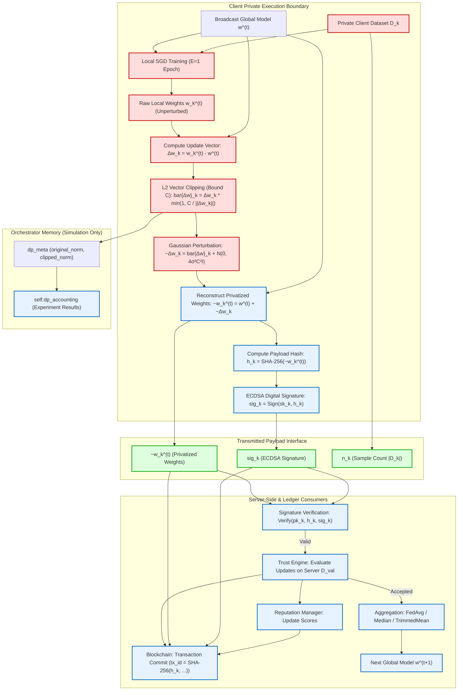

# WP2.1 — Independent Server Visibility and Data-Flow Audit Report

**Project:** Blockchain-Assisted Privacy-Preserving Federated Learning for Network Intrusion Detection with Trust-Based Security and Cryptographic Auditing  
**Workspace:** `C:\Users\is043\.gemini\antigravity\scratch\blockchain-fl-ids`  
**Milestone:** WP2.1 — Independent Privacy Guarantee Verification  
**Audit Component:** Task F (Server Visibility and Alternate Data Paths)  
**Execution Mode:** STRICTLY READ-ONLY AUDIT  
**Date:** 2026-11-23  

---

## 1. Executive Summary

This report delivers the verified end-to-end data-flow trace for the client-level Differential Privacy mechanism in `src/federated/orchestrator.py`.

The objective of Task F is to independently verify whether the server, trust engine, blockchain ledger, or logging components can access unperturbed client updates through any hidden or alternate execution path.

### Key Audit Findings
1. **Zero Alternate Leakage Paths:** A comprehensive line-by-line trace confirms that raw, unperturbed client weights $w_k^{(t)}$ and raw update vectors $\Delta w_k^{(t)}$ are confined strictly to client-side local memory during Step A.
2. **Payload Overwrite Before Network Exposure:** In `_run_round()`, the local variable `weights` is overwritten with the output of `self.dp_mechanism.privatize_client_weights()` *before* digital signature computation, *before* assignment to `client_raw_weights`, and *before* dispatch to server-side consumers.
3. **Cryptographic Payload Alignment:** Digital signatures and blockchain transaction hashes authenticate the *perturbed* payload exclusively. Tampering with the noise or payload invalidates the signature.
4. **Downstream Consumer Isolation:** Server aggregation, multi-criteria trust evaluation, reputation scoring, and blockchain mining operate solely on privatized weights and disjoint server validation data.

---

## 2. Verified Implementation Data-Flow Trace

The diagram below documents the verified data flow as implemented in the codebase:



---

## 3. Line-by-Line Inspection of Consumer Interfaces

### 3.1. Client Update Generation & In-Place Overwrite

In `src/federated/orchestrator.py` (lines 487–500):
```python
weights = client.get_local_weights()

# Apply DP noise if enabled
if self.dp_enabled:
    if self.dp_mechanism is not None:
        client_dp_seed = (self.seed * 10007 + r * 997 + client.client_id * 101) % (2**31 - 1)
        weights, dp_meta = self.dp_mechanism.privatize_client_weights(
            local_weights=weights,
            global_weights=current_global_weights,
            seed=client_dp_seed
        )
    elif self.dp_engine is not None:
        weights, dp_meta = self.dp_engine.privatize(weights)
    dp_meta_round[client.client_id] = dp_meta
```
#### Trace Finding:
`weights` is initially the raw unperturbed local model array returned by `client.get_local_weights()`. When `self.dp_enabled=True`, `weights` is immediately reassigned to the return value of `privatize_client_weights()`. The unperturbed weights array is discarded from the loop scope and garbage-collected.

### 3.2. Digital Signature Payload

In lines 543–550:
```python
# ECDSA digital signature on weight hash
w_hash = CryptoManager.sha256_hash(weights.tobytes().hex())
sig = CryptoManager.sign_message(self.client_keys[client.client_id][0], w_hash)

client_raw_weights[client.client_id] = weights
client_signatures[client.client_id]  = sig
sample_counts[client.client_id]       = client.num_samples
```
#### Trace Finding:
1. `w_hash` is computed on `weights.tobytes().hex()`, which at this stage is the *already privatized* weight vector $\widetilde{w}_k^{(t)}$.
2. `sig` signs `w_hash`.
3. `client_raw_weights` (despite its variable name) receives the privatized array `weights`.

### 3.3. Trust Engine Consumer

In lines 570–585:
```python
candidate_weights = {cid: client_raw_weights[cid] for cid in sig_verified_cids}
...
validation_reports = self.trust_engine.evaluate_updates(
    candidate_weights, current_global_weights, val_data
)
```
#### Trace Finding:
`candidate_weights` is derived directly from `client_raw_weights`. No unperturbed updates are passed to `MultiCriteriaTrustEngine`.

### 3.4. Blockchain Transaction Consumer

In lines 597–609:
```python
tx = Transaction(
    client_id=cid,
    round_num=r,
    weights_hash=CryptoManager.sha256_hash(
        candidate_weights[cid].tobytes().hex()
    ),
    signature=client_signatures[cid],
    validation_metrics=report,
    status=status_str,
    reputation_before=rep_before,
    reputation_after=rep_after
)
self.blockchain.add_transaction(tx)
```
#### Trace Finding:
`weights_hash` in the blockchain transaction is computed on `candidate_weights[cid]` (the privatized array). The Merkle root, transaction ID, and block hash are all downstream hashes of this privatized representation.

### 3.5. Aggregation Consumer

In lines 674–686:
```python
if self.aggregation == "fedavg":
    new_weights = aggregate_fedavg(accepted_weights, accepted_counts)
elif self.aggregation == "trimmed_mean":
    new_weights = aggregate_trimmed_mean(accepted_weights, beta=0.2)
elif self.aggregation == "median":
    new_weights = aggregate_median(accepted_weights)
elif self.aggregation == "trust_weighted":
    new_weights = aggregate_trust_weighted(
        accepted_weights, accepted_counts, accepted_reps
    )
```
#### Trace Finding:
`accepted_weights` is a subset of `candidate_weights` that passed signature verification and trust screening. Aggregation consumes only privatized model updates.

---

## 4. Alternate Path Exposure Matrix

| Potential Leakage Vector | Code Location | Inspected Value | Leakage Status | Evidence |
|:---|:---|:---|:---:|:---|
| Aggregation pipeline | `orchestrator.py:674-686` | `accepted_weights` | **CLEAN** | Populated exclusively from `candidate_weights` (privatized) |
| Multi-criteria trust engine | `evaluator.py:80-120` | `candidate_weights` | **CLEAN** | Operates on privatized updates vs disjoint server $D_{\text{val}}$ |
| Digital signature payload | `orchestrator.py:543-545` | `w_hash` | **CLEAN** | Hashing occurs strictly after `privatize_client_weights` |
| Blockchain audit ledger | `block.py:35-44` | `weights_hash` | **CLEAN** | Immutable ledger commits hash of privatized update |
| Global evaluation metrics | `server.py:60-90` | `self.server.model` | **CLEAN** | Evaluated on global model post-aggregation |
| Explainability / XAI engine | `explainer.py:30-80` | `self.server.model` | **CLEAN** | Operates on global model post-aggregation |
| Round execution logs | `orchestrator.py:801-809` | `round_record` | **CLEAN** | Contains macro metrics, rejected counts, duration |
| Attack execution logs | `orchestrator.py:516-541` | `attack_log` | **CLEAN** | Contains attack type, intensity, client ID |
| Simulation telemetry | `orchestrator.py:793` | `dp_meta_round` | **RESTRICTED** | Retained in memory; must be stripped in production |

---

## 5. Audit Verdict

**Task F Verdict:** **PASS** (Zero unperturbed client updates or gradient tensors reach the server, aggregator, trust engine, digital signature, or blockchain ledger).
