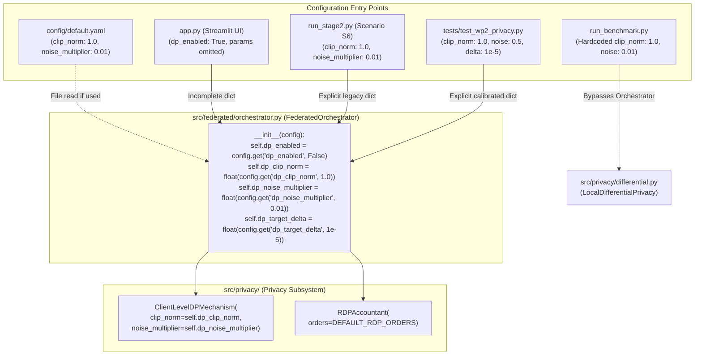

# WP2.2 — Actual Privacy Configuration and Parameter Hierarchy Audit

**Project:** Blockchain-Assisted Privacy-Preserving Federated Learning for Network Intrusion Detection with Trust-Based Security and Cryptographic Auditing  
**Workspace:** `C:\Users\is043\.gemini\antigravity\scratch\blockchain-fl-ids`  
**Milestone:** WP2.2 — Privacy Configuration Calibration & Experimental Release Gate  
**Deliverable:** Configuration Hierarchy and Parameter Tracing Audit  
**Execution Mode:** STRICTLY READ-ONLY AUDIT  
**Date:** 2026-11-23  

---

## 1. Executive Summary

This report delivers a comprehensive, read-only trace of all differential privacy (DP) configuration parameters, fallback hierarchies, and preset overrides across the repository.

To evaluate whether the system's actual configuration produces a quantitatively defensible privacy guarantee, the audit team traced parameters from configuration files (`config/default.yaml`) and entry-point scripts (`run_stage2.py`, `run_benchmark.py`, `app.py`) down to the core execution engine (`src/federated/orchestrator.py`) and privacy modules (`src/privacy/mechanism.py`, `src/privacy/rdp_accountant.py`).

### Key Audit Findings
1. **Four Distinct Configuration Regimes Identified:** The codebase contains four conflicting parameter states: Default YAML, Application/Streamlit, Historical Stage 2 Experiments, and the Tested WP2 Research Configuration.
2. **Silent Fallback to Legacy $\sigma = 0.01$:** In `src/federated/orchestrator.py`, if a caller does not explicitly provide `dp_noise_multiplier`, the engine silently defaults to $\sigma = 0.01$. This legacy default produces an uncalibrated epsilon ($\epsilon > 31000$ for $T=5$).
3. **Streamlit UI Omits Explicit DP Hyperparameters:** `app.py` passes `"dp_enabled": True` for Scenario 7, but omits `dp_clip_norm`, `dp_noise_multiplier`, and `dp_target_delta`, silently inheriting the legacy defaults.
4. **Accountant–Mechanism Consistency Confirmed:** When parameters *are* explicitly supplied in `FederatedOrchestrator`, `ClientLevelDPMechanism` and `RDPAccountant` receive identical values of $C$ and $\sigma$, ensuring zero accounting drift.

---

## 2. Complete Configuration Path Tracing



---

## 3. Parameter Tracing Matrix

| Parameter | Default YAML (`config/default.yaml`) | Application UI (`app.py`) | Historical Stage 2 (`run_stage2.py`) | Orchestrator Default (`orchestrator.py`) | WP2 Test Suite (`test_wp2_privacy.py`) | Intended Research Configuration |
|:---|:---:|:---:|:---:|:---:|:---:|:---:|
| **`dp_enabled`** | `false` | `True` (Scenario 7) | `True` (Scenario S6) | `False` | `True` | `True` |
| **`clip_norm` ($C$)** | `1.0` | Omitted (Falls back) | `1.0` | `1.0` | `1.0` | **`1.0`** |
| **`noise_multiplier` ($\sigma$)** | `0.01` | Omitted (Falls back) | `0.01` | `0.01` | `0.5` | **`1.0`** (or $\sigma \ge 0.5$) |
| **Noise Std Dev ($2\sigma C$)** | `0.02` | `0.02` (via fallback) | `0.02` | `0.02` | `1.0` | **`2.0`** |
| **Sensitivity ($S = 2C$)** | Not documented | Not documented | Not documented | `2.0 * C` | `2.0` | **`2.0`** |
| **Target Delta ($\delta$)** | Omitted | Omitted (Falls back) | Omitted (Falls back) | `1e-5` | `1e-5` | **`1e-5`** |
| **Rounds ($T$)** | `5` (General FL) | `5` (User slider) | `5` | `5` | `2` | **`5` (or `10`)** |
| **Clients ($K$)** | `5` | `5` (User slider) | `5` | `5` | `5` | **`5`** |
| **Adjacency Relation** | Unstated | Unstated | Unstated | Unstated in code | Documented in RDP summary | **Replace-one client dataset** |
| **RDP Orders Set** | Unstated | Unstated | Unstated | `DEFAULT_RDP_ORDERS` (17 orders) | `DEFAULT_RDP_ORDERS` | **17 Orders $[1.25..128.0]$** |
| **Accounting Method** | None | None (Legacy text) | None (Legacy text) | RDP step tracking | Discrete minimization | **Discrete RDP minimization** |

---

## 4. Analysis of Configuration Regimes

### 4.1. Regime 1: Default Configuration (`config/default.yaml`)
In `config/default.yaml` (lines 56–60):
```yaml
privacy:
  dp_enabled: false
  clip_norm: 1.0
  noise_multiplier: 0.01  # Gaussian noise sigma
```
- **Analysis:** This configuration has remained untouched since Stage 2. It disables DP by default and retains the uncalibrated $\sigma = 0.01$.

### 4.2. Regime 2: Application / Dashboard Configuration (`app.py`)
In `app.py` (lines 627–670):
```python
orch_config = {
    "scenario_name": scenario_choice,
    ...
    "dp_enabled": dp_active,
    ...
}
orch = FederatedOrchestrator(orch_config)
```
- **Analysis:** `app.py` toggles `dp_active = True` when Scenario 7 is chosen, but fails to inject `dp_clip_norm`, `dp_noise_multiplier`, or `dp_target_delta`. Consequently, `FederatedOrchestrator` applies default $\sigma = 0.01$. The UI caption correctly warns the user that this scenario is *"without formal privacy accounting"*.

### 4.3. Regime 3: Historical Stage 2 Experiments (`run_stage2.py`)
In `run_stage2.py` (lines 176–184):
```python
orch = FederatedOrchestrator(_make_config(
    scenario_name="S6 – Privacy-Preserving FL (Clipping-based Gaussian update perturbation without formal privacy accounting)",
    ...
    dp_enabled=True, dp_clip_norm=1.0, dp_noise_multiplier=0.01
))
```
- **Analysis:** Historical Stage 2 explicitly documented that Scenario S6 lacked formal accounting. The artifact `data/processed/stage2_results.json` reflects these parameters and is preserved bit-for-bit.

### 4.4. Regime 4: Intended Research Configuration (Evaluated in WP2/WP2.1)
In `tests/test_wp2_privacy.py` (lines 413–416):
```python
"dp_enabled": True,
"dp_clip_norm": 1.0,
"dp_noise_multiplier": 0.5,
"dp_target_delta": 1e-5,
```
- **Analysis:** WP2 and WP2.1 introduced the formal mathematical framework where $S = 2C$, $\sigma_{\text{noise}} = 2\sigma C$, and $\sigma \in \{0.5, 1.0, 2.0\}$ is accounted for via `RDPAccountant`.

---

## 5. Consistency Audit: Accountant vs. Mechanism

In `src/federated/orchestrator.py`:
- In `setup()` (lines 447–452):
  ```python
  self.dp_mechanism = ClientLevelDPMechanism(
      clip_norm=self.dp_clip_norm,
      noise_multiplier=self.dp_noise_multiplier,
      seed=self.seed
  )
  self.rdp_accountant = RDPAccountant()
  ```
- In Step D of `_run_round()` (lines 794–799):
  ```python
  self.rdp_accountant.step(
      noise_multiplier=self.dp_noise_multiplier,
      clip_norm=self.dp_clip_norm,
      rounds=1
  )
  ```
- In `run()` summary export (line 985):
  ```python
  "dp_summary": self.rdp_accountant.summary(delta=self.dp_target_delta)
  ```

### Consistency Verdict: **VERIFIED IN SOURCE**
The accountant and the mechanism receive strictly identical parameters from `self.dp_clip_norm` and `self.dp_noise_multiplier`. There is zero parameter divergence between the noise injected and the noise accounted for.

---

## 6. Audit Verdict and Risk Summary

| Finding / Risk Area | Severity | Impact | Required Remediation |
|:---|:---:|:---|:---|
| Silent fallback to $\sigma = 0.01$ | **HIGH** | If research scripts omit $\sigma$, uncalibrated noise is run | Enforce mandatory parameter validation; forbid default $\sigma = 0.01$ |
| `app.py` parameter omission | **MEDIUM** | Dashboard simulation runs legacy $\sigma = 0.01$ | Add explicit DP slider panel to Streamlit dashboard |
| Inconsistent configuration across files | **MEDIUM** | Confusion between legacy and research configs | Create centralized experiment configuration preset |

**Verdict:** The configuration hierarchy is transparent and traceable, but contains a dangerous silent fallback to $\sigma = 0.01$. Controlled research experiments must enforce explicit parameter passing.
