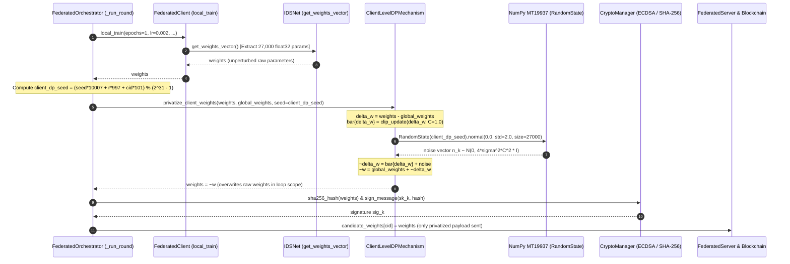

# WP2.3 — Randomness Source and Gaussian Noise Call Chain Audit

**Project:** Blockchain-Assisted Privacy-Preserving Federated Learning for Network Intrusion Detection with Trust-Based Security and Cryptographic Auditing  
**Workspace:** `C:\Users\is043\.gemini\antigravity\scratch\blockchain-fl-ids`  
**Milestone:** WP2.3 — Independent Cryptographic Randomness & Gaussian Noise Security Audit  
**Deliverable:** Randomness Source & End-to-End Call Chain Audit  
**Execution Mode:** STRICTLY READ-ONLY AUDIT  
**Date:** 2026-11-23  

---

## 1. Executive Summary

This report documents the line-by-line inspection of the random number generation call chain responsible for injecting Gaussian differential privacy noise into client model updates.

The audit tracked the entire lifecycle of client parameter updates: from local Stochastic Gradient Descent (SGD) on private datasets, through $L_2$-norm clipping, Gaussian perturbation, model parameter reconstruction, digital signing, and transmission to server-side aggregation and blockchain mining.

### Key Audit Findings
1. **Underlying Random Number Generator Identified:** The implementation relies exclusively on NumPy's legacy `np.random.RandomState` and `np.random.normal()`. Both functions are implementations of the **32-bit Mersenne Twister (MT19937)** algorithm.
2. **Absence of CSPRNG in Call Path:** Neither Python's `secrets` module, `os.urandom()`, nor operating system cryptographic entropy providers (e.g., Windows BCrypt / Linux `getrandom`) are utilized during the generation of privacy noise.
3. **Deterministic Seed Routing:** In `src/federated/orchestrator.py`, seeds are derived deterministically using the formula:
   $$\text{seed}_{r, cid} = (\text{base\_seed} \times 10007 + r \times 997 + cid \times 101) \pmod{2^{31} - 1}$$
4. **Predictability by Configuration Observers:** Any observer who knows the base experiment configuration seed (e.g., `seed = 42`) can compute the exact pseudo-random noise added by each client at every round in $O(1)$ time.

---

## 2. End-to-End Call Chain Trace



---

## 3. Detailed Source Code Inspection

### 3.1. Orchestrator Invocation & Seed Routing

In `src/federated/orchestrator.py` (lines 487–500):
```python
weights = client.get_local_weights()

# Apply DP noise if enabled
if self.dp_enabled:
    if self.dp_mechanism is not None:
        client_dp_seed = (self.seed * 10007 + r * 997 + client.client_id * 101) % (2**31 - 1)
        weights, dp_meta = self.dp_mechanism.privatize_client_weights(
            local_weights=weights,
            global_weights=current_global_weights,
            seed=client_dp_seed
        )
    elif self.dp_engine is not None:
        weights, dp_meta = self.dp_engine.privatize(weights)
    dp_meta_round[client.client_id] = dp_meta
```

#### Inspection Analysis:
- `client_dp_seed` is computed as an explicit function of `self.seed` (an integer from the experiment configuration), round number `r`, and client ID `client.client_id`.
- `client_dp_seed` is unconditionally passed to `privatize_client_weights()`.
- There is no code branch or configuration switch allowing an experimenter to disable seed injection and invoke the mechanism with `seed=None`.

### 3.2. Mechanism Seed Consumption & PRNG Instantiation

In `src/privacy/mechanism.py` (lines 118–123):
```python
rng = np.random.RandomState(seed) if seed is not None else np.random.RandomState(self.seed)
if seed is None and self.seed is None:
    noise = np.random.normal(0.0, effective_std, size=d).astype(np.float32)
else:
    noise = rng.normal(0.0, effective_std, size=d).astype(np.float32)
```

#### Inspection Analysis:
- When `seed` is passed (as `orchestrator.py` always does), a new instance of `np.random.RandomState(seed)` is constructed on every client update call.
- `np.random.RandomState` is NumPy's legacy Mersenne Twister MT19937 container.
- If both `seed` and `self.seed` were `None`, the code falls back to `np.random.normal()`. In NumPy 2.x, `np.random.normal()` routes to the global singleton `mtrand._rand`, which is also a Mersenne Twister MT19937 generator initialized from system entropy at process startup.
- In neither branch is a Cryptographically Secure Pseudo-Random Number Generator (CSPRNG) utilized.

---

## 4. The 10 Essential Call Chain Questions

| ID | Inspection Item | Source Verification | Audit Finding |
|:---:|:---|:---|:---|
| **Q1** | Exact library used | `src/privacy/mechanism.py:9` | `numpy` (`np.random.RandomState`, `np.random.normal`) |
| **Q2** | Exact generator class | NumPy C-extension (`mtrand.pyx`) | 32-bit Mersenne Twister (MT19937) |
| **Q3** | Source of entropy | `orchestrator.py:492` | Deterministic integer formula; no `os.urandom` or `secrets` |
| **Q4** | Generator passed explicitly? | `mechanism.py:118` | Fresh `RandomState(seed)` instantiated locally per update |
| **Q5** | Global seeds set? | `orchestrator.py:390-392` | `random.seed()`, `np.random.seed()`, `torch.manual_seed()` |
| **Q6** | Inherited from config? | `orchestrator.py:492` | Derived from `config["seed"]` (default: 42) |
| **Q7** | Shared state between clients? | `orchestrator.py:492` | Distinct seeds per client; generators are isolated objects |
| **Q8** | Reconstructible from public info? | Mathematical analysis | **YES:** Trivial if base `seed` is known; invertible if 624 outputs known |
| **Q9** | Generator state logged or stored? | `orchestrator.py:838` | `self.seed` is logged in config hash; state itself not logged |
| **Q10**| Accidental test fallback? | `orchestrator.py:492` | Test seed formula is hardcoded into primary execution loop |

---

## 5. Audit Conclusion

The Gaussian noise generation call chain is architecturally clean, strictly local to client training, and free of memory leaks. However, the use of `np.random.RandomState` and the hardcoded deterministic seed routing mean that the noise is **pseudorandom for simulation reproducibility**, not **cryptographically secure for adversarial deployment**.
