# WP2.3 — Test, Research & Deployment Randomness Separation Audit

**Project:** Blockchain-Assisted Privacy-Preserving Federated Learning for Network Intrusion Detection with Trust-Based Security and Cryptographic Auditing  
**Workspace:** `C:\Users\is043\.gemini\antigravity\scratch\blockchain-fl-ids`  
**Milestone:** WP2.3 — Independent Cryptographic Randomness & Gaussian Noise Security Audit  
**Deliverable:** Reproducibility vs. Unpredictability & Execution-Mode Separation Audit  
**Execution Mode:** STRICTLY READ-ONLY AUDIT  
**Date:** 2026-11-23  

---

## 1. Executive Summary

This report investigates the architectural boundary between deterministic reproducibility (required for scientific testing and regression baselines) and cryptographic unpredictability (required for operational privacy in adversarial networks).

Differential privacy research requires two competing properties:
1. **Scientific Reproducibility:** To benchmark model performance, comparative baselines, and unit tests, researchers must be able to reproduce bit-for-bit identical executions across distinct platforms and environments.
2. **Adversarial Unpredictability:** In an operational deployment against an honest-but-curious server, privacy noise must be sampled from a truly unpredictable entropy source that the server cannot observe, infer, or reconstruct.

### Key Audit Findings
1. **Mode Separation Exists Only in Documentation:** The source code in `src/federated/orchestrator.py` hardcodes deterministic seed derivation directly into the main execution loop. There is no runtime switch, configuration flag, or enum distinguishing Testing Mode from Production Mode.
2. **Current Implementation is Exclusively a Simulation Testbed:** The codebase operates entirely within a single-process Python simulation. It is scientifically valid for evaluating algorithmic convergence and accuracy degradation under Gaussian noise, but cannot be deployed directly to real-world edge devices without software modifications.
3. **Actionable Roadmap Defined:** We define a clean, non-breaking architectural pattern for formalizing three distinct execution modes in future development.

---

## 2. Evaluation of the Three Randomness Modes

```mermaid
flowchart TD
    subgraph Mode1["Mode 1: Automated Testing Mode"]
        T_Seed["Fixed Test Seed (e.g., seed=42)"] --> T_PRNG["NumPy MT19937"]
        T_PRNG --> T_Eval["Assert exact numerical outputs in pytest"]
    end

    subgraph Mode2["Mode 2: Controlled Research Simulation"]
        R_Seed["Multi-Seed Protocol (e.g., seeds 42..46)"] --> R_PRNG["NumPy MT19937 with Linear Congruential Spacing"]
        R_PRNG --> R_Eval["Benchmark mean ± std accuracy under noise"]
    end

    subgraph Mode3["Mode 3: Distributed Physical Deployment"]
        D_Seed["Local Edge Hardware Entropy (/dev/urandom)"] --> D_CSPRNG["CSPRNG (ChaCha20 / AES-CTR)"]
        D_CSPRNG --> D_Eval["Operational Privacy against Honest-but-Curious Server"]
    end

    classDef tmode fill:#ffeedd,stroke:#dd8800,stroke-width:2px;
    classDef rmode fill:#ddffdd,stroke:#00aa00,stroke-width:2px;
    classDef dmode fill:#ddddff,stroke:#0000cc,stroke-width:2px;

    class Mode1 tmode;
    class Mode2 rmode;
    class Mode3 dmode;
```



### 2.1. Mode 1: Automated Testing Mode
- **Objective:** Verify software correctness, test clipping math, check accountant edge cases, and run regression CI/CD suites.
- **Randomness Policy:** Fully deterministic seeds (`seed = 42`, `seed = 123`).
- **Current Repository Status:** **FULLY OPERATIONAL.** All 175 tests in `tests/` execute deterministically and pass with zero flake.

### 2.2. Mode 2: Controlled Research Simulation Mode
- **Objective:** Measure empirical privacy-utility trade-offs, attack resilience, and aggregation stability across multi-seed evaluations.
- **Randomness Policy:** Distinct pseudo-random seeds per round and client derived from a known base seed. Seed collisions must be avoided within each run.
- **Current Repository Status:** **OPERATIONAL.** `orchestrator.py` implements $(10007 \times \text{seed} + 997 \times r + 101 \times cid) \pmod{2^{31}-1}$.
- **Caveat:** Results must be reported as a **simulation of differential privacy**. Researchers cannot claim security against an honest-but-curious server who knows the simulation script.

### 2.3. Mode 3: Distributed Physical Deployment Mode
- **Objective:** Real-world federated deployment across physical edge nodes (e.g., campus routers, hospital VPCs, enterprise gateways).
- **Randomness Policy:** Local cryptographic entropy (`/dev/urandom` / `secrets`). The server must have zero knowledge of or influence over client seeds.
- **Current Repository Status:** **NOT IMPLEMENTED IN CODE.** The current code has no mechanism for edge clients to generate independent CSPRNG noise.

---

## 3. Code Inspection of Mode Governance

In `src/federated/orchestrator.py` (lines 490–498):
```python
# Apply DP noise if enabled
if self.dp_enabled:
    if self.dp_mechanism is not None:
        client_dp_seed = (self.seed * 10007 + r * 997 + client.client_id * 101) % (2**31 - 1)
        weights, dp_meta = self.dp_mechanism.privatize_client_weights(
            local_weights=weights,
            global_weights=current_global_weights,
            seed=client_dp_seed
        )
```

### Critical Findings:
1. `client_dp_seed` is hardcoded. There is no conditional logic such as:
   ```python
   # Desired future pattern (NOT currently present in code):
   seed_to_use = client_dp_seed if self.use_deterministic_seed else None
   ```
2. In `src/privacy/mechanism.py`, `perturb_update()` supports `seed=None`:
   ```python
   if seed is None and self.seed is None:
       noise = np.random.normal(0.0, effective_std, size=d).astype(np.float32)
   ```
   However, because `orchestrator.py` always passes `seed=client_dp_seed`, this unseeded branch is **dead code during orchestrator execution**.
3. Consequently, the claim that the system supports production deployment randomness is **valid only as a conceptual specification, not as existing functional code**.

---

## 4. Privacy Guarantee Implications

| Operational Context | Applicable Threat Model | Mathematical DP Validity | Operational Cryptographic Security | Audit Verdict |
|:---|:---|:---:|:---:|:---:|
| **Algorithmic Simulation** | Academic evaluation of accuracy and attack detection under DP noise | **VALID** ($\epsilon = 13.26$) | **NOT REQUIRED** (Simulation only) | **APPROVED FOR RESEARCH** |
| **Simulated Adversary** | Server inspecting updates in single-process simulation | **VALID** (Conditionally on unknown seed) | **COLLAPSES** (If server knows config seed) | **RESTRICTED** |
| **Distributed Deployment** | Real-world physical edge nodes communicating over network | **VALID MATHEMATICALLY** | **INSECURE** (Requires CSPRNG implementation) | **NOT APPROVED FOR DEPLOYMENT** |

### Core Conclusion:
The mathematical validity of the Rényi Differential Privacy accounting is **unaffected** by the pseudorandom nature of MT19937. The RDP accountant correctly computes the theoretical divergence under the assumption of ideal Gaussian noise.

However, the **operational security** of the guarantee is restricted to controlled research simulation. The software must not be marketed or deployed as a production-ready edge privacy system without implementing CSPRNG entropy governance.

---

## 5. Architectural Recommendations for Future Implementation

When implementation is authorized in future milestones, the following design should be introduced into `src/federated/orchestrator.py`:

```python
# Recommended future implementation pattern:
class ExecutionMode(str, Enum):
    TEST = "test"              # Deterministic seeding for CI/CD
    SIMULATION = "simulation"  # Multi-seed controlled research simulation
    DEPLOYMENT = "deployment"  # Cryptographically secure local hardware entropy

# In orchestrator.py:
if self.execution_mode == ExecutionMode.DEPLOYMENT:
    seed_arg = None  # Forces ClientLevelDPMechanism to draw from OS CSPRNG
else:
    seed_arg = (self.seed * 10007 + r * 997 + client.client_id * 101) % (2**31 - 1)
```

---

## 6. Audit Verdict

**Section 6 Verdict:** The execution-mode separation is **partially implemented** (supported conceptually and in unit tests, but missing a runtime configuration switch in the orchestrator). The system is approved for **controlled simulation benchmarks only**.
