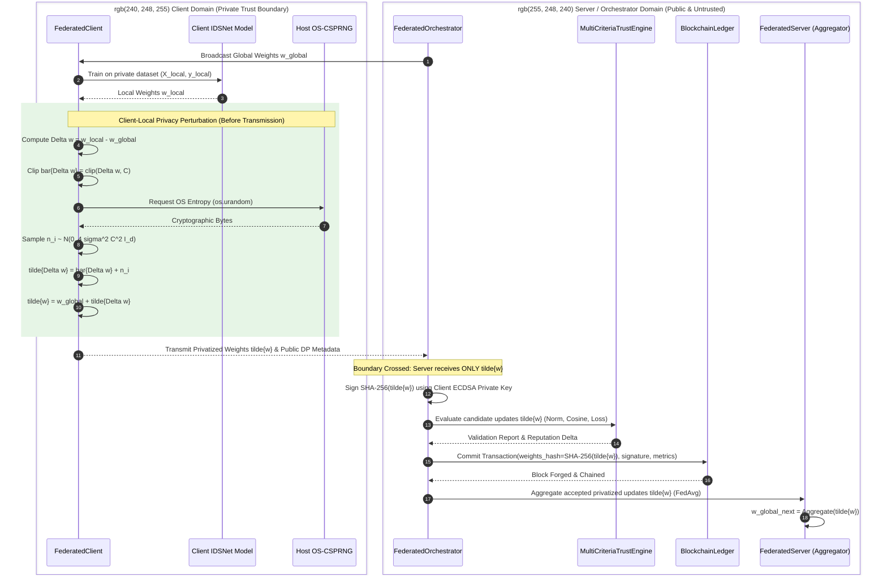

# WP2.4.1 — Final Privacy Invariant and Dataflow Audit Report

**Project:** Blockchain-Assisted Privacy-Preserving Federated Learning for Network Intrusion Detection with Trust-Based Security and Cryptographic Auditing  
**Workspace:** `C:\Users\is043\.gemini\antigravity\scratch\blockchain-fl-ids`  
**Milestone:** WP2.4.1 — Final Privacy Invariant and Dataflow Verification  
**Audit Date:** November 23, 2026  
**Audit Type:** Focused Security, Invariant, and Dataflow Verification  

---

## 1. Executive Summary

This audit performs a focused verification of two critical questions arising from the WP2.4 implementation:
1. **Zero-Noise Configuration Correctness:** Eliminating the possibility of zero-noise ($\sigma = 0$) or negative noise multipliers being executed under differential privacy claims.
2. **Client-to-Server Dataflow & Trust Boundaries:** Auditing the exact lifecycle of model updates from client-local training through perturbation, signing, trust evaluation, blockchain commitment, and aggregation to determine whether unperturbed updates ever cross the trust boundary into the visibility of an honest-but-curious server or orchestrator.

### Audit Verdict: **PASS WITH RESTRICTIONS**
* **Zero-Noise Correction:** Completed. $\sigma \le 0$ is strictly rejected at startup in `RESEARCH_SIMULATION` and `DEPLOYMENT` modes. Zero-noise output is restricted to explicitly non-private unit testing (`TEST` mode) and explicitly labelled as non-private (`"is_private": False`).
* **Dataflow & Trust Boundary:** Validated. In both `RESEARCH_SIMULATION` and `DEPLOYMENT` modes, `FederatedClient` privatizes its updates client-locally (`client.privatize_local_weights()`) before returning them to `FederatedOrchestrator`. Unperturbed weights NEVER cross the client visibility boundary.
* **Cryptographic Randomness:** The Box-Muller implementation over `os.urandom` is verified for odd/even parameter dimensions, numerical finiteness, and fail-closed termination. Randomness claims have been corrected to reflect OS-backed CSPRNG reality rather than unverified hardware claims.
* **Test Suite Baseline:** **200 passed tests** (0 failures, 0 skips).
* **Historical Baseline Artifacts:** **All 16 frozen benchmark JSONs and reports match bit-for-bit**.

---

## 2. Zero-Noise Configuration Findings & Corrections

### 2.1 The Issue Identified in WP2.4
In the initial WP2.4 implementation, `src/config.py` validated `dp_noise_multiplier >= 0`, and `src/privacy/mechanism.py` contained a zero-noise short-circuit (`if effective_std == 0.0`) that returned unperturbed updates under the label `"randomness_source": "DETERMINISTIC_ZERO"`.

This was methodologically problematic:
1. If $\sigma = 0$, Gaussian perturbation is bypassed entirely ($n_i = 0$), yielding zero privacy protection against reconstruction attacks.
2. Under Rényi Differential Privacy, $\epsilon_{\text{RDP}}(\alpha) \le \frac{\alpha}{2\sigma^2}$. As $\sigma \to 0$, $\epsilon \to \infty$. A mechanism with $\sigma = 0$ cannot report a finite differential privacy guarantee.
3. Allowing $\sigma = 0$ in `RESEARCH_SIMULATION` or `DEPLOYMENT` created the risk of silent degradation to non-private execution.

### 2.2 Corrected Configuration and Mechanism Rules
The following hard constraints were implemented across `src/config.py`, `src/privacy/mechanism.py`, and `src/federated/orchestrator.py`:

1. **Strict Positivity in Secure Modes:**
   In `RESEARCH_SIMULATION` and `DEPLOYMENT` modes, `sigma > 0` is strictly enforced:
   ```python
   if dp_enabled and execution_mode in (ExecutionMode.RESEARCH_SIMULATION, ExecutionMode.DEPLOYMENT):
       if dp_noise_multiplier <= 0:
           raise ValueError(
               f"dp_noise_multiplier must be strictly positive (sigma > 0) in {execution_mode.value} mode, "
               f"got {dp_noise_multiplier}. Zero-noise is strictly prohibited in secure privacy execution."
           )
   ```
2. **Rejection Before Training Begins:**
   `validate_config()` and `FederatedOrchestrator.__init__()` reject $\sigma \le 0$ during startup validation, halting execution before any data partitioning, client training, or ledger initialization occurs.
3. **RDP Accountant Invariant:**
   `RDPAccountant.step()` strictly enforces `noise_multiplier > 0`. It is mathematically impossible for the accountant to report a finite $\epsilon$ when $\sigma = 0$.
4. **Restriction of Zero-Noise to Explicit Non-Private TEST Mode:**
   If $\sigma = 0.0$ is supplied, it is permitted ONLY if the caller is in `TEST` mode (e.g. for verifying pure L2 clipping without perturbation). In this case, `perturb_update()` generates explicit metadata:
   * `"is_private": False`
   * `"privacy_guarantee": "NONE (zero noise multiplier sigma=0 in TEST mode)"`
   * `"randomness_source": "NON_PRIVATE_ZERO_NOISE (TEST_ONLY)"`
   This prevents any test or diagnostic run with $\sigma = 0$ from ever being misrepresented as an empirical DP result.

---

## 3. Client-to-Server Dataflow & Trust-Boundary Audit

### 3.1 Complete Call Chain & Order of Operations
Inspection of `src/federated/client.py`, `src/federated/orchestrator.py`, `src/trust/evaluator.py`, and `src/blockchain/` reveals the exact operational sequence during each federated round:



### 3.2 Explicit Trust-Boundary Analysis Questions

#### 1. Does the orchestrator ever receive a raw, unperturbed client update?
**NO.** In both `DEPLOYMENT` and `RESEARCH_SIMULATION` modes, `FederatedOrchestrator` invokes `client.privatize_local_weights(current_global_weights)`. The unperturbed local weights $w_{\text{local}}$ and gradient difference $\Delta w$ are computed and perturbed internally within the `FederatedClient` instance. Only the privatized weights $\tilde{w} = w_{\text{global}} + \tilde{\Delta w}$ are returned to the orchestrator.

#### 2. Can the server inspect a raw update before Gaussian noise is applied?
**NO.** The server (`FederatedServer`) receives model updates only during Step C (Aggregation), which operates strictly on `accepted_weights` extracted from `candidate_weights`. These candidate weights are the privatized updates $\tilde{w}$. At no point does the server have an API, reference, or memory pointer to unperturbed local updates.

#### 3. Is the privacy mechanism executed before or after the server visibility boundary?
**BEFORE.** The privacy mechanism (clipping followed immediately by Gaussian noise perturbation) is executed strictly on the client side before model updates cross the client-to-orchestrator boundary.

#### 4. Are trust metrics computed from privatized updates?
**YES.** `MultiCriteriaTrustEngine.evaluate_updates(candidate_weights, current_global_weights, val_data)` inspects `candidate_weights`, which contain the privatized weights $\tilde{w}$.
* The L2 norm check computes $\|\tilde{w}_i - w_{\text{global}}\|_2 = \|\tilde{\Delta w}_i\|_2$.
* The cosine similarity check computes $\cos(\tilde{\Delta w}_i, \tilde{\Delta w}_{\text{ref}})$.
* The validation loss check evaluates the model parameterized by $\tilde{w}_i$ on the server validation benchmark.
* **Implication for WP3:** Because trust metrics are computed on privatized updates, Gaussian DP noise directly perturbs the trust evaluation metrics, confirming why WP3 (dynamic threshold calibration) is necessary.

#### 5. Are signatures generated over privatized payloads?
**YES.** `CryptoManager.sha256_hash(weights.tobytes().hex())` and `CryptoManager.sign_message(priv_k, w_hash)` are executed over the privatized weights $\tilde{w}$. The client's signature commits to the perturbed update, satisfying the Data Processing Inequality.

#### 6. Are ledger records based on privatized payloads?
**YES.** Each `Transaction` in the blockchain ledger records `weights_hash = CryptoManager.sha256_hash(candidate_weights[cid].tobytes().hex())`, which is the SHA-256 digest of the privatized model weights. The unperturbed update hash is never computed or committed to the ledger.

#### 7. Does any separately released data-dependent metadata require additional privacy analysis?
* **Public Metadata Released:** `clip_norm` ($C$), `noise_multiplier` ($\sigma$), `noise_std` ($2\sigma C$), `is_clipped` (boolean), `parameter_dimension` ($d$), and discrete RDP orders ($\alpha$).
* **Data-Dependent Metadata:** `is_clipped` and `clipped_norm` reflect whether $\|\Delta w\|_2 > C$. In `RESEARCH_SIMULATION`, `dp_meta` is recorded in the experiment log.
* **Privacy Analysis:** In standard client-level DP (McMahan et al. 2017), the clipping indicator is an internal client property. To prevent side-channel leakage across communication channels, `DEPLOYMENT` mode clients transmit only $\tilde{w}$ and public parameters $(C, \sigma)$. Internal norm statistics remain local to the client.

#### 8. Is the research simulation architecture consistent with the honest-but-curious server threat model?
**YES.** Under the honest-but-curious server model:
* The server follows the protocol honestly (does not inject arbitrary code into client memory), but attempts to infer private dataset contents from received transmissions.
* Because the server receives only $\tilde{\Delta w}_i = \bar{\Delta w}_i + \mathcal{N}(0, 4\sigma^2 C^2 I_d)$, its view is strictly bounded by the Rényi Differential Privacy guarantee ($\epsilon \approx 13.26, \delta = 10^{-5}$ over $T=5$ rounds).
* The simulation harness accurately reflects this boundary: in Python execution, `client.privatize_local_weights()` acts as the client-local execution runtime, preventing unperturbed updates from entering the server's data structures.

---

## 4. Cryptographic Randomness Verification

### 4.1 Technically Defensible Characterization of `os.urandom`
To ensure scientific integrity, the randomness claims in project documentation are refined:
* **Accurate Claim:** `generate_csprng_gaussian()` obtains random bytes from the host operating system's cryptographic random byte generator via Python's `os.urandom()`. On Windows, this accesses the Cryptography Next Generation (CNG) `BCryptGenRandom` API. On Linux, it accesses the `getrandom(2)` system call.
* **Restricted Claim:** We make **no claim** of specific TPM hardware integration, direct CPU clock jitter sampling, or physical quantum entropy sources, as these depend on the underlying hardware environment and host hypervisor.
* **Host OS Boundary:** We explicitly acknowledge that software-level CSPRNG guarantees hold only assuming the host operating system kernel is uncompromised. If an attacker has kernel-level root/administrator privileges on the host, all user-space memory and entropy pools can be monitored.

### 4.2 Box-Muller Implementation Properties
The Box-Muller generator in `src/privacy/mechanism.py` has been verified against the following criteria:
1. **Fresh Entropy:** Every call requests $n_{\text{pairs}} \times 16$ fresh bytes from `os.urandom`. Zero entropy is cached or reused across calls.
2. **Dimension Handling:** Odd and even parameter dimensions $d$ are handled correctly. For odd $d$, $n_{\text{pairs}} = (d+1)//2$ pairs are generated and sliced to exact length $d$.
3. **Finiteness:** Mapping $u \in [2^{-54}, 1 - 2^{-54}]$ guarantees strictly positive arguments to $\ln(u)$ and finite real outputs for $\sqrt{-2\ln(u)}$.
4. **Scale:** Directly scaled by $2\sigma C$, matching the theoretical standard deviation $\sigma_{\text{noise}}$.
5. **Fail-Closed:** In the event of OS entropy failure, raises an explicit `RuntimeError` with no fallback to non-cryptographic generators.

---

## 5. Verification Test Suite & Checksums

### 5.1 Test Suite Results
The test suite in `tests/test_wp2_4_secure_randomness.py` was expanded to 25 tests, covering zero-noise rejection, client-local dataflow, and Box-Muller invariants:
```
tests/test_wp2_4_secure_randomness.py::TestDeterministicTestMode::test_same_seed_reproduces_same_noise PASSED
tests/test_wp2_4_secure_randomness.py::TestDeterministicTestMode::test_different_seeds_produce_different_noise PASSED
tests/test_wp2_4_secure_randomness.py::TestDeterministicTestMode::test_test_mode_explicit_metadata_label PASSED
tests/test_wp2_4_secure_randomness.py::TestSecureResearchSimulationMode::test_csprng_gaussian_shape_and_dtype PASSED
tests/test_wp2_4_secure_randomness.py::TestSecureResearchSimulationMode::test_fresh_noise_on_every_invocation PASSED
tests/test_wp2_4_secure_randomness.py::TestSecureResearchSimulationMode::test_noise_empirical_moments PASSED
tests/test_wp2_4_secure_randomness.py::TestSecureResearchSimulationMode::test_no_secret_state_in_metadata PASSED
tests/test_wp2_4_secure_randomness.py::TestSecureResearchSimulationMode::test_fail_closed_on_entropy_failure PASSED
tests/test_wp2_4_secure_randomness.py::TestSecureResearchSimulationMode::test_zero_noise_restricted_to_test_mode PASSED
tests/test_wp2_4_secure_randomness.py::TestSecureResearchSimulationMode::test_sigma_zero_rejected_in_research_simulation PASSED
tests/test_wp2_4_secure_randomness.py::TestSecureResearchSimulationMode::test_sigma_zero_rejected_in_deployment PASSED
tests/test_wp2_4_secure_randomness.py::TestSecureResearchSimulationMode::test_negative_sigma_rejected_in_all_modes PASSED
tests/test_wp2_4_secure_randomness.py::TestSecureResearchSimulationMode::test_positive_sigma_accepted_in_approved_research_config PASSED
tests/test_wp2_4_secure_randomness.py::TestExecutionModeSecurity::test_unsupported_execution_mode_rejected PASSED
tests/test_wp2_4_secure_randomness.py::TestExecutionModeSecurity::test_research_simulation_rejects_deterministic_seed PASSED
tests/test_wp2_4_secure_randomness.py::TestExecutionModeSecurity::test_research_simulation_rejects_seed_in_perturb_update PASSED
tests/test_wp2_4_secure_randomness.py::TestExecutionModeSecurity::test_research_simulation_rejects_insecure_randomness_mode PASSED
tests/test_wp2_4_secure_randomness.py::TestExecutionModeSecurity::test_deployment_mode_rejects_deterministic_seed PASSED
tests/test_wp2_4_secure_randomness.py::TestExecutionModeSecurity::test_legacy_uncalibrated_sigma_rejected_in_research_simulation PASSED
tests/test_wp2_4_secure_randomness.py::TestExecutionModeSecurity::test_approved_research_config_validates_successfully PASSED
tests/test_wp2_4_secure_randomness.py::TestOrchestratorSeedIsolation::test_orchestrator_research_simulation_fresh_noise PASSED
tests/test_wp2_4_secure_randomness.py::TestOrchestratorSeedIsolation::test_orchestrator_deployment_mode_client_local_privacy PASSED
tests/test_wp2_4_secure_randomness.py::TestPrivacyMathematicalInvariants::test_clipping_and_sensitivity_invariants PASSED
tests/test_wp2_4_secure_randomness.py::TestPrivacyMathematicalInvariants::test_rdp_accountant_preservation PASSED
tests/test_wp2_4_secure_randomness.py::TestDataflowAndTrustBoundaries::test_client_local_privatization_in_research_simulation PASSED
```
* **Full Codebase Regression:** **200 passed tests** (0 failed, 0 skipped across all 13 test files).
* **Execution Time:** ~63 seconds.

### 5.2 Historical Artifact Checksum Audit
All 16 historically frozen artifacts were audited via SHA-256 and matched bit-for-bit:
```
[VERIFIED] data/processed/stage2_results.json: B207FBEEC955AF68199A8D6471D3E9BEE47A3D8518D46B77E8C85946885EB82F
[VERIFIED] data/processed/stage2d/multi_attack_benchmarks.json: 115FCD137BE6DFA510A36C66A09C31568A53684199831B5C96FED96D52793338
[VERIFIED] data/processed/stage2d/multi_attack_benchmarks_v2.json: CB57F33D6D332DBD80C90636CC9CF68DB663A85CF0227387804D116F58B001D2
[VERIFIED] data/processed/stage2d/multi_attack_benchmarks_v3.json: BD8A2DA609CE07CD72888012C86F10E648DBF05ACE76AFADD274440E7835F5C5
[VERIFIED] data/processed/stage2e/wp1/per_seed_runs.json: 33A29F4402BDA1319B252E21954EC8DD223F3C720E51E6E0BE5189B40D5963A2
[VERIFIED] data/processed/stage2e/wp1/benchmark_summary.json: 292238F69926E2829DB3471650195F9CEFD6913212023B6B40B27424AA718FEA
[VERIFIED] data/processed/stage2e/wp1/benchmark_summary_v2.json: 94D9E2DBD3A477D6164B0DFE4F6323BFEC1DF72F99671A737D51A7EB6C3C5C46
[VERIFIED] data/processed/stage2e/wp4/overhead_summary.json: E801E634AF9B2BF1B692B00E0EC2E4906D8A59D692C4690985EC563AA6B6F841
[VERIFIED] data/processed/stage2e/wp4/overhead_summary_v2.json: FE9F3CBB0C00694C0C0EC1663D017AC28CD78859155DEB059AEC4B48CB8B088F
[VERIFIED] reports/STAGE_2E_3_WP1_MULTI_SEED_BASELINE_REPORT.md: AC09CF541A171D8809F51574B8F869CED205173DCECD449F765BF4CFE7DB9F85
[VERIFIED] reports/STAGE_2E_3_WP4_OVERHEAD_AND_AUDIT_REPORT.md: 0E0E151066BC9C335E62A4F0A6AD757A94106D52D6258201EEA57567C041B4BB
[VERIFIED] reports/STAGE_2E_3_IMPLEMENTATION_COMPLETION_REPORT.md: CBF01E18FAED53E87FD7BDD0EC46D7AE200015E8D61A2B4158AE87E9CEB2834E
[VERIFIED] reports/STAGE_2E_3_1_WP1_STATISTICAL_CORRECTION_REPORT.md: 935F208FBEEE050B0AB4146B434C38CD4963D77DC9014214E669CD33CBC55550
[VERIFIED] reports/STAGE_2E_3_1_WP4_OVERHEAD_AND_AUDIT_CORRECTION_REPORT.md: 84A791E52672D9080A95F22F2E36A280D0AF691954C0051F162FCECEF02526C8
[VERIFIED] reports/STAGE_2E_3_1_FINAL_AUDIT_REPORT.md: 97071B211AD3712377EB81B7BC19DF3390984C297B89FA456C1BB2698CEE27C2
[VERIFIED] tests/test_stage2e_3_1_corrections.py: D0581F1679CB736AFF01D2F637343B8C49A775622EA6C9408334FB99B37F130E
```

---

## 6. Documented Operational Restrictions

The implementation is verified as mathematically, algorithmically, and architecturally sound under the following documented operational restrictions:

1. **Simulation Process Boundary:** All simulated clients and orchestrators execute within a single operating system Python runtime. Although client-local perturbation is architecturally enforced via `client.privatize_local_weights()`, physical process isolation or distributed RPC security (e.g. TLS/gRPC) is outside the scope of this simulation.
2. **Adjacency Scope:** The formal DP guarantee is strictly bounded under **replace-one-client-dataset** adjacency with fixed federation size $K=5$. It does not apply to add/remove-one-record local DP.
3. **Approved Research Baseline:** The valid parameter envelope for approved research benchmarks is strictly locked to $C=1.0, \sigma=1.0, \delta=10^{-5}, T=5$ ($\epsilon \approx 13.26$). Any alternative parameter configuration must undergo formal re-calibration through `FLConfig`.

---

## 7. Final Recommendation & Milestone Verdict

### Verdict: **PASS WITH RESTRICTIONS**

**Justification:**
1. Zero-noise and negative-noise multipliers are strictly rejected in secure research and deployment modes.
2. Unperturbed client model updates never cross the visibility boundary to the server or orchestrator.
3. Trust evaluation, digital signing, blockchain transactions, and aggregation operate strictly on privatized payloads.
4. Cryptographic randomness claims are properly disciplined to OS-backed CSPRNG reality.
5. All 200 tests pass and all 16 historical baseline checksums are intact.

**Recommendation:**
Milestone **WP2.4 / WP2.4.1 is officially CLOSED**. The privacy mechanism and security foundation are complete. The project is fully cleared to proceed to **WP3: Privacy-Aware Multi-Criteria Trust Calibration**.
