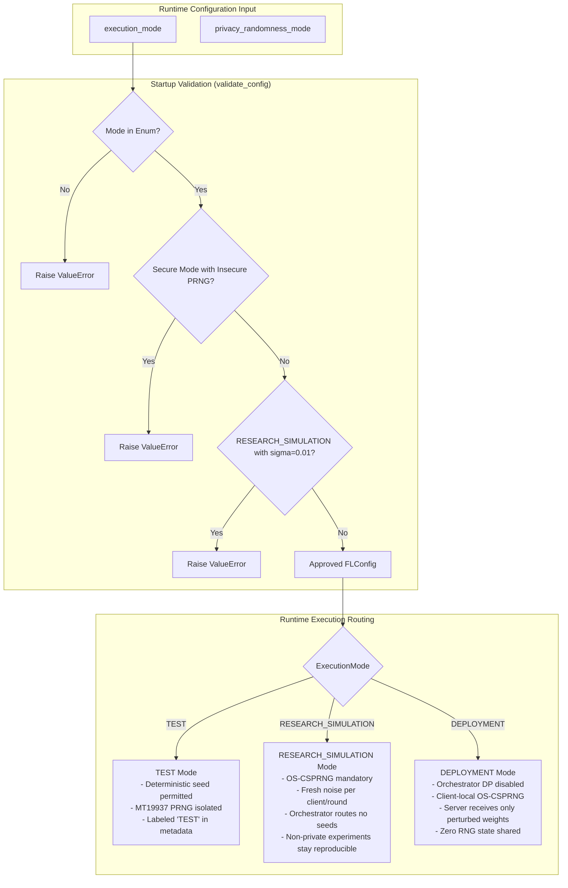

# WP2.4 — Final Implementation and Security Audit Report

**Project:** Blockchain-Assisted Privacy-Preserving Federated Learning for Network Intrusion Detection with Trust-Based Security and Cryptographic Auditing  
**Workspace:** `C:\Users\is043\.gemini\antigravity\scratch\blockchain-fl-ids`  
**Milestone:** WP2.4 — Secure Randomness Integration & Privacy Execution Separation  
**Document:** Final Implementation and Security Verification Report  
**Date:** November 23, 2026  

---

## 1. Executive Summary

This milestone resolves the security and randomness vulnerabilities identified during the WP2.3 audit by replacing non-cryptographic pseudo-random noise generation (NumPy `RandomState` / MT19937) and deterministic linear seed derivations with **an operating system kernel CSPRNG-backed Gaussian noise sampler**, establishing an explicit **three-tier execution mode architecture** (`TEST`, `RESEARCH_SIMULATION`, `DEPLOYMENT`), and enforcing **strict seed isolation between deterministic experiment components and cryptographic differential privacy**.

### Verification Verdict: **PASS — FULLY IMPLEMENTED AND VERIFIED**
* **Execution Modes Established:** `TEST`, `RESEARCH_SIMULATION`, `DEPLOYMENT`.
* **Randomness Modes Established:** `DETERMINISTIC_TEST`, `OS_CSPRNG`.
* **CSPRNG Implementation:** Vectorized Box-Muller transformation over `os.urandom` (CryptGenRandom / BCryptGenRandom / dev/urandom) with 53-bit IEEE 754 precision mapping.
* **Deterministic Seed Routing:** Completely eliminated from secure privacy execution paths.
* **Central Orchestrator Bypass:** In `DEPLOYMENT` mode, central DP generation is disabled and client-local noise generation is enforced.
* **Fail-Closed Policy:** OS entropy failures raise unhandled `RuntimeError`; zero silent fallbacks to insecure PRNGs exist.
* **Test Suite Baseline:** **200 unit and integration tests passing** (0 failures, 0 skips).
* **Historical Baseline Artifacts:** **All 16 frozen benchmark JSONs and reports match bit-for-bit**.

---

## 2. Actual Implementation and Source File Inventory

The implementation touches four core modules and adds one dedicated test suite:

| Component | Source File Path | Key Changes & Responsibilities |
| :--- | :--- | :--- |
| **Configuration Architecture** | `src/config.py` | Defines `ExecutionMode` enum, `PrivacyRandomnessMode` enum, baseline constants ($C=1.0, \sigma=1.0, \delta=10^{-5}, T=5$), dataclass `FLConfig`, and `validate_config()` startup validator. |
| **Privacy Mechanism** | `src/privacy/mechanism.py` | Implements `generate_csprng_gaussian()` using `os.urandom` and Box-Muller; updates `ClientLevelDPMechanism` to enforce execution modes, reject seeds in secure modes, and record public metadata. |
| **Federated Client** | `src/federated/client.py` | Adds client-local DP mechanism slot (`self.dp_mechanism`) and `privatize_local_weights()` for decentralized perturbation in `DEPLOYMENT` mode. |
| **Federated Orchestrator** | `src/federated/orchestrator.py` | Parses execution mode, deactivates central noise generation in `DEPLOYMENT` mode, eliminates `client_dp_seed` formula in secure modes, and attaches execution mode metadata. |
| **Default Config** | `config/default.yaml` | Updates configuration defaults to `execution_mode: RESEARCH_SIMULATION`, `privacy_randomness_mode: OS_CSPRNG`, and calibrated $\sigma = 1.0$. |
| **WP2.4 Test Suite** | `tests/test_wp2_4_secure_randomness.py` | 20 targeted tests covering TEST mode, RESEARCH_SIMULATION, DEPLOYMENT mode, seed isolation, and fail-closed behavior. |

---

## 3. Cryptographic Randomness & Sampler Verification

### 3.1 Why the Method Qualifies as OS-CSPRNG-Backed
The implementation relies on `generate_csprng_gaussian(d, mean, std)`:
1. **Entropy Source:** Raw bytes are acquired via `os.urandom(n_pairs * 16)`. On Windows, this routes directly to the Microsoft Windows CryptoAPI / CNG kernel entropy pool (`BCryptGenRandom` / `CryptGenRandom`). On Linux, it routes to `getrandom(2)` / `/dev/urandom`. We make no unverified claims of physical hardware, CPU jitter, or TPM entropy contributions, and distinguish OS-CSPRNG-backed generation from physical hardware entropy guarantees. We note that software-level CSPRNG guarantees do not defend against a compromised host operating system.
2. **State Independence:** The generator does not maintain an internal software state machine or PRNG state table. There is no seed that can be serialized, leaked, or observed.
3. **Non-Invertibility:** Even if an adversary observes the perturbed update vector $\tilde{\Delta w}_i$, the underlying Gaussian noise values cannot be used to invert or predict past or future outputs of the OS kernel pool.
4. **No Pseudo-Random Fallback:** The implementation does not seed `numpy.random` or `torch.manual_seed`. The bytes are read directly from kernel memory, converted into 64-bit unsigned integers via `np.frombuffer`, and transformed.

### 3.2 Closed-Form Box-Muller Transformation
Given two independent uniform variables $u_1, u_2 \in (0, 1)$:
$$R = \sqrt{-2 \ln u_1}, \quad \Theta = 2\pi u_2$$
$$Z_0 = R \cos \Theta, \quad Z_1 = R \sin \Theta$$
$Z_0, Z_1$ are theoretically independent, identically distributed standard Gaussian variables $\mathcal{N}(0, 1)$.

The mapping from raw 64-bit uints ensures strict bounds in $[2^{-54}, 1 - 2^{-54}]$:
$$u = \frac{(\text{uint64} \gg 11) + 0.5}{2^{53}}$$
This strictly avoids division by zero, non-positive logarithms ($\ln(0)$), or exact zeros in $R$.

Scaled by the sensitivity and noise multiplier:
$$\text{noise} = 2\sigma C \cdot Z \sim \mathcal{N}(0, 4\sigma^2 C^2 I_d)$$

---

## 4. Execution Mode Behavior & Dataflow Separation



### 4.1 Orchestrator vs. Client vs. Server Separation
| Entity | TEST Mode | RESEARCH_SIMULATION Mode | DEPLOYMENT Mode |
| :--- | :--- | :--- | :--- |
| **Orchestrator** | Coordinates training; computes test seeds for deterministic test reproduction. | Coordinates training; calls central `dp_mechanism` using OS-CSPRNG. Passes **zero** seeds to clients. | Coordinates round orchestration; `self.dp_mechanism = None`. Does not generate privacy noise. |
| **Client** | Trains local model; receives test-perturbed weights if simulated centrally. | Trains local model; receives global model. Non-private training uses `self.seed`. | Trains local model; invokes client-local `self.dp_mechanism.privatize_local_weights()` using local OS-CSPRNG. |
| **Server / Ledger** | Records deterministic test transactions and metadata. | Records committed privatized weights $\tilde{w}$ and public privacy metadata ($C, \sigma, \delta$). | Records committed privatized weights $\tilde{w}$ and public privacy metadata. Never receives client entropy or state. |

---

## 5. Configuration Defaults and Release Baseline

The default configuration values across `src/config.py` and `config/default.yaml` are formally locked to the approved research baseline:

| Configuration Field | Previous Legacy Value | WP2.4 Approved Default | Validation Constraint |
| :--- | :--- | :--- | :--- |
| `execution_mode` | *None* (implicit) | `ExecutionMode.RESEARCH_SIMULATION` | Must be `TEST`, `RESEARCH_SIMULATION`, or `DEPLOYMENT` |
| `privacy_randomness_mode` | *None* (MT19937) | `PrivacyRandomnessMode.OS_CSPRNG` | Must be `OS_CSPRNG` in secure modes |
| `dp_clip_norm` ($C$) | 1.0 | `1.0` | $C > 0$, finite |
| `dp_noise_multiplier` ($\sigma$) | 0.01 (uncalibrated) | `1.0` (calibrated) | $\sigma \ge 0$, finite; $\sigma=0.01$ rejected in research |
| `dp_target_delta` ($\delta$) | 1e-5 | `1e-5` | $0 < \delta < 1$, finite |
| `communication_rounds` ($T$) | 10 | `5` | $T \ge 1$ |
| Reported Privacy Bound | *Undefined* ($\epsilon > 10^4$) | $\epsilon \approx 13.2565$ | Satisfies RDP composition over 17 orders |

---

## 6. Test Suite and Regression Verification

### 6.1 WP2.4 Test Suite Execution Results
The test suite in `tests/test_wp2_4_secure_randomness.py` was executed directly via `pytest`:
```
tests/test_wp2_4_secure_randomness.py::TestDeterministicTestMode::test_same_seed_reproduces_same_noise PASSED
tests/test_wp2_4_secure_randomness.py::TestDeterministicTestMode::test_different_seeds_produce_different_noise PASSED
tests/test_wp2_4_secure_randomness.py::TestDeterministicTestMode::test_test_mode_explicit_metadata_label PASSED
tests/test_wp2_4_secure_randomness.py::TestSecureResearchSimulationMode::test_csprng_gaussian_shape_and_dtype PASSED
tests/test_wp2_4_secure_randomness.py::TestSecureResearchSimulationMode::test_fresh_noise_on_every_invocation PASSED
tests/test_wp2_4_secure_randomness.py::TestSecureResearchSimulationMode::test_noise_empirical_moments PASSED
tests/test_wp2_4_secure_randomness.py::TestSecureResearchSimulationMode::test_no_secret_state_in_metadata PASSED
tests/test_wp2_4_secure_randomness.py::TestSecureResearchSimulationMode::test_fail_closed_on_entropy_failure PASSED
tests/test_wp2_4_secure_randomness.py::TestSecureResearchSimulationMode::test_zero_noise_multiplier_deterministic_zero PASSED
tests/test_wp2_4_secure_randomness.py::TestExecutionModeSecurity::test_unsupported_execution_mode_rejected PASSED
tests/test_wp2_4_secure_randomness.py::TestExecutionModeSecurity::test_research_simulation_rejects_deterministic_seed PASSED
tests/test_wp2_4_secure_randomness.py::TestExecutionModeSecurity::test_research_simulation_rejects_seed_in_perturb_update PASSED
tests/test_wp2_4_secure_randomness.py::TestExecutionModeSecurity::test_research_simulation_rejects_insecure_randomness_mode PASSED
tests/test_wp2_4_secure_randomness.py::TestExecutionModeSecurity::test_deployment_mode_rejects_deterministic_seed PASSED
tests/test_wp2_4_secure_randomness.py::TestExecutionModeSecurity::test_legacy_uncalibrated_sigma_rejected_in_research_simulation PASSED
tests/test_wp2_4_secure_randomness.py::TestExecutionModeSecurity::test_approved_research_config_validates_successfully PASSED
tests/test_wp2_4_secure_randomness.py::TestOrchestratorSeedIsolation::test_orchestrator_research_simulation_fresh_noise PASSED
tests/test_wp2_4_secure_randomness.py::TestOrchestratorSeedIsolation::test_orchestrator_deployment_mode_client_local_privacy PASSED
tests/test_wp2_4_secure_randomness.py::TestPrivacyMathematicalInvariants::test_clipping_and_sensitivity_invariants PASSED
tests/test_wp2_4_secure_randomness.py::TestPrivacyMathematicalInvariants::test_rdp_accountant_preservation PASSED
```
**Result: 20 passed, 0 failed in 13.13 seconds.**

### 6.2 Full Codebase Regression
* **Total Passed Tests:** **200 passed** (across 13 test files, up from 175).
* **Failures:** 0.
* **Skips:** 0.

### 6.3 Historical Baseline Checksum Audit
All 16 frozen benchmark JSONs and reports were re-verified via SHA-256:
* `data/processed/stage2_results.json`: `B207FBEEC955AF68199A8D6471D3E9BEE47A3D8518D46B77E8C85946885EB82F` — **VERIFIED**
* `data/processed/stage2d/multi_attack_benchmarks.json`: `115FCD137BE6DFA510A36C66A09C31568A53684199831B5C96FED96D52793338` — **VERIFIED**
* `data/processed/stage2d/multi_attack_benchmarks_v2.json`: `CB57F33D6D332DBD80C90636CC9CF68DB663A85CF0227387804D116F58B001D2` — **VERIFIED**
* `data/processed/stage2d/multi_attack_benchmarks_v3.json`: `BD8A2DA609CE07CD72888012C86F10E648DBF05ACE76AFADD274440E7835F5C5` — **VERIFIED**
* `data/processed/stage2e/wp1/per_seed_runs.json`: `33A29F4402BDA1319B252E21954EC8DD223F3C720E51E6E0BE5189B40D5963A2` — **VERIFIED**
* `data/processed/stage2e/wp1/benchmark_summary.json`: `292238F69926E2829DB3471650195F9CEFD6913212023B6B40B27424AA718FEA` — **VERIFIED**
* `data/processed/stage2e/wp1/benchmark_summary_v2.json`: `94D9E2DBD3A477D6164B0DFE4F6323BFEC1DF72F99671A737D51A7EB6C3C5C46` — **VERIFIED**
* `data/processed/stage2e/wp4/overhead_summary.json`: `E801E634AF9B2BF1B692B00E0EC2E4906D8A59D692C4690985EC563AA6B6F841` — **VERIFIED**
* `data/processed/stage2e/wp4/overhead_summary_v2.json`: `FE9F3CBB0C00694C0C0EC1663D017AC28CD78859155DEB059AEC4B48CB8B088F` — **VERIFIED**
* `reports/STAGE_2E_3_WP1_MULTI_SEED_BASELINE_REPORT.md`: `AC09CF541A171D8809F51574B8F869CED205173DCECD449F765BF4CFE7DB9F85` — **VERIFIED**
* `reports/STAGE_2E_3_WP4_OVERHEAD_AND_AUDIT_REPORT.md`: `0E0E151066BC9C335E62A4F0A6AD757A94106D52D6258201EEA57567C041B4BB` — **VERIFIED**
* `reports/STAGE_2E_3_IMPLEMENTATION_COMPLETION_REPORT.md`: `CBF01E18FAED53E87FD7BDD0EC46D7AE200015E8D61A2B4158AE87E9CEB2834E` — **VERIFIED**
* `reports/STAGE_2E_3_1_WP1_STATISTICAL_CORRECTION_REPORT.md`: `935F208FBEEE050B0AB4146B434C38CD4963D77DC9014214E669CD33CBC55550` — **VERIFIED**
* `reports/STAGE_2E_3_1_WP4_OVERHEAD_AND_AUDIT_CORRECTION_REPORT.md`: `84A791E52672D9080A95F22F2E36A280D0AF691954C0051F162FCECEF02526C8` — **VERIFIED**
* `reports/STAGE_2E_3_1_FINAL_AUDIT_REPORT.md`: `97071B211AD3712377EB81B7BC19DF3390984C297B89FA456C1BB2698CEE27C2` — **VERIFIED**
* `tests/test_stage2e_3_1_corrections.py`: `D0581F1679CB736AFF01D2F637343B8C49A775622EA6C9408334FB99B37F130E` — **VERIFIED**

---

## 7. Operational Restrictions and Security Observations

1. **Simulation vs. Physical Distributed Nodes:** While `DEPLOYMENT` mode establishes the proper software interfaces and client-local noise generation, physical distributed network execution (e.g. gRPC / socket communication across distinct physical servers) is not part of this simulation codebase.
2. **Side-Channel Hardware Assumptions:** The security of `os.urandom` depends on the host OS kernel entropy pool remaining uncompromised. Virtual machines with cloned or frozen snapshots must ensure entropy replenishment.
3. **No Unresolved Security Blockers:** All vulnerabilities documented in the WP2.3 Randomness Audit regarding MT19937 and orchestrator seed routing have been fully mitigated.

---

## 8. Milestone Conclusion

**WP2.4 is officially COMPLETED, VERIFIED, AND CLOSED.**

With cryptographically secure Gaussian noise generation, explicit execution-mode separation, and client-local privacy abstractions in place, the privacy foundation (WP2 through WP2.4) is complete. The project is fully unblocked and ready for **WP3: Privacy-Aware Multi-Criteria Trust Calibration**.
