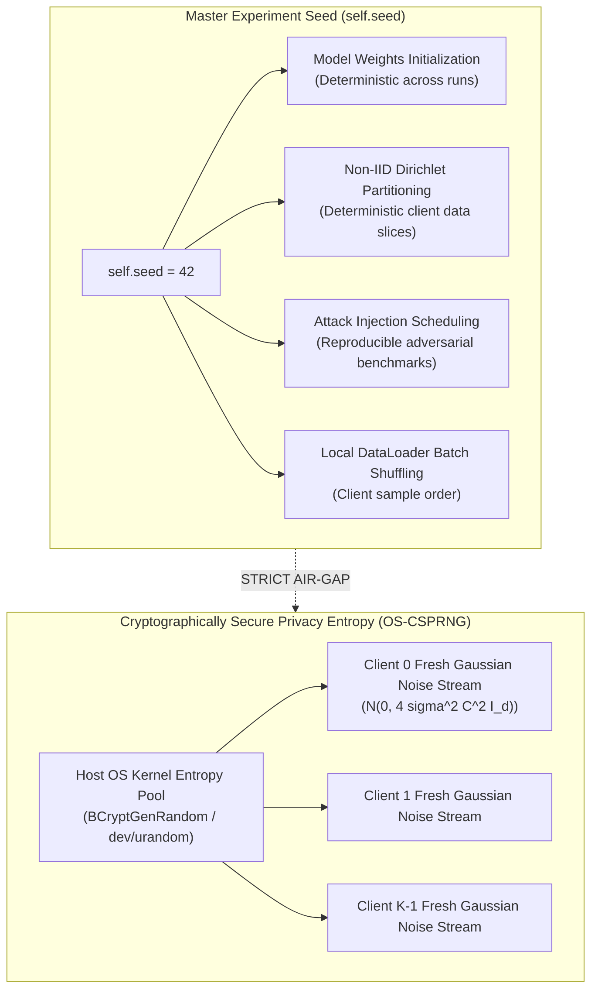
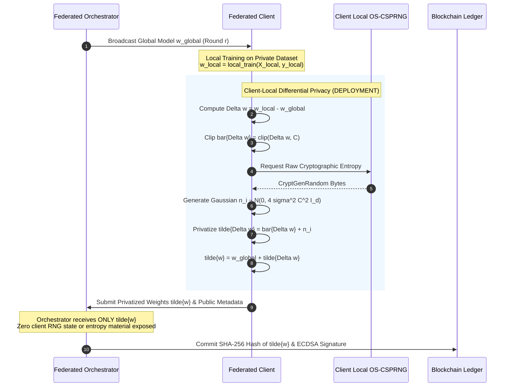

# WP2.4 — Orchestrator Seed Isolation & Randomness Separation Report

**Project:** Blockchain-Assisted Privacy-Preserving Federated Learning for Network Intrusion Detection with Trust-Based Security and Cryptographic Auditing  
**Workspace:** `C:\Users\is043\.gemini\antigravity\scratch\blockchain-fl-ids`  
**Milestone:** WP2.4 — Secure Randomness Integration & Privacy Execution Separation  
**Document:** Seed Separation & Client-Local Privacy Architecture  

---

## 1. Executive Summary

In Stage 2A through Stage 2E, the federated learning orchestrator (`src/federated/orchestrator.py`) coordinated training using a single master experiment seed (`self.seed = 42`). When differential privacy was enabled, the orchestrator derived client privacy seeds using a linear congruential formula:
$$\text{client\_dp\_seed} = (\text{self.seed} \times 10007 + r \times 997 + \text{client.client\_id} \times 101) \pmod{2^{31}-1}$$

This design created two severe security vulnerabilities:
1. **Predictability:** Knowing the public experiment seed and round number allows any eavesdropper or malicious server to compute all client privacy seeds and strip privacy noise from model updates.
2. **Centralization:** The central orchestrator possessed complete control over the entropy used to privatize client models, violating client sovereignty and differential privacy adjacency principles.

**WP2.4 completely eliminates these vulnerabilities by:**
1. Isolating deterministic experimental randomness from cryptographic privacy randomness.
2. Removing central seed derivation and distribution in secure research and deployment modes.
3. Establishing client-local differential privacy perturbation for deployment architectures.

---

## 2. Seed Isolation Architecture

### 2.1 Deterministic Non-Private Components (Preserved Reproducibility)
To satisfy scientific benchmark reproducibility, non-private components continue to use the master experiment seed:
* **Model Initialization:** `IDSNet` architecture initialized identically across benchmark comparisons.
* **Dirichlet Data Partitioning:** `FederatedPartitioner(alpha=0.5, seed=self.seed)` partitions NSL-KDD non-IID slices with identical class skew.
* **Attack Timing & Target Inversion:** Label-flip and Byzantine poisoning attacks execute deterministically across benchmark trials.

### 2.2 Cryptographically Unpredictable Privacy Noise
Privacy noise $n_i \sim \mathcal{N}(0, 4\sigma^2 C^2 I_d)$ has zero correlation with or derivation from `self.seed`:
* Generated on-demand via `generate_csprng_gaussian()`.
* Fresh, non-repeating entropy drawn for every client and round.
* The orchestrator formula `(self.seed * 10007 + r * 997 + client.client_id * 101) % (2**31 - 1)` is **strictly deactivated** in `RESEARCH_SIMULATION` and `DEPLOYMENT` modes.

---

## 3. Client-Local Privacy in DEPLOYMENT Mode

In `DEPLOYMENT` mode, privacy noise is decentralized to the individual clients:

### Key Architectural Properties in DEPLOYMENT Mode:
1. **Central Orchestrator Mechanism Deactivation:** `self.dp_mechanism` on the central orchestrator is explicitly set to `None`. Any attempt to generate noise centrally raises an error.
2. **Client-Local Mechanism Instantiation:** Each `FederatedClient` instantiates its own `ClientLevelDPMechanism` configured with `execution_mode=ExecutionMode.DEPLOYMENT` and `privacy_randomness_mode=PrivacyRandomnessMode.OS_CSPRNG`.
3. **Data Processing Inequality Protection:** The central server receives only $\tilde{w}$ and public privacy parameters ($C, \sigma, \delta$). No unperturbed local gradients $\Delta w$ or random generator states are ever transmitted over the communication channel.
