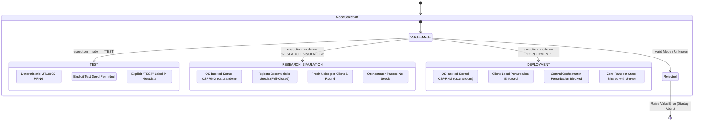

# WP2.4 — Secure Randomness & Execution Separation Architecture

**Project:** Blockchain-Assisted Privacy-Preserving Federated Learning for Network Intrusion Detection with Trust-Based Security and Cryptographic Auditing  
**Workspace:** `C:\Users\is043\.gemini\antigravity\scratch\blockchain-fl-ids`  
**Milestone:** WP2.4 — Secure Randomness Integration & Privacy Execution Separation  
**Document:** Architecture Specification  

---

## 1. Executive Overview

In the preceding audit (WP2.3), an architectural vulnerability was identified in the simulation harness: the differential privacy mechanism in `src/privacy/mechanism.py` relied on NumPy's `RandomState` (32-bit Mersenne Twister MT19937) and deterministic seed derivation in `src/federated/orchestrator.py`:
$$\text{client\_dp\_seed} = (\text{self.seed} \times 10007 + r \times 997 + \text{client.client\_id} \times 101) \pmod{2^{31}-1}$$

While suitable for reproducible deterministic testing, MT19937 is an invertible, non-cryptographic pseudorandom generator. If an adversary observes 624 state outputs or discovers the master experiment seed, all past and future differential privacy noise vectors can be completely reconstructed, nullifying differential privacy guarantees.

**WP2.4 resolves this challenge by introducing:**
1. A formal three-tier `ExecutionMode` abstraction (`TEST`, `RESEARCH_SIMULATION`, `DEPLOYMENT`).
2. A formal `PrivacyRandomnessMode` abstraction (`DETERMINISTIC_TEST`, `OS_CSPRNG`).
3. An operating system kernel CSPRNG-backed Gaussian noise sampler (`generate_csprng_gaussian`) based on vectorized Box-Muller transformations over OS entropy (`os.urandom`).
4. Complete isolation of deterministic experimental randomness (dataset partitioning, model initialization, reproducible benchmark harness) from secure privacy randomness.
5. Client-local privacy perturbation architecture in `DEPLOYMENT` mode, ensuring central orchestrators never generate or distribute noise seeds.

---

## 2. Three-Tier Execution Mode Architecture

### 2.1 Mode A: TEST
* **Objective:** Unit testing, numerical edge-case validation, and deterministic regression testing.
* **Randomness Source:** Permitted to use `np.random.RandomState(seed)` with explicitly supplied test seeds.
* **Guarantees:**
  * Exact bitwise reproducibility when identical test configurations and seeds are supplied.
  * Isolated strictly to testing harness; impossible to trigger accidentally in production.
  * Metadata explicitly records `"execution_mode": "TEST"` and `"privacy_randomness_mode": "DETERMINISTIC_TEST"`.

### 2.2 Mode B: RESEARCH_SIMULATION (Approved Research Baseline Mode)
* **Objective:** Controlled scientific research experiments evaluating formal client-level differential privacy.
* **Randomness Source:** Operating system kernel CSPRNG (`os.urandom` / `CryptGenRandom` on Windows, `/dev/urandom` on Linux).
* **Guarantees:**
  * Rejects all deterministic seeds passed to `ClientLevelDPMechanism` or `perturb_update` (raises `ValueError`).
  * Rejects `DETERMINISTIC_TEST` mode (raises `ValueError`).
  * Generates completely independent, fresh Gaussian noise for every client and every communication round.
  * Complete independence between privacy noise and non-private experimental components (Dirichlet data partitioning, model initialization, and attack configurations remain reproducible via `self.seed`).
  * Metadata records `"execution_mode": "RESEARCH_SIMULATION"` and `"randomness_source": "OS_CSPRNG"`.
  * **Zero secret seeds, keys, generator states, or entropy material are ever recorded or leaked to logs.**

### 2.3 Mode C: DEPLOYMENT (Architectural Staging for Distributed Operations)
* **Objective:** Architectural preparation for decentralized multi-node deployment.
* **Randomness Source:** Client-local kernel CSPRNG.
* **Guarantees:**
  * Noise generation is strictly decentralized: each `FederatedClient` generates its own perturbation vector locally via `client.privatize_local_weights()`.
  * Central orchestrator perturbation is disabled (`self.dp_mechanism is None` on orchestrator).
  * Central orchestrator does not generate, route, or distribute privacy seeds.
  * Server receives only the privatized weights ($\tilde{w} = w_{\text{global}} + \tilde{\Delta w}$), satisfying the Data Processing Inequality.
  * Server never receives client RNG states or entropy material.
  * Fails closed if secure client-local randomness cannot be initialized.

---

## 3. Configuration & Startup Validation Rules

The architecture is codified in `src/config.py` and validated at startup via `validate_config()`:

| Rule ID | Invariant | Enforcement Mechanism | Failure Mode |
| :--- | :--- | :--- | :--- |
| **VAL-01** | **Valid Mode** | Must be in `[TEST, RESEARCH_SIMULATION, DEPLOYMENT]` | `ValueError("Unsupported execution_mode")` |
| **VAL-02** | **No Insecure Randomness in Secure Modes** | If `RESEARCH_SIMULATION` or `DEPLOYMENT`, randomness mode MUST be `OS_CSPRNG` | `ValueError("Insecure randomness mode is strictly prohibited")` |
| **VAL-03** | **No Deterministic Seeds in Secure Modes** | `seed` passed to `ClientLevelDPMechanism` in secure modes is prohibited | `ValueError("Deterministic seed is strictly prohibited")` |
| **VAL-04** | **No Seed in `perturb_update`** | Passing `seed` to `perturb_update` in secure modes is prohibited | `ValueError("Explicit seed is strictly prohibited")` |
| **VAL-05** | **Reject Legacy Uncalibrated Sigma** | If `dp_enabled=True` in `RESEARCH_SIMULATION`, $\sigma=0.01$ is rejected | `ValueError("Legacy uncalibrated sigma=0.01 is strictly rejected")` |
| **VAL-06** | **Parameter Bounds** | $C > 0$, $\sigma \ge 0$, $0 < \delta < 1$, $T \ge 1$ | `ValueError` on non-positive / non-finite bounds |
| **VAL-07** | **Fail-Closed OS Entropy** | If OS entropy fails during CSPRNG draw, execution terminates | `RuntimeError("OS-backed CSPRNG sampling failed")` |
| **VAL-08** | **No Silent Fallback** | System never silently degrades from CSPRNG to MT19937 | Hard exception; zero fallback branches |

---

## 4. Preservation of Mathematical Privacy Guarantees

WP2.4 strictly preserves the mathematical privacy formulation established in WP2 and audited in WP2.1:
1. **Adjacency:** Replace-one-client-dataset adjacency ($D \sim D'$).
2. **Global Sensitivity:** Complete L2-norm update clipping bound $C \implies S = 2C$.
3. **Noise Scale:** Gaussian noise $n_i \sim \mathcal{N}(0, 4\sigma^2 C^2 I_d) \implies \sigma_{\text{noise}} = 2\sigma C$.
4. **Rényi DP Composition:**
   $$\text{RDP}_\alpha(M) = \frac{\alpha S^2}{2 \sigma_{\text{noise}}^2} = \frac{\alpha (2C)^2}{2 (2\sigma C)^2} = \frac{\alpha}{2\sigma^2}$$
   $$T \text{ rounds: } \text{RDP}_\alpha(M^{(T)}) \le \frac{T\alpha}{2\sigma^2}$$
5. **Canonical Privacy Bound:**
   $$\epsilon(\delta) = \min_{\alpha \in \text{orders}} \left[ \frac{T\alpha}{2\sigma^2} + \frac{\ln(1/\delta)}{\alpha - 1} \right]$$
   For the approved research baseline ($C=1.0, \sigma=1.0, \delta=10^{-5}, T=5$):
   $$\epsilon \approx 13.2565$$

The replacement of the underlying random number generator strictly changes the **entropy source** from a predictable pseudo-random sequence to an unpredictable cryptographic source; it introduces zero deviation in the mathematical probability density function.
